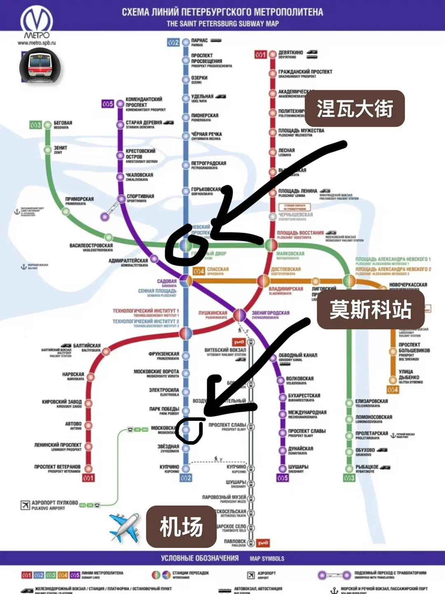

ค่าแท็กซี่ในมอสโกและเซนต์ปีเตอร์สเบิร์กพุ่งสูงขึ้นมากในระยะไม่กี่ปี — เกือบสองเท่าในสามปีที่ผ่านมา — และแท็กซี่ที่เรียกตรงจากสนามบินมักแพงกว่าที่บ้าน วิธีเดินทางจากสนามบินปุลโคโว (LED) เข้าสู่ใจกลางเมืองอย่างถูกและเร็ว เพียงทำตามสองขั้นตอนด้านล่าง

## ขั้นแรก: นั่งรถบัส 39 หรือ 39A ไปมอสคอฟสกายา

เป้าหมายคือ **สถานีมอสคอฟสกายา (Московская) บนรถไฟใต้ดินสายสีน้ำเงิน M2**

### ออกจากอาคารผู้โดยสาร

- **เที่ยวบินระหว่างประเทศ**: ออกจากอาคารแล้ว **เลี้ยวขวา 52 ม.**
- **เที่ยวบินภายในประเทศ**: ออกจากอาคารแล้ว **เลี้ยวซ้าย 52 ม.**

จ่ายค่าโดยสารเมื่อขึ้นรถ

### เลือกเส้นทางไหนระหว่างสองสาย

| เส้นทาง | เวลาเดินทาง | สิ่งที่ควรรู้ |
| --- | --- | --- |
| **รถบัส 39** | ประมาณ 25 นาทีถึงมอสคอฟสกายา | จอดทุกป้าย; เกือบทุกคนบนรถลงที่นี่ |
| **39A ด่วน** | ประมาณ 20 นาทีตรงถึงปลายทาง | ไม่จอดระหว่างทาง |

รถบัสยังมี **จอแสดงผลสองภาษารัสเซีย-อังกฤษ** แสดงความเร็ว เส้นทาง เวลา และอุณหภูมิภายนอก คุณจึงตามได้ทั้งหมดโดยไม่ต้องรู้ภาษารัสเซียสักคำ และเห็นป้ายที่จะถึงเสมอ

> **จุดสังเกต**: เมื่อผ่าน **จตุรัสชัยชนะ** (มีอนุสาวรีย์ชัยชนะกลางจัตุรัส) ป้ายถัดไปคือสถานีรถไฟใต้ดินมอสคอฟสกายา (รถบัส 39) รถด่วน 39A ไม่จอดที่นั่นและถึงป้ายช้ากว่าประมาณ 1–2 นาที ขึ้นอยู่กับการจราจร

## ขั้นที่สอง: เปลี่ยนไปรถไฟใต้ดินสาย 2

เมื่อลงรถ เพียงตามฝูงชนแล้วคุณจะเดินตรงเข้าไปในสถานีรถไฟใต้ดิน สายสีน้ำเงินใช้เวลาประมาณ **15–20 นาที** เข้าสู่ใจกลางเมือง

**การเดินทางทั้งหมดรวมการเปลี่ยนสายใช้เวลาประมาณ 1 ชั่วโมง** ถึงใจกลางเมือง

## เวลาเปิดและค่าโดยสาร

| รายการ | เวลา |
| --- | --- |
| รถบัส 39 | ทุกวัน 05:15–01:41 ทุก 5–7 นาทีในช่วงกลางวัน |
| รถบัส 39E (ด่วน) | ทุกวัน 06:00–01:49 ทุก 13–20 นาที |
| รถไฟใต้ดิน | ทุกวัน 05:35–00:41 |

| รายการ | ค่าโดยสาร |
| --- | --- |
| รถบัส | 88 รูเบิล (ประมาณ 7 หยวน) |
| รถไฟใต้ดิน | 95 รูเบิล (ประมาณ 8 หยวน) |

## วิธีจ่ายเงิน

บนรถบัสคุณจ่ายได้ด้วย **บัตรธนาคารรัสเซีย (รวม YooMoney) หรือเงินสด** โดยซื้อตั๋วจากพนักงานเก็บค่าโดยสารโดยตรง

> **ควรแลกธนบัตร 5,000 รูเบิลให้แตกก่อนเดินทาง** — พนักงานอาจไม่มีเงินทอน และคนท้องถิ่นแทบจ่ายด้วยบัตรเสมอ

## เคล็ดลับปฏิบัติ

- มีชั้นวางกระเป๋าบนรถ กระเป๋าเดินทางจึงไม่มีปัญหา
- **ตรวจเวลารถบัสแบบสดบน 2GIS** (แอปแผนที่ที่ดีที่สุดในโลกที่ใช้ภาษารัสเซีย) ดาวน์โหลดไว้ก่อนออกเดินทาง
- **อย่านั่งแท็กซี่เถื่อนที่สนามบิน** — เป็นปัญหาพบบ่อยในสนามบินทั่วโลก และราคาสูงกว่าทางการมาก
