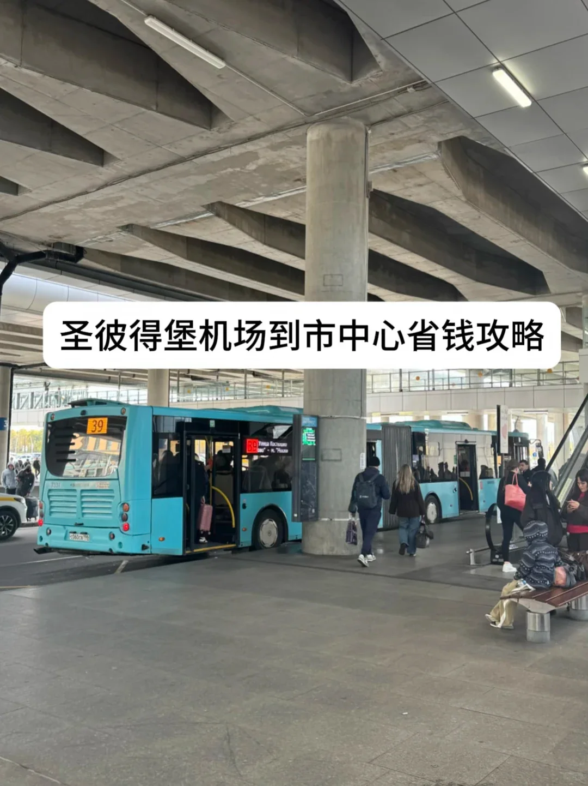

Moskova ve St Petersburg'da taksi ücretleri son yıllarda dik biçimde arttı — son üç yılda neredeyse iki katına çıktı — ve doğrudan havalimanından binilen taksi genellikle memleketinizdekinden daha pahalıdır. Pulkovo Havalimanı'ndan (LED) şehir merkezine ucuz ve hızlı gitmek için aşağıdaki iki adımı izlemeniz yeterli.

## Birinci adım: 39 veya 39A otobüsüyle Moskovskaya'ya gidin

Hedefiniz **mavi M2 metro hattındaki Moskovskaya istasyonu (Московская)**.

### Terminalden çıkış

- **Dış hat uçuşları**: binadan çıkın ve **52 m sağa dönün**
- **İç hat uçuşları**: terminalden çıkın ve **52 m sola dönün**

Binerken ücreti ödemeniz yeterli.

### İki güzergâhtan hangisi seçilmeli

| Güzergâh | Yolculuk süresi | Bilinmesi gerekenler |
| --- | --- | --- |
| **39 numaralı otobüs** | Moskovskaya'ya yaklaşık 25 dakika | Her durakta durur; araçtakilerin neredeyse tamamı burada iner |
| **39A ekspres** | Doğrudan son durağa yaklaşık 20 dakika | Arada durak yok |

Otobüslerde ayrıca hız, güzergâh, saat ve dış sıcaklığı gösteren **Rusça-İngilizce iki dilli ekranlar** var; böylece tek kelime Rusça bilmeden her şeyi takip edebilir ve durağınızın yaklaştığını her zaman görebilirsiniz.

> **İşaret ipucu**: **Zafer Meydanı**'nı (ortasında zafer anıtı vardır) geçtiğinizde bir sonraki durak Moskovskaya metro istasyonudur (39 numaralı otobüs). 39A ekspres orada durmaz ve trafiğe bağlı olarak durağa yaklaşık 1–2 dakika sonra ulaşır.

## İkinci adım: Metro 2. Hattı'na aktarma yapın

İndikten sonra kalabalığı takip edin, doğrudan metro istasyonuna yürürsünüz; mavi hat merkeze yaklaşık **15–20 dakika** sürer.

**Aktarma dahil tüm yolculuk, şehir merkezine ulaşmak için yaklaşık 1 saat sürer.**

## Çalışma saatleri ve ücretler

| Madde | Saatler |
| --- | --- |
| 39 numaralı otobüs | Her gün 05:15–01:41, gündüz her 5–7 dakikada bir |
| 39E numaralı otobüs (ekspres) | Her gün 06:00–01:49, her 13–20 dakikada bir |
| Metro | Her gün 05:35–00:41 |

| Madde | Ücret |
| --- | --- |
| Otobüs | 88 ruble (yaklaşık 7 yuan) |
| Metro | 95 ruble (yaklaşık 8 yuan) |

## Nasıl ödenir

Otobüste **Rus banka kartıyla (YooMoney dahil) veya nakit** ödeyebilir, bileti doğrudan kondüktörden alabilirsiniz.

> **Yola çıkmadan önce 5.000 rublelik bir banknotu bozdurmaya değer** — kondüktörün para üstü olmayabilir ve yerel halk neredeyse her zaman kartla öder.

## Pratik ipuçları

- Araçta bagaj rafları var, yani valiz sorun değil.
- **Canlı otobüs saatlerini 2GIS'te kontrol edin** (Rusça konuşulan dünyanın en iyi harita uygulaması); yola çıkmadan önce indirin.
- **Havalimanındaki resmî olmayan taksilere asla binmeyin** — dünya genelinde havalimanlarında yaygın bir sorundur ve fiyat resmî olandan çok daha yüksektir.
