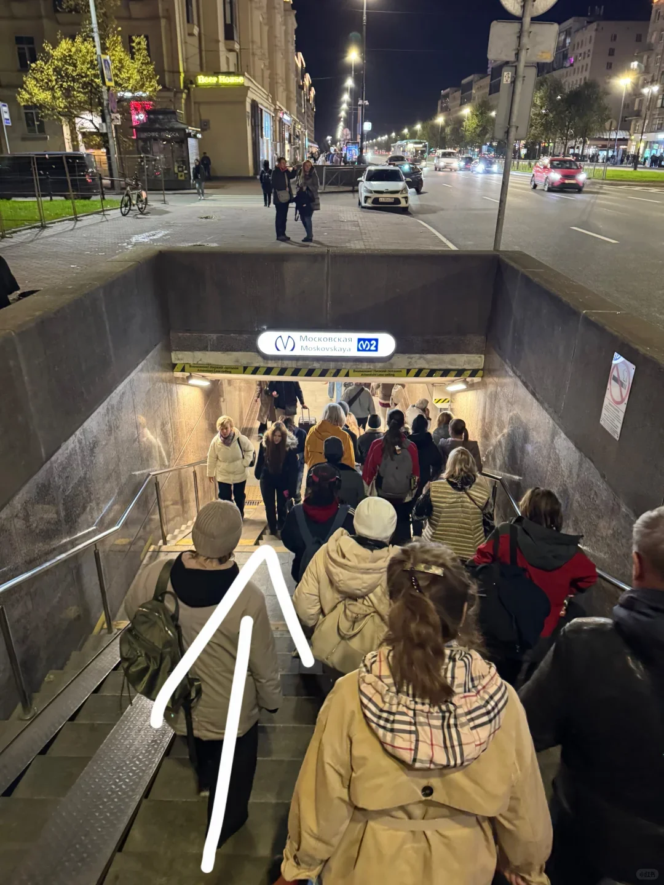

Giá taxi ở Moskva và Sankt-Peterburg đã tăng mạnh trong những năm gần đây — gần gấp đôi trong ba năm qua — và một chuyến taxi bắt thẳng từ sân bay thường đắt hơn ở nhà. Để đi từ Sân bay Pulkovo (LED) vào trung tâm thành phố một cách rẻ và nhanh, chỉ cần làm theo hai bước dưới đây.

## Bước một: bắt xe buýt 39 hoặc 39A đến Moskovskaya

Mục tiêu của bạn là **ga Moskovskaya (Московская) trên tuyến tàu điện ngầm M2 màu xanh dương**.

### Ra khỏi nhà ga

- **Chuyến quốc tế**: rời tòa nhà và **rẽ phải 52 m**
- **Chuyến nội địa**: rời nhà ga và **rẽ trái 52 m**

Chỉ cần trả tiền vé khi lên xe.

### Chọn tuyến nào trong hai tuyến

| Tuyến | Thời gian đi | Điều cần biết |
| --- | --- | --- |
| **Xe buýt 39** | Khoảng 25 phút đến Moskovskaya | Dừng ở mọi trạm; gần như tất cả hành khách trên xe đều xuống đây |
| **39A express** | Khoảng 20 phút thẳng tới bến cuối | Không dừng giữa đường |

Xe buýt còn có **màn hình hiển thị song ngữ Nga - Anh** hiển thị tốc độ, lộ trình, thời gian và nhiệt độ bên ngoài, nên bạn có thể theo dõi tất cả mà không cần biết một từ tiếng Nga và luôn thấy trạm của mình sắp tới.

> **Mẹo nhận biết**: khi bạn đi qua **Quảng trường Chiến thắng** (có đài tưởng niệm chiến thắng ở giữa), trạm tiếp theo là ga tàu điện ngầm Moskovskaya (xe buýt 39). Tuyến 39A express không dừng ở đó và tới trạm chậm hơn khoảng 1–2 phút, tùy giao thông.

## Bước hai: chuyển sang Tuyến tàu điện ngầm 2

Khi xuống xe, chỉ cần đi theo đám đông và bạn sẽ đi thẳng vào ga tàu điện ngầm; tuyến màu xanh dương mất khoảng **15–20 phút** vào trung tâm.

**Toàn bộ chuyến đi, kể cả lúc chuyển tuyến, mất khoảng 1 giờ** để tới trung tâm thành phố.

## Giờ mở cửa và giá vé

| Hạng mục | Giờ |
| --- | --- |
| Xe buýt 39 | Hằng ngày 05:15–01:41, ban ngày 5–7 phút một chuyến |
| Xe buýt 39E (express) | Hằng ngày 06:00–01:49, 13–20 phút một chuyến |
| Tàu điện ngầm | Hằng ngày 05:35–00:41 |

| Hạng mục | Giá vé |
| --- | --- |
| Xe buýt | 88 rúp (khoảng 7 nhân dân tệ) |
| Tàu điện ngầm | 95 rúp (khoảng 8 nhân dân tệ) |

## Cách trả tiền

Trên xe buýt, bạn có thể trả bằng **thẻ ngân hàng Nga (kể cả YooMoney) hoặc tiền mặt**, mua vé trực tiếp từ nhân viên soát vé.

> **Nên đổi một tờ 5.000 rúp trước khi đi** — nhân viên soát vé có thể không có tiền lẻ, và người địa phương gần như luôn trả bằng thẻ.

## Mẹo thực tế

- Trên xe có giá để hành lý, nên mang vali không thành vấn đề.
- **Kiểm tra giờ xe buýt trực tiếp trên 2GIS** (ứng dụng bản đồ tốt nhất trong thế giới nói tiếng Nga); hãy tải trước khi khởi hành.
- **Đừng bao giờ đi taxi không chính thức ở sân bay** — đây là vấn đề phổ biến ở sân bay khắp thế giới, và giá cao hơn nhiều so với giá chính thức.
