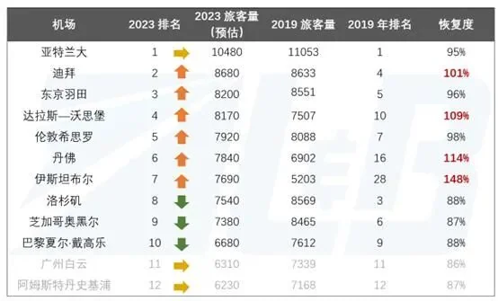

2024년 4월 사우디아라비아 민간항공총국(GACA)은 리야드 정부 계획의 배경이 되는 항공 전략을 발표했습니다. 2030년까지 연간 항공 여객을 3배로 늘려 3억 3천만 명으로, 항공 화물을 450만 톤으로 끌어올리고, 전 세계 250개 이상 목적지로의 연결 빈도를 높이겠다는 것입니다. 이를 위해 국가는 항공 분야에 최대 1,000억 달러를 투자할 계획입니다.

이 숫자들의 물리적 중심이 킹 살만 국제공항(KSIA)입니다. 공개된 내용에 따르면 이 공항은 리야드에 약 57제곱킬로미터를 차지하고, 평행 활주로 6개를 갖추며, 2030년까지 여객 1억 2천만 명을 처리하고, 기존 킹 칼리드 국제공항(KKIA) 터미널을 계획 안에 흡수합니다. 이것은 터미널 증축이 아닙니다. 도시의 공항을 그 공항 자체를 중심으로 다시 짓는 일입니다.

## 1. 3억 3천만 명은 어디서 오는가

사우디아라비아의 인구는 3천만 명을 조금 넘습니다. 따라서 연간 3억 3천만 명은 주민 한 명당 대략 열 번의 비행에 해당합니다. 그 수요는 국내 수요에서 나올 수 없습니다. 다른 세 곳에서 와야 합니다. 제3국 사이를 연결하는 환승 승객, 비즈니스와 회의 여행, 종교 여행입니다. 순례는 오랫동안 사우디 항공의 안정적인 기반이었지만 그 대부분은 제다에 내립니다. 리야드가 노리는 것은 앞의 두 가지입니다.

같은 전략이 250개 이상 목적지와 450만 톤의 화물을 함께 내세우는 이유이기도 합니다. 지점 간 시장으로는 그 규모를 지탱할 수 없고, 허브만이 촘촘한 노선망과 큰 화물 에이프런을 동시에 가질 수 있습니다. 2016년 경제의 석유 의존을 줄이기 위해 출범한 비전 2030은 항공을 수출 가능한 인프라로 봅니다. 승객과 화물, 지역 본부를 모두 자국 안에 붙잡아 두는 것입니다.

경쟁은 이미 존재합니다. 두바이와 도하는 20년에 걸쳐 동서 환승을 하나의 산업으로 만들었고, 유럽과 남아시아, 동남아시아 사이 교통량의 상당 부분이 이 두 곳을 거쳐 연결됩니다. 사우디아라비아는 아무도 서비스하지 않던 시장을 여는 것이 아니라 이미 작동하는 노선망에서 점유율을 빼앗으려 합니다. 수요 위험은 낮아지지만, 가격과 빈도, 연결 품질에서 성숙한 두 허브와 정면으로 겨루어야 한다는 뜻이기도 합니다.

## 2. 57제곱킬로미터 위의 하드웨어

KSIA의 규모는 땅과 활주로에서 먼저 드러납니다. 57제곱킬로미터는 중소 도시의 시가지 면적을 공항에 내준 것입니다. 평행 활주로 6개는 혼잡 시간대의 이착륙이 서로를 기다리지 않게 합니다. 12제곱킬로미터의 지원 시설에는 주거와 엔터테인먼트, 소매, 물류가 배치되어 있어, 이 공항은 교통 시설이라기보다 활주로가 붙은 신도시에 가깝습니다.

| 항목 | 공개 수치 |
| --- | --- |
| 부지 면적 | 약 57제곱킬로미터 |
| 활주로 | 평행 활주로 6개 |
| 2030년 여객 처리 능력 | 연 1억 2천만 명 |
| 2050년 여객 처리 능력 | 연 1억 8천5백만 명 |
| 2050년 화물 처리 능력 | 연 350만 톤 |
| 지원 시설 | 12제곱킬로미터 |

장기 목표도 구체적입니다. 2050년까지 여객 1억 8천5백만 명, 화물 연 350만 톤입니다. 국가 전략의 2030년 화물 목표는 450만 톤이므로 두 수치는 서로 다른 기준으로 계산된 것입니다. 2030년의 1억 2천만 명과 나란히 놓으면, 장기 수치는 1단계가 계획된 처리 능력의 일부만 사용하며 이후 확장을 위해 여지를 의도적으로 남겨 둔다는 것을 보여 줍니다.

렌더링이 시사하는 것보다 중요한 세부가 하나 있습니다. KSIA는 빈 부지에 짓는 것이 아닙니다. 계획은 기존 KKIA 터미널을 명시적으로 흡수합니다. 새 공항은 운영 중인 공항 주위로 자라나고, 리야드의 항공편은 공사 내내 같은 땅에서 이착륙합니다. 운영하면서 짓는 일은 보통 처음부터 짓는 일보다 조직하기 어렵습니다.

## 3. 1억 2천만 명은 세계에서 어디쯤인가

2023년 수치로 세계에서 여객이 가장 많은 공항은 애틀랜타로 약 1억 480만 명이었고, 두바이 국제공항이 8,680만 명, 도쿄 하네다가 8,200만 명으로 뒤를 이었습니다. 표의 데이터는 더 페이퍼(The Paper)가 정리한 2023년 세계 공항 순위에서 가져왔습니다.

따라서 1억 2천만 명은 10위권 수치가 아니라 현재 세계 1위를 곧바로 넘어서는 숫자입니다. GlobalData는 더 단호합니다. KSIA가 2030년에 제때 완공된다면 여객 처리 능력 기준으로 세계 최대 운영 공항이 된다는 것입니다.

다만 처리 능력과 실제 실적은 다릅니다. 1억 2천만 명을 위해 설계된 공항이 훨씬 적은 여객을 처리할 수도 있습니다. 실제로 얼마나 운항하는지는 기반 항공사의 기재와 항공 서비스 협정, 슬롯 배분, 연결 품질에 달려 있기 때문입니다. 사우디아라비아는 그 부분도 준비하고 있습니다. 국부펀드가 소유한 신생 항공사 리야드 에어(Riyadh Air)는 리야드에 기반을 두고 석유 수도에서 항공 허브로 바꾸는 것을 목표로 합니다. 아무리 크게 지어도 항공사 항공기가 없으면 활주로는 비어 있습니다.

## 4. 시공: Mace, 컨소시엄, 일정 위험

공사는 시공 단계로 넘어갔습니다. 2024년 2월 MEED는 영국 엔지니어링 회사 Mace가 이 사업의 시공 파트너 역할을 수주했고, 시공사들이 컨소시엄을 구성해 세계 최대 공항이 될 이 사업의 후속 공사 입찰을 준비하고 있다고 보도했습니다.

기존 공항 공사는 더 진척되어 있습니다. 2023년 6월 터키 IC Ictas와 현지 Al-Rashid Trading & Contracting의 합작사가 1·2터미널 개보수 계약을 수주했고, 2023년 초에는 3·4터미널 리모델링을 마쳤습니다. 그 공사가 공항의 성격을 바꾸지는 않지만, 옛 시설과 새 시설을 하나로 잇기 위한 전제 조건입니다.

위험은 여기에 있습니다. 1,000억 달러는 계획된 투자 상한이지 이미 확정된 자금이 아닙니다. 활주로 6개와 12제곱킬로미터의 지원 시설, 새 터미널이 모두 같은 기간 안에 진행되어야 합니다. 그리고 2030년은 공학적 기한이자 국가 전략에 붙은 공개 약속입니다. 초대형 공항은 정시와 예산 안에 정확히 끝나는 경우가 드뭅니다. KSIA의 진짜 시험은 렌더링이 아니라 1단계가 2030년 이전에 작동하는 환승 상품을 내놓는지입니다.

## 5. 여행자에게 무엇을 의미하나

당장은 리야드로 들어오고 나가는 모든 사람이 여전히 킹 칼리드 국제공항(RUH)을 이용합니다. KSIA는 개항 날짜가 발표되지 않았고, "내년에 문을 연다"는 주장은 의심스럽게 봐야 합니다. 운영사가 일정을 공표할 때까지는 존재하는 공항을 기준으로 계획하십시오.

중기적으로는 건축물보다 노선도를 보십시오. 새 항공사와 더 촘촘해지는 유럽·아시아 스케줄은 새 터미널보다 훨씬 먼저 리야드가 닿을 수 있는 곳을 바꿀 것입니다. 중동을 거쳐 환승할 계획이라면 두바이와 도하가 여전히 가장 촘촘한 선택이고, 리야드는 더 얇지만 성장하는 선택입니다. 예약 전에 GACA와 운영사의 최신 공지를 확인하십시오. 마스터플랜을 들여다보는 것보다 유용합니다.

## 6. 2025–2026년 업데이트: 시공 조직 완성

2025년 5월 이 사업에는 Mace의 시공 파트너 역할과 함께 인프라에 Parsons, 터미널 시공에 Bechtel이 추가되었습니다. [Enterprise AM](https://enterpriseam.com/ksa/2025/05/15/king-salman-airport-taps-parsons-for-infrastructure-bechtel-for-terminal-delivery/)이 보도한 내용이며, 이후 시공사 후보 명단과 단계별 입찰이 진행되었습니다. 2024년의 "입찰을 위해 컨소시엄 구성 중" 단계와 비교하면 이제는 더 구체적인 시공 준비 단계입니다.

그것이 앞선 판단을 바꾸지는 않습니다. KSIA는 여전히 개항 날짜가 발표되지 않았고, 2030년은 개항 약속이 아니라 처리 능력 목표입니다. 여행자에게 리야드는 당분간 킹 칼리드 국제공항(RUH)입니다. KSIA에서 무슨 일이 일어나든 결국 항공사 공급과 노선망으로 드러나야 합니다.

## 관련 링크

- **이 사이트에서**: [킹 칼리드 국제공항 (RUH)](/airport/RUH), [사우디아라비아 (SA)](/country/SA)
- **위키백과**: [킹 살만 국제공항](https://en.wikipedia.org/wiki/King_Salman_International_Airport), [킹 칼리드 국제공항](https://en.wikipedia.org/wiki/King_Khalid_International_Airport)
- **바이두 백과**: [킹 살만 국제공항](https://baike.baidu.com/item/%E8%90%A8%E5%8B%92%E6%9B%BC%E5%9B%BD%E7%8E%8B%E5%9B%BD%E9%99%85%E6%9C%BA%E5%9C%BA)

이미지 출처: MEED와 더 페이퍼. 수치는 GACA와 사업 공개 자료에서 가져왔습니다. 공항 제원과 일정은 바뀔 수 있으므로 여행 전에 운영사 사이트를 확인하십시오.
