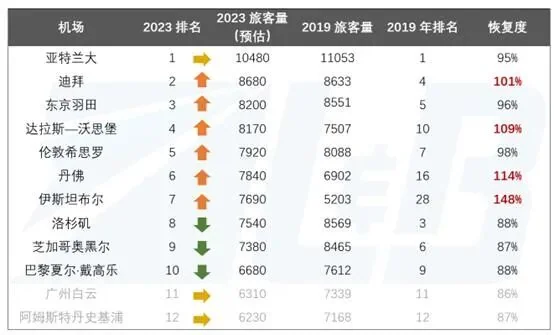

В апреле 2024 года Главное управление гражданской авиации Саудовской Аравии (GACA) изложило авиационную стратегию, стоящую за планами правительства Эр-Рияда: к 2030 году королевство хочет втрое увеличить годовой пассажиропоток до 330 млн, поднять авиагрузооборот до 4,5 млн тонн и увеличить частоту сообщения более чем с 250 направлениями по всему миру. Чтобы оплатить это, страна намерена инвестировать в авиацию до $100 млрд.

Физическая опора этих цифр — King Salman International Airport (KSIA). Согласно опубликованным данным, аэропорт займёт около 57 км² в Эр-Рияде, получит шесть параллельных ВПП, пропускную способность 120 млн пассажиров к 2030 году, а существующие терминалы King Khalid International Airport (KKIA) будут вписаны в план. Это не расширение терминала. Это перестройка аэропорта города вокруг самого себя.

## 1. Откуда возьмутся 330 млн пассажиров

Население Саудовской Аравии — чуть более 30 млн, поэтому 330 млн пассажиров в год означают примерно десять полётов на жителя. Такой поток не может идти от внутреннего спроса. Он должен прийти из трёх других источников: пассажиры, летящие между третьими странами, деловые и конференционные поездки и религиозные путешествия. Паломничество давно составляет устойчивую базу саудовской авиации, но большая его часть приземляется в Джидде. Эр-Рияд охотится за первыми двумя источниками.

Именно поэтому та же стратегия соединяет более 250 направлений с 4,5 млн тонн грузов. Рынки «точка — точка» не выдерживают такого масштаба; только хабу одновременно нужны плотное покрытие маршрутов и большая грузовая перрон. Vision 2030, запущенная в 2016 году, чтобы снизить зависимость экономики от нефти, рассматривает авиацию как экспортируемую инфраструктуру: удержать пассажиров, грузы и региональные штаб-квартиры внутри страны.

Конкуренция уже существует. Дубай и Доха потратили два десятилетия, превращая пересадки Восток — Запад в индустрию, и значительная доля трафика между Европой, Южной Азией и Юго-Восточной Азией соединяется через один из них. Саудовская Аравия пытается отвоевать долю на уже работающей маршрутной сети, а не открыть рынок, который никто не обслуживал. Это снижает риск спроса, но означает и прямую конкуренцию с двумя зрелыми хабами по цене, частоте и качеству пересадки.

## 2. Инфраструктура на 57 квадратных километрах

Масштаб KSIA виден прежде всего в земле и полосах. Пятьдесят семь квадратных километров — это застроенная площадь среднего города, отданная под аэропорт. Шесть параллельных ВПП не дают пиковым потокам ждать друг друга. Двенадцать квадратных километров вспомогательных объектов отведены под жильё, развлечения, торговлю и логистику, что делает аэропорт не столько транспортным объектом, сколько новым промышленным городом с ВПП в придачу.

| Пункт | Опубликованная цифра |
| --- | --- |
| Площадь участка | Около 57 км² |
| Взлётно-посадочные полосы | 6 параллельных ВПП |
| Пассажиропропускная способность, 2030 | 120 млн в год |
| Пассажиропропускная способность, 2050 | 185 млн в год |
| Грузовая пропускная способность, 2050 | 3,5 млн тонн в год |
| Вспомогательные объекты | 12 км² |

Долгосрочные цели столь же конкретны: 185 млн пассажиров и 3,5 млн тонн грузов в год к 2050 году. Обратите внимание, что грузовая цель национальной стратегии на 2030 год — 4,5 млн тонн, поэтому эти две цифры считаются по разным базам. Рядом с показателем 120 млн на 2030 год долгосрочные цифры показывают, что первая фаза использует лишь часть запланированной мощности, а место намеренно оставлено для дальнейшего расширения.

Одна деталь важнее, чем кажется по рендерам. KSIA строится не на пустой площадке: план прямо включает существующие терминалы KKIA. Новый аэропорт растёт вокруг действующего, и рейсы Эр-Рияда будут прибывать и отправляться с того же участка земли на протяжении всего строительства. Строить во время работы обычно сложнее организовать, чем строить с нуля.

## 3. Где 120 млн в мировом рейтинге

По данным за 2023 год, самым загруженным аэропортом мира по пассажиропотоку была Атланта — около 104,8 млн, за ней Дубай — 86,8 млн и Токио-Ханэда — 82 млн. Данные таблицы взяты из глобального рейтинга аэропортов 2023 года, составленного The Paper.

Значит, 120 млн — не цифра из топ-10; она напрямую превзошла бы нынешнего мирового лидера. GlobalData ещё прямее: если KSIA будет завершён вовремя в 2030 году, он станет крупнейшим действующим аэропортом мира по пассажирской пропускной способности.

Однако пропускная способность и трафик — разные вещи. Аэропорт может быть спроектирован на 120 млн и всё равно обслуживать гораздо меньше, потому что фактический полёт зависит от флотов базовых авиакомпаний, соглашений о воздушном сообщении, распределения слотов и качества стыковок. Саудовская Аравия работает и над этой частью. Riyadh Air, новый перевозчик, принадлежащий суверенному фонду, базируется в Эр-Рияде с целью превратить нефтяную столицу в авиационный хаб. Стройте как угодно масштабно: без самолётов авиакомпаний полосы останутся пустыми.

## 4. Реализация: Mace, консорциумы и риск графика

Строительство перешло в стадию реализации. В феврале 2024 года MEED сообщил, что британская инженерная фирма Mace получила роль партнёра по реализации проекта, а подрядчики формируют консорциумы, чтобы подавать заявки на строительные работы, которые вот-вот начнутся в аэропорту, который должен стать крупнейшим в мире.

Работы в существующем аэропорту продвинулись дальше. В июне 2023 года совместное предприятие турецкой IC Ictas и местной Al-Rashid Trading & Contracting получило контракт на реконструкцию терминалов 1 и 2, завершив ранее в 2023 году обновление терминалов 3 и 4. Эта работа не меняет суть аэропорта, но является предпосылкой для соединения старых и новых объектов.

Риск именно здесь. $100 млрд — это запланированный потолок инвестиций, а не уже вложенные деньги. Шесть ВПП, 12 км² вспомогательных объектов и новый терминал должны уложиться в одно окно. А 2030 год — одновременно инженерный дедлайн и публичное обещание, привязанное к национальной стратегии. Очень крупные аэропорты редко завершаются точно в срок и в бюджет. Для KSIA настоящая проверка — не рендеры, а то, даст ли первая фаза работающий продукт пересадки до 2030 года.

## 5. Что это значит для путешественников

Пока все, кто летает в Эр-Рияд или из него, по-прежнему пользуются King Khalid International Airport (RUH). У KSIA нет объявленной даты открытия, и любые утверждения, что он откроется «в следующем году», стоит воспринимать с подозрением. Пока оператор не опубликует график, планируйте вокруг существующего аэропорта.

В среднесрочной перспективе следите за маршрутной картой, а не за архитектурой. Новые авиакомпании и более плотные европейские и азиатские расписания изменят доступность Эр-Рияда задолго до того, как это сделает новый терминал. Если вы планируете пересадку через Ближний Восток, Дубай и Доха остаются самыми плотными вариантами; Эр-Рияд — более разреженный, но растущий. Перед бронированием проверьте последние уведомления GACA и оператора — это полезнее изучения генплана.

## 6. Обновление 2025–2026: команда реализации сформирована

В мае 2025 года к роли партнёра по реализации Mace добавились Parsons для инфраструктуры и Bechtel для терминалов, как [сообщил Enterprise AM](https://enterpriseam.com/ksa/2025/05/15/king-salman-airport-taps-parsons-for-infrastructure-bechtel-for-terminal-delivery/); с тех пор шорт-листы подрядчиков и поэтапные тендеры продвинулись вперёд. По сравнению со стадией 2024 года, когда «консорциумы формировались для участия в тендерах», проект теперь находится в более конкретной строительной подготовке.

Это не меняет прежней оценки: у KSIA по-прежнему нет объявленной даты открытия, а 2030 год — цель по пропускной способности, а не обещание открытия. Для путешественников Эр-Рияд пока остаётся King Khalid International Airport (RUH); что бы ни происходило в KSIA, в конечном счёте это должно проявиться в провозной способности авиакомпаний и маршрутных сетях.

## Полезные ссылки

- **На этом сайте**: [King Khalid International Airport (RUH)](/airport/RUH), [Саудовская Аравия (SA)](/country/SA)
- **Википедия**: [King Salman International Airport](https://en.wikipedia.org/wiki/King_Salman_International_Airport), [King Khalid International Airport](https://en.wikipedia.org/wiki/King_Khalid_International_Airport)
- **Baidu Baike**: [King Salman International Airport](https://baike.baidu.com/item/%E8%90%A8%E5%8B%92%E6%9B%BC%E5%9B%BD%E7%8E%8B%E5%9B%BD%E9%99%85%E6%9C%BA%E5%9C%BA)

Источник изображений: MEED и The Paper. Цифры взяты из GACA и опубликованных материалов проекта; характеристики аэропорта и сроки могут измениться, поэтому перед поездкой проверьте сайт оператора.
