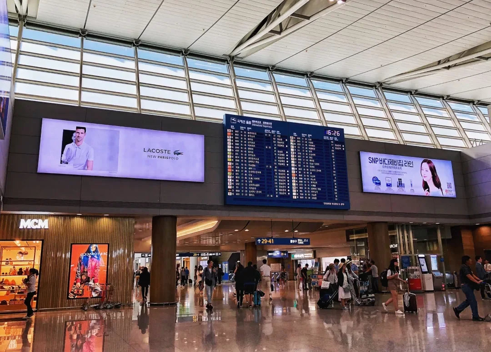
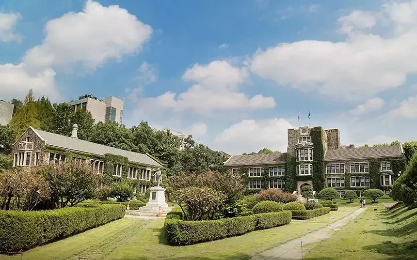

V Soulu je přeložený název pro návštěvníky; korejská adresa je pro řidiče a aplikace. Taxikář přeložený název nemusí rozpoznat, Naver Map nejspolehlivěji zpracuje korejštinu a Kakao T očekává korejský cíl.

Seznam níže je rozdělen podle toho, k čemu ho potřebujete, a korejský sloupec je určen ke zkopírování tak, jak je. Zkopírujte ho, vložte do Naver Map, ukažte obrazovku řidiči a udělejte si snímek pro použití offline. Adresy a obchody se mění, proto si to před odjezdem ještě jednou ověřte.

## 1. Proč mít korejské adresy v telefonu

Mnoho soulských taxikářů je starších a už anglické názvy ulic jim dělají potíže; přepsaný název je ještě horší. Řekněte anglicky „N Seoul Tower“ a řidič hádá; podáte telefon s **서울 용산구 남산공원길 105** a konverzace skončila.

Naver Map je korejská vlastní mapová služba a korejská čísla ulic zpracovává nejlépe, zatímco anglické nebo čínské klíčové slovo často najde čtvrť, ale ne vchod. Kakao T porovnává cíle také v korejštině, takže korejská adresa uspěje mnohem častěji než anglický název.

Korea také přešla na systém názvu ulice a čísla, zatímco starší parcelní čísla — název čtvrti plus číslo — v aplikacích a u řidičů stále fungují. Obojí je v pořádku; jen si je nepřekládejte sami.

## 2. Jak to používat: zkopírujte, vložte, ukažte, vyfotografujte

1. **Kopírujte jen korejský sloupec.** Když si vezmete i přeložený název, hledání může skončit v jiné pobočce.
2. **Vložte ho do Naver Map** a zkontrolujte, že špendlík je u vchodu, který chcete — hlavní budovy a přístavby bývají vzdálené jednu ulici.
3. **Ukažte obrazovku řidiči.** Korejská adresa plus špendlík na mapě porazí výslovnost.
4. **Udělejte snímek pro offline použití.** Uložte si několik míst, která ten den plánujete navštívit; ve vozech metra často není signál.

Obchody se stěhují, duty-free obchody se přejmenovávají, pop-upy zavírají a otevírací doba se mění — před odjezdem si to znovu ověřte v Naver Map nebo Kakao T.

## 3. Letiště a dopravní uzly

Terminály T1 a T2 v Inčchonu jsou samostatné budovy, takže si před nástupem do letištního vlaku nebo do taxi potvrďte terminál. Gimpo obsluhuje krátké mezinárodní lety a k tomu silný vnitrostátní provoz na Čedžu, a ty používají různé budovy.

| Místo | Korejsky (ke zkopírování) | Použití / poznámky |
| --- | --- | --- |
| Letiště Inčchon T1 | 인천공항T1 | Špendlík pro vlak, autobusy a taxi; bezplatný shuttle do T2, 18 minut |
| Letiště Inčchon T2 | 인천공항T2 | Většina letů Korean Air a SkyTeam |
| Mezinárodní letiště Gimpo | 김포국제공항 | Krátké mezinárodní lety a vnitrostátní na Čedžu; linky 5/9, AREX se zastávkami |
| Soulské nádraží | 서울역 | Konečná expresu AREX; linky 1 a 4, KTX |

Z Gimpa dojede vlak AREX se zastávkami na Soulské nádraží asi za 22 minut s kartou T-money; z Inčchonu mají expres a vlak se zastávkami odlišné jízdné i pravidla.

## 4. Paláce, památky a parky

Paláce a památky se shlukují v Jongno a Jung-gu, pěšky nebo jednu stanici metra od sebe, a na ty hlavní stačí půl dne. Adresy ulic jsou důležité, protože tato místa mají několik vchodů.

| Místo | Korejsky (ke zkopírování) | Použití / poznámky |
| --- | --- | --- |
| Gyeongbokgung | 사직로 161 경복궁 | Vedle Gwanghwamunu; zavřeno v úterý |
| Bukchon Hanok Village | 서울 종로구 계동길 37 | Stále obytná část — nerušte hlukem |
| N Seoul Tower | 서울 용산구 남산공원길 105 | Na Namsanu; taxi zastavují u dolní stanice lanovky |
| Lanovka Namsan | 서울 중구 소파로 83 | Dolní stanice, obvyklá cesta nahoru |
| Cheong Wa Dae | 청와대 | Severně od Gyeongbokgungu; některé části vyžadují rezervaci |
| Myeongdong Cathedral | 명동대성당 | Východní konec ulice Myeongdong, mnoho schodů |

Parky fungují jinak: adresa označuje jednu bránu a dovnitř se stejně jde pěšky. Parky u řeky Han se táhnou do více než tuctu úseků, takže holé hledání 한강공원 vrátí něco neurčitého.

| Místo | Korejsky (ke zkopírování) | Použití / poznámky |
| --- | --- | --- |
| Yeouido Hangang Park | 서울 영등포구 여의동로 330 | Pikniky a západy slunce; stanice Yeouinaru, linka 5 |
| Hangang Park | 한강공원 | Obecné — přidejte úsek (여의도, 뚝섬) |
| Seoul Forest | 서울 성동구 뚝섬로 273 | Vedle Seongsu-dongu; procházky a pikniky |
| Lotte World Tower | 롯데월드타워 | Jamsil; uvnitř Lotte World a duty free |

## 5. Nákupní čtvrti, obchodní domy a duty free

Názvy čtvrtí mají dva nebo tři znaky a navigace je rozpoznává přesně. Jsou to názvy oblastí, ne adresy obchodů — na stejné ulici je několik poboček jedné značky, takže po příjezdu hledejte znovu název obchodu.

| Místo | Korejsky (ke zkopírování) | Použití / poznámky |
| --- | --- | --- |
| Myeongdong | 명동 | Kosmetika a pouliční jídlo; směnárny |
| Myeongdong Cartoon Street | 명동 재미로 | Krátká ulička uvnitř Myeongdongu |
| Hongdae | 홍대 | Pouliční hudebníci a malé obchody; stanice Hongik University |
| Dongdaemun | 동대문 | Velkoobchod a maloobchod v noci; hned vedle DDP |
| Apgujeong | 압구정동 | Vlajkové prodejny značek a select shopy |
| Cheongdam-dong | 청담동 | Luxusní ulice, pěšky z Apgujeongu |
| Hannam-dong | 한남동 | Kavárny a konceptové obchody, hodně kopců |
| Itaewon | 이태원동 | Mezinárodní restaurace a bary |
| Seongsu-dong | 성수동 | Kavárny a značkové obchody ve starých továrnách |

V obchodních domech nakupují místní; duty free je pro odjíždějící cestovatele a nákupy se vyzvedávají na letišti. Prodejny mají ve zvyku se přejmenovávat, takže nejdřív zkontrolujte, že ještě existují.

| Místo | Korejsky (ke zkopírování) | Použití / poznámky |
| --- | --- | --- |
| Lotte Department Store, hlavní | 롯데백화점 본점 | Myeongdong, propojeno s Lotte Duty Free |
| Lotte Duty Free Myeongdong | 롯데면세점 명동본점 | Registrace pasu, vyzvednutí na letišti |
| Shinsegae Department Store, hlavní | 신세계백화점 본점 | Myeongdong; hlavní budova a přístavba se liší |
| Shinsegae Duty Free | 신세계면세점 | Myeongdong, vedle hlavního obchodu |
| Shinsegae Department Store, Gangnam | 신세계백화점 강남점 | Stanice Gangnam, propojeno podzemím |
| Shilla Duty Free | 신라면세점 서울점 | Jangchung-dong, blízko Dongdaemunu |
| Hyundai Department Store, hlavní | 현대백화점 압구정본점 | Blízko stanice Apgujeong, vrácení daně uvnitř |
| Hyundai Duty Free, Gangnam | 현대백화점면세점 무역센터점 | Trade Centre, Samseong-dong |
| Lotte Duty Free, Jamsil | 롯데면세점 월드타워점 | Uvnitř Lotte World Tower |

## 6. Univerzity a fotografická místa

Univerzity jsou tu součástí nákupní mapy: Ewha, Yonsei a Hongik každá leží v síti obchodů a kaváren. Areály jsou obvykle otevřené návštěvníkům, ale výukové budovy vyžadují kartu, proto čtěte cedule a držte se mimo výuku.

| Místo | Korejsky (ke zkopírování) | Použití / poznámky |
| --- | --- | --- |
| Ewha Womans University | 서울 서대문구 이화여대길 52 | Zapuštěná knihovna a hlavní brána jsou fotografická místa |
| Yonsei University | 서울 서대문구 연세로 50 | Sinchon; 15 minut pěšky od Ewha |
| Seoul National University | 서울특별시 관악구 관악로 1 | Kampus Gwanak; linkou 2 a pak autobusem |
| Hongik University | 서울 마포구 와우산로 94 | Hlavní brána Hongdae, obchody venku |
| Hanyang University | 한양대 | Oblast Wangsimni, stanice Hanyang University |

Adresy fotografických míst zastarávají nejrychleji: billboardové stěny mění značku, pop-upy zavírají, stánky se stěhují. U trhů je adresa vchodem a uvnitř se orientujete podle čísla stánku.

| Místo | Korejsky (ke zkopírování) | Použití / poznámky |
| --- | --- | --- |
| Gwangjang Market | 서울시 종로구 창경궁로 88 | Stánky s jídlem a obchodníci s látkami; stanice Jongno 5-ga |
| Olive Young Myeongdong Town | 올리브영 명동 타운 | Největší pobočka v Myeongdongu, vrácení daně |
| Budova SM Entertainment | SM엔터테인먼트 스튜디오센터 | Oblast Seongsu-dong; ověřte, zda jsou návštěvníci vpuštěni |
| Billboardová stěna v Sinsa-dongu | 서울특별시 강남구 신사동 520-9 | Stěna mění značku; nejdřív hledejte aktuální místo |

## Související odkazy

- **Na tomto webu**: [Mezinárodní letiště Inčchon (ICN)](/airport/ICN), [Jižní Korea (KR)](/country/KR)
- **Wikipedie**: [Soul](https://en.wikipedia.org/wiki/Seoul), [Gyeongbokgung](https://en.wikipedia.org/wiki/Gyeongbokgung), [N Seoul Tower](https://en.wikipedia.org/wiki/N_Seoul_Tower)
- **Baidu Baike**: [Soul](https://baike.baidu.com/item/%E9%A6%96%E5%B0%94), [Gyeongbokgung](https://baike.baidu.com/item/%E6%99%AF%E7%A6%8F%E5%AE%AB), [N Seoul Tower](https://baike.baidu.com/item/N%E9%A6%96%E5%B0%94%E5%A1%94)

Zdroj: Xiao Han Beauty Research Club (účet na WeChatu). Adresy, názvy obchodů a stav otevření se mění — před cestou si zkontrolujte, co ukazují Naver Map a Kakao T.
