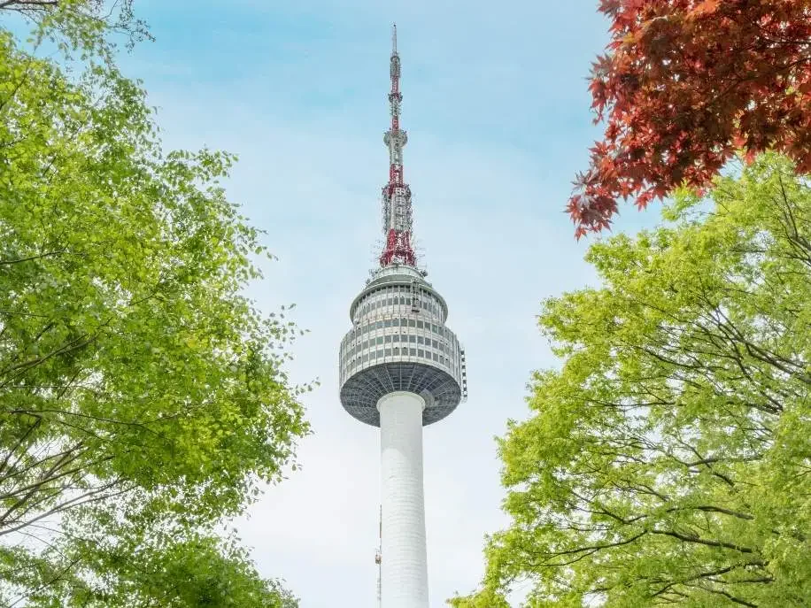
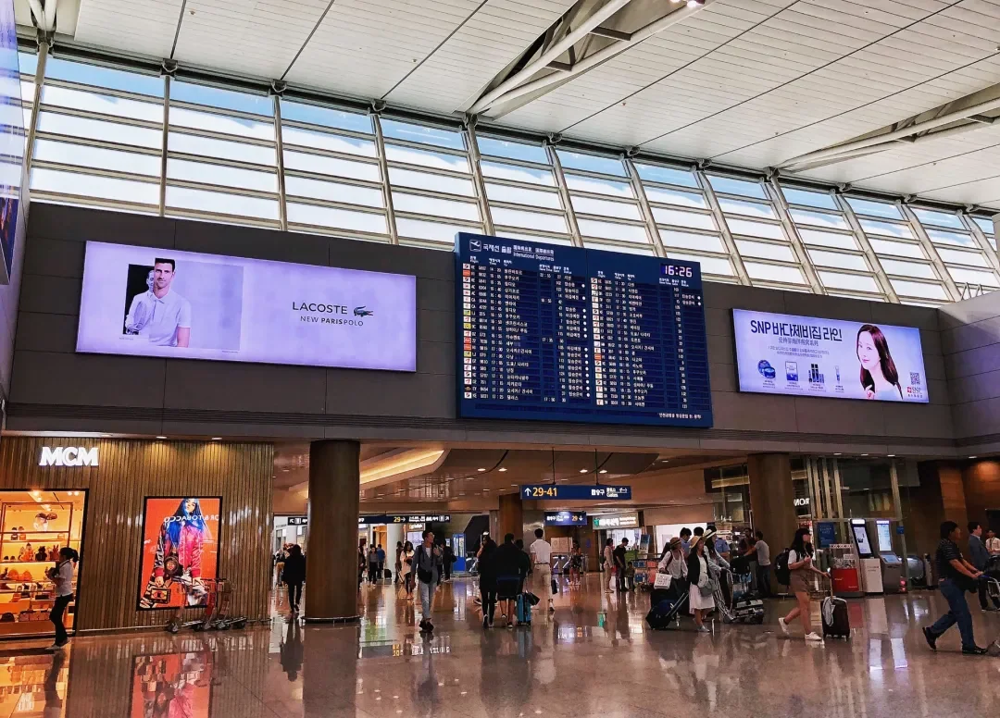
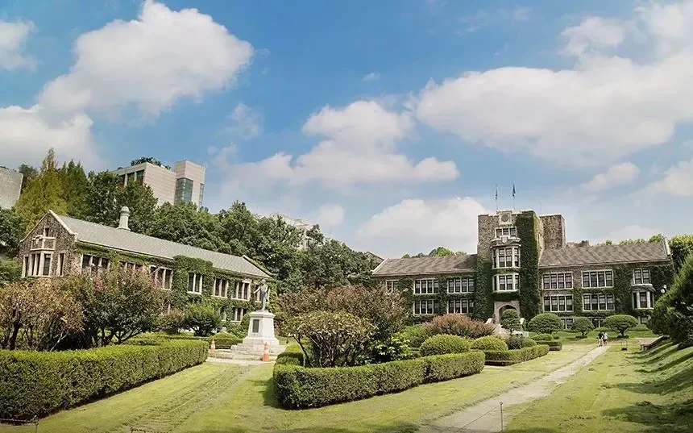

À Séoul, le nom traduit est pour les visiteurs ; l'adresse coréenne est pour les chauffeurs et les applications. Un chauffeur de taxi peut ne pas reconnaître le nom traduit, Naver Map résout le coréen de la manière la plus fiable, et Kakao T attend une destination en coréen.

La liste ci-dessous est classée selon l'usage, et la colonne coréenne est faite pour être copiée telle quelle. Copiez-la, collez-la dans Naver Map, montrez l'écran au chauffeur et faites une capture d'écran pour l'utiliser hors ligne. Les adresses et les boutiques changent : vérifiez une dernière fois avant de partir.

## 1. Pourquoi garder des adresses coréennes sur son téléphone

Beaucoup de chauffeurs de taxi à Séoul sont plus âgés et trouvent déjà les noms de rues anglais difficiles ; un nom translittéré est pire. Dites « N Seoul Tower » en anglais et le chauffeur devine ; tendez un téléphone affichant **서울 용산구 남산공원길 105** et la conversation s'arrête.

Naver Map est le service cartographique coréen et résout le mieux les numéros de rue coréens, tandis qu'un mot-clé en anglais ou en chinois trouve souvent le quartier mais pas l'entrée. Kakao T fait aussi correspondre les destinations en coréen : une adresse coréenne réussit donc bien plus souvent qu'un nom anglais.

La Corée est également passée à un système nom de rue + numéro, tandis que les anciens numéros de lot — un nom de district et un numéro — fonctionnent encore dans les applications et avec les chauffeurs. Les deux conviennent ; ne les traduisez simplement pas vous-même.

## 2. Comment procéder : copier, coller, montrer, photographier

1. **Copiez uniquement la colonne coréenne.** Emportez le nom traduit et la recherche risque d'aboutir à une autre succursale.
2. **Collez-la dans Naver Map** et vérifiez que l'épingle est sur l'entrée souhaitée — les bâtiments principaux et les annexes sont souvent à une rue l'écart.
3. **Montrez l'écran au chauffeur.** Une adresse coréenne et une épingle sur la carte valent mieux que la prononciation.
4. **Faites une capture d'écran pour l'utiliser hors ligne.** Enregistrez les quelques lieux prévus ce jour-là ; les rames de métro n'ont souvent pas de réseau.

Les boutiques déménagent, les boutiques hors taxes changent de nom, les pop-ups ferment et les horaires évoluent : vérifiez à nouveau sur Naver Map ou Kakao T avant de partir.

## 3. Aéroports et pôles de transport

Les terminaux T1 et T2 d'Incheon sont des bâtiments séparés : confirmez votre terminal avant de prendre le train de l'aéroport ou un taxi. Gimpo traite les vols internationaux court-courriers ainsi qu'un fort trafic intérieur vers Jeju, et ces vols utilisent des bâtiments différents.

| Lieu | Coréen (copier-coller) | Usage / remarques |
| --- | --- | --- |
| Aéroport d'Incheon T1 | 인천공항T1 | Train, bus et épingle taxi ; navette gratuite vers T2, 18 minutes |
| Aéroport d'Incheon T2 | 인천공항T2 | La plupart des vols Korean Air et SkyTeam |
| Aéroport international de Gimpo | 김포국제공항 | International court-courrier et intérieur Jeju ; lignes 5/9, AREX omnibus |
| Gare de Séoul | 서울역 | Terminus de l'AREX express ; lignes 1 et 4, KTX |

Depuis Gimpo, l'AREX omnibus rejoint la gare de Séoul en environ 22 minutes avec T-money ; depuis Incheon, l'express et l'omnibus ont des tarifs et des règles différents.

## 4. Palais, monuments et parcs

Les palais et monuments se concentrent dans les quartiers de Jongno et Jung-gu, à une marche ou un arrêt de métro les uns des autres ; une demi-journée suffit pour les principaux. Les adresses de rue comptent, car ces lieux ont plusieurs entrées.

| Lieu | Coréen (copier-coller) | Usage / remarques |
| --- | --- | --- |
| Gyeongbokgung | 사직로 161 경복궁 | À côté de Gwanghwamun ; fermé le mardi |
| Village hanok de Bukchon | 서울 종로구 계동길 37 | Toujours habité — limitez le bruit |
| N Seoul Tower | 서울 용산구 남산공원길 105 | Sur le Namsan ; les taxis s'arrêtent à la base du téléphérique |
| Téléphérique du Namsan | 서울 중구 소파로 83 | Station inférieure, la voie habituelle pour monter |
| Cheong Wa Dae | 청와대 | Au nord de Gyeongbokgung ; certaines zones nécessitent une réservation |
| Cathédrale de Myeongdong | 명동대성당 | À l'extrémité est de la rue de Myeongdong, nombreux escaliers |

Les parcs fonctionnent autrement : l'adresse indique une porte et il faut encore marcher à l'intérieur. Les parcs du fleuve Han comptent plus d'une douzaine de sections : une recherche brute 한강공원 renvoie donc quelque chose de vague.

| Lieu | Coréen (copier-coller) | Usage / remarques |
| --- | --- | --- |
| Parc du Hangang de Yeouido | 서울 영등포구 여의동로 330 | Pique-niques et couchers de soleil ; station Yeouinaru, ligne 5 |
| Parc du Hangang | 한강공원 | Générique — ajoutez la section (여의도, 뚝섬) |
| Seoul Forest | 서울 성동구 뚝섬로 273 | À côté de Seongsu-dong ; promenades et pique-niques |
| Lotte World Tower | 롯데월드타워 | Jamsil ; Lotte World et boutique hors taxes à l'intérieur |

## 5. Quartiers commerçants, grands magasins et boutiques hors taxes

Les noms de quartiers font deux ou trois caractères et la navigation les reconnaît précisément. Ce sont des noms de zone, pas des adresses de boutique — la même rue compte plusieurs succursales d'une même marque : recherchez à nouveau le nom de la boutique en arrivant.

| Lieu | Coréen (copier-coller) | Usage / remarques |
| --- | --- | --- |
| Myeongdong | 명동 | Cosmétiques et restauration de rue ; bureaux de change |
| Rue des dessins de Myeongdong | 명동 재미로 | Ruelle courte à l'intérieur de Myeongdong |
| Hongdae | 홍대 | Musiciens de rue et petites boutiques ; station Hongik University |
| Dongdaemun | 동대문 | Gros et détail la nuit ; DDP juste à côté |
| Apgujeong | 압구정동 | Boutiques phares de marques et concept stores |
| Cheongdam-dong | 청담동 | Rue du luxe, accessible à pied depuis Apgujeong |
| Hannam-dong | 한남동 | Cafés et concept stores, beaucoup de pentes |
| Itaewon | 이태원동 | Restaurants internationaux et bars |
| Seongsu-dong | 성수동 | Cafés et boutiques de marques dans d'anciennes usines |

Les grands magasins sont l'endroit où les habitants font leurs achats ; la boutique hors taxes est pour les voyageurs au départ, avec retrait des achats à l'aéroport. Les outlets sont susceptibles d'être renommés : vérifiez d'abord qu'ils existent encore.

| Lieu | Coréen (copier-coller) | Usage / remarques |
| --- | --- | --- |
| Grand magasin Lotte, principal | 롯데백화점 본점 | Myeongdong, relié à Lotte Duty Free |
| Lotte Duty Free Myeongdong | 롯데면세점 명동본점 | Enregistrement du passeport, retrait à l'aéroport |
| Grand magasin Shinsegae, principal | 신세계백화점 본점 | Myeongdong ; le bâtiment principal et l'annexe diffèrent |
| Shinsegae Duty Free | 신세계면세점 | Myeongdong, à côté du magasin principal |
| Grand magasin Shinsegae, Gangnam | 신세계백화점 강남점 | Station Gangnam, relié en sous-sol |
| Shilla Duty Free | 신라면세점 서울점 | Jangchung-dong, près de Dongdaemun |
| Grand magasin Hyundai, principal | 현대백화점 압구정본점 | Près de la station Apgujeong, détaxe à l'intérieur |
| Hyundai Duty Free, Gangnam | 현대백화점면세점 무역센터점 | Trade Centre, Samseong-dong |
| Lotte Duty Free, Jamsil | 롯데면세점 월드타워점 | À l'intérieur de Lotte World Tower |

## 6. Universités et spots photo

Les universités font partie de la carte commerçante : Ewha, Yonsei et Hongik sont chacune au cœur d'un quadrillage de boutiques et de cafés. Les campus sont généralement ouverts aux visiteurs, mais les bâtiments d'enseignement exigent une carte : lisez les panneaux et tenez-vous à l'écart des cours.

| Lieu | Coréen (copier-coller) | Usage / remarques |
| --- | --- | --- |
| Université Ewha Womans | 서울 서대문구 이화여대길 52 | La bibliothèque en contrebas et la porte principale sont les spots photo |
| Université Yonsei | 서울 서대문구 연세로 50 | Sinchon ; 15 minutes à pied depuis Ewha |
| Université nationale de Séoul | 서울특별시 관악구 관악로 1 | Campus de Gwanak ; ligne 2 puis un bus |
| Université Hongik | 서울 마포구 와우산로 94 | Porte principale de Hongdae, boutiques à l'extérieur |
| Université de Hanyang | 한양대 | Quartier de Wangsimni, station Hanyang University |

Les adresses des spots photo se périment le plus vite : les murs de panneaux changent de marque, les pop-ups ferment, les étals se déplacent. Pour les marchés, l'adresse est l'entrée, et à l'intérieur on se repère par numéro d'étal.

| Lieu | Coréen (copier-coller) | Usage / remarques |
| --- | --- | --- |
| Marché de Gwangjang | 서울시 종로구 창경궁로 88 | Stands de nourriture et marchands de tissus ; station Jongno 5-ga |
| Olive Young Myeongdong Town | 올리브영 명동 타운 | La plus grande succursale de Myeongdong, détaxe |
| Bâtiment de SM Entertainment | SM엔터테인먼트 스튜디오센터 | Quartier de Seongsu-dong ; vérifiez si les visiteurs sont admis |
| Mur de panneaux de Sinsa-dong | 서울특별시 강남구 신사동 520-9 | Le mur change de marque ; cherchez d'abord l'emplacement actuel |

## Liens utiles

- **Sur ce site** : [Aéroport international d'Incheon (ICN)](/airport/ICN), [Corée du Sud (KR)](/country/KR)
- **Wikipédia** : [Séoul](https://en.wikipedia.org/wiki/Seoul), [Gyeongbokgung](https://en.wikipedia.org/wiki/Gyeongbokgung), [N Seoul Tower](https://en.wikipedia.org/wiki/N_Seoul_Tower)
- **Baidu Baike** : [Séoul](https://baike.baidu.com/item/%E9%A6%96%E5%B0%94), [Gyeongbokgung](https://baike.baidu.com/item/%E6%99%AF%E7%A6%8F%E5%AE%AB), [N Seoul Tower](https://baike.baidu.com/item/N%E9%A6%96%E5%B0%94%E5%A1%94)

Source : Xiao Han Beauty Research Club (compte WeChat). Les adresses, noms de boutiques et statuts d'ouverture changent — vérifiez ce qu'affichent Naver Map et Kakao T avant de voyager.
