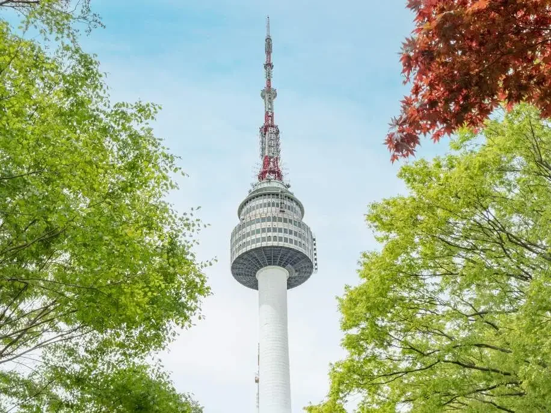

Huko Seoul, jina lililotafsiriwa ni kwa ajili ya wageni; anwani ya Kikorea ni kwa ajili ya madereva na programu. Dereva wa teksi anaweza asitambue jina lililotafsiriwa, Naver Map hutatua Kikorea kwa uhakika zaidi, na Kakao T inatarajia lengo la Kikorea.

Orodha iliyo hapa chini imepangwa kwa mujibu wa kile unachokihitaji, na safu ya Kikorea inakusudiwa kunakiliwa kama ilivyo. Inakili, ibandike kwenye Naver Map, onyesha skrini kwa dereva, na ipige picha ya skrini kwa matumizi bila mtandao. Anwani na maduka hubadilika, kwa hiyo angalia mara moja zaidi kabla ya kuanza safari.

## 1. Kwa nini kuweka anwani za Kikorea kwenye simu yako

Madereva wengi wa teksi Seoul ni wazee na tayari wanaona majina ya barabara ya Kiingereza ni kazi ngumu; jina lililohamishwa kwa herufi ni mbaya zaidi. Sema "N Seoul Tower" kwa Kiingereza na dereva atakuwa akikisia; mpe simu inayoonyesha **서울 용산구 남산공원길 105** na mazungumzo yanakwisha.

Naver Map ni huduma ya ramani ya Korea yenyewe na hutatua namba za barabara za Kikorea vizuri zaidi, wakati neno la Kiingereza au Kichina mara nyingi hupata mtaa lakini si lango. Kakao T hulinganisha maeneo kwa Kikorea pia, kwa hiyo anwani ya Kikorea hufanikiwa mara nyingi zaidi kuliko jina la Kiingereza.

Korea pia imehama kwenda mfumo wa jina la barabara pamoja na namba, wakati namba za zamani za viwanja — jina la wilaya pamoja na namba — bado zinafanya kazi kwenye programu na kwa madereva. Zote mbili ni sawa; tu usizitafsiri mwenyewe.

## 2. Jinsi ya kuitumia: nakili, bandika, onyesha, piga picha ya skrini

1. **Nakili safu ya Kikorea pekee.** Beba jina lililotafsiriwa pamoja nayo na utafutaji unaweza kuishia kwenye tawi tofauti.
2. **Ibandike kwenye Naver Map** na hakikisha alama ya mahali iko kwenye lango unalotaka — majengo makuu na majengo ya nyongeza mara nyingi hutenganishwa na barabara moja.
3. **Onyesha skrini kwa dereva.** Anwani ya Kikorea pamoja na alama ya ramani hushinda matamshi.
4. **Ipige picha ya skrini kwa matumizi bila mtandao.** Hifadhi maeneo machache unayopanga kutembelea siku hiyo; mabehewa ya metro mara nyingi hayana mtandao.

Maduka huhama, maduka ya bure ya kodi hubadilishwa majina, maduka ya muda hufungwa na saa hubadilika — angalia tena kwenye Naver Map au Kakao T kabla ya kuanza safari.

## 3. Viwanja vya ndege na vituo vya usafiri

T1 na T2 za Incheon ni majengo tofauti, kwa hiyo thibitisha terminali yako kabla ya kupanda treni ya uwanja wa ndege au kuita teksi. Gimpo inashughulikia ndege za kimataifa za safari fupi pamoja na trafiki kubwa ya ndani kwenda Jeju, na hizo hutumia majengo tofauti.

| Mahali | Kikorea (nakili-bandika) | Matumizi / maelezo |
| --- | --- | --- |
| Incheon Airport T1 | 인천공항T1 | Alama ya treni, mabasi na teksi; usafiri wa bure hadi T2, dakika 18 |
| Incheon Airport T2 | 인천공항T2 | Ndege nyingi za Korean Air na SkyTeam |
| Gimpo International Airport | 김포국제공항 | Kimataifa cha safari fupi na ndani cha Jeju; Line 5/9, AREX inayosimama kila kituo |
| Seoul Station | 서울역 | Kituo cha mwisho cha AREX ya haraka; Line 1 na 4, KTX |

Kutoka Gimpo, AREX inayosimama kila kituo hufika Seoul Station kwa takriban dakika 22 ukitumia T-money; kutoka Incheon, treni ya haraka na ile inayosimama kila kituo zina nauli na kanuni tofauti.

## 4. Majumba ya kifalme, alama za mji na mbuga

Majumba ya kifalme na alama za mji hukusanyika Jongno na Jung-gu, umbali wa kutembea au kituo kimoja cha metro, na nusu siku inatosha kwa yale makuu. Anwani za mitaa ni muhimu kwa sababu maeneo haya yana malango kadhaa.

| Mahali | Kikorea (nakili-bandika) | Matumizi / maelezo |
| --- | --- | --- |
| Gyeongbokgung | 사직로 161 경복궁 | Karibu na Gwanghwamun; hufungwa Jumanne |
| Bukchon Hanok Village | 서울 종로구 계동길 37 | Bado ni makazi — punguza kelele |
| N Seoul Tower | 서울 용산구 남산공원길 105 | Kwenye Namsan; teksi husimama kwenye kituo cha chini cha treni ya kebo |
| Namsan Cable Car | 서울 중구 소파로 83 | Kituo cha chini, njia ya kawaida ya kupanda |
| Cheong Wa Dae | 청와대 | Kaskazini mwa Gyeongbokgung; maeneo mengine yanahitaji kuweka nafasi |
| Myeongdong Cathedral | 명동대성당 | Mwisho wa mashariki wa barabara ya Myeongdong, ngazi nyingi |

Mbuga zinafanya kazi tofauti: anwani huonyesha lango moja na bado unatembea ndani. Mbuga za Mto Han zina zaidi ya sehemu kumi na mbili, kwa hiyo utafutaji tupu wa 한강공원 hurejesha kitu kisichoeleweka.

| Mahali | Kikorea (nakili-bandika) | Matumizi / maelezo |
| --- | --- | --- |
| Yeouido Hangang Park | 서울 영등포구 여의동로 330 | Chakula cha nje na machweo; kituo cha Yeouinaru, Line 5 |
| Hangang Park | 한강공원 | Kawaida — ongeza sehemu (여의도, 뚝섬) |
| Seoul Forest | 서울 성동구 뚝섬로 273 | Karibu na Seongsu-dong; matembezi na chakula cha nje |
| Lotte World Tower | 롯데월드타워 | Jamsil; Lotte World na duka la bure la kodi ndani |

## 5. Maeneo ya ununuzi, maduka makubwa na maduka ya bure ya kodi

Majina ya wilaya yana herufi mbili au tatu na uelekezaji huyatambua kwa usahihi. Haya ni majina ya maeneo, si anwani za maduka — barabara moja hushikilia matawi kadhaa ya chapa moja, kwa hiyo tafuta tena jina la duka ukifika.

| Mahali | Kikorea (nakili-bandika) | Matumizi / maelezo |
| --- | --- | --- |
| Myeongdong | 명동 | Vipodozi na chakula cha mtaa; wabadilishaji fedha |
| Myeongdong Cartoon Street | 명동 재미로 | Korido fupi ndani ya Myeongdong |
| Hongdae | 홍대 | Wapiga muziki wa mtaa na maduka madogo; kituo cha Hongik University |
| Dongdaemun | 동대문 | Jumla na rejareja usiku; DDP karibu |
| Apgujeong | 압구정동 | Maduka makuu ya chapa na maduka maalum |
| Cheongdam-dong | 청담동 | Barabara ya bidhaa za kifahari, inayotembelewa kwa miguu kutoka Apgujeong |
| Hannam-dong | 한남동 | Kahawa na maduka ya dhana, miteremko mingi |
| Itaewon | 이태원동 | Migahawa na baa za kimataifa |
| Seongsu-dong | 성수동 | Mikahawa na maduka ya chapa katika viwanda vya zamani |

Maduka makubwa ni mahali wenyeji hununua; duka la bure la kodi ni kwa wasafiri wanaondoka, na manunuzi huchukuliwa uwanja wa ndege. Maduka ya mauzo ya moja kwa moja yana uwezekano wa kubadilishwa majina, kwa hiyo angalia kwanza kama bado lipo.

| Mahali | Kikorea (nakili-bandika) | Matumizi / maelezo |
| --- | --- | --- |
| Lotte Department Store, main | 롯데백화점 본점 | Myeongdong, limeunganishwa na Lotte Duty Free |
| Lotte Duty Free Myeongdong | 롯데면세점 명동본점 | Usajili wa pasipoti, kuchukua uwanja wa ndege |
| Shinsegae Department Store, main | 신세계백화점 본점 | Myeongdong; jengo kuu na nyongeza vinatofautiana |
| Shinsegae Duty Free | 신세계면세점 | Myeongdong, kando ya duka kuu |
| Shinsegae Department Store, Gangnam | 신세계백화점 강남점 | Kituo cha Gangnam, kimeunganishwa chini ya ardhi |
| Shilla Duty Free | 신라면세점 서울점 | Jangchung-dong, karibu na Dongdaemun |
| Hyundai Department Store, main | 현대백화점 압구정본점 | Karibu na kituo cha Apgujeong, marejesho ndani |
| Hyundai Duty Free, Gangnam | 현대백화점면세점 무역센터점 | Trade Centre, Samseong-dong |
| Lotte Duty Free, Jamsil | 롯데면세점 월드타워점 | Ndani ya Lotte World Tower |

## 6. Vyuo vikuu na maeneo ya picha

Vyuo vikuu ni sehemu ya ramani ya ununuzi hapa: Ewha, Yonsei na Hongik kila kimoja kiko ndani ya gridi ya maduka na mikahawa. Kambi kwa ujumla ziko wazi kwa wageni, lakini majengo ya kufundishia yanahitaji kadi, kwa hiyo soma alama na jiepushe na madarasa.

| Mahali | Kikorea (nakili-bandika) | Matumizi / maelezo |
| --- | --- | --- |
| Ewha Womans University | 서울 서대문구 이화여대길 52 | Maktaba iliyozama na lango kuu ni maeneo ya picha |
| Yonsei University | 서울 서대문구 연세로 50 | Sinchon; dakika 15 kwa miguu kutoka Ewha |
| Seoul National University | 서울특별시 관악구 관악로 1 | Kambi ya Gwanak; Line 2 kisha basi |
| Hongik University | 서울 마포구 와우산로 94 | Lango kuu la Hongdae, maduka nje |
| Hanyang University | 한양대 | Eneo la Wangsimni, kituo cha Hanyang University |

Anwani za maeneo ya picha huwa za zamani haraka zaidi: kuta za mabango hubadilisha chapa, maduka ya muda hufungwa, vibanda huhama. Kwa masoko anwani ni lango, na ndani unaelekea kwa namba ya kibanda.

| Mahali | Kikorea (nakili-bandika) | Matumizi / maelezo |
| --- | --- | --- |
| Gwangjang Market | 서울시 종로구 창경궁로 88 | Vibanda vya chakula na wafanyabiashara wa vitambaa; kituo cha Jongno 5-ga |
| Olive Young Myeongdong Town | 올리브영 명동 타운 | Tawi kubwa zaidi la Myeongdong, marejesho ya kodi |
| SM Entertainment building | SM엔터테인먼트 스튜디오센터 | Eneo la Seongsu-dong; angalia kama wageni wanaruhusiwa |
| Sinsa-dong billboard wall | 서울특별시 강남구 신사동 520-9 | Ukuta hubadilisha chapa; tafuta eneo la sasa kwanza |

## Viungo vinavyohusiana

- **Kwenye tovuti hii**: [Uwanja wa Ndege wa Kimataifa wa Incheon (ICN)](/airport/ICN), [Korea Kusini (KR)](/country/KR)
- **Wikipedia**: [Seoul](https://en.wikipedia.org/wiki/Seoul), [Gyeongbokgung](https://en.wikipedia.org/wiki/Gyeongbokgung), [N Seoul Tower](https://en.wikipedia.org/wiki/N_Seoul_Tower)
- **Baidu Baike**: [Seoul](https://baike.baidu.com/item/%E9%A6%96%E5%B0%94), [Gyeongbokgung](https://baike.baidu.com/item/%E6%99%AF%E7%A6%8F%E5%AE%AB), [N Seoul Tower](https://baike.baidu.com/item/N%E9%A6%96%E5%B0%94%E5%A1%94)

Chanzo: Xiao Han Beauty Research Club (akaunti ya WeChat). Anwani, majina ya maduka na hali ya kufunguliwa hubadilika — angalia kile Naver Map na Kakao T zinaonyesha kabla ya kusafiri.
