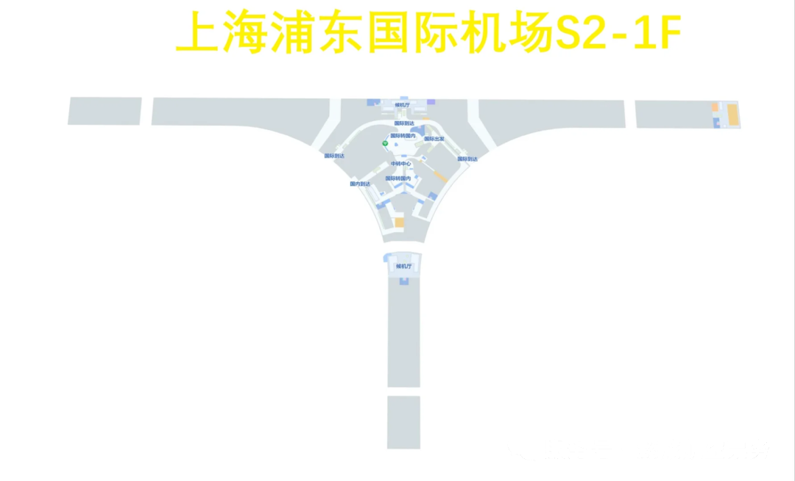

❤️❤️❤️ শাংহাই পুডং আন্তর্জাতিক বিমানবন্দর আয়তনে চীনের বৃহত্তম বিমানবন্দর। এটি 57 বর্গকিলোমিটার জুড়ে বিস্তৃত — ম্যাকাওয়ের সমগ্র ভূমিভাগের চেয়েও বড় — এবং এখানে পাঁচটি রানওয়ে রয়েছে, বছরে যাতায়াত করেন 5 কোটিরও বেশি যাত্রী।

## টার্মিনাল ও স্যাটেলাইট হল

👉👉👉 পুডংয়ে দুটি টার্মিনাল (T1 ও T2) এবং দুটি স্যাটেলাইট হল (S1 ও S2) আছে।

- ✅ **T1**: অভ্যন্তরীণ ও আন্তর্জাতিক, তিন তলা — আগমন 1F ও 2F-এ, প্রস্থান 3F-এ।
- ✅ **S1 স্যাটেলাইট হল**: অভ্যন্তরীণ ও আন্তর্জাতিক, চার তলা — আগমন 1F ও MF-এ, 2F-এ আগমন-প্রস্থান মিশ্র তলা, প্রস্থান 3F-এ।
- ✅ **T2**: অভ্যন্তরীণ ও আন্তর্জাতিক, চার তলা — আগমন 1F, 2F ও MF-এ, প্রস্থান 3F-এ।
- ✅ **S2 স্যাটেলাইট হল**: অভ্যন্তরীণ ও আন্তর্জাতিক, চার তলা — আগমন 1F ও MF-এ, 2F-এ মিশ্র তলা, প্রস্থান 3F-এ।

⚠️⚠️⚠️ নোট: S1-কে S2 থেকে একটি কাচের পার্টিশন আলাদা রেখেছে — এক হল থেকে অন্য হলে যাওয়া যায় না।

## তলার চিত্র

👉👉👉 নিচে তলার বিস্তারিত চিত্র দেওয়া হলো:

- T1-1F ➡️ চিত্র 2
- T1-2F ➡️ চিত্র 3
- T1-3F ➡️ চিত্র 4
- S1-1F ➡️ চিত্র 5
- S1-MF ➡️ চিত্র 6
- S1-2F ➡️ চিত্র 7
- S1-3F ➡️ চিত্র 8
- T2-1F ➡️ চিত্র 9
- T2-2F ➡️ চিত্র 10
- T2-MF ➡️ চিত্র 11
- T2-3F ➡️ চিত্র 12
- S2-1F ➡️ চিত্র 13
- S2-MF ➡️ চিত্র 14
- S2-2F ➡️ চিত্র 15
- S2-3F ➡️ চিত্র 16

### T1

### S1

### T2

### S2

## সংশ্লিষ্ট লিংক

- **এই সাইটে**: [শাংহাই পুডং আন্তর্জাতিক বিমানবন্দর (PVG)](/airport/PVG), [চীন (CN)](/country/CN)
- **উইকিপিডিয়া**: [শাংহাই পুডং আন্তর্জাতিক বিমানবন্দর](https://en.wikipedia.org/wiki/Shanghai_Pudong_International_Airport)
- **বাইদু বাইকে**: [শাংহাই পুডং আন্তর্জাতিক বিমানবন্দর](https://baike.baidu.com/item/%E4%B8%8A%E6%B5%B7%E6%B5%A6%E4%B8%9C%E5%9B%BD%E9%99%85%E6%9C%BA%E5%9C%BA)
