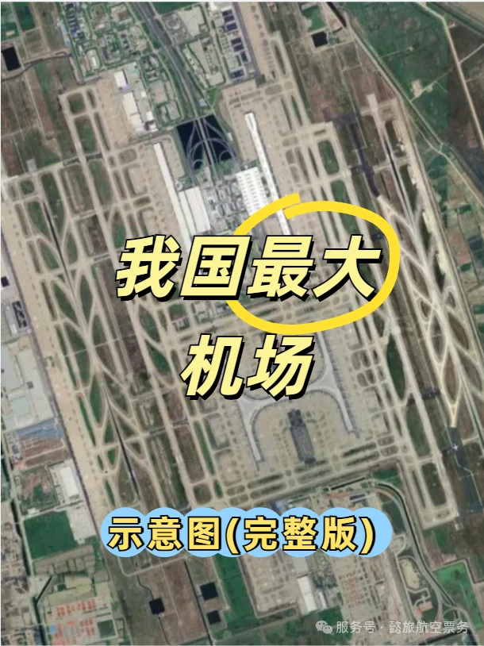

❤️❤️❤️ Šanghajské mezinárodní letiště Pudong je rozlohou největší letiště v Číně. Zabírá 57 km² — více než celá pevninská rozloha Macaa — a má pět ranvejí a více než 50 milionů cestujících ročně.

## Terminály a satelitní haly

👉👉👉 Pudong má dva terminály (T1 a T2) a dvě satelitní haly (S1 a S2).

- ✅ **T1**: vnitrostátní i mezinárodní provoz, tři podlaží — přílety v 1F a 2F, odlety ve 3F.
- ✅ **Satelitní hala S1**: vnitrostátní i mezinárodní provoz, čtyři podlaží — přílety v 1F a MF, ve 2F společné podlaží pro přílety i odlety, odlety ve 3F.
- ✅ **T2**: vnitrostátní i mezinárodní provoz, čtyři podlaží — přílety v 1F, 2F a MF, odlety ve 3F.
- ✅ **Satelitní hala S2**: vnitrostátní i mezinárodní provoz, čtyři podlaží — přílety v 1F a MF, ve 2F společné podlaží, odlety ve 3F.

⚠️⚠️⚠️ Pozor: S1 a S2 odděluje skleněná přepážka — mezi oběma halami se nelze pohybovat.

## Plány podlaží

👉👉👉 Následují podrobné plány podlaží:

- T1-1F ➡️ Obrázek 2
- T1-2F ➡️ Obrázek 3
- T1-3F ➡️ Obrázek 4
- S1-1F ➡️ Obrázek 5
- S1-MF ➡️ Obrázek 6
- S1-2F ➡️ Obrázek 7
- S1-3F ➡️ Obrázek 8
- T2-1F ➡️ Obrázek 9
- T2-2F ➡️ Obrázek 10
- T2-MF ➡️ Obrázek 11
- T2-3F ➡️ Obrázek 12
- S2-1F ➡️ Obrázek 13
- S2-MF ➡️ Obrázek 14
- S2-2F ➡️ Obrázek 15
- S2-3F ➡️ Obrázek 16

### T1

### S1

### T2

### S2

## Související odkazy

- **Na tomto webu**: [Šanghajské mezinárodní letiště Pudong (PVG)](/airport/PVG), [Čína (CN)](/country/CN)
- **Wikipedie**: [Shanghai Pudong International Airport](https://en.wikipedia.org/wiki/Shanghai_Pudong_International_Airport)
- **Baidu Baike**: [Shanghai Pudong International Airport](https://baike.baidu.com/item/%E4%B8%8A%E6%B5%B7%E6%B5%A6%E4%B8%9C%E5%9B%BD%E9%99%85%E6%9C%BA%E5%9C%BA)
