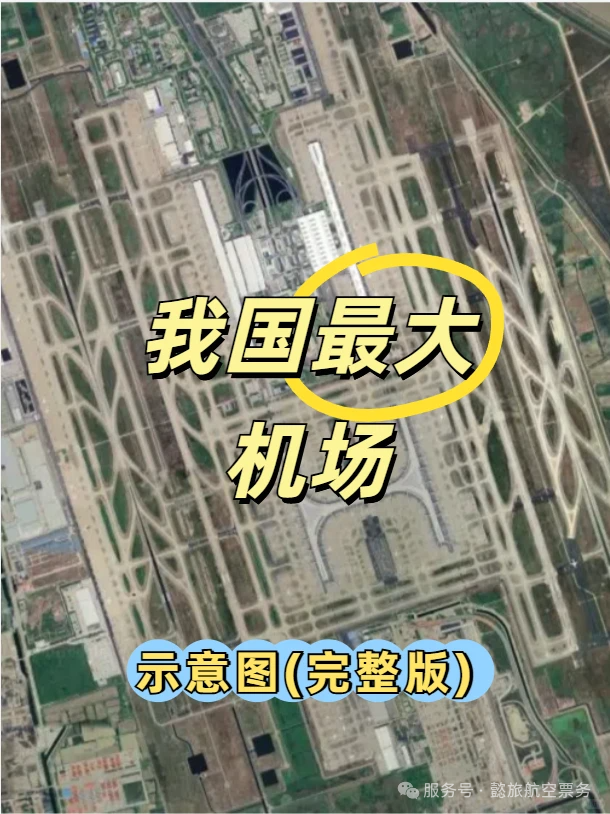

❤️❤️❤️ Der Shanghai Pudong International Airport ist flächenmäßig der größte Flughafen Chinas. Er umfasst 57 km² – mehr als die gesamte Landfläche Macaus – und verfügt über fünf Start- und Landebahnen; jährlich fertigt er mehr als 50 Millionen Passagiere ab.

## Terminals und Satellitenhallen

👉👉👉 Pudong hat zwei Terminals (T1 und T2) und zwei Satellitenhallen (S1 und S2).

- ✅ **T1**: Inlands- und internationaler Verkehr, drei Etagen – Ankünfte auf 1F und 2F, Abflüge auf 3F.
- ✅ **S1-Satellitenhalle**: Inlands- und internationaler Verkehr, vier Etagen – Ankünfte auf 1F und MF, eine gemischte Ankunfts- und Abflugebene auf 2F, Abflüge auf 3F.
- ✅ **T2**: Inlands- und internationaler Verkehr, vier Etagen – Ankünfte auf 1F, 2F und MF, Abflüge auf 3F.
- ✅ **S2-Satellitenhalle**: Inlands- und internationaler Verkehr, vier Etagen – Ankünfte auf 1F und MF, eine gemischte Etage auf 2F, Abflüge auf 3F.

⚠️⚠️⚠️ Hinweis: Eine Glaswand trennt S1 von S2 – Sie können nicht zwischen beiden wechseln.

## Etagenpläne

👉👉👉 Es folgen detaillierte Etagenpläne:

- T1-1F ➡️ Abbildung 2
- T1-2F ➡️ Abbildung 3
- T1-3F ➡️ Abbildung 4
- S1-1F ➡️ Abbildung 5
- S1-MF ➡️ Abbildung 6
- S1-2F ➡️ Abbildung 7
- S1-3F ➡️ Abbildung 8
- T2-1F ➡️ Abbildung 9
- T2-2F ➡️ Abbildung 10
- T2-MF ➡️ Abbildung 11
- T2-3F ➡️ Abbildung 12
- S2-1F ➡️ Abbildung 13
- S2-MF ➡️ Abbildung 14
- S2-2F ➡️ Abbildung 15
- S2-3F ➡️ Abbildung 16

### T1

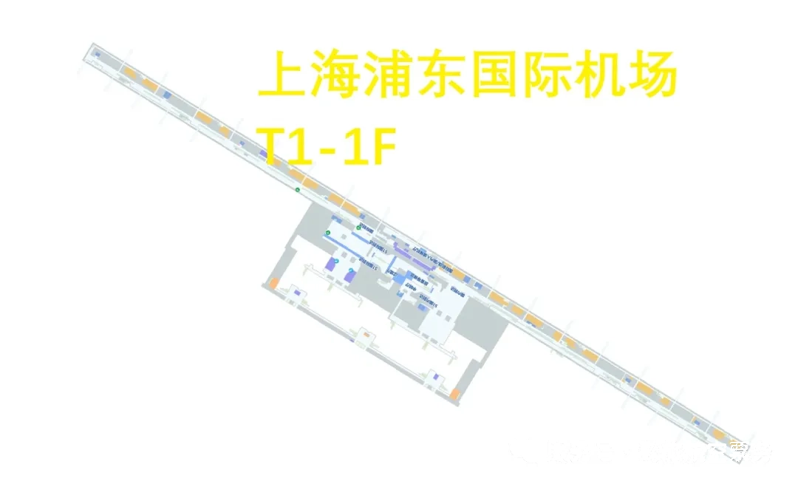

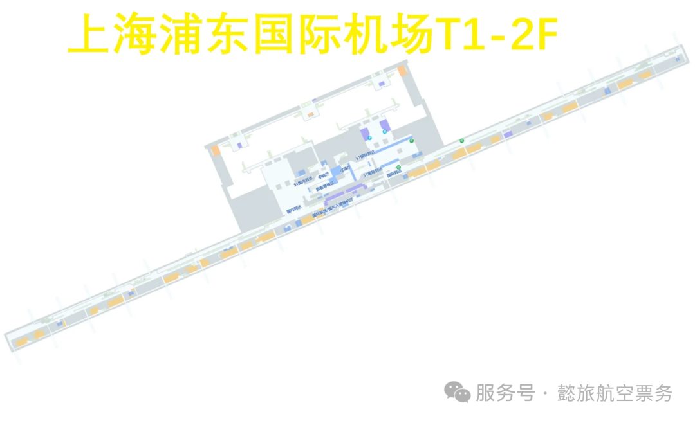

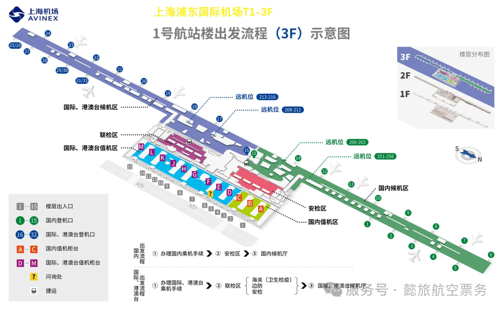

### S1

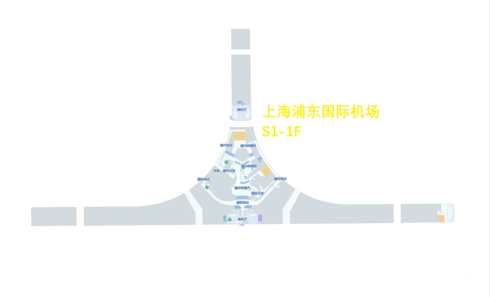

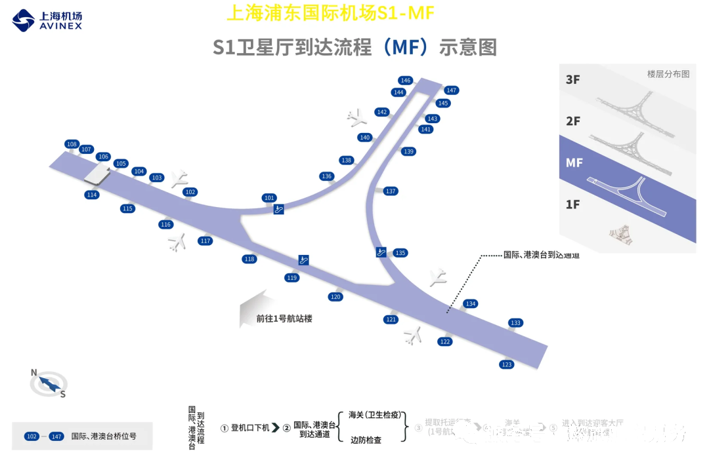

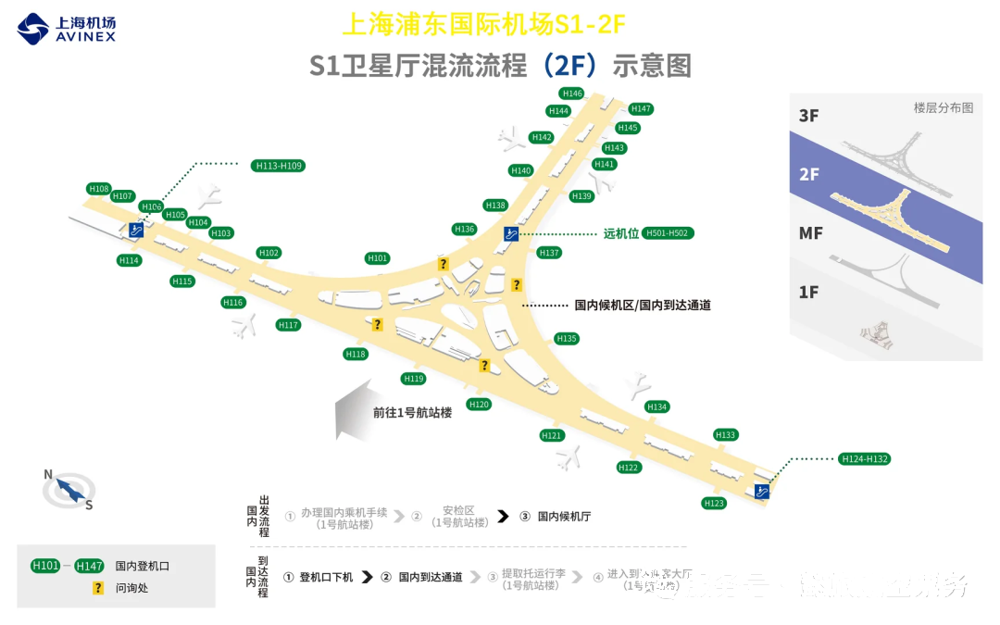

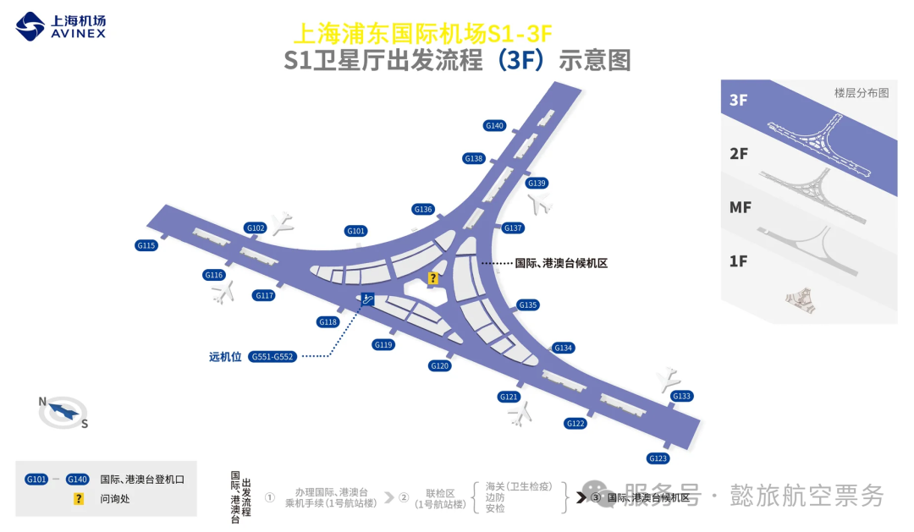

### T2

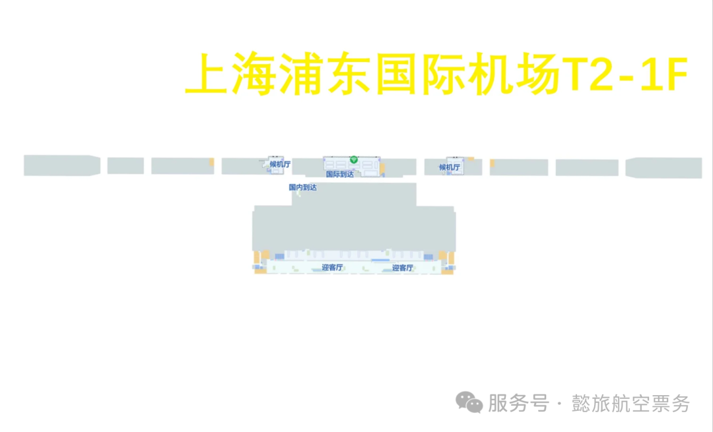

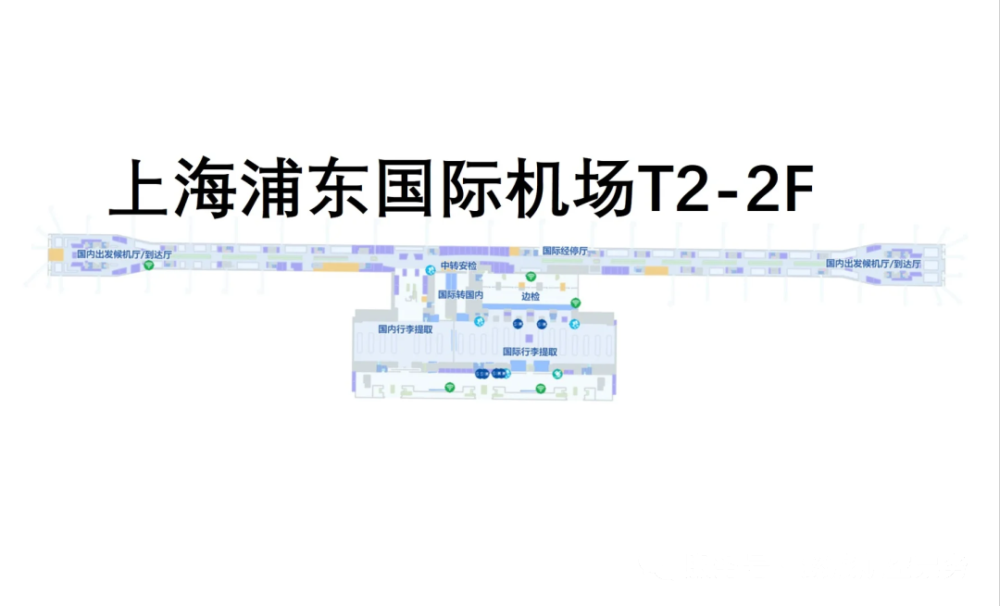

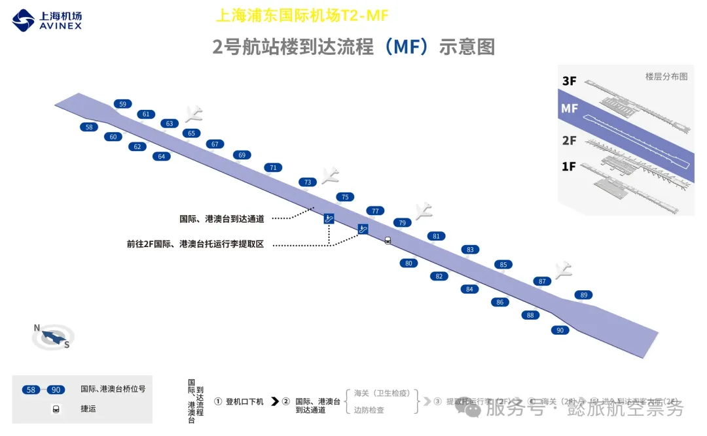

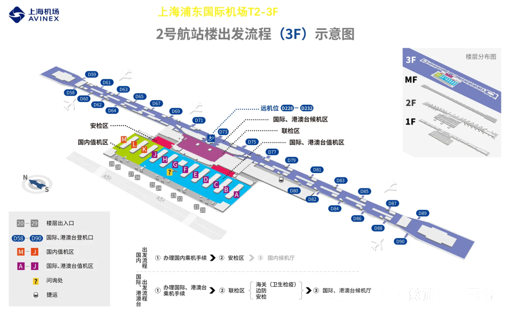

### S2

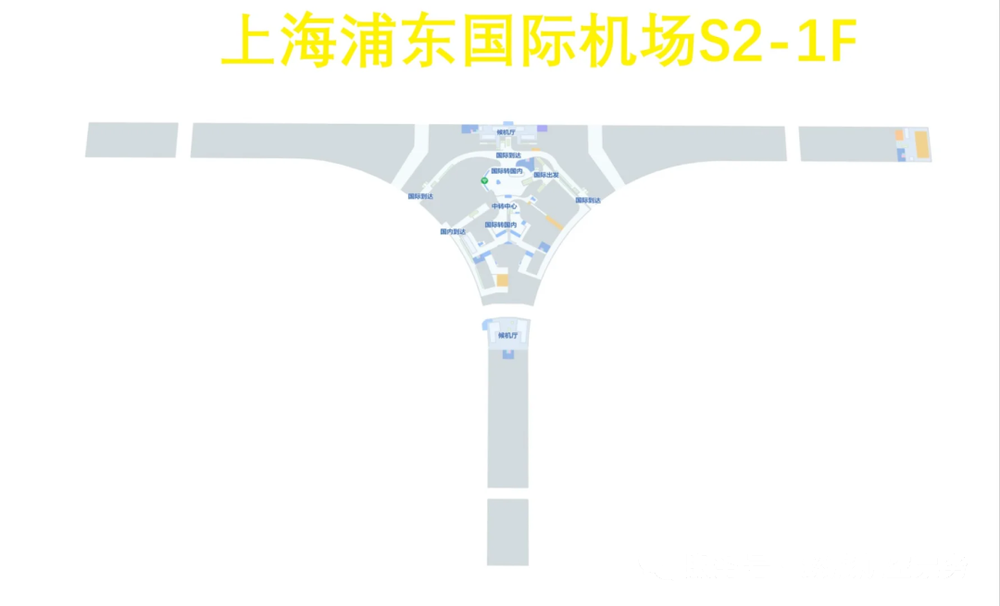

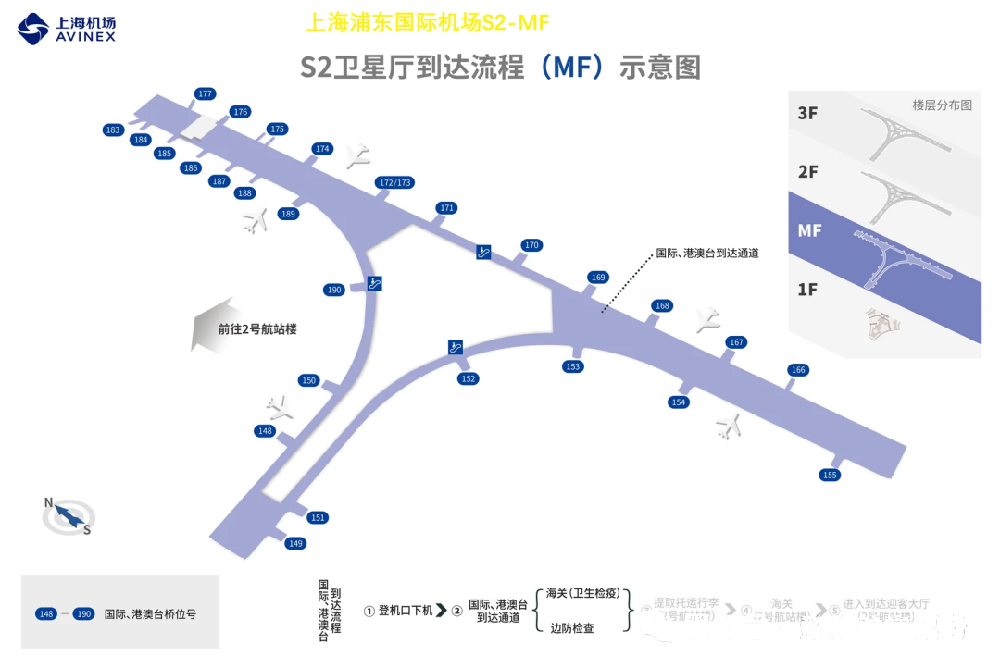

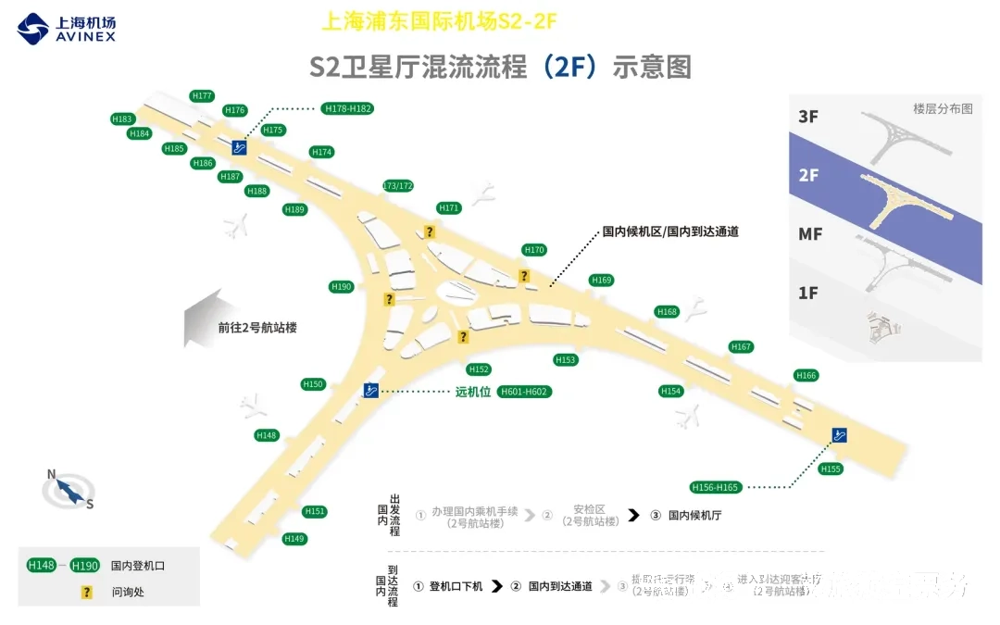

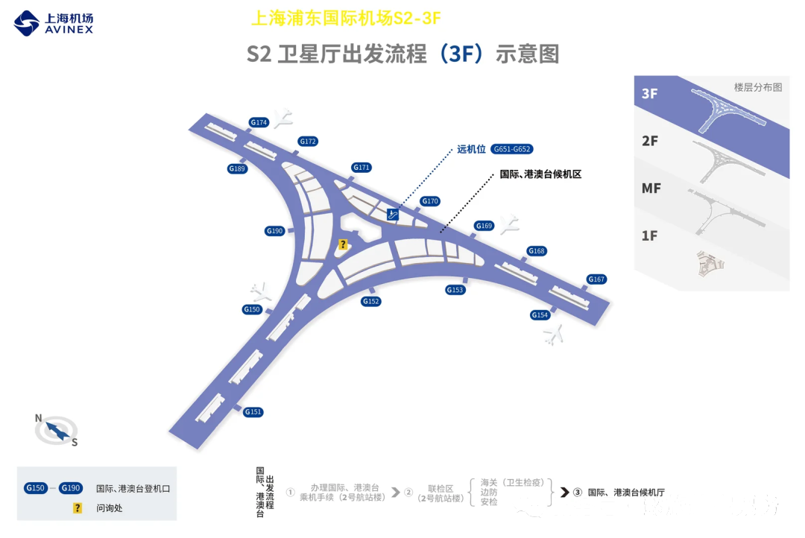

## Weiterführende Links

- **Auf dieser Website**: [Shanghai Pudong International Airport (PVG)](/airport/PVG), [China (CN)](/country/CN)
- **Wikipedia**: [Shanghai Pudong International Airport](https://en.wikipedia.org/wiki/Shanghai_Pudong_International_Airport)
- **Baidu Baike**: [Shanghai Pudong International Airport](https://baike.baidu.com/item/%E4%B8%8A%E6%B5%B7%E6%B5%A6%E4%B8%9C%E5%9B%BD%E9%99%85%E6%9C%BA%E5%9C%BA)
