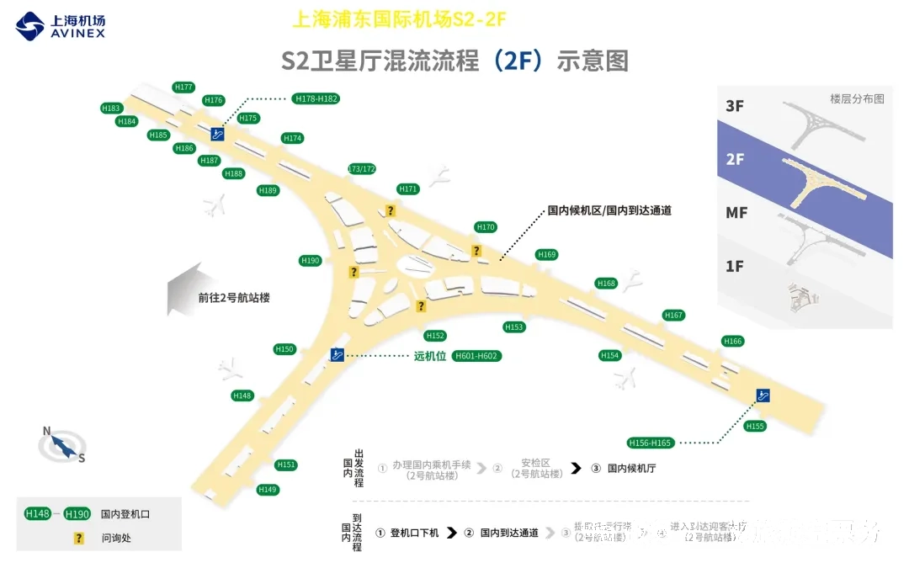

❤️❤️❤️ El Aeropuerto Internacional de Shanghái Pudong es el aeropuerto más grande de China por superficie. Ocupa 57 km² —más que toda la superficie terrestre de Macao— y tiene cinco pistas y más de 50 millones de pasajeros al año.

## Terminales y salas satélite

👉👉👉 Pudong tiene dos terminales (T1 y T2) y dos salas satélite (S1 y S2).

- ✅ **T1**: nacional e internacional, tres plantas: llegadas en la 1F y la 2F, salidas en la 3F.
- ✅ **Sala satélite S1**: nacional e internacional, cuatro plantas: llegadas en la 1F y la MF, una planta mixta de llegadas y salidas en la 2F, salidas en la 3F.
- ✅ **T2**: nacional e internacional, cuatro plantas: llegadas en la 1F, la 2F y la MF, salidas en la 3F.
- ✅ **Sala satélite S2**: nacional e internacional, cuatro plantas: llegadas en la 1F y la MF, una planta mixta en la 2F, salidas en la 3F.

⚠️⚠️⚠️ Nota: una mampara de cristal separa S1 de S2; no puedes pasar de una a otra.

## Planos por plantas

👉👉👉 A continuación, los planos detallados por plantas:

- T1-1F ➡️ Figura 2
- T1-2F ➡️ Figura 3
- T1-3F ➡️ Figura 4
- S1-1F ➡️ Figura 5
- S1-MF ➡️ Figura 6
- S1-2F ➡️ Figura 7
- S1-3F ➡️ Figura 8
- T2-1F ➡️ Figura 9
- T2-2F ➡️ Figura 10
- T2-MF ➡️ Figura 11
- T2-3F ➡️ Figura 12
- S2-1F ➡️ Figura 13
- S2-MF ➡️ Figura 14
- S2-2F ➡️ Figura 15
- S2-3F ➡️ Figura 16

### T1

### S1

### T2

### S2

## Enlaces relacionados

- **En este sitio**: [Aeropuerto Internacional de Shanghái Pudong (PVG)](/airport/PVG), [China (CN)](/country/CN)
- **Wikipedia**: [Shanghai Pudong International Airport](https://en.wikipedia.org/wiki/Shanghai_Pudong_International_Airport)
- **Baidu Baike**: [Shanghai Pudong International Airport](https://baike.baidu.com/item/%E4%B8%8A%E6%B5%B7%E6%B5%A6%E4%B8%9C%E5%9B%BD%E9%99%85%E6%9C%BA%E5%9C%BA)
