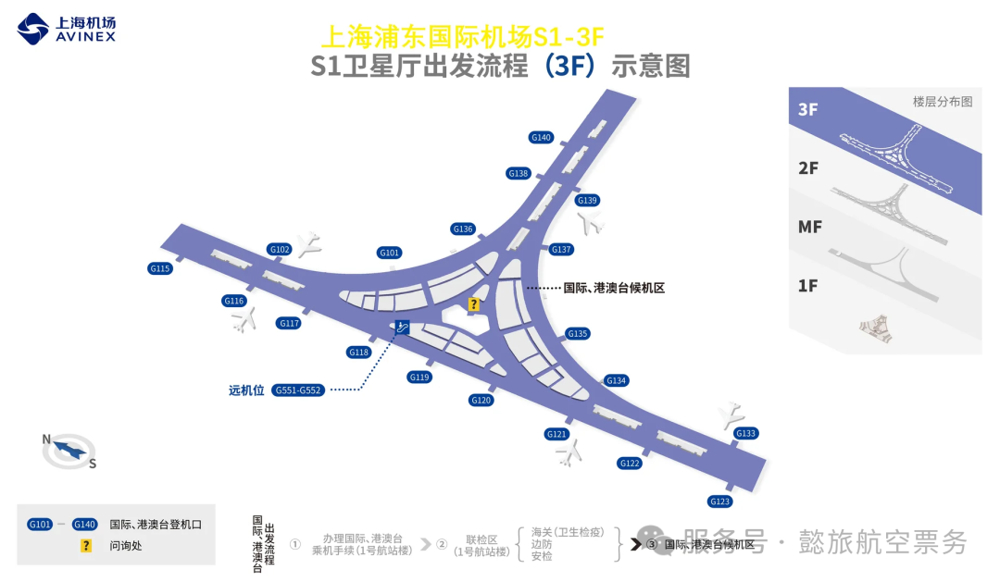
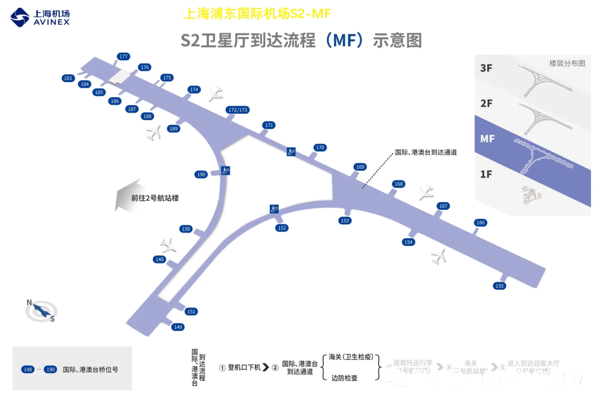

❤️❤️❤️ Bandara Internasional Shanghai Pudong adalah bandara terbesar di Tiongkok berdasarkan luas. Bandara ini mencakup 57 km² — lebih luas dari seluruh daratan Makau — dan memiliki lima landasan pacu serta lebih dari 50 juta penumpang setahun.

## Terminal dan aula satelit

👉👉👉 Pudong memiliki dua terminal (T1 dan T2) dan dua aula satelit (S1 dan S2).

- ✅ **T1**: domestik dan internasional, tiga lantai — kedatangan di 1F dan 2F, keberangkatan di 3F.
- ✅ **Aula satelit S1**: domestik dan internasional, empat lantai — kedatangan di 1F dan MF, lantai campuran kedatangan dan keberangkatan di 2F, keberangkatan di 3F.
- ✅ **T2**: domestik dan internasional, empat lantai — kedatangan di 1F, 2F, dan MF, keberangkatan di 3F.
- ✅ **Aula satelit S2**: domestik dan internasional, empat lantai — kedatangan di 1F dan MF, lantai campuran di 2F, keberangkatan di 3F.

⚠️⚠️⚠️ Catatan: sekat kaca memisahkan S1 dari S2 — Anda tidak dapat berpindah antara keduanya.

## Diagram lantai

👉👉👉 Diagram lantai terperinci berikut ini:

- T1-1F ➡️ Gambar 2
- T1-2F ➡️ Gambar 3
- T1-3F ➡️ Gambar 4
- S1-1F ➡️ Gambar 5
- S1-MF ➡️ Gambar 6
- S1-2F ➡️ Gambar 7
- S1-3F ➡️ Gambar 8
- T2-1F ➡️ Gambar 9
- T2-2F ➡️ Gambar 10
- T2-MF ➡️ Gambar 11
- T2-3F ➡️ Gambar 12
- S2-1F ➡️ Gambar 13
- S2-MF ➡️ Gambar 14
- S2-2F ➡️ Gambar 15
- S2-3F ➡️ Gambar 16

### T1

### S1

### T2

### S2

## Tautan terkait

- **Di situs ini**: [Bandara Internasional Shanghai Pudong (PVG)](/airport/PVG), [Tiongkok (CN)](/country/CN)
- **Wikipedia**: [Shanghai Pudong International Airport](https://en.wikipedia.org/wiki/Shanghai_Pudong_International_Airport)
- **Baidu Baike**: [Shanghai Pudong International Airport](https://baike.baidu.com/item/%E4%B8%8A%E6%B5%B7%E6%B5%A6%E4%B8%9C%E5%9B%BD%E9%99%85%E6%9C%BA%E5%9C%BA)
