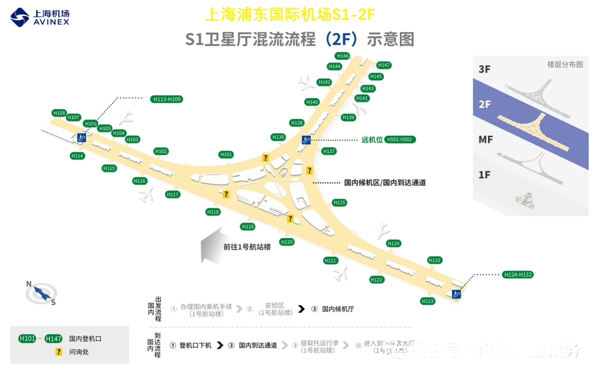
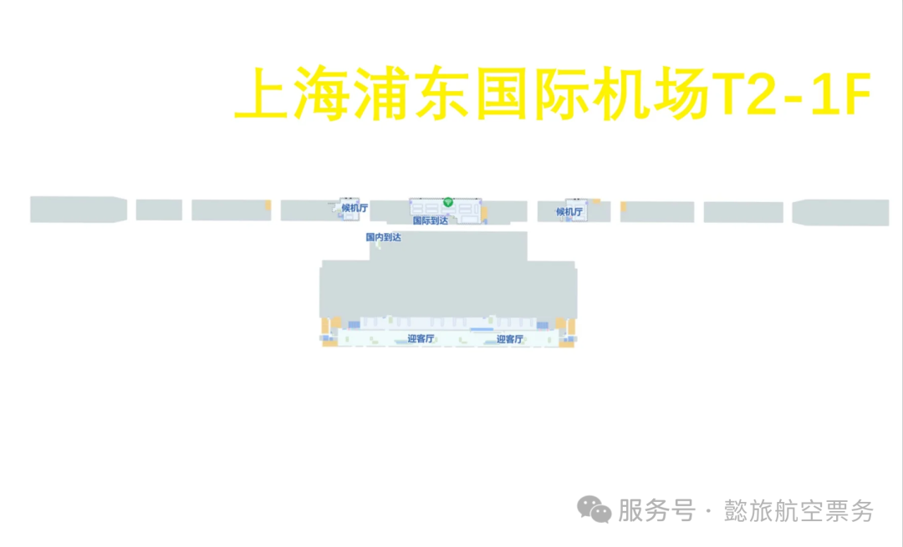

❤️❤️❤️ 上海浦東国際空港は、面積で中国最大の空港です。57 km²を占め、マカオの全陸地面積より広く、5本の滑走路と年間5,000万人超の旅客を抱えます。

## ターミナルとサテライトホール

👉👉👉 浦東には2つのターミナル（T1とT2）と2つのサテライトホール（S1とS2）があります。

- ✅ **T1**：国内線と国際線、3フロア。到着は1Fと2F、出発は3F。
- ✅ **S1サテライトホール**：国内線と国際線、4フロア。到着は1FとMF、2Fは到着と出発が混在するフロア、出発は3F。
- ✅ **T2**：国内線と国際線、4フロア。到着は1F、2F、MF、出発は3F。
- ✅ **S2サテライトホール**：国内線と国際線、4フロア。到着は1FとMF、2Fは混在フロア、出発は3F。

⚠️⚠️⚠️ 注意：S1とS2の間はガラスの仕切りで分かれており、行き来できません。

## フロア図

👉👉👉 以下、詳細なフロア図です。

- T1-1F ➡️ 図2
- T1-2F ➡️ 図3
- T1-3F ➡️ 図4
- S1-1F ➡️ 図5
- S1-MF ➡️ 図6
- S1-2F ➡️ 図7
- S1-3F ➡️ 図8
- T2-1F ➡️ 図9
- T2-2F ➡️ 図10
- T2-MF ➡️ 図11
- T2-3F ➡️ 図12
- S2-1F ➡️ 図13
- S2-MF ➡️ 図14
- S2-2F ➡️ 図15
- S2-3F ➡️ 図16

### T1

### S1

### T2

### S2

## 関連リンク

- **このサイト内**：[上海浦東国際空港 (PVG)](/airport/PVG)、[中国 (CN)](/country/CN)
- **Wikipedia**：[上海浦東国際空港](https://en.wikipedia.org/wiki/Shanghai_Pudong_International_Airport)
- **百度百科**：[上海浦東国際空港](https://baike.baidu.com/item/%E4%B8%8A%E6%B5%B7%E6%B5%A6%E4%B8%9C%E5%9B%BD%E9%99%85%E6%9C%BA%E5%9C%BA)
