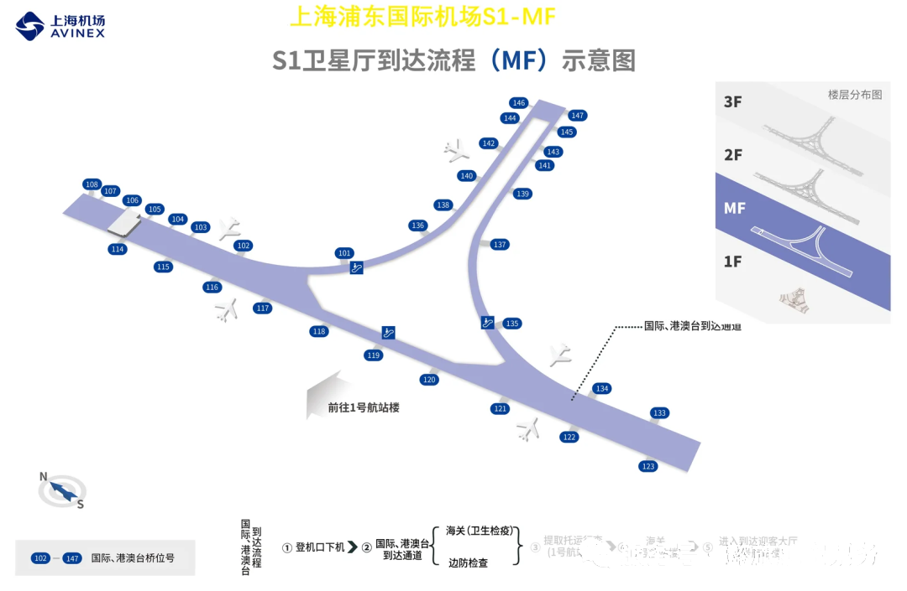

❤️❤️❤️ De internationale luchthaven Shanghai Pudong is qua oppervlakte de grootste luchthaven van China. Hij beslaat 57 km² — meer dan de totale landoppervlakte van Macau — en heeft vijf startbanen en meer dan 50 miljoen passagiers per jaar.

## Terminals en satellietgebouwen

👉👉👉 Pudong heeft twee terminals (T1 en T2) en twee satellietgebouwen (S1 en S2).

- ✅ **T1**: binnenlands en internationaal, drie verdiepingen — aankomst op 1F en 2F, vertrek op 3F.
- ✅ **S1-satellietgebouw**: binnenlands en internationaal, vier verdiepingen — aankomst op 1F en MF, een gemengde aankomst- en vertrekverdieping op 2F, vertrek op 3F.
- ✅ **T2**: binnenlands en internationaal, vier verdiepingen — aankomst op 1F, 2F en MF, vertrek op 3F.
- ✅ **S2-satellietgebouw**: binnenlands en internationaal, vier verdiepingen — aankomst op 1F en MF, een gemengde verdieping op 2F, vertrek op 3F.

⚠️⚠️⚠️ Let op: een glazen wand scheidt S1 van S2 — u kunt zich niet tussen de twee verplaatsen.

## Plattegronden per verdieping

👉👉👉 Hieronder volgen gedetailleerde plattegronden per verdieping:

- T1-1F ➡️ Figuur 2
- T1-2F ➡️ Figuur 3
- T1-3F ➡️ Figuur 4
- S1-1F ➡️ Figuur 5
- S1-MF ➡️ Figuur 6
- S1-2F ➡️ Figuur 7
- S1-3F ➡️ Figuur 8
- T2-1F ➡️ Figuur 9
- T2-2F ➡️ Figuur 10
- T2-MF ➡️ Figuur 11
- T2-3F ➡️ Figuur 12
- S2-1F ➡️ Figuur 13
- S2-MF ➡️ Figuur 14
- S2-2F ➡️ Figuur 15
- S2-3F ➡️ Figuur 16

### T1

### S1

### T2

### S2

## Gerelateerde links

- **Op deze site**: [Internationale luchthaven Shanghai Pudong (PVG)](/airport/PVG), [China (CN)](/country/CN)
- **Wikipedia**: [Internationale luchthaven Shanghai Pudong](https://en.wikipedia.org/wiki/Shanghai_Pudong_International_Airport)
- **Baidu Baike**: [Internationale luchthaven Shanghai Pudong](https://baike.baidu.com/item/%E4%B8%8A%E6%B5%B7%E6%B5%A6%E4%B8%9C%E5%9B%BD%E9%99%85%E6%9C%BA%E5%9C%BA)
