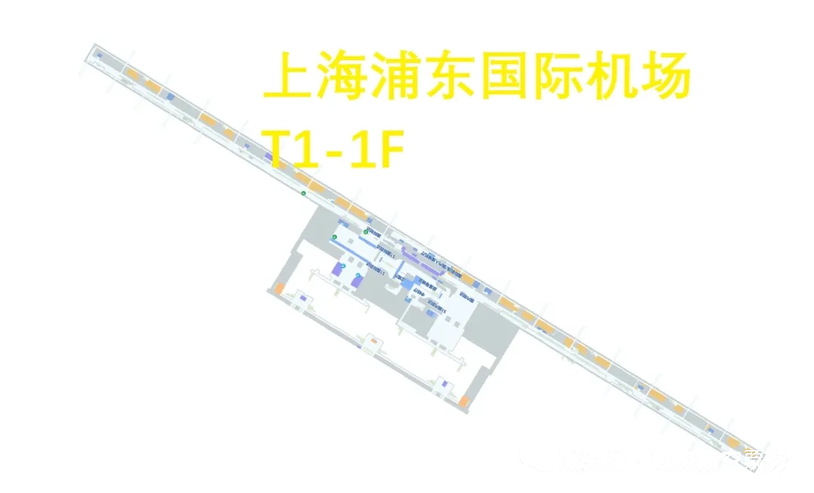

❤️❤️❤️ O Aeroporto Internacional de Xangai-Pudong é o maior aeroporto da China em área. Ocupa 57 km² — mais do que toda a área terrestre de Macau — e tem cinco pistas e mais de 50 milhões de passageiros por ano.

## Terminais e áreas satélites

👉👉👉 Pudong tem dois terminais (T1 e T2) e duas áreas satélites (S1 e S2).

- ✅ **T1**: doméstico e internacional, três andares — desembarque no 1F e no 2F, embarque no 3F.
- ✅ **Área satélite S1**: doméstico e internacional, quatro andares — desembarque no 1F e no MF, um andar misto de desembarque e embarque no 2F, embarque no 3F.
- ✅ **T2**: doméstico e internacional, quatro andares — desembarque no 1F, no 2F e no MF, embarque no 3F.
- ✅ **Área satélite S2**: doméstico e internacional, quatro andares — desembarque no 1F e no MF, um andar misto no 2F, embarque no 3F.

⚠️⚠️⚠️ Atenção: uma divisória de vidro separa o S1 do S2 — você não pode circular entre os dois.

## Diagramas dos andares

👉👉👉 Seguem os diagramas detalhados dos andares:

- T1-1F ➡️ Figura 2
- T1-2F ➡️ Figura 3
- T1-3F ➡️ Figura 4
- S1-1F ➡️ Figura 5
- S1-MF ➡️ Figura 6
- S1-2F ➡️ Figura 7
- S1-3F ➡️ Figura 8
- T2-1F ➡️ Figura 9
- T2-2F ➡️ Figura 10
- T2-MF ➡️ Figura 11
- T2-3F ➡️ Figura 12
- S2-1F ➡️ Figura 13
- S2-MF ➡️ Figura 14
- S2-2F ➡️ Figura 15
- S2-3F ➡️ Figura 16

### T1

### S1

### T2

### S2

## Links relacionados

- **Neste site**: [Aeroporto Internacional de Xangai-Pudong (PVG)](/airport/PVG), [China (CN)](/country/CN)
- **Wikipedia**: [Aeroporto Internacional de Xangai-Pudong](https://en.wikipedia.org/wiki/Shanghai_Pudong_International_Airport)
- **Baidu Baike**: [Aeroporto Internacional de Xangai-Pudong](https://baike.baidu.com/item/%E4%B8%8A%E6%B5%B7%E6%B5%A6%E4%B8%9C%E5%9B%BD%E9%99%85%E6%9C%BA%E5%9C%BA)
