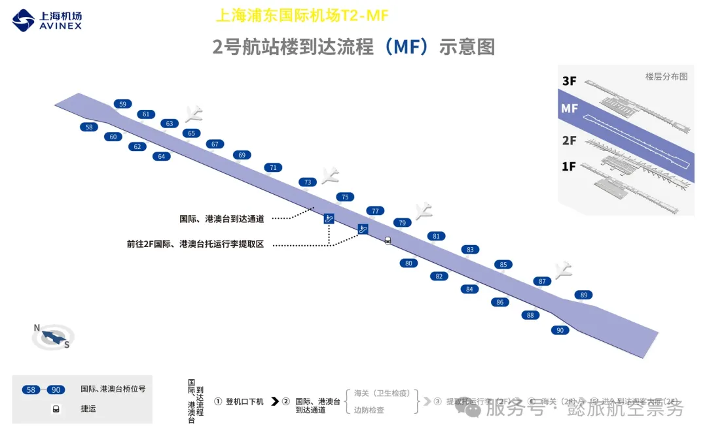

❤️❤️❤️ Шанхайский международный аэропорт Пудун — крупнейший аэропорт Китая по площади. Он занимает 57 км² — больше всей сухопутной территории Макао — и имеет пять взлётно-посадочных полос и более 50 млн пассажиров в год.

## Терминалы и спутниковые залы

👉👉👉 В Пудуне два терминала (T1 и T2) и два спутниковых зала (S1 и S2).

- ✅ **T1**: внутренние и международные рейсы, три этажа — прилёт на 1F и 2F, вылет на 3F.
- ✅ **Спутниковый зал S1**: внутренние и международные рейсы, четыре этажа — прилёт на 1F и MF, смешанный этаж прилёта и вылета на 2F, вылет на 3F.
- ✅ **T2**: внутренние и международные рейсы, четыре этажа — прилёт на 1F, 2F и MF, вылет на 3F.
- ✅ **Спутниковый зал S2**: внутренние и международные рейсы, четыре этажа — прилёт на 1F и MF, смешанный этаж на 2F, вылет на 3F.

⚠️⚠️⚠️ Обратите внимание: S1 и S2 разделены стеклянной перегородкой — перейти между ними нельзя.

## Поэтажные схемы

👉👉👉 Ниже подробные поэтажные схемы:

- T1-1F ➡️ Рисунок 2
- T1-2F ➡️ Рисунок 3
- T1-3F ➡️ Рисунок 4
- S1-1F ➡️ Рисунок 5
- S1-MF ➡️ Рисунок 6
- S1-2F ➡️ Рисунок 7
- S1-3F ➡️ Рисунок 8
- T2-1F ➡️ Рисунок 9
- T2-2F ➡️ Рисунок 10
- T2-MF ➡️ Рисунок 11
- T2-3F ➡️ Рисунок 12
- S2-1F ➡️ Рисунок 13
- S2-MF ➡️ Рисунок 14
- S2-2F ➡️ Рисунок 15
- S2-3F ➡️ Рисунок 16

### T1

### S1

### T2

### S2

## Полезные ссылки

- **На этом сайте**: [Шанхайский международный аэропорт Пудун (PVG)](/airport/PVG), [Китай (CN)](/country/CN)
- **Википедия**: [Shanghai Pudong International Airport](https://en.wikipedia.org/wiki/Shanghai_Pudong_International_Airport)
- **Baidu Baike**: [Shanghai Pudong International Airport](https://baike.baidu.com/item/%E4%B8%8A%E6%B5%B7%E6%B5%A6%E4%B8%9C%E5%9B%BD%E9%99%85%E6%9C%BA%E5%9C%BA)
