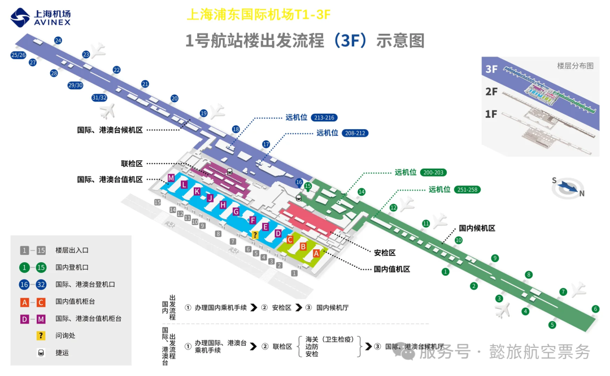
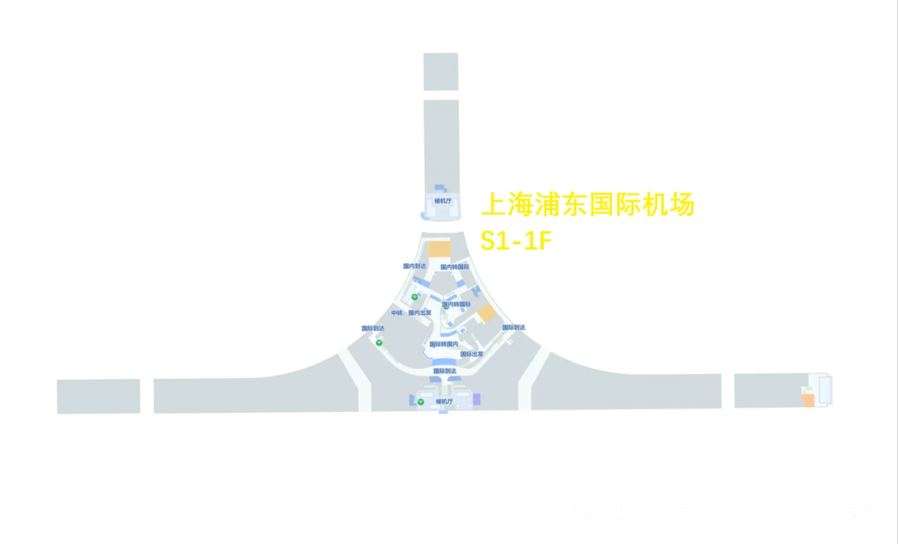
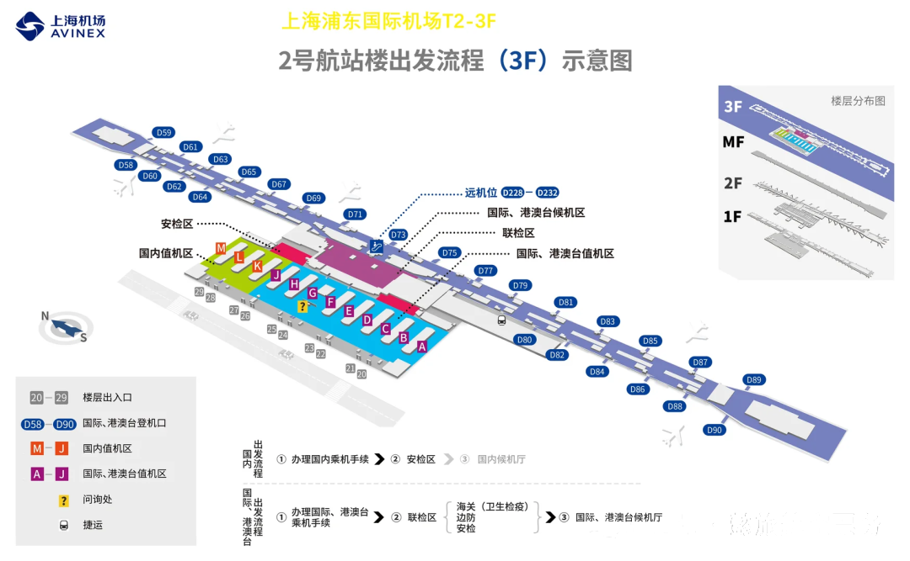

❤️❤️❤️ Shanghai Pudong International Airport är Kinas största flygplats till ytan. Den täcker 57 km² – mer än hela Macaus landarea – och har fem rullbanor och fler än 50 miljoner passagerare om året.

## Terminaler och satellithallar

👉👉👉 Pudong har två terminaler (T1 och T2) och två satellithallar (S1 och S2).

- ✅ **T1**: inrikes och utrikes, tre våningar – ankomster på 1F och 2F, avgångar på 3F.
- ✅ **S1 satellithall**: inrikes och utrikes, fyra våningar – ankomster på 1F och MF, en våning med både ankomster och avgångar på 2F, avgångar på 3F.
- ✅ **T2**: inrikes och utrikes, fyra våningar – ankomster på 1F, 2F och MF, avgångar på 3F.
- ✅ **S2 satellithall**: inrikes och utrikes, fyra våningar – ankomster på 1F och MF, en blandad våning på 2F, avgångar på 3F.

⚠️⚠️⚠️ Observera: en glasvägg skiljer S1 från S2 – du kan inte ta dig mellan de två.

## Våningsdiagram

👉👉👉 Här följer detaljerade våningsdiagram:

- T1-1F ➡️ Figur 2
- T1-2F ➡️ Figur 3
- T1-3F ➡️ Figur 4
- S1-1F ➡️ Figur 5
- S1-MF ➡️ Figur 6
- S1-2F ➡️ Figur 7
- S1-3F ➡️ Figur 8
- T2-1F ➡️ Figur 9
- T2-2F ➡️ Figur 10
- T2-MF ➡️ Figur 11
- T2-3F ➡️ Figur 12
- S2-1F ➡️ Figur 13
- S2-MF ➡️ Figur 14
- S2-2F ➡️ Figur 15
- S2-3F ➡️ Figur 16

### T1

### S1

### T2

### S2

## Relaterade länkar

- **På den här webbplatsen**: [Shanghai Pudong International Airport (PVG)](/airport/PVG), [Kina (CN)](/country/CN)
- **Wikipedia**: [Shanghai Pudong International Airport](https://en.wikipedia.org/wiki/Shanghai_Pudong_International_Airport)
- **Baidu Baike**: [Shanghai Pudong International Airport](https://baike.baidu.com/item/%E4%B8%8A%E6%B5%B7%E6%B5%A6%E4%B8%9C%E5%9B%BD%E9%99%85%E6%9C%BA%E5%9C%BA)
