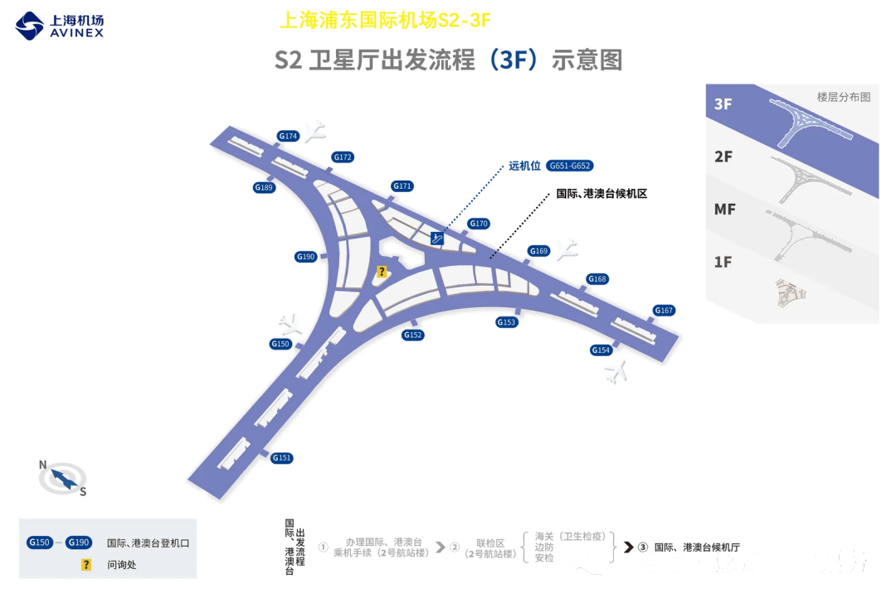

❤️❤️❤️ Uwanja wa Ndege wa Kimataifa wa Shanghai Pudong ndio uwanja mkubwa zaidi nchini China kwa eneo. Una eneo la kilomita za mraba 57 — zaidi ya eneo lote la ardhi la Macau — na una njia tano za kuruka na kutua na zaidi ya abiria milioni 50 kwa mwaka.

## Vituo na kumbi za satelaiti

👉👉👉 Pudong ina vituo viwili (T1 na T2) na kumbi mbili za satelaiti (S1 na S2).

- ✅ **T1**: safari za ndani na kimataifa, orofa tatu — kuwasili kwenye 1F na 2F, kuondoka kwenye 3F.
- ✅ **Ukumbi wa satelaiti S1**: safari za ndani na kimataifa, orofa nne — kuwasili kwenye 1F na MF, orofa inayochanganya kuwasili na kuondoka kwenye 2F, kuondoka kwenye 3F.
- ✅ **T2**: safari za ndani na kimataifa, orofa nne — kuwasili kwenye 1F, 2F na MF, kuondoka kwenye 3F.
- ✅ **Ukumbi wa satelaiti S2**: safari za ndani na kimataifa, orofa nne — kuwasili kwenye 1F na MF, orofa mchanganyiko kwenye 2F, kuondoka kwenye 3F.

⚠️⚠️⚠️ Kumbuka: kizigeu cha glasi kinatenganisha S1 na S2 — huwezi kupita kati ya hivyo viwili.

## Michoro ya orofa

👉👉👉 Michoro ya kina ya orofa inafuata:

- T1-1F ➡️ Kielelezo 2
- T1-2F ➡️ Kielelezo 3
- T1-3F ➡️ Kielelezo 4
- S1-1F ➡️ Kielelezo 5
- S1-MF ➡️ Kielelezo 6
- S1-2F ➡️ Kielelezo 7
- S1-3F ➡️ Kielelezo 8
- T2-1F ➡️ Kielelezo 9
- T2-2F ➡️ Kielelezo 10
- T2-MF ➡️ Kielelezo 11
- T2-3F ➡️ Kielelezo 12
- S2-1F ➡️ Kielelezo 13
- S2-MF ➡️ Kielelezo 14
- S2-2F ➡️ Kielelezo 15
- S2-3F ➡️ Kielelezo 16

### T1

### S1

### T2

### S2

## Viungo vinavyohusiana

- **Kwenye tovuti hii**: [Uwanja wa Ndege wa Kimataifa wa Shanghai Pudong (PVG)](/airport/PVG), [China (CN)](/country/CN)
- **Wikipedia**: [Uwanja wa Ndege wa Kimataifa wa Shanghai Pudong](https://en.wikipedia.org/wiki/Shanghai_Pudong_International_Airport)
- **Baidu Baike**: [Uwanja wa Ndege wa Kimataifa wa Shanghai Pudong](https://baike.baidu.com/item/%E4%B8%8A%E6%B5%B7%E6%B5%A6%E4%B8%9C%E5%9B%BD%E9%99%85%E6%9C%BA%E5%9C%BA)
