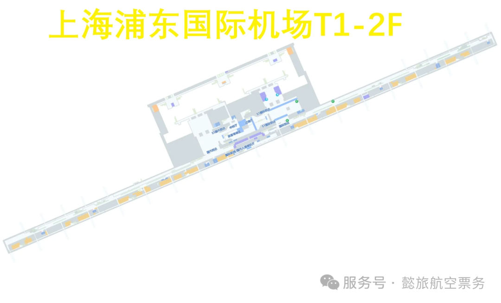

❤️❤️❤️ Şanghay Pudong Uluslararası Havalimanı, alan bakımından Çin'in en büyük havalimanıdır. 57 km² kaplar — Makao'nun tüm kara alanından daha büyük — ve beş piste, yılda 50 milyondan fazla yolcuya sahiptir.

## Terminaller ve uydu salonları

👉👉👉 Pudong'da iki terminal (T1 ve T2) ve iki uydu salonu (S1 ve S2) vardır.

- ✅ **T1**: iç ve dış hatlar, üç kat — varışlar 1F ve 2F'de, kalkışlar 3F'de.
- ✅ **S1 uydu salonu**: iç ve dış hatlar, dört kat — varışlar 1F ve MF'de, 2F'de varış ve kalkışların karışık olduğu bir kat, kalkışlar 3F'de.
- ✅ **T2**: iç ve dış hatlar, dört kat — varışlar 1F, 2F ve MF'de, kalkışlar 3F'de.
- ✅ **S2 uydu salonu**: iç ve dış hatlar, dört kat — varışlar 1F ve MF'de, 2F'de karma kat, kalkışlar 3F'de.

⚠️⚠️⚠️ Not: S1 ile S2'yi cam bir bölme ayırır — ikisi arasında geçiş yapamazsınız.

## Kat şemaları

👉👉👉 Ayrıntılı kat şemaları aşağıdadır:

- T1-1F ➡️ Şekil 2
- T1-2F ➡️ Şekil 3
- T1-3F ➡️ Şekil 4
- S1-1F ➡️ Şekil 5
- S1-MF ➡️ Şekil 6
- S1-2F ➡️ Şekil 7
- S1-3F ➡️ Şekil 8
- T2-1F ➡️ Şekil 9
- T2-2F ➡️ Şekil 10
- T2-MF ➡️ Şekil 11
- T2-3F ➡️ Şekil 12
- S2-1F ➡️ Şekil 13
- S2-MF ➡️ Şekil 14
- S2-2F ➡️ Şekil 15
- S2-3F ➡️ Şekil 16

### T1

### S1

### T2

### S2

## İlgili bağlantılar

- **Bu sitede**: [Şanghay Pudong Uluslararası Havalimanı (PVG)](/airport/PVG), [Çin (CN)](/country/CN)
- **Wikipedia**: [Shanghai Pudong International Airport](https://en.wikipedia.org/wiki/Shanghai_Pudong_International_Airport)
- **Baidu Baike**: [Shanghai Pudong International Airport](https://baike.baidu.com/item/%E4%B8%8A%E6%B5%B7%E6%B5%A6%E4%B8%9C%E5%9B%BD%E9%99%85%E6%9C%BA%E5%9C%BA)
