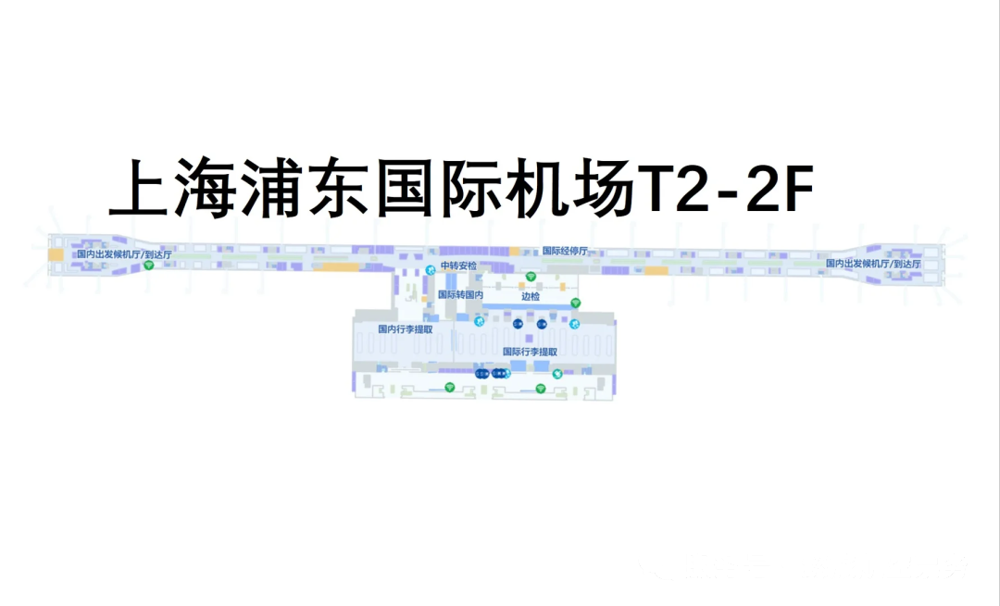

❤️❤️❤️ Міжнародний аеропорт Шанхай Пудун — найбільший за площею аеропорт Китаю. Він займає 57 км² — більше за всю суходільну площу Макао — і має п’ять злітно-посадкових смуг та понад 50 мільйонів пасажирів на рік.

## Термінали та сателітні зали

👉👉👉 У Пудуні два термінали (T1 і T2) і два сателітні зали (S1 і S2).

- ✅ **T1**: внутрішні та міжнародні рейси, три поверхи — прибуття на 1-му й 2-му поверхах, відправлення на 3-му.
- ✅ **Сателітний зал S1**: внутрішні та міжнародні рейси, чотири поверхи — прибуття на 1-му поверсі й мезоніні, змішаний поверх прибуття та відправлення на 2-му, відправлення на 3-му.
- ✅ **T2**: внутрішні та міжнародні рейси, чотири поверхи — прибуття на 1-му й 2-му поверхах та мезоніні, відправлення на 3-му.
- ✅ **Сателітний зал S2**: внутрішні та міжнародні рейси, чотири поверхи — прибуття на 1-му поверсі й мезоніні, змішаний поверх на 2-му, відправлення на 3-му.

⚠️⚠️⚠️ Зверніть увагу: S1 і S2 розділяє скляна перегородка — перейти з одного залу до іншого неможливо.

## Поетажні схеми

👉👉👉 Далі наведено детальні поетажні схеми:

- T1-1F ➡️ Рисунок 2
- T1-2F ➡️ Рисунок 3
- T1-3F ➡️ Рисунок 4
- S1-1F ➡️ Рисунок 5
- S1-MF ➡️ Рисунок 6
- S1-2F ➡️ Рисунок 7
- S1-3F ➡️ Рисунок 8
- T2-1F ➡️ Рисунок 9
- T2-2F ➡️ Рисунок 10
- T2-MF ➡️ Рисунок 11
- T2-3F ➡️ Рисунок 12
- S2-1F ➡️ Рисунок 13
- S2-MF ➡️ Рисунок 14
- S2-2F ➡️ Рисунок 15
- S2-3F ➡️ Рисунок 16

### T1

### S1

### T2

### S2

## Пов’язані посилання

- **На цьому сайті**: [Міжнародний аеропорт Шанхай Пудун (PVG)](/airport/PVG), [Китай (CN)](/country/CN)
- **Вікіпедія**: [Міжнародний аеропорт Шанхай Пудун](https://en.wikipedia.org/wiki/Shanghai_Pudong_International_Airport)
- **Baidu Baike**: [Міжнародний аеропорт Шанхай Пудун](https://baike.baidu.com/item/%E4%B8%8A%E6%B5%B7%E6%B5%A6%E4%B8%9C%E5%9B%BD%E9%99%85%E6%9C%BA%E5%9C%BA)
