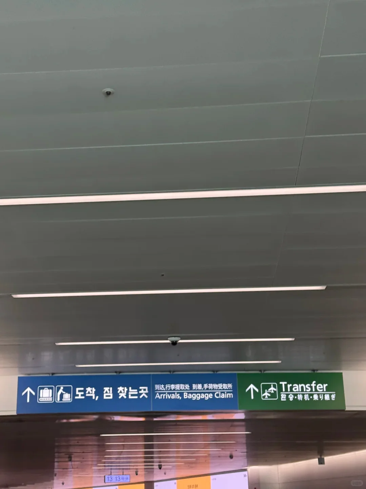

No hay vuelo directo de Shenyang a Nueva York. La ruta habitual hace una escala en Seúl: un salto corto de Taoxian a Incheon y luego un vuelo transpacífico, normalmente con la misma aerolínea, Korean Air por ejemplo. Con un solo billete, el equipaje se factura hasta Nueva York y las dos tarjetas de embarque se emiten en Shenyang, así que la conexión no requiere recoger maletas ni volver a facturar. Los horarios de largo radio de Incheon son densos y sus transbordos se quedan dentro de una misma terminal, lo que hace el cambio más tranquilo que en la mayoría de los hubs.

Todas las cifras que siguen son puntos de referencia; prevalecen los avisos vigentes de la aerolínea y del aeropuerto.

## 1. Cómo encaja la ruta

De Shenyang Taoxian (SHE) a Incheon se tarda unos noventa minutos. De Incheon a Nueva York JFK es un tramo transpacífico de 13–14 horas; al volar hacia el este cruzando la línea de cambio de fecha, la salida y la llegada suelen caer en la misma fecha local. Los dos tramos no pueden ser más distintos: uno apenas da para una película, el otro da para dos siestas.

Con un horario típico sales de Shenyang por la mañana, llegas a Incheon hacia el mediodía, vuelas a la mañana siguiente y aterrizas en Nueva York hacia el mediodía del mismo día. Los dos horarios a menudo no encajan, y así aparece una noche en Seúl; Incheon tiene hoteles de tránsito, y una cama gana a diez horas en un asiento de cabina. Al reservar, comprueba si la conexión es el mismo día y si las maletas están etiquetadas hasta Nueva York o solo hasta Incheon.

Nueva York va 12 horas por detrás de Pekín en verano y 13 en invierno, así que deja el primer día ligero.

## 2. Shenyang Taoxian: facturación, documentos y equipaje facturado de extremo a extremo

Llega al aeropuerto dos horas y media antes. Las salidas internacionales están en la Terminal 3, con los mostradores de Korean Air en la misma planta; suelen cerrar 60 minutos antes de la salida.

En la facturación se verifica tu pasaporte (seis meses de validez), un visado estadounidense válido y si tu inscripción en EVUS está al día. Los titulares de pasaporte chino con un visado B1/B2 de diez años deben confirmar el EVUS antes de cada viaje a EE. UU.; una inscripción suele durar dos años. Los pasaportes del Programa de Exención de Visado usan ESTA en su lugar. El mostrador también mirará tu billete de continuación o de vuelta.

Los titulares de pasaporte chino que hagan tránsito en Incheon también deberían comprobar las normas coreanas de tránsito: con un billete de continuación, sin entrada al país y con un visado estadounidense válido (u otro que cumpla los requisitos), la ruta de tránsito sin pasar por inmigración suele funcionar, pero la política cambia; confírmalo con la aerolínea o con la embajada coreana antes de salir. Si piensas entrar en Seúl para pasar una noche, necesitas un visado coreano o cumplir los requisitos para entrar sin visado.

También es el momento de confirmar tu asiento y tu comida especial en el tramo largo: trece horas son más llevaderas en un asiento de ventanilla o de pasillo lejos de los baños.

Con un solo billete obtienes las dos tarjetas de embarque y la maleta se etiqueta hasta Nueva York. Con billetes separados, o con unos días en Seúl, lo normal es que la maleta se quede en Incheon y haya que recogerla y volver a facturarla.

Sal por los canales electrónicos automáticos: pasaporte, huellas, seguridad. Los agentes de frontera pueden preguntarte el motivo y la duración de la estancia. Las baterías externas se quedan en cabina.

## 3. Terminal 2 de Incheon: seguridad de tránsito y mostrador de transbordos

Korean Air usa la Terminal 2 en Incheon, y los pasajeros en conexión se quedan en el edificio. Sigue los carteles verdes de «Transfer», no los azules de «Arrivals»: los canales se separan en un cruce, y el equivocado significa pasar por inmigración coreana. Algunos socios llegan a la Terminal 1, donde la lanzadera gratuita entre terminales añade unos 30 minutos.

Los pasajeros en tránsito pasan un control de seguridad en el nivel 2 y luego suben a las puertas del nivel 3. El mostrador de transbordos justo fuera de la seguridad gestiona cambios de reserva y confirmación de asiento. El embarque empieza 30–40 minutos antes de la salida, y la planta de puertas tiene tiendas, restaurantes y duchas; las salas VIP se pueden reservar por horas.

| Situación | Tiempo a dejar | Por qué |
| --- | --- | --- |
| Un billete, conexión el mismo día | 2 horas o más | La seguridad de tránsito puede tener cola |
| Dos billetes separados | 3 horas o más | No hay protección si el primer tramo se retrasa |
| Conexión con pernocta | 8 horas o más | Necesitas un hotel o un hotel de tránsito |

El tiempo mínimo de conexión del aeropuerto ronda los 45 minutos, pero ese es el caso optimista: en una primera vez, añade una hora.

Una conexión con pernocta funciona de dos maneras. Quédate en la zona restringida en un hotel de tránsito: las maletas siguen facturadas y nunca pasas por inmigración. Entra en Seúl y un titular de pasaporte chino necesita un visado coreano; los viajeros con un visado estadounidense válido en tránsito hacia Estados Unidos suelen poder entrar sin visado 30 días, pero las normas cambian a menudo, así que consulta la última nota de la embajada.

## 4. El tramo largo y la llegada a JFK

El tramo largo dura 13–14 horas en un fuselaje ancho como un A380, un 777 o un 787. Se sirven dos o tres comidas, con aperitivos entre medias, y se reparten almohadas de cuello, mantas y zapatillas. Pide una comida especial en la app de la aerolínea antes de salir; no se puede organizar a bordo.

Aterrizas en la Terminal 1 de JFK. Los no estadounidenses hacen cola en el carril de visitantes; la espera depende de cuántos vuelos lleguen a la vez, y entre veinte minutos y una hora es normal. Ten a mano el pasaporte, la impresión del EVUS, el billete de vuelta o de continuación y la reserva del hotel. Un agente de CBP normalmente solo pregunta el motivo, la duración de la estancia y dónde te alojas, y luego toma las huellas y una foto. Si te envían a inspección secundaria, explica el viaje con calma.

No se permiten móviles ni fotografías en la sala de inmigración. Recoge las maletas después de inmigración y luego pasa por aduanas: canal rojo para declarar, verde si no. Solo al cruzar esa puerta estás formalmente en Estados Unidos.

## 5. Cómo entrar en la ciudad desde JFK

Sigue los carteles del AirTrain después de aduanas. El AirTrain es gratuito entre terminales y solo se paga al salir del aeropuerto. La ruta habitual a Manhattan es el tren a Jamaica, donde pagas unos 8,50 $ y cambias al metro E, J o Z; el metro cuesta 3 $ por viaje y se paga acercando la tarjeta o el móvil a OMNY. La otra rama va a Howard Beach para el tren A. Calcula 60–90 minutos.

El Long Island Rail Road es más rápido: cambia en Jamaica y llega a Penn Station o Grand Central en unos veinte minutos, con una tarifa aparte. El AirTrain funciona día y noche, con servicio nocturno más espaciado; el tren E circula de noche, y el J y el Z se espacian después de medianoche. La mayoría de las estaciones de metro no tienen ascensor, así que dos maletas grandes significan escaleras.

Un taxi a Midtown suele costar 70 $ o más con peajes y propina; razonable con equipaje pesado; si no, el tren es más estable.

## 6. Antes de volar

- Pasaporte válido seis meses, con un visado estadounidense válido.
- EVUS impreso; ESTA si el pasaporte es del Programa de Exención de Visado.
- Números de billete, las dos tarjetas de embarque, maletas facturadas de extremo a extremo.
- Billete de vuelta y reserva de hotel; 2 horas para una conexión el mismo día, 8 para una con pernocta.
- Vuelve a comprobar las normas de tránsito de Corea y tu estado de EVUS antes de salir.
- Medicamentos en su envase original; baterías externas en cabina.

## Enlaces relacionados

- **En este sitio**: [Aeropuerto Internacional de Incheon (ICN)](/airport/ICN), [Aeropuerto Internacional John F. Kennedy (JFK)](/airport/JFK), [Corea del Sur (KR)](/country/KR), [Estados Unidos (US)](/country/US), [China (CN)](/country/CN)
- **Wikipedia**: [Incheon International Airport](https://en.wikipedia.org/wiki/Incheon_International_Airport), [John F. Kennedy International Airport](https://en.wikipedia.org/wiki/John_F._Kennedy_International_Airport)
- **Baidu Baike**: [Incheon International Airport](https://baike.baidu.com/item/%E4%BB%81%E5%B7%9D%E5%9B%BD%E9%99%85%E6%9C%BA%E5%9C%BA), [John F. Kennedy International Airport](https://baike.baidu.com/item/%E7%BA%A6%E7%BF%B0%C2%B7F%C2%B7%E8%82%AF%E5%B0%BC%E8%BF%AA%E5%9B%BD%E9%99%85%E6%9C%BA%E5%9C%BA)

Los horarios, los tiempos de conexión y las tarifas siguen la información publicada por las aerolíneas y los aeropuertos; las normas de visado y entrada siguen los últimos avisos del Ministerio de Justicia de Corea, de la Aduana y Protección Fronteriza de Estados Unidos y de los consulados correspondientes. Fuente: guía de viaje de WeChat.
