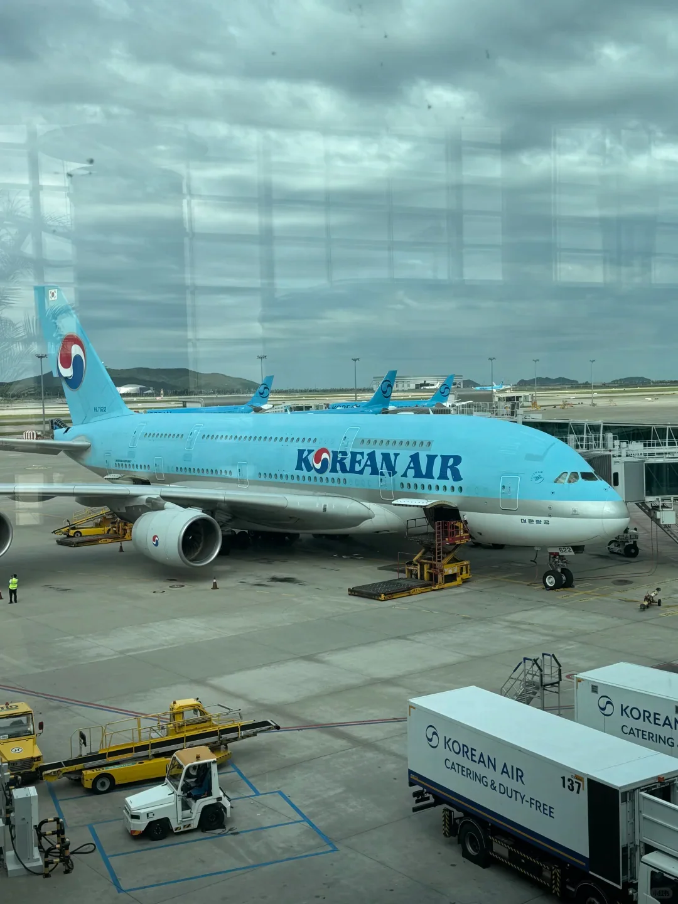
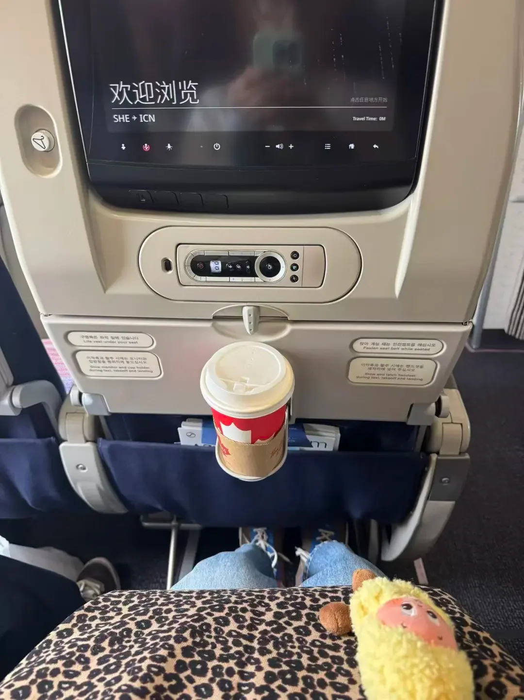
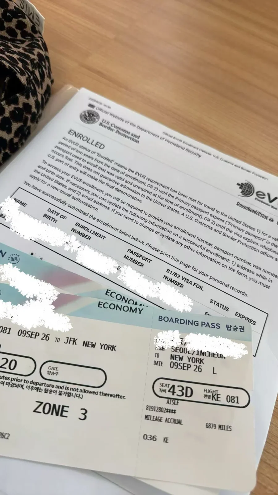
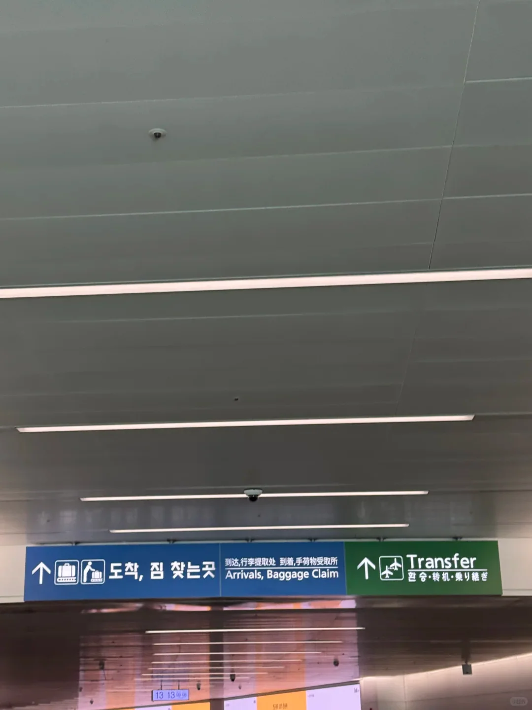
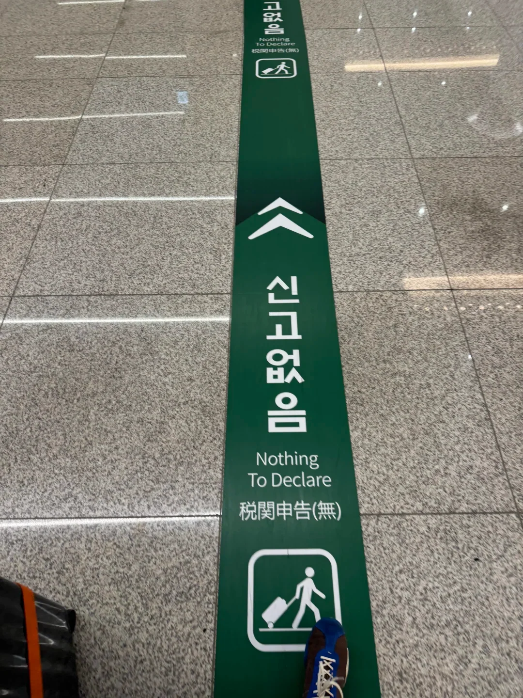
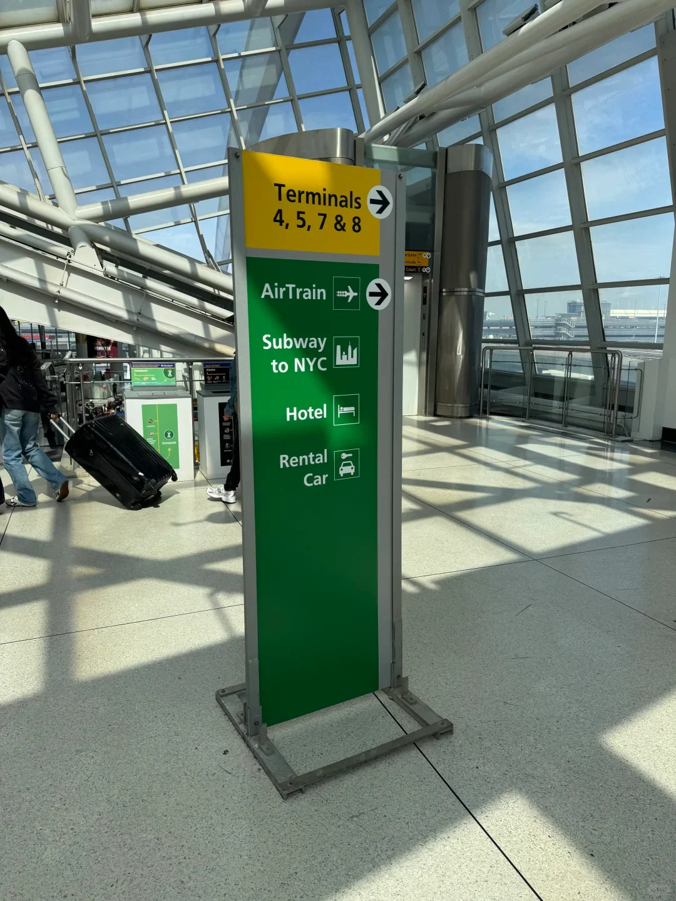

Non esiste un volo diretto da Shenyang a New York. La rotta abituale prevede uno scalo a Seul: un breve volo da Taoxian a Incheon, poi un volo transpacifico, di solito con la stessa compagnia — Korean Air, per esempio. Con un unico biglietto i bagagli sono imbarcati fino a New York ed entrambe le carte d'imbarco vengono emesse a Shenyang, quindi la coincidenza non richiede il ritiro dei bagagli né un secondo check-in. Gli orari di lungo raggio di Incheon sono densi e i transiti restano all'interno di un solo terminal, il che rende il cambio più tranquillo rispetto alla maggior parte degli hub.

Ogni cifra qui sotto è un punto di riferimento; prevalgono gli avvisi attuali della compagnia e dell'aeroporto.

## 1. Come si incastra la rotta

Da Shenyang Taoxian (SHE) a Incheon si vola per circa novanta minuti. Da Incheon a New York JFK è una tratta transpacifica di 13–14 ore; volando verso est attraverso la linea del cambiamento di data, partenza e arrivo cadono di solito nella stessa data locale. Le due tratte non potrebbero essere più diverse — una è appena un film, l'altra richiede due sonni.

Con un orario tipico si parte da Shenyang al mattino, si arriva a Incheon verso mezzogiorno, si riparte la mattina dopo e si atterra a New York verso mezzogiorno dello stesso giorno. Spesso i due orari non si allineano, ed è così che compare una notte a Seul; Incheon ha hotel di transito, e un letto batte dieci ore su un sedile di cabina. Al momento della prenotazione, controllate se la coincidenza è nello stesso giorno e se i bagagli sono etichettati per New York o solo per Incheon.

New York è 12 ore indietro rispetto a Pechino d'estate e 13 d'inverno, quindi tenete leggero il primo giorno.

## 2. Shenyang Taoxian: check-in, documenti e bagagli imbarcati fino a destinazione

Siate in aeroporto due ore e mezza prima. Le partenze internazionali sono nel Terminal 3, con i banchi Korean Air sullo stesso livello; di solito chiudono 60 minuti prima della partenza.

Il check-in verifica il passaporto (validità di sei mesi), un visto USA valido e se l'iscrizione all'EVUS è aggiornata. I titolari di passaporto cinese con visto B1/B2 di dieci anni devono confermare l'EVUS prima di ogni viaggio negli Stati Uniti; un'iscrizione dura normalmente due anni. I passaporti del Visa Waiver Program usano invece l'ESTA. Il banco controllerà anche il biglietto di proseguimento o di ritorno.

I titolari di passaporto cinese in transito a Incheon dovrebbero controllare anche le regole coreane sul transito: con un biglietto unico, senza ingresso e con un visto USA valido (o altro visto idoneo), il percorso di transito airside di solito funziona, ma la politica cambia — confermate con la compagnia o con l'ambasciata coreana prima della partenza. Se prevedete di entrare a Seul per una notte, vi serve un visto coreano o dovete avere diritto all'ingresso senza visto.

È anche il momento di confermare il posto e il pasto speciale sulla tratta lunga: tredici ore sono più facili in un posto vicino al finestrino o al corridoio, lontano dai bagni.

Con un unico biglietto ricevete entrambe le carte d'imbarco e il bagaglio è etichettato per New York. Con biglietti separati, o con qualche giorno a Seul, di solito il bagaglio si ferma a Incheon e va ritirato e riconsegnato.

Uscite attraverso i canali elettronici automatici — passaporto, impronte digitali, controlli di sicurezza. Gli agenti di frontiera possono chiedere lo scopo e la durata del soggiorno. I power bank restano in cabina.

## 3. Incheon Terminal 2: controlli di transito e banco trasferimenti

Korean Air usa il Terminal 2 a Incheon, e i passeggeri in coincidenza restano nell'edificio. Seguite le insegne verdi "Transfer", non quelle blu "Arrivals": i canali si dividono a un incrocio, e sbagliare significa passare l'immigrazione coreana. Alcuni partner arrivano al Terminal 1, dove la navetta gratuita tra terminal aggiunge circa 30 minuti.

I passeggeri in transito passano un controllo di sicurezza al livello 2, poi salgono ai gate del livello 3. Il banco trasferimenti appena fuori dai controlli gestisce le riprotezioni e la conferma dei posti. L'imbarco inizia 30–40 minuti prima della partenza, e il livello dei gate ha negozi, ristoranti e docce; i saloni si possono prenotare a ore.

| Situazione | Tempo da prevedere | Perché |
| --- | --- | --- |
| Un biglietto, coincidenza nello stesso giorno | 2 ore o più | I controlli di transito possono fare coda |
| Due biglietti separati | 3 ore o più | Nessuna protezione se il primo volo ritarda |
| Coincidenza notturna | 8 ore o più | Serve un hotel o un hotel di transito |

Il tempo minimo di coincidenza dell'aeroporto è di circa 45 minuti, ma è il caso ottimistico — alla prima esperienza aggiungete un'ora.

Una coincidenza notturna funziona in due modi. Restate airside in un hotel di transito: i bagagli restano imbarcati fino a destinazione e non passate mai l'immigrazione. Se entrate a Seul, un titolare di passaporto cinese ha bisogno di un visto coreano; i viaggiatori con un visto USA valido in transito verso gli Stati Uniti possono di solito entrare senza visto per 30 giorni, ma le regole cambiano spesso, quindi controllate l'ultima nota dell'ambasciata.

## 4. La tratta lunga e l'arrivo a JFK

La tratta lunga dura 13–14 ore su un wide-body come un A380, 777 o 787. Vengono serviti due o tre pasti, con snack nel mezzo, e vengono distribuiti cuscini da collo, coperte e pantofole. Ordinate un pasto speciale nell'app della compagnia prima della partenza; non si può organizzare a bordo.

Atterrate al Terminal 1 di JFK. I cittadini non statunitensi fanno la coda nella corsia visitatori; l'attesa dipende da quanti voli arrivano insieme, e venti minuti o un'ora sono normali. Tenete pronti passaporto, stampa dell'EVUS, biglietto di ritorno o di proseguimento e prenotazione dell'hotel. Un agente CBP di solito chiede solo lo scopo, la durata del soggiorno e dove alloggiate, poi prende impronte digitali e una foto. Se venite mandati all'ispezione secondaria, spiegate il viaggio con calma.

Nel padiglione dell'immigrazione non sono ammessi telefoni e fotografie. Ritirate i bagagli dopo l'immigrazione, poi passate la dogana — corsia rossa per dichiarare, verde se non avete nulla. Solo oltre quella porta siete formalmente negli Stati Uniti.

## 5. Raggiungere la città da JFK

Seguite le indicazioni AirTrain dopo la dogana. L'AirTrain è gratuito tra i terminal e si paga solo quando lasciate l'aeroporto. La rotta abituale per Manhattan è il treno per Jamaica, dove pagate circa 8,50 $ e cambiate con la metropolitana E, J o Z; la metropolitana costa 3 $ a corsa, pagati avvicinando la carta o il telefono a OMNY. L'altro ramo porta a Howard Beach per il treno A. Prevedete 60–90 minuti.

La Long Island Rail Road è più veloce: cambiate a Jamaica e raggiungete Penn Station o Grand Central in circa venti minuti, con una tariffa separata. L'AirTrain funziona 24 ore su 24 con un servizio notturno più rado; il treno E circola tutta la notte, il J e il Z si diradano dopo mezzanotte. La maggior parte delle stazioni della metropolitana non ha ascensori, quindi due valigie grandi significano scale.

Un taxi per Midtown costa di solito 70 $ o più, con pedaggi e mancia — ragionevole con bagagli pesanti; altrimenti il treno è più regolare.

## 6. Prima di volare

- Passaporto valido sei mesi, con un visto USA valido.
- EVUS stampato; ESTA per un passaporto del VWP.
- Numeri dei biglietti, entrambe le carte d'imbarco, bagagli imbarcati fino a destinazione.
- Biglietto di ritorno e prenotazione dell'hotel; 2 ore per una coincidenza nello stesso giorno, 8 per una notte.
- Ricontrollate le regole coreane sul transito e lo stato del vostro EVUS prima della partenza.
- Medicine nella confezione originale; power bank in cabina.

## Link correlati

- **Su questo sito**: [Aeroporto internazionale di Incheon (ICN)](/airport/ICN), [Aeroporto internazionale John F. Kennedy (JFK)](/airport/JFK), [Corea del Sud (KR)](/country/KR), [Stati Uniti (US)](/country/US), [Cina (CN)](/country/CN)
- **Wikipedia**: [Incheon International Airport](https://en.wikipedia.org/wiki/Incheon_International_Airport), [John F. Kennedy International Airport](https://en.wikipedia.org/wiki/John_F._Kennedy_International_Airport)
- **Baidu Baike**: [Incheon International Airport](https://baike.baidu.com/item/%E4%BB%81%E5%B7%9D%E5%9B%BD%E9%99%85%E6%9C%BA%E5%9C%BA), [John F. Kennedy International Airport](https://baike.baidu.com/item/%E7%BA%A6%E7%BF%B0%C2%B7F%C2%B7%E8%82%AF%E5%B0%BC%E8%BF%AA%E5%9B%BD%E9%99%85%E6%9C%BA%E5%9C%BA)

Orari, tempi di coincidenza e tariffe seguono le informazioni pubblicate dalle compagnie e dagli aeroporti; le regole sui visti e sull'ingresso seguono le ultime comunicazioni del Ministero della Giustizia coreano, della US Customs and Border Protection e dei consolati competenti. Fonte: WeChat travel guide.
