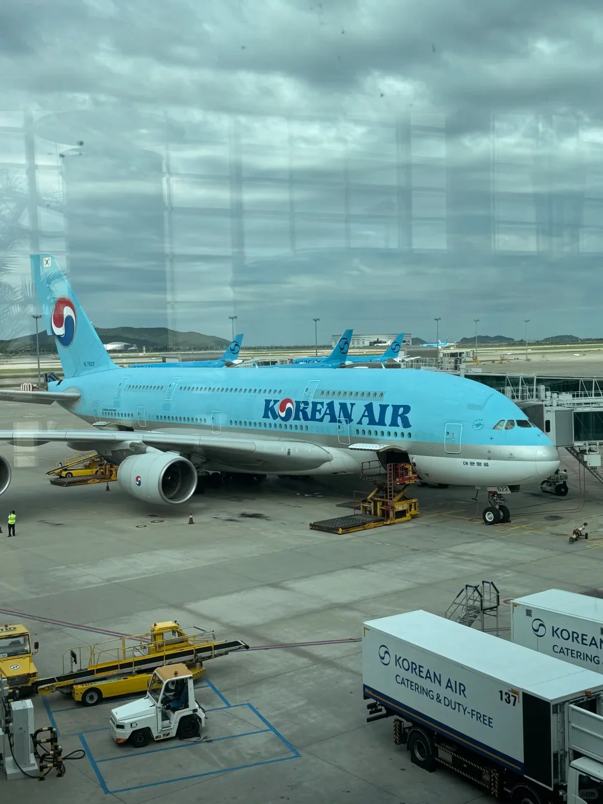
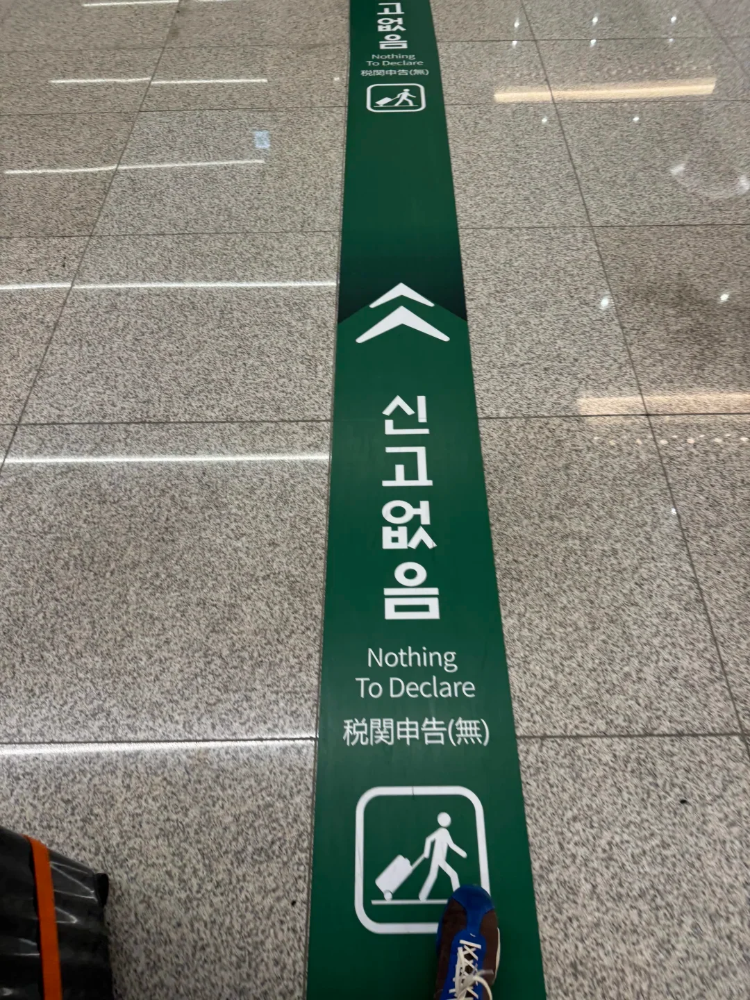

Nie ma bezpośredniego połączenia z Shenyang do Nowego Jorku. Zwykle trasa prowadzi przez jedną przesiadkę w Seulu: krótki przelot z Taoxian do Inczon, a potem lot transpacyficzny, najczęściej tymi samymi liniami — na przykład Korean Air. Na jednym bilecie bagaże są odprawione aż do Nowego Jorku, a obie karty pokładowe wydawane są w Shenyang, więc przesiadka nie wymaga odbioru bagażu ani drugiej odprawy. Rozkład lotów długodystansowych w Inczon jest gęsty, a przesiadki odbywają się w obrębie jednego terminalu, co czyni ją spokojniejszą zmianą niż na większości hubów.

Wszystkie poniższe liczby są punktem odniesienia; decydują aktualne komunikaty linii lotniczej i lotniska.

## 1. Jak układają się odcinki trasy

Shenyang Taoxian (SHE) – Inczon to około dziewięćdziesięciu minut. Inczon – Nowy Jork JFK to transpacyficzny odcinek trwający 13–14 godzin; lecąc na wschód przez linię zmiany daty, odlot i przylot zwykle wypadają tego samego dnia lokalnego. Te dwa odcinki trudno sobie wyobrazić bardziej różne — na jednym ledwie obejrzysz film, na drugim prześpisz się dwa razy.

W typowym rozkładzie z Shenyang wylatujesz rano, około południa jesteś w Inczon, następnego ranka ruszasz dalej i lądujesz w Nowym Jorku około południa tego samego dnia. Te dwa rozkłady często do siebie nie pasują — i tak pojawia się noc w Seulu; w Inczon są hotele tranzytowe, a łóżko jest lepsze niż dziesięć godzin w fotelu kabinowym. Przy rezerwacji sprawdź, czy przesiadka jest tego samego dnia i czy bagaż jest nadany do Nowego Jorku, czy tylko do Inczon.

Nowy Jork jest 12 godzin za Pekinem latem, a 13 zimą, więc pierwszy dzień zaplanuj lekko.

## 2. Shenyang Taoxian: odprawa, dokumenty i bagaż odprawiony do celu

Bądź na lotnisku dwie i pół godziny wcześniej. Odloty międzynarodowe odbywają się w terminalu 3, a stanowiska Korean Air są na tym samym poziomie; zwykle zamykają się 60 minut przed odlotem.

Podczas odprawy sprawdzany jest paszport (ważność sześciu miesięcy), ważna wiza amerykańska oraz aktualność wpisu w EVUS. Posiadacze paszportu chińskiego z dziesięcioletnią wizą B1/B2 muszą potwierdzić EVUS przed każdą podróżą do USA; jeden wpis zwykle obowiązuje dwa lata. Paszporty objęte programem Visa Waiver Program korzystają z ESTA. Stanowisko sprawdzi też bilet na dalszy odcinek lub bilet powrotny.

Posiadacze chińskiego paszportu przesiadający się w Inczon powinni też sprawdzić koreańskie przepisy tranzytowe: przy bilecie łączonym, braku wjazdu i ważnej wizie amerykańskiej (lub innej uprawniającej) trasa transferu po stronie airside zwykle działa, ale przepisy się zmieniają — potwierdź je u przewoźnika lub w koreańskiej ambasadzie przed wyjazdem. Jeśli planujesz wjazd do Seulu na noc, potrzebujesz wizy koreańskiej albo musisz spełniać warunki ruchu bezwizowego.

To także moment, by potwierdzić miejsce i specjalny posiłek na długim odcinku: trzynaście godzin łatwiej znieść przy oknie lub przy przejściu, z dala od toalet.

Przy jednym bilecie dostajesz obie karty pokładowe, a bagaż jest nadany do Nowego Jorku. Osobne bilety albo kilka dni w Seulu zwykle oznaczają, że bagaż zatrzyma się w Inczon i trzeba go odebrać oraz odprawić ponownie.

Przechodzisz przez automatyczne bramki elektroniczne — paszport, odciski palców, kontrola bezpieczeństwa. Funkcjonariusze straży granicznej mogą zapytać o cel i długość pobytu. Powerbanki zostają w kabinie.

## 3. Inczon, terminal 2: kontrola w tranzycie i stanowisko transferowe

Korean Air korzysta w Inczon z terminalu 2, a pasażerowie przesiadający się pozostają w budynku. Idź za zielonymi znakami „Transfer", a nie niebieskimi „Arrivals": korytarze rozdzielają się na jednym rozwidleniu, a wybór złego oznacza odprawę imigracyjną w Korei. Niektórzy partnerzy przylatują na terminal 1, gdzie bezpłatny autobus wahadłowy między terminalami wydłuża podróż o około 30 minut.

Pasażerowie tranzytowi przechodzą jedną kontrolę bezpieczeństwa na poziomie 2, a następnie udają się na poziom 3 do bramek. Stanowisko transferowe tuż za kontrolą zajmuje się przebukowaniem i potwierdzaniem miejsc. Boarding zaczyna się 30–40 minut przed odlotem, a na poziomie bramek są sklepy, restauracje i prysznice; saloniki można rezerwować na godziny.

| Sytuacja | Zarezerwuj | Dlaczego |
| --- | --- | --- |
| Jeden bilet, przesiadka tego samego dnia | 2 godziny lub więcej | Przy kontroli w tranzycie mogą być kolejki |
| Dwa osobne bilety | 3 godziny lub więcej | Brak ochrony, jeśli pierwszy odcinek się opóźni |
| Przesiadka z noclegiem | 8 godzin lub więcej | Potrzebujesz hotelu lub hotelu tranzytowego |

Minimalny czas przesiadki na lotnisku to około 45 minut, ale to wariant optymistyczny — przy pierwszym razie dodaj godzinę.

Przesiadka z noclegiem ma dwa warianty. Zostań po stronie airside w hotelu tranzytowym: bagaż pozostaje odprawiony do celu, a ty nie przechodzisz odprawy imigracyjnej. Jeśli wyjdziesz do Seulu, posiadacz chińskiego paszportu potrzebuje wizy koreańskiej; podróżni z ważną wizą amerykańską w tranzycie do USA mogą zwykle wjechać bez wizy na 30 dni, ale przepisy często się zmieniają, więc sprawdź najnowszy komunikat ambasady.

## 4. Długi odcinek i przylot na JFK

Długi odcinek trwa 13–14 godzin w szerokokadłubowym samolocie, takim jak A380, 777 czy 787. Podawane są dwa lub trzy posiłki, z przekąskami pomiędzy, a rozdawane są poduszki pod szyję, koce i kapcie. Specjalny posiłek zamów w aplikacji linii przed odlotem; na pokładzie nie da się go zorganizować.

Lądujesz na terminalu 1 JFK. Obywatele krajów innych niż USA stoją w kolejce dla odwiedzających; czas oczekiwania zależy od tego, ile samolotów przylatuje jednocześnie, a normalne jest od dwudziestu minut do godziny. Miej przygotowany paszport, wydruk EVUS, bilet powrotny lub na dalszy odcinek i rezerwację hotelu. Funkcjonariusz CBP zwykle pyta tylko o cel podróży, długość pobytu i miejsce zakwaterowania, a potem pobiera odciski palców i zdjęcie. Jeśli zostaniesz skierowany do dodatkowej kontroli, spokojnie wyjaśnij podróż.

W hali imigracyjnej nie wolno używać telefonów ani robić zdjęć. Po odprawie imigracyjnej odbierz bagaż, a następnie przejdź kontrolę celną — czerwony korytarz, jeśli masz coś do zgłoszenia, zielony, jeśli nie. Dopiero za tymi drzwiami formalnie jesteś w Stanach Zjednoczonych.

## 5. Jak dostać się z JFK do miasta

Po kontroli celnej idź za znakami AirTrain. AirTrain jest bezpłatny między terminalami i płatny dopiero przy wyjeździe z lotniska. Typowa trasa na Manhattan prowadzi pociągiem do Jamaica, gdzie płacisz około 8,50 USD i przesiadasz się na metro linii E, J lub Z; przejazd metrem kosztuje 3 USD i płaci się, zbliżając kartę lub telefon do czytnika OMNY. Druga odnoga prowadzi do Howard Beach, skąd odjeżdża pociąg A. Zarezerwuj 60–90 minut.

Long Island Rail Road jest szybsza: przesiadasz się na Jamaica i w około dwadzieścia minut dojeżdżasz do Penn Station lub Grand Central, za osobną opłatę. AirTrain kursuje całą dobę, ale nocą rzadziej; pociąg E jeździ przez całą noc, a J i Z przerzedzają się po północy. Większość stacji metra nie ma wind, więc dwie duże walizki oznaczają schody.

Taksówka na Midtown to zwykle 70 USD lub więcej wraz z opłatami za przejazd i napiwkiem — rozsądne z ciężkimi bagażami; w przeciwnym razie pociąg jest pewniejszy.

## 6. Przed wyjazdem

- Paszport ważny sześć miesięcy, z ważną wizą amerykańską.
- Wydrukowany EVUS; ESTA przy paszporcie objętym VWP.
- Numery biletów, obie karty pokładowe, bagaż odprawiony do celu.
- Bilet powrotny i rezerwacja hotelu; 2 godziny na przesiadkę tego samego dnia, 8 na przesiadkę z noclegiem.
- Przed wyjazdem ponownie sprawdź koreańskie przepisy tranzytowe i status EVUS.
- Leki w oryginalnym opakowaniu; powerbanki w kabinie.

## Powiązane linki

- **Na tej stronie**: [Port lotniczy Inczon (ICN)](/airport/ICN), [Port lotniczy im. Johna F. Kennedy'ego (JFK)](/airport/JFK), [Korea Południowa (KR)](/country/KR), [Stany Zjednoczone (US)](/country/US), [Chiny (CN)](/country/CN)
- **Wikipedia**: [Port lotniczy Inczon](https://en.wikipedia.org/wiki/Incheon_International_Airport), [Port lotniczy im. Johna F. Kennedy'ego](https://en.wikipedia.org/wiki/John_F._Kennedy_International_Airport)
- **Baidu Baike**: [Port lotniczy Inczon](https://baike.baidu.com/item/%E4%BB%81%E5%B7%9D%E5%9B%BD%E9%99%85%E6%9C%BA%E5%9C%BA), [Port lotniczy im. Johna F. Kennedy'ego](https://baike.baidu.com/item/%E7%BA%A6%E7%BF%B0%C2%B7F%C2%B7%E8%82%AF%E5%B0%BC%E8%BF%AA%E5%9B%BD%E9%99%85%E6%9C%BA%E5%9C%BA)

Rozkłady, czasy przesiadek i ceny biletów opierają się na publikowanych informacjach linii lotniczych i lotnisk; zasady wizowe i wjazdowe — na najnowszych komunikatach koreańskiego Ministerstwa Sprawiedliwości, amerykańskiej agencji Customs and Border Protection i właściwych konsulatów. Źródło: przewodnik podróżniczy na WeChat.
