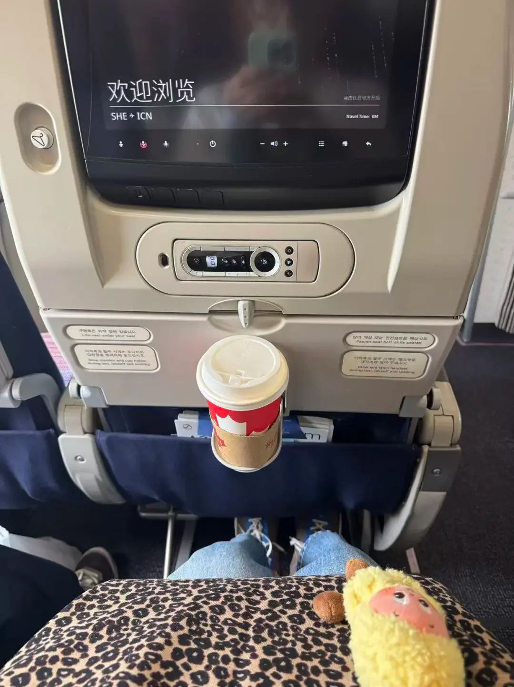

Nu există zbor direct de la Shenyang la New York. Ruta obișnuită are o singură escală, la Seul: un zbor scurt de la Taoxian la Incheon, apoi un segment peste Pacific, de obicei cu aceeași companie aeriană — de exemplu Korean Air. Cu un singur bilet, bagajele sunt înregistrate până la New York și ambele cartele de îmbarcare sunt emise la Shenyang, așa că legătura nu presupune ridicarea bagajelor și nici un al doilea check-in. Orarul de lung curier al Incheonului este dens, iar transferurile se fac în interiorul unui singur terminal, ceea ce face escala mai relaxată decât în majoritatea huburilor.

Toate cifrele de mai jos sunt orientative; contează anunțurile actuale ale companiei aeriene și ale aeroportului.

## 1. Cum se leagă ruta

De la Shenyang Taoxian (SHE) la Incheon durează aproximativ nouăzeci de minute. De la Incheon la New York JFK este un segment peste Pacific de 13–14 ore; zburând spre est peste linia de schimbare a datei, plecarea și sosirea cad de obicei în aceeași zi locală. Cele două segmente nu pot fi mai diferite — unul ține cât un singur film, celălalt cât două somnuri.

Pe un orar tipic pleci din Shenyang dimineața, ajungi la Incheon în jur de amiază, pleci mai departe a doua zi dimineață și aterizezi la New York în jur de amiază în aceeași zi. De multe ori cele două orare nu se aliniază, iar de aici apare o noapte la Seul; Incheon are hoteluri de tranzit, iar un pat este mai bun decât zece ore pe scaunul din cabină. Când faci rezervarea, verifică dacă legătura este în aceeași zi și dacă bagajele sunt etichetate până la New York sau doar până la Incheon.

New York este cu 12 ore în urma Beijingului vara și cu 13 iarna, așa că ține-ți prima zi lejeră.

## 2. Shenyang Taoxian: check-in, documente și bagaje înregistrate până la destinație

Fii la aeroport cu două ore și jumătate înainte. Plecările internaționale sunt în Terminalul 3, iar ghișeele Korean Air se află la același nivel; de obicei se închid cu 60 de minute înainte de plecare.

La check-in se verifică pașaportul (valabilitate de șase luni), o viză americană valabilă și dacă înregistrarea EVUS este la zi. Deținătorii unui pașaport chinezesc cu viză B1/B2 de zece ani trebuie să confirme EVUS înainte de fiecare călătorie în SUA; o înregistrare durează de obicei doi ani. Pentru pașapoartele din Programul de scutire de viză se folosește în schimb ESTA. Ghișeul va verifica și biletul de continuare sau de întoarcere.

Deținătorii de pașaport chinezesc care tranzitează Incheon ar trebui să verifice și regulile coreene de tranzit: cu un bilet unic, fără intrare în țară și cu o viză americană valabilă (sau altă viză eligibilă), ruta de transfer în zona aeroportuară funcționează de obicei, dar politica se schimbă — confirmă cu compania aeriană sau cu ambasada Coreei înainte de plecare. Dacă intenționezi să intri în Seul pentru o noapte, ai nevoie de viză coreeană sau trebuie să îndeplinești condițiile pentru intrarea fără viză.

Este și momentul să confirmi locul și meniul special pentru segmentul lung: treisprezece ore sunt mai ușoare într-un loc la geam sau la culoar, departe de toalete.

Cu un singur bilet primești ambele cartele de îmbarcare și bagajul este etichetat până la New York. Cu bilete separate sau cu câteva zile petrecute la Seul, bagajul se oprește de obicei la Incheon și trebuie ridicat și înregistrat din nou.

Ieși prin canalele electronice automate — pașaport, amprente, securitate. Polițiștii de frontieră pot întreba care este scopul și durata șederii. Bateriile externe rămân în cabină.

## 3. Terminalul 2 Incheon: securitatea pentru tranzit și biroul de transfer

Korean Air folosește Terminalul 2 la Incheon, iar pasagerii în legătură rămân în clădire. Urmează indicatoarele verzi „Transfer”, nu pe cele albastre „Arrivals”: canalele se despart la o singură bifurcație, iar alegerea greșită înseamnă trecerea prin controlul de imigrare coreean. Câțiva parteneri sosesc în Terminalul 1, unde naveta gratuită între terminale adaugă circa 30 de minute.

Pasagerii în tranzit trec printr-un singur control de securitate la nivelul 2, apoi urcă la porțile de la nivelul 3. Biroul de transfer de lângă zona de securitate se ocupă de rerezevări și de confirmarea locurilor. Îmbarcarea începe cu 30–40 de minute înainte de plecare, iar la nivelul porților există magazine, restaurante și dușuri; saloanele pot fi rezervate cu ora.

| Situație | Timp de prevăzut | Motiv |
| --- | --- | --- |
| Un singur bilet, legătură în aceeași zi | 2 ore sau mai mult | La securitatea pentru tranzit pot fi cozi |
| Două bilete separate | 3 ore sau mai mult | Nu există protecție dacă primul segment are întârziere |
| Legătură peste noapte | 8 ore sau mai mult | Ai nevoie de un hotel sau de un hotel de tranzit |

Timpul minim de legătură al aeroportului este de aproximativ 45 de minute, dar acesta este cazul optimist — la prima încercare, adaugă o oră.

O legătură peste noapte se poate face în două feluri. Rămâi în zona aeroportuară, la un hotel de tranzit: bagajele rămân înregistrate până la destinație și nu treci deloc prin imigrare. Dacă intri în Seul, un deținător de pașaport chinezesc are nevoie de viză coreeană; călătorii cu viză americană valabilă care tranzitează spre Statele Unite pot intra de obicei fără viză pentru 30 de zile, dar regulile se schimbă des, așa că verifică ultima notă a ambasadei.

## 4. Segmentul lung și sosirea la JFK

Segmentul lung durează 13–14 ore pe un avion wide-body precum A380, 777 sau 787. Se servesc două sau trei mese, cu gustări între ele, și se distribuie perne de gât, pături și papuci. Comandă meniul special din aplicația companiei înainte de plecare; nu poate fi aranjat la bord.

Aterizezi la Terminalul 1 JFK. Cetățenii străini stau la rând pe culoarul pentru vizitatori; așteptarea depinde de câte zboruri sosesc simultan, iar între douăzeci de minute și o oră este normal. Ai la îndemână pașaportul, tipăritura EVUS, biletul de întoarcere sau de continuare și rezervarea la hotel. Un ofițer CBP întreabă de obicei doar scopul, durata șederii și unde stai, apoi ia amprentele și o fotografie. Dacă ești trimis la verificare secundară, explică-ți călătoria calm.

Telefoanele și fotografiile nu sunt permise în sala de imigrare. Ridică bagajele după imigrare, apoi treci prin vamă — culoarul roșu pentru a declara, cel verde dacă nu ai nimic de declarat. Abia după acea ușă ești oficial în Statele Unite.

## 5. De la JFK în oraș

După vamă, urmează indicatoarele spre AirTrain. AirTrain este gratuit între terminale și se plătește doar când părăsești aeroportul. Ruta obișnuită spre Manhattan este trenul până la Jamaica, unde plătești circa 8,50 $ și schimbi cu metroul E, J sau Z; metroul costă 3 $ pe cursă, plătit prin apropierea cardului sau a telefonului de cititorul OMNY. Cealaltă ramură merge la Howard Beach, pentru trenul A. Prevede 60–90 de minute.

Long Island Rail Road este mai rapid: schimbi la Jamaica și ajungi la Penn Station sau Grand Central în circa douăzeci de minute, cu o taxă separată. AirTrain circulă non-stop, cu o frecvență mai rară noaptea târziu; trenul E circulă peste noapte, iar J și Z se răresc după miezul nopții. Majoritatea stațiilor de metrou nu au lifturi, așa că două valize mari înseamnă scări.

Un taxi până în Midtown costă de obicei 70 $ sau mai mult, cu taxe de drum și bacșiș — rezonabil dacă ai bagaje grele; altfel, trenul este mai stabil.

## 6. Înainte de zbor

- Pașaport valabil șase luni, cu o viză americană valabilă.
- EVUS tipărit; ESTA pentru un pașaport din programul VWP.
- Numerele biletelor, ambele cartele de îmbarcare, bagajele înregistrate până la destinație.
- Bilet de întoarcere și rezervare la hotel; 2 ore pentru o legătură în aceeași zi, 8 pentru una peste noapte.
- Reverifică regulile de tranzit ale Coreei și starea EVUS înainte de plecare.
- Medicamente în ambalajul original; baterii externe în cabină.

## Linkuri utile

- **Pe acest site**: [Aeroportul Internațional Incheon (ICN)](/airport/ICN), [Aeroportul Internațional John F. Kennedy (JFK)](/airport/JFK), [Coreea de Sud (KR)](/country/KR), [Statele Unite (US)](/country/US), [China (CN)](/country/CN)
- **Wikipedia**: [Aeroportul Internațional Incheon](https://en.wikipedia.org/wiki/Incheon_International_Airport), [Aeroportul Internațional John F. Kennedy](https://en.wikipedia.org/wiki/John_F._Kennedy_International_Airport)
- **Baidu Baike**: [Aeroportul Internațional Incheon](https://baike.baidu.com/item/%E4%BB%81%E5%B7%9D%E5%9B%BD%E9%99%85%E6%9C%BA%E5%9C%BA), [Aeroportul Internațional John F. Kennedy](https://baike.baidu.com/item/%E7%BA%A6%E7%BF%B0%C2%B7F%C2%B7%E8%82%AF%E5%B0%BC%E8%BF%AA%E5%9B%BD%E9%99%85%E6%9C%BA%E5%9C%BA)

Orarele, timpii de legătură și tarifele urmează informațiile publicate de companiile aeriene și de aeroporturi; regulile de viză și de intrare urmează ultimele anunțuri ale Ministerului Justiției din Coreea, ale Serviciului Vamal și de Protecție a Frontierelor al SUA (US Customs and Border Protection) și ale consulatelor relevante. Sursă: ghid de călătorie WeChat.
