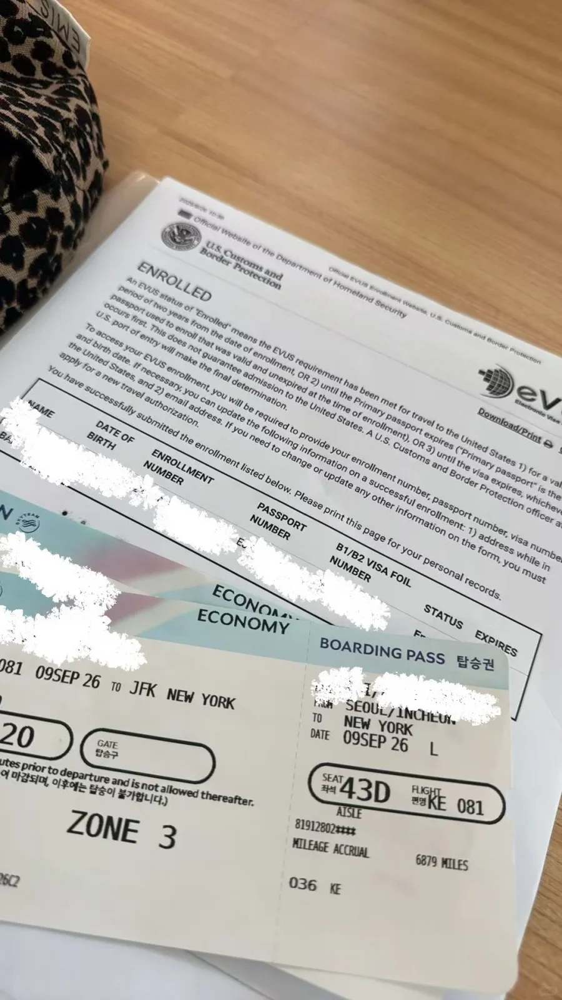
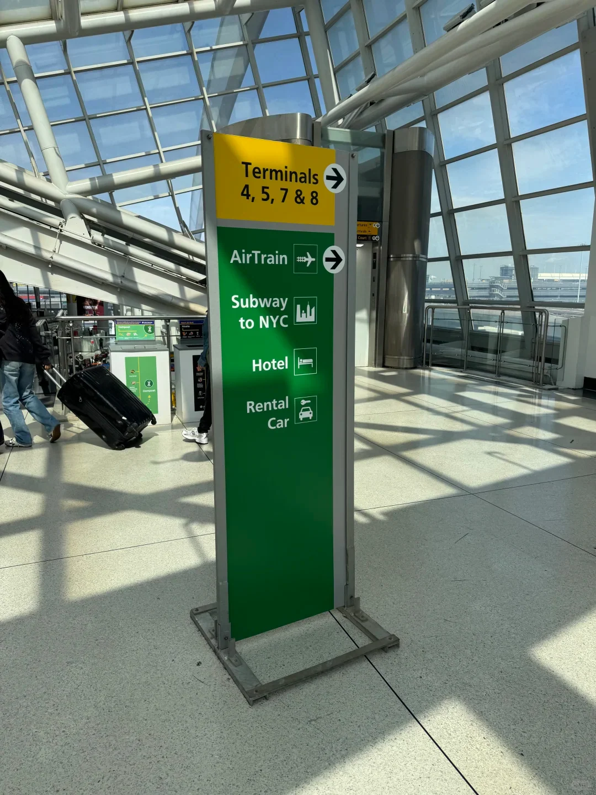

ไม่มีเที่ยวบินตรงจากเสิ่นหยางไปนิวยอร์ก เส้นทางปกติคือหยุดหนึ่งครั้งที่โซล: บินระยะสั้นจากเถาเสียนไปอินชอน แล้วต่อเที่ยวบินข้ามแปซิฟิก มักเป็นสายการบินเดียวกัน — เช่น Korean Air ด้วยตั๋วใบเดียว กระเป๋าจะถูกโหลดต่อถึงนิวยอร์กและออกบัตรขึ้นเครื่องทั้งสองใบที่เสิ่นหยาง การเปลี่ยนเครื่องจึงไม่ต้องรับกระเป๋าและไม่ต้องเช็คอินใหม่ ตารางบินระยะไกลของอินชอนหนาแน่นและการเปลี่ยนเครื่องอยู่ในอาคารเดียว ทำให้เปลี่ยนเครื่องสงบกว่าฮับส่วนใหญ่

ตัวเลขทุกตัวด้านล่างเป็นจุดอ้างอิง ประกาศล่าสุดของสายการบินและสนามบินมีผลเหนือกว่า

## 1. เส้นทางประกอบกันอย่างไร

เสิ่นหยางเถาเสียน (SHE) ไปอินชอนใช้เวลาประมาณเก้าสิบนาที อินชอนไปนิวยอร์ก JFK เป็นช่วงข้ามแปซิฟิก 13–14 ชั่วโมง บินตะวันออกข้ามเส้นแบ่งวัน เวลาออกและถึงมักตรงกับวันท้องถิ่นเดียวกัน สองช่วงต่างกันสุดขั้ว — ช่วงหนึ่งแทบดูหนังไม่จบ อีกช่วงต้องนอนสองรอบ

ตามตารางบินทั่วไป คุณออกจากเสิ่นหยางตอนเช้า ถึงอินชอนราวเที่ยง ออกบินเช้าวันถัดไปและลงนิวยอร์กประมาณเที่ยงวันเดียวกัน เวลาสองช่วงมักไม่ตรงกัน จึงเกิดการค้างคืนในโซล อินชอนมีโรงแรมทรานซิต และเตียงดีกว่าสิบชั่วโมงบนที่นั่งโดยสาร เมื่อจอง ตรวจว่าการเปลี่ยนเครื่องเป็นวันเดียวกันหรือไม่ และกระเป๋าถูกติดแท็กถึงนิวยอร์กหรือแค่อินชอน

นิวยอร์กช้ากว่าปักกิ่ง 12 ชั่วโมงในฤดูร้อนและ 13 ชั่วโมงในฤดูหนาว วันแรกจึงควรเบา ๆ

## 2. เสิ่นหยางเถาเสียน: เช็คอิน เอกสาร และกระเป๋าโหลดต่อ

ถึงสนามบินก่อนสองชั่วโมงครึ่ง ขาออกระหว่างประเทศอยู่ที่อาคารผู้โดยสาร 3 เคาน์เตอร์ Korean Air อยู่ชั้นเดียวกัน มักปิด 60 นาทีก่อนออกบิน

การเช็คอินตรวจหนังสือเดินทาง (อายุเหลือหกเดือน) วีซ่าสหรัฐที่ยังใช้ได้ และการลงทะเบียน EVUS ยังปัจจุบันหรือไม่ ผู้ถือหนังสือเดินทางจีนพร้อมวีซ่า B1/B2 สิบปีต้องยืนยัน EVUS ก่อนเดินทางไปสหรัฐทุกครั้ง การลงทะเบียนหนึ่งครั้งปกติมีอายุสองปี หนังสือเดินทางในโครงการยกเว้นวีซ่าใช้ ESTA แทน เคาน์เตอร์จะดูตั๋วต่อไปหรือตั๋วกลับด้วย

ผู้ถือหนังสือเดินทางจีนที่เปลี่ยนเครื่องที่อินชอนควรตรวจกฎการเปลี่ยนเครื่องของเกาหลีด้วย: ด้วยตั๋วต่อเนื่อง ไม่เข้าประเทศ และมีวีซ่าสหรัฐ (หรือวีซ่าที่เข้าเงื่อนไข) ที่ยังใช้ได้ เส้นทางเปลี่ยนเครื่องฝั่งในมักใช้ได้ แต่นโยบายเปลี่ยน — ยืนยันกับสายการบินหรือสถานทูตเกาหลีก่อนออกเดินทาง หากวางแผนเข้าโซลค้างคืน คุณต้องมีวีซ่าเกาหลีหรือเข้าเงื่อนไขยกเว้นวีซ่า

นี่คือจังหวะยืนยันที่นั่งและอาหารพิเศษในเที่ยวบินยาวด้วย: สิบสามชั่วโมงสบายกว่าหากได้ที่นั่งริมหน้าต่างหรือริมทางเดินห่างห้องน้ำ

ด้วยตั๋วใบเดียว คุณได้บัตรขึ้นเครื่องทั้งสองใบและกระเป๋าติดแท็กถึงนิวยอร์ก ตั๋วแยก หรือพักโซลสองสามวัน มักหมายถึงกระเป๋าหยุดที่อินชอนและต้องรับแล้วเช็คอินใหม่

ออกผ่านช่องอิเล็กทรอนิกส์อัตโนมัติ — หนังสือเดินทาง ลายนิ้วมือ ความปลอดภัย เจ้าหน้าที่ตรวจคนเข้าเมืองอาจถามวัตถุประสงค์และระยะพัก พาวเวอร์แบงก์เก็บในห้องโดยสาร

## 3. อาคารผู้โดยสาร 2 ของอินชอน: ความปลอดภัยระหว่างเปลี่ยนเครื่องและเคาน์เตอร์เปลี่ยนเครื่อง

Korean Air ใช้อาคารผู้โดยสาร 2 ที่อินชอน และผู้โดยสารเปลี่ยนเครื่องอยู่ในอาคารเดียวกัน ตามป้าย «Transfer» สีเขียว ไม่ใช่ป้าย «Arrivals» สีน้ำเงิน: ช่องทางแยกที่ทางแยกหนึ่ง และผิดทางหมายถึงต้องผ่านตรวจคนเข้าเมืองเกาหลี พันธมิตรบางรายมาถึงอาคารผู้โดยสาร 1 ซึ่งรถรับส่งฟรีระหว่างอาคารเพิ่มเวลาประมาณ 30 นาที

ผู้โดยสารเปลี่ยนเครื่องผ่านจุดตรวจความปลอดภัยหนึ่งจุดบนชั้น 2 แล้วขึ้นไปประตูขึ้นเครื่องชั้น 3 เคาน์เตอร์เปลี่ยนเครื่องนอกจุดตรวจจัดการจองใหม่และยืนยันที่นั่ง การขึ้นเครื่องเริ่ม 30–40 นาทีก่อนออกบิน และชั้นประตูมีร้านค้า ร้านอาหาร และห้องอาบน้ำ เลานจ์จองเป็นชั่วโมงได้

| สถานการณ์ | เวลาที่ควรเผื่อ | เหตุผล |
| --- | --- | --- |
| ตั๋วใบเดียว เปลี่ยนเครื่องวันเดียวกัน | 2 ชั่วโมงขึ้นไป | จุดตรวจเปลี่ยนเครื่องมีคิวได้ |
| ตั๋วแยกสองใบ | 3 ชั่วโมงขึ้นไป | ไม่มีการคุ้มครองหากเที่ยวแรกมาช้า |
| เปลี่ยนเครื่องข้ามคืน | 8 ชั่วโมงขึ้นไป | ต้องมีโรงแรมหรือโรงแรมทรานซิต |

เวลาต่อเครื่องขั้นต่ำของสนามบินอยู่ที่ประมาณ 45 นาที แต่นั่นเป็นกรณีที่โชคดีที่สุด — ครั้งแรกให้เผื่อเพิ่มหนึ่งชั่วโมง

การเปลี่ยนเครื่องข้ามคืนทำได้สองแบบ พักฝั่งในที่โรงแรมทรานซิต: กระเป๋าโหลดต่อและไม่ต้องผ่านตรวจคนเข้าเมือง เข้าโซลและผู้ถือหนังสือเดินทางจีนต้องมีวีซ่าเกาหลี; นักเดินทางที่มีวีซ่าสหรัฐใช้ได้และเปลี่ยนเครื่องไปสหรัฐมักเข้าได้โดยไม่ต้องวีซ่า 30 วัน แต่กฎเปลี่ยนบ่อย ตรวจประกาศล่าสุดของสถานทูต

## 4. เที่ยวบินยาวและการมาถึง JFK

เที่ยวบินยาวใช้เวลา 13–14 ชั่วโมงบนเครื่องลำตัวกว้างอย่าง A380, 777 หรือ 787 มีอาหารสองหรือสามมื้อพร้อมของว่างระหว่างนั้น และแจกหมอนรองคอ ผ้าห่ม และรองเท้าแตะ สั่งอาหารพิเศษในแอปสายการบินก่อนออกเดินทาง — จัดการบนเครื่องไม่ได้

คุณลงที่ JFK อาคารผู้โดยสาร 1 ผู้ที่ไม่ใช่พลเมืองสหรัฐต่อคิวช่องผู้มาเยือน เวลารอขึ้นอยู่กับจำนวนเที่ยวบินที่มาถึงพร้อมกัน ปกติ 20 นาทีถึงหนึ่งชั่วโมง เตรียมหนังสือเดินทาง ใบพิมพ์ EVUS ตั๋วกลับหรือตั๋วต่อไป และการจองโรงแรม เจ้าหน้าที่ CBP มักถามเพียงวัตถุประสงค์ ระยะพัก และที่พัก จากนั้นเก็บลายนิ้วมือและถ่ายรูป หากถูกส่งตรวจสอบรอบสอง ให้อธิบายการเดินทางอย่างสงบ

ห้ามใช้โทรศัพท์และถ่ายรูปในโถงตรวจคนเข้าเมือง รับกระเป๋าหลังตรวจคนเข้าเมือง แล้วผ่านศุลกากร — ช่องแดงเพื่อสำแดง ช่องเขียวหากไม่มีอะไรต้องสำแดง เพิ่งผ่านประตูนั้นคุณจึงเข้าสหรัฐอย่างเป็นทางการ

## 5. เข้าเมืองจาก JFK

ตามป้าย AirTrain หลังศุลกากร AirTrain ฟรีระหว่างอาคารและเก็บเงินเมื่อออกจากสนามบินเท่านั้น เส้นทางปกติไปแมนฮัตตันคือรถไฟไปจาเมกา ซึ่งคุณจ่ายประมาณ $8.50 แล้วเปลี่ยนไปรถไฟใต้ดินสาย E, J หรือ Z; รถไฟใต้ดิน $3 ต่อเที่ยว จ่ายด้วยการแตะ OMNY ด้วยบัตรหรือโทรศัพท์ อีกสายไปฮาวเวิร์ดบีชเพื่อต่อรถไฟสาย A เผื่อเวลา 60–90 นาที

Long Island Rail Road เร็วกว่า: เปลี่ยนที่จาเมกาและถึงเพนน์สเตชันหรือแกรนด์เซ็นทรัลในประมาณยี่สิบนาที ด้วยค่าโดยสารแยก AirTrain วิ่งตลอด 24 ชั่วโมงโดยบริการกลางคืนห่างขึ้น รถไฟ E วิ่งข้ามคืน ส่วน J และ Z เบาบางหลังเที่ยงคืน สถานีรถไฟใต้ดินส่วนใหญ่ไม่มีลิฟต์ กระเป๋าใหญ่สองใบจึงหมายถึงบันได

แท็กซี่ไปมิดทาวน์ปกติ $70 ขึ้นไปรวมค่าทางด่วนและทิป — สมเหตุสมผลหากกระเป๋าหนัก ไม่อย่างนั้นรถไฟมั่นคงกว่า

## 6. ก่อนบิน

- หนังสือเดินทางอายุเหลือหกเดือน พร้อมวีซ่าสหรัฐที่ยังใช้ได้
- พิมพ์ EVUS แล้ว; ESTA สำหรับหนังสือเดินทางในโครงการยกเว้นวีซ่า
- หมายเลขตั๋ว บัตรขึ้นเครื่องทั้งสองใบ กระเป๋าโหลดต่อ
- ตั๋วกลับและการจองโรงแรม; เผื่อ 2 ชั่วโมงสำหรับเปลี่ยนเครื่องวันเดียวกัน 8 ชั่วโมงสำหรับข้ามคืน
- ตรวจกฎการเปลี่ยนเครื่องของเกาหลีและสถานะ EVUS อีกครั้งก่อนออกเดินทาง
- ยาในบรรจุภัณฑ์เดิม; พาวเวอร์แบงก์ในห้องโดยสาร

## ลิงก์ที่เกี่ยวข้อง

- **ในเว็บไซต์นี้**: [สนามบินนานาชาติอินชอน (ICN)](/airport/ICN), [สนามบินนานาชาติจอห์น เอฟ. เคนเนดี (JFK)](/airport/JFK), [เกาหลีใต้ (KR)](/country/KR), [สหรัฐอเมริกา (US)](/country/US), [จีน (CN)](/country/CN)
- **Wikipedia**: [สนามบินนานาชาติอินชอน](https://en.wikipedia.org/wiki/Incheon_International_Airport), [สนามบินนานาชาติจอห์น เอฟ. เคนเนดี](https://en.wikipedia.org/wiki/John_F._Kennedy_International_Airport)
- **Baidu Baike**: [สนามบินนานาชาติอินชอน](https://baike.baidu.com/item/%E4%BB%81%E5%B7%9D%E5%9B%BD%E9%99%85%E6%9C%BA%E5%9C%BA), [สนามบินนานาชาติจอห์น เอฟ. เคนเนดี](https://baike.baidu.com/item/%E7%BA%A6%E7%BF%B0%C2%B7F%C2%B7%E8%82%AF%E5%B0%BC%E8%BF%AA%E5%9B%BD%E9%99%85%E6%9C%BA%E5%9C%BA)

ตารางบิน เวลาเปลี่ยนเครื่อง และค่าโดยสารอ้างอิงข้อมูลที่สายการบินและสนามบินเผยแพร่; กฎวีซ่าและการเข้าเมืองอ้างอิงประกาศล่าสุดจากกระทรวงยุติธรรมเกาหลี ศุลกากรและพิทักษ์ชายแดนสหรัฐ และสถานกงสุลที่เกี่ยวข้อง ที่มา: คู่มือท่องเที่ยว WeChat
