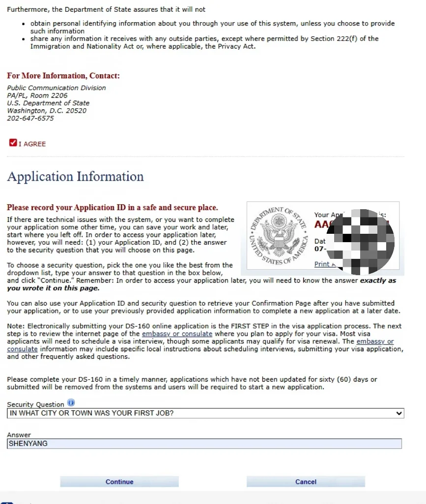
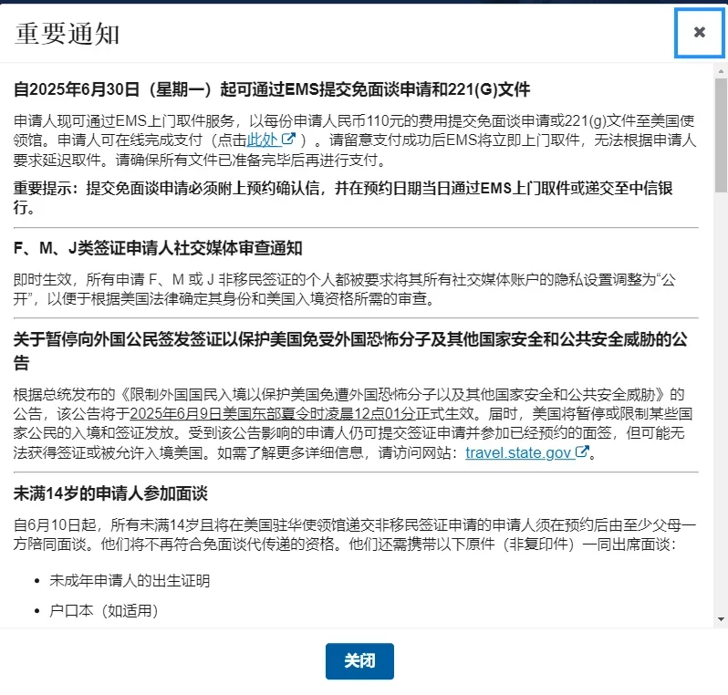
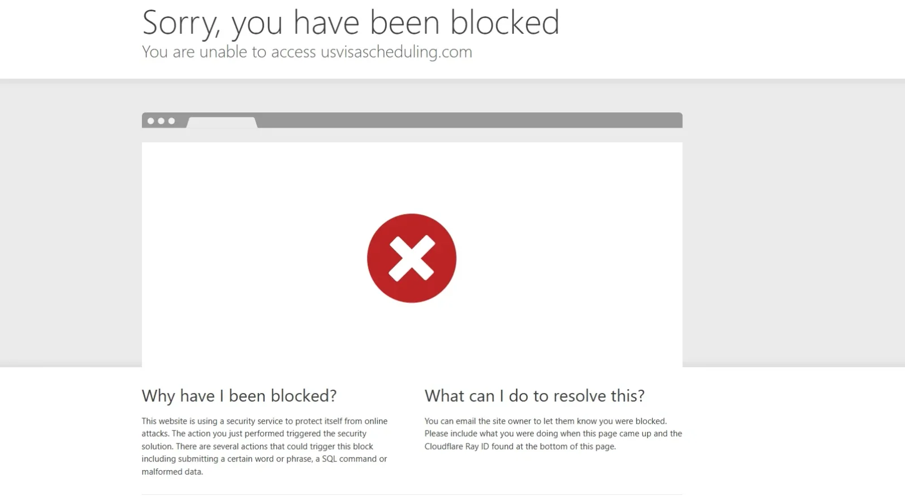

When a US B1/B2 visa nears expiry, or has just expired, many travellers renew it inside China without sitting a fresh interview. The time goes not into the form itself but into a few choices that are easy to get wrong: interview waiver or interview, how to restart after cancelling, and why the payment receipt will not load.

This guide follows the Shenyang process: documents, the DS-160, the appointment, the drop-off. Visa policy and interview-waiver eligibility have changed several times in the past two years, so the US embassy and consulate websites and the appointment system's own decision are what count. This is a description of the process, not legal advice, and no outcome is promised.

## 1. First confirm you are renewing, not applying afresh

A renewal assumes you have held the same class of visa before. For B1/B2 that usually means the previous visa was in the same category, expired within the permitted window, and that you were fingerprinted and have no refusal on record. The window has commonly been described as 12 months after expiry, but both the window and the conditions have moved repeatedly in recent years, in both directions.

So the first step is the visa page of the US mission in China, to see whether interview-waiver renewals are being accepted now. The system decides eligibility once your details are in, and that decision outranks any guide. If you are not eligible, prepare for a standard interview and book one at the Consulate General in Shenyang.

The Shenyang consulate handles non-immigrant visas for Liaoning, Jilin and Heilongjiang, at No. 52, 14th Weilu, Heping District. You pass through security on the day, and phones, laptops, power banks and large bags cannot go in; paid storage nearby is neither cheap nor reliable, so bring a clear plastic folder and little else.

## 2. Documents and photo: two days of preparation

Not much is needed, but the details are in English, and last-minute translation is what costs time:

- **Photo:** one digital copy plus two prints. The usual requirements are 51 × 51 mm, taken within six months, white background, no glasses; follow the photo page on the official site rather than reusing an old picture.
- **US address:** hotel name, street address, ZIP code, phone and email, entered field by field in the form.
- **Name telegraph codes:** look up each character of your Chinese name; the form asks for them.
- **Work, education, family:** employer name and address in English, job title and duties, school and major, spouse and parents' basic details.

Put all of it in one document to copy from while filling the form.

## 3. The DS-160: slow down and save constantly

The DS-160 lives on the CEAC site, and pages do occasionally error out, close or fail to load. That is normal rather than something you did; a different browser, a cleared cache and avoiding the evening peak usually help.

A few habits make it manageable. Save after every page before moving on. Screenshot the AA number and the security question as soon as you start, because they are the only way back into the application. Before submitting, read the whole thing through once more. After submitting, save the confirmation page as a PDF and print a copy. An application untouched for 60 days is deleted and has to be started again.

There is one principle: answer truthfully. Itinerary, address and employment should match reality; inventing a tidier trip creates a mismatch that surfaces later.

## 4. The appointment: do not choose an interview by mistake

Appointments run through the visa scheduling system. After registering, create a new application, and get the visa type right: a renewal by interview waiver is filed as Interview Waiver, while All Others means an actual interview. Choose wrongly and you discover it only after paying and picking a slot, which leaves cancelling and starting over.

There is a trap after cancelling: do not use "reschedule", because that keeps the interview. Wait about 24 hours, then close the current application and begin a new one. A warning appears saying the unfinished application will be permanently closed; confirm it. The new application pulls in most of what you entered, and at the key step you choose Interview Waiver and answer honestly; the system decides whether you qualify and only then moves you to payment.

Payment has its own snags. Within 24 hours of cancelling, the system may not have synced and cannot find your receipt number; wait a few hours, or email or call support to have it traced. Once the receipt number appears, follow the same payment path again and the system fills in the details. Payment is normally made online, and the receipt number is worth writing down for tracking and later changes.

The confirmation slip you end up with carries a date and time, and that is not an interview. It is when you take documents to a CITIC Bank branch, or when EMS collects them. To check you chose correctly, look at the visa priority level on the confirmation: it should read Interview Waiver.

## 5. Submitting documents, and the usual pitfalls

Since 30 June 2025, interview-waiver applications and 221(g) follow-up documents can be submitted through EMS collection, at RMB 110 per application, paid online; EMS then collects from your address and will not delay collection on request. The alternative is to deliver to a CITIC Bank branch at your appointment time. Choose one.

The package normally holds: your passport, including the old one with the previous visa, the DS-160 confirmation page, a compliant photo, the appointment confirmation, and anything else the consulate asks for. Passports usually come back by EMS with payment on delivery, so make sure the address and phone number in the appointment are right.

A few things people miss. Do not book non-refundable flights or hotels before the passport is back, because administrative processing under 221(g) makes the timeline unpredictable. Minors, and applicants who were under 14 when the previous visa was issued, face different conditions and may still need an interview or a parent present. The scheduling system is sensitive to browser and network, so when the page says you are blocked, changing browser, time or connection often fixes it. Processing is measured in working weeks and takes longer in peak season, so leave room in your plans.

Once the passport returns with the new visa, there is one more step: holders of a 10-year B1/B2 visa must update their EVUS enrolment before each trip to the United States, and re-enrol after a renewal brings a new passport or visa. Renewal and EVUS are two separate things; do not discover an expired enrolment at the airport.

## Related links

- **On this site**: [China (CN)](/country/CN), [United States (US)](/country/US)
- **Wikipedia**: [US visa](https://en.wikipedia.org/wiki/United_States_visa), [Consulate General of the United States, Shenyang](https://en.wikipedia.org/wiki/Consulate_General_of_the_United_States,_Shenyang)
- **Baidu Baike**: [US visa](https://baike.baidu.com/item/%E7%BE%8E%E5%9B%BD%E7%AD%BE%E8%AF%81)

Eligibility, documents, fees and processing times follow the current notices of the US mission in China and its appointment system; policy can change at any time. Image credit: WeChat travel guide.
