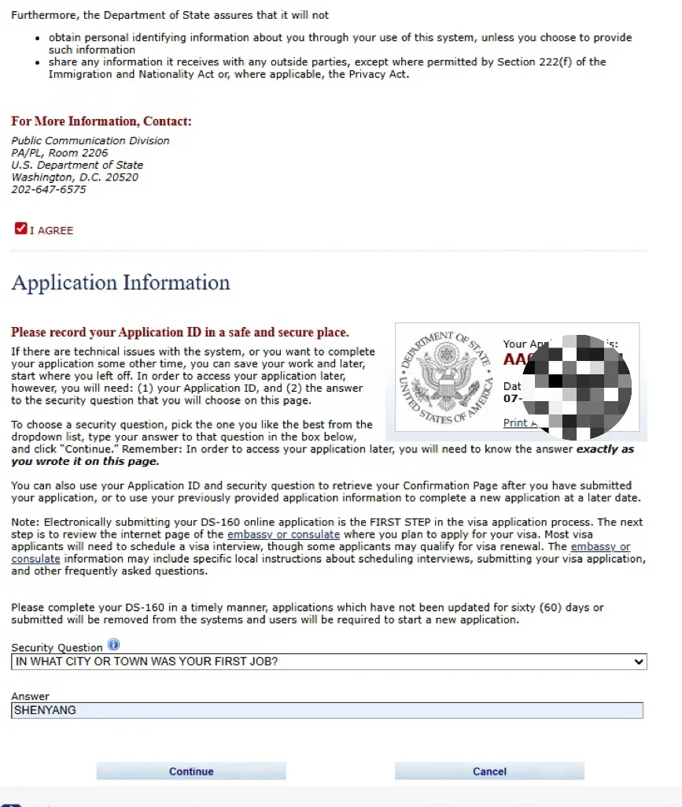

Quando um visto americano B1/B2 se aproxima do vencimento, ou acabou de vencer, muitos viajantes o renovam dentro da China sem passar por uma nova entrevista. O tempo não vai para o formulário em si, mas para algumas escolhas fáceis de errar: dispensa de entrevista ou entrevista, como recomeçar depois de cancelar e por que o recibo de pagamento não carrega.

Este guia segue o processo de Shenyang: documentos, o DS-160, o agendamento e a entrega. A política de vistos e a elegibilidade para a dispensa de entrevista mudaram várias vezes nos últimos dois anos, então o que vale são os sites da embaixada e dos consulados dos EUA e a decisão do próprio sistema de agendamento. Esta é uma descrição do processo, não aconselhamento jurídico, e nenhum resultado é prometido.

## 1. Primeiro confirme que você está renovando, não pedindo um visto novo

Uma renovação pressupõe que você já teve um visto da mesma classe. Para B1/B2, isso geralmente significa que o visto anterior era da mesma categoria, venceu dentro da janela permitida, e que você deixou digitais e não tem recusa registrada. A janela costuma ser descrita como 12 meses após o vencimento, mas tanto a janela quanto as condições mudaram repetidamente nos últimos anos, para os dois lados.

Então o primeiro passo é a página de vistos da missão dos EUA na China, para ver se as renovações com dispensa de entrevista estão sendo aceitas agora. O sistema decide a elegibilidade depois que seus dados são inseridos, e essa decisão tem precedência sobre qualquer guia. Se você não for elegível, prepare-se para uma entrevista padrão e agende uma no Consulado-Geral em Shenyang.

O consulado de Shenyang cuida de vistos de não imigrante para Liaoning, Jilin e Heilongjiang, no nº 52, 14th Weilu, distrito de Heping. Você passa pela segurança no dia, e celulares, notebooks, power banks e bolsas grandes não podem entrar; o armazenamento pago nas proximidades não é barato nem confiável, então leve uma pasta plástica transparente e pouco mais.

## 2. Documentos e foto: dois dias de preparação

Não é preciso muita coisa, mas os detalhes são em inglês, e traduzir em cima da hora é o que custa tempo:

- **Foto:** uma cópia digital mais duas impressas. Os requisitos habituais são 51 × 51 mm, tirada nos últimos seis meses, fundo branco, sem óculos; siga a página de fotos do site oficial em vez de reaproveitar uma foto antiga.
- **Endereço nos EUA:** nome do hotel, endereço, CEP, telefone e e-mail, inseridos campo a campo no formulário.
- **Códigos telegráficos do nome:** procure cada caractere do seu nome chinês; o formulário os pede.
- **Trabalho, educação, família:** nome e endereço do empregador em inglês, cargo e funções, escola e curso, dados básicos do cônjuge e dos pais.

Coloque tudo em um único documento para copiar enquanto preenche o formulário.

## 3. O DS-160: vá devagar e salve o tempo todo

O DS-160 fica no site do CEAC, e as páginas às vezes dão erro, fecham ou não carregam. Isso é normal, não é culpa sua; um navegador diferente, o cache limpo e evitar o pico da noite costumam ajudar.

Alguns hábitos tornam tudo administrável. Salve depois de cada página antes de seguir. Tire um print do número AA e da pergunta de segurança assim que começar, porque são a única forma de voltar à solicitação. Antes de enviar, leia tudo mais uma vez. Depois de enviar, salve a página de confirmação em PDF e imprima uma cópia. Uma solicitação sem movimentação por 60 dias é excluída e precisa ser começada de novo.

Há um princípio: responda com a verdade. Itinerário, endereço e emprego devem corresponder à realidade; inventar uma viagem mais arrumada cria uma divergência que aparece depois.

## 4. O agendamento: não escolha uma entrevista por engano

Os agendamentos passam pelo sistema de agendamento de vistos. Depois de se cadastrar, crie uma nova solicitação e acerte o tipo de visto: uma renovação por dispensa de entrevista é registrada como Interview Waiver, enquanto All Others significa uma entrevista de verdade. Escolha errado e você só descobre depois de pagar e escolher um horário, o que deixa como saída cancelar e começar de novo.

Há uma armadilha depois de cancelar: não use “reschedule”, porque isso mantém a entrevista. Espere cerca de 24 horas, depois feche a solicitação atual e comece uma nova. Aparece um aviso dizendo que a solicitação inacabada será encerrada permanentemente; confirme. A nova solicitação puxa a maior parte do que você inseriu e, na etapa decisiva, você escolhe Interview Waiver e responde com sinceridade; o sistema decide se você se qualifica e só então avança para o pagamento.

O pagamento tem suas próprias pedras. Nas 24 horas seguintes ao cancelamento, o sistema pode não ter sincronizado e não encontrar o número do seu recibo; espere algumas horas ou envie um e-mail ou ligue para o suporte para rastreá-lo. Quando o número do recibo aparecer, siga o mesmo caminho de pagamento de novo e o sistema preenche os dados. O pagamento normalmente é feito on-line, e vale anotar o número do recibo para acompanhar e para mudanças posteriores.

O comprovante de confirmação que você recebe traz data e hora, e isso não é uma entrevista. É quando você leva os documentos a uma agência do CITIC Bank, ou quando a EMS os recolhe. Para verificar se escolheu certo, olhe o nível de prioridade do visto na confirmação: deve estar Interview Waiver.

## 5. Entrega de documentos e as armadilhas habituais

Desde 30 de junho de 2025, solicitações com dispensa de entrevista e documentos complementares do 221(g) podem ser enviados por coleta da EMS, a RMB 110 por solicitação, pagos on-line; a EMS então recolhe no seu endereço e não atrasa a coleta a pedido. A alternativa é entregar em uma agência do CITIC Bank no horário do seu agendamento. Escolha uma.

O pacote normalmente contém: seu passaporte, incluindo o antigo com o visto anterior, a página de confirmação do DS-160, uma foto em conformidade, a confirmação do agendamento e qualquer outra coisa que o consulado peça. Os passaportes costumam voltar pela EMS com pagamento na entrega, então certifique-se de que o endereço e o telefone no agendamento estão corretos.

Algumas coisas passam despercebidas. Não reserve voos ou hotéis não reembolsáveis antes de o passaporte voltar, porque o processamento administrativo sob o 221(g) torna o prazo imprevisível. Menores, e solicitantes que tinham menos de 14 anos quando o visto anterior foi emitido, enfrentam condições diferentes e podem ainda precisar de entrevista ou da presença de um dos pais. O sistema de agendamento é sensível ao navegador e à rede, então quando a página diz que você está bloqueado, trocar de navegador, horário ou conexão costuma resolver. O processamento é medido em semanas úteis e demora mais na alta temporada, então deixe folga nos seus planos.

Quando o passaporte voltar com o novo visto, há mais uma etapa: titulares de visto B1/B2 de 10 anos precisam atualizar o cadastro no EVUS antes de cada viagem aos Estados Unidos, e se recadastrar quando uma renovação trouxer um passaporte ou visto novo. Renovação e EVUS são duas coisas separadas; não descubra um cadastro vencido no aeroporto.

## Links relacionados

- **Neste site**: [China (CN)](/country/CN), [Estados Unidos (US)](/country/US)
- **Wikipedia**: [Visto americano](https://en.wikipedia.org/wiki/United_States_visa), [Consulado-Geral dos Estados Unidos em Shenyang](https://en.wikipedia.org/wiki/Consulate_General_of_the_United_States,_Shenyang)
- **Baidu Baike**: [Visto americano](https://baike.baidu.com/item/%E7%BE%8E%E5%9B%BD%E7%AD%BE%E8%AF%81)

Elegibilidade, documentos, taxas e prazos de processamento seguem os avisos atuais da missão dos EUA na China e do seu sistema de agendamento; a política pode mudar a qualquer momento. Crédito das imagens: guia de viagem do WeChat.
