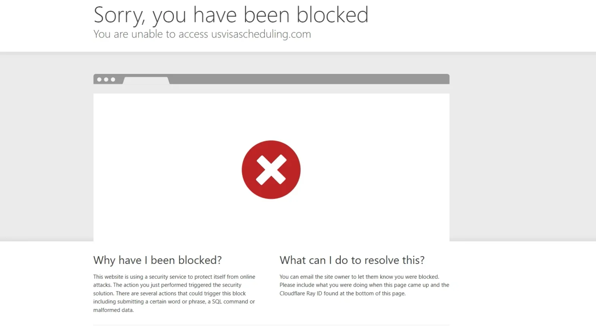

Wakati viza ya B1/B2 ya Marekani inakaribia kuisha, au imeisha tu, wasafiri wengi huihuisha ndani ya China bila kufanya mahojiano mapya. Muda huenda si kwenye fomu yenyewe bali kwenye maamuzi machache ambayo ni rahisi kukosea: msamaha wa mahojiano au mahojiano, jinsi ya kuanza upya baada ya kughairi, na kwa nini risiti ya malipo haipaki.

Mwongozo huu unafuata mchakato wa Shenyang: nyaraka, DS-160, miadi, na uwasilishaji. Sera ya viza na ustahiki wa msamaha wa mahojiano vimebadilika mara kadhaa katika miaka miwili iliyopita, kwa hivyo tovuti za ubalozi na balozi ndogo za Marekani pamoja na uamuzi wa mfumo wa miadi ndio yanayohesabiwa. Haya ni maelezo ya mchakato, si ushauri wa kisheria, na hakuna matokeo yanayoahidiwa.

## 1. Kwanza thibitisha kwamba unahuisha, si kuomba upya

Kuhuisha kunadhania kuwa umewahi kuwa na aina hiyo hiyo ya viza. Kwa B1/B2 hiyo kwa kawaida humaanisha kuwa viza iliyotangulia ilikuwa katika kundi lilelile, iliisha ndani ya kipindi kinachoruhusiwa, na kwamba alama zako za vidole zilichukuliwa na huna kumbukumbu ya kukataliwa. Kipindi hicho kwa kawaida kimeelezwa kuwa miezi 12 baada ya kuisha, lakini kipindi na masharti yamebadilika mara kwa mara katika miaka ya hivi karibuni, kwa pande zote mbili.

Kwa hivyo hatua ya kwanza ni ukurasa wa viza wa ubalozi wa Marekani nchini China, ili kuona kama uhuishaji wa msamaha wa mahojiano unakubaliwa sasa. Mfumo huamua ustahiki mara tu taarifa zako zinapowekwa, na uamuzi huo una nguvu kuliko mwongozo wowote. Ikiwa hukidhi vigezo, jitayarishe kwa mahojiano ya kawaida na upange miadi katika Balozi Ndogo ya Shenyang.

Balozi Ndogo ya Shenyang hushughulikia viza zisizo za wahamiaji kwa Liaoning, Jilin na Heilongjiang, katika Namba 52, 14th Weilu, Wilaya ya Heping. Utapitia ukaguzi wa usalama siku hiyo, na hauwezi kuingiza simu, kompyuta ndogo, benki za nishati au mizigo mikubwa; hifadhi ya kulipia karibu si ya bei nafuu wala ya kuaminika, kwa hivyo leta folda ya plastiki ya uwazi na vitu vichache tu.

## 2. Nyaraka na picha: siku mbili za maandalizi

Hakuna vitu vingi vinavyohitajika, lakini maelezo yapo kwa Kiingereza, na tafsiri ya dakika za mwisho ndiyo hupoteza muda:

- **Picha:** nakala moja ya kidijitali pamoja na nakala mbili zilizochapishwa. Mahitaji ya kawaida ni 51 × 51 mm, iliyopigwa ndani ya miezi sita, mandharinyuma meupe, bila miwani; fuata ukurasa wa picha kwenye tovuti rasmi badala ya kutumia picha ya zamani.
- **Anwani ya Marekani:** jina la hoteli, anwani ya mtaa, msimbo wa ZIP, simu na barua pepe, vikiwekwa sehemu kwa sehemu kwenye fomu.
- **Misimbo ya telegrafi ya majina:** tafuta kila herufi ya jina lako la Kichina; fomu inazihitaji.
- **Kazi, elimu, familia:** jina na anwani ya mwajiri kwa Kiingereza, cheo cha kazi na majukumu, shule na taaluma, mwenzi na maelezo ya msingi ya wazazi.

Weka yote katika hati moja ya kunakili unapojaza fomu.

## 3. DS-160: punga mwendo na uhifadhi kila mara

DS-160 iko kwenye tovuti ya CEAC, na kurasa mara kwa mara hutoa hitilafu, hufungwa au hushindwa kupakiwa. Hilo ni jambo la kawaida, si kosa lako; kivinjari tofauti, kufuta akiba ya kivinjari na kuepuka saa za kilele jioni kwa kawaida husaidia.

Tabia chache hufanya iwe rahisi. Hifadhi baada ya kila ukurasa kabla ya kuendelea. Piga picha ya skrini ya namba ya AA na swali la usalama mara tu unapoanza, kwa sababu ndiyo njia pekee ya kurudi kwenye maombi. Kabla ya kuwasilisha, soma yote mara moja zaidi. Baada ya kuwasilisha, hifadhi ukurasa wa uthibitisho kama PDF na uchapishe nakala. Maombi ambayo hayajafanyiwa mabadiliko kwa siku 60 hufutwa na lazima yaanzishwe upya.

Kuna kanuni moja: jibu kwa ukweli. Ratiba ya safari, anwani na ajira zinapaswa kuendana na ukweli; kubuni safari iliyo nadhifu zaidi huzaa kutokulingana kunakojitokeza baadaye.

## 4. Miadi: usichague mahojiano kwa makosa

Miadi hupangwa kupitia mfumo wa kupanga miadi ya viza. Baada ya kujisajili, tengeneza maombi mapya, na uchague aina sahihi ya viza: uhuishaji kwa msamaha wa mahojiano huwasilishwa kama "Interview Waiver", ilhali "All Others" humaanisha mahojiano halisi. Ukichagua vibaya utagundua tu baada ya kulipa na kuchagua nafasi, jambo linalokulazimu kughairi na kuanza upya.

Kuna mtego baada ya kughairi: usitumie "reschedule", kwa sababu hiyo huhifadhi mahojiano. Subiri takriban saa 24, kisha funga maombi ya sasa na uanze mapya. Onyo linaonekana likisema kwamba maombi ambayo hayajakamilika yatafungwa kabisa; thibitisha. Maombi mapya huchukua sehemu kubwa ya yale uliyoweka, na katika hatua muhimu unachagua "Interview Waiver" na kujibu kwa ukweli; mfumo huamua kama unakidhi vigezo na ndipo tu hukupeleka kwenye malipo.

Malipo pia yana mitego yake. Ndani ya saa 24 baada ya kughairi, mfumo unaweza usiwe umesawazisha data na hauwezi kupata namba yako ya risiti; subiri saa chache, au tuma barua pepe au piga simu kwa msaada ili ifuatiliwe. Mara namba ya risiti inapoonekana, fuata tena njia hiyo hiyo ya malipo na mfumo hujaza maelezo. Malipo kwa kawaida hufanywa mtandaoni, na namba ya risiti inafaa kuandikwa kwa ufuatiliaji na mabadiliko ya baadaye.

Karatasi ya uthibitisho utakayopata ina tarehe na saa, na hiyo si mahojiano. Hiyo ni tarehe na saa ya kupeleka nyaraka kwenye tawi la Benki ya CITIC, au ya EMS kuzichukua. Ili kuthibitisha kuwa umechagua kwa usahihi, angalia kiwango cha kipaumbele cha viza kwenye uthibitisho: kinapaswa kusomeka "Interview Waiver".

## 5. Kuwasilisha nyaraka, na mitego ya kawaida

Tangu 30 Juni 2025, maombi ya msamaha wa mahojiano na nyaraka za ufuatiliaji za 221(g) zinaweza kuwasilishwa kupitia ukusanyaji wa EMS, kwa RMB 110 kwa ombi, ikilipwa mtandaoni; kisha EMS huchukua kutoka anwani yako na haitachelewesha ukusanyaji kwa ombi lako. Njia mbadala ni kuwasilisha kwenye tawi la Benki ya CITIC wakati wa miadi yako. Chagua moja.

Kifurushi kwa kawaida huwa na: pasipoti yako, pamoja na ya zamani yenye viza iliyotangulia, ukurasa wa uthibitisho wa DS-160, picha inayokidhi mahitaji, uthibitisho wa miadi, na kitu kingine chochote ambacho balozi ndogo inaomba. Pasipoti kwa kawaida hurudi kwa EMS na malipo wakati wa kupokea, kwa hivyo hakikisha anwani na namba ya simu kwenye miadi ni sahihi.

Mambo machache ambayo watu huyakosa. Usinunue tikiti za ndege au usifanye uhifadhi wa hoteli usioweza kurejeshwa kabla pasipoti haijarudi, kwa sababu uchakataji wa kiutawala chini ya 221(g) hufanya muda kuwa usiotabirika. Watoto, na waombaji waliokuwa chini ya miaka 14 wakati viza iliyotangulia ilitolewa, wanakabiliana na masharti tofauti na bado wanaweza kuhitaji mahojiano au kuwepo kwa mzazi. Mfumo wa kupanga miadi ni nyeti kwa kivinjari na mtandao, kwa hivyo ukurasa unaposema umezuiwa, kubadilisha kivinjari, muda au muunganisho mara nyingi hutatua tatizo. Uchakataji hupimwa kwa wiki za kazi na huchukua muda mrefu zaidi katika msimu wa kilele, kwa hivyo acha nafasi katika mipango yako.

Mara pasipoti inaporudi na viza mpya, kuna hatua moja zaidi: wenye viza ya B1/B2 ya miaka 10 lazima wafanye usajili wao wa EVUS kuwa wa sasa kabla ya kila safari kwenda Marekani, na kujisajili upya ikiwa uhuishaji umeleta pasipoti au viza mpya. Uhuishaji na EVUS ni vitu viwili tofauti; usigundue usajili ulioisha muda ukiwa uwanjani.

## Viungo vinavyohusiana

- **Kwenye tovuti hii**: [China (CN)](/country/CN), [Marekani (US)](/country/US)
- **Wikipedia**: [Viza ya Marekani](https://en.wikipedia.org/wiki/United_States_visa), [Balozi Ndogo ya Marekani, Shenyang](https://en.wikipedia.org/wiki/Consulate_General_of_the_United_States,_Shenyang)
- **Baidu Baike**: [Viza ya Marekani](https://baike.baidu.com/item/%E7%BE%8E%E5%9B%BD%E7%AD%BE%E8%AF%81)

Ustahiki, nyaraka, ada na muda wa uchakataji hufuata notisi za sasa za ujumbe wa Marekani nchini China na mfumo wake wa miadi; sera inaweza kubadilika wakati wowote. Picha: mwongozo wa usafiri wa WeChat.
