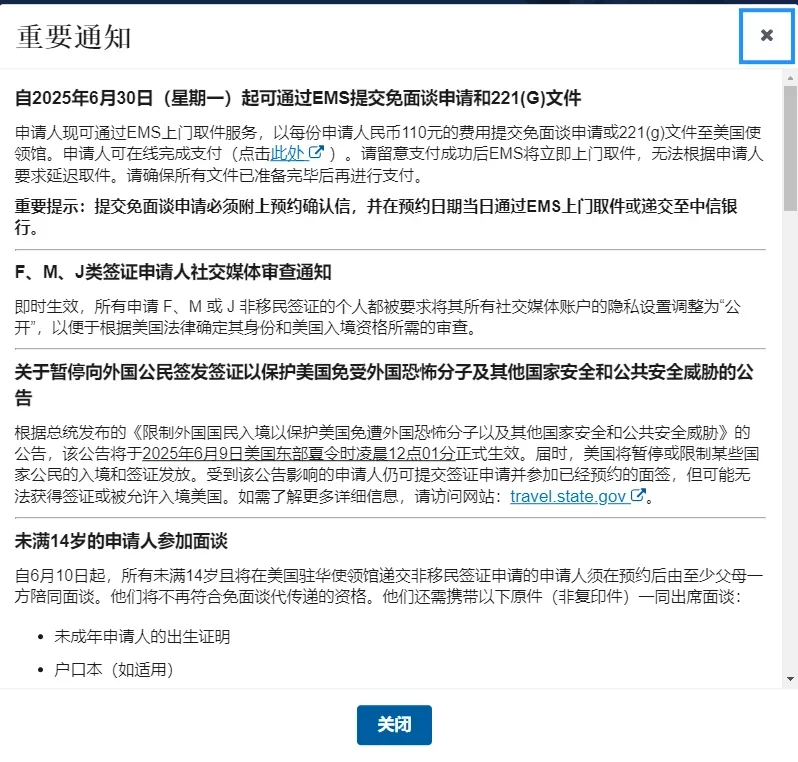

ABD B1/B2 vizesinin süresi dolarken veya yeni dolmuşken, birçok gezgin Çin içinde yeni bir mülakata girmeden yeniler. Zaman formun kendisine değil, kolayca yanlış yapılabilecek birkaç seçime gider: mülakat muafiyeti mi mülakat mı, iptalden sonra nasıl yeniden başlanır ve ödeme makbuzu neden yüklenmez.

Bu rehber Shenyang sürecini izler: belgeler, DS-160, randevu, belge teslimi. Vize politikası ve mülakat muafiyeti uygunluğu son iki yılda birkaç kez değişti, bu yüzden ABD büyükelçiliği ve konsolosluğu web siteleri ile randevu sisteminin kendi kararı geçerlidir. Bu bir süreç anlatımıdır, hukuki tavsiye değildir ve hiçbir sonuç vaat edilmez.

## 1. Önce yenileme mi yoksa sıfırdan başvuru mu olduğunu doğrulayın

Yenileme, daha önce aynı vize sınıfına sahip olduğunuzu varsayar. B1/B2 için bu genellikle önceki vizenin aynı kategoride olduğu, izin verilen pencere içinde sona erdiği, parmak izi verdiğiniz ve kayıtlarda ret olmadığı anlamına gelir. Pencere genellikle sona ermesinden sonraki 12 ay olarak tanımlandı, ancak hem pencere hem de koşullar son yıllarda defalarca, her iki yönde de değişti.

Bu yüzden ilk adım, Çin'deki ABD misyonunun vize sayfasıdır; mülakat muafiyetli yenilemelerin şu anda kabul edilip edilmediğine bakın. Bilgileriniz girildikten sonra uygunluğa sistem karar verir ve bu karar herhangi bir rehberden üstündür. Uygun değilseniz standart bir mülakata hazırlanın ve Shenyang Başkonsolosluğu'ndan randevu alın.

Shenyang Başkonsolosluğu, Heping Bölgesi 14. Weilu No. 52 adresinde Liaoning, Jilin ve Heilongjiang için göçmen olmayan vize işlemlerini yürütür. Randevu günü güvenlikten geçersiniz; telefon, dizüstü bilgisayar, power bank ve büyük çantalar içeri alınmaz; yakındaki ücretli emanet ne ucuz ne de güvenilirdir, bu yüzden şeffaf bir plastik dosya ve az şey getirin.

## 2. Belgeler ve fotoğraf: iki günlük hazırlık

Çok şey gerekmez, ancak ayrıntılar İngilizcedir ve son dakika çevirisi zaman kaybettiren şeydir:

- **Fotoğraf:** bir dijital kopya artı iki baskı. Olağan gereksinimler 51 × 51 mm, son altı ay içinde çekilmiş, beyaz arka plan, gözlüksüz; eski bir fotoğrafı yeniden kullanmak yerine resmî sitedeki fotoğraf sayfasını izleyin.
- **ABD adresi:** otel adı, sokak adresi, posta kodu, telefon ve e-posta; formda alan alan girilir.
- **Ad telgraf kodları:** Çince adınızın her karakterini araştırın; form bunları ister.
- **İş, eğitim, aile:** işveren adı ve adresi İngilizce, görev unvanı ve sorumluluklar, okul ve bölüm, eş ve ebeveynlerin temel bilgileri.

Formu doldururken kopyalayabilmek için hepsini tek bir belgeye koyun.

## 3. DS-160: yavaşlayın ve sürekli kaydedin

DS-160, CEAC sitesinde bulunur ve sayfalar ara sıra hata verir, kapanır veya yüklenmez. Bu, sizin yaptığınız bir şey değil normaldir; farklı bir tarayıcı, temizlenmiş önbellek ve akşam yoğunluğundan kaçınmak genellikle yardımcı olur.

Birkaç alışkanlık süreci yönetilebilir kılar. Her sayfadan sonra, ilerlemeden önce kaydedin. Başlar başlamaz AA numarasının ve güvenlik sorusunun ekran görüntüsünü alın, çünkü başvuruya geri dönmenin tek yolu bunlardır. Göndermeden önce tümünü bir kez daha baştan sona okuyun. Gönderdikten sonra onay sayfasını PDF olarak kaydedin ve bir kopyasını yazdırın. 60 gün boyunca dokunulmayan başvuru silinir ve yeniden başlatılması gerekir.

Tek bir ilke var: doğru yanıtlayın. Seyahat planı, adres ve istihdam gerçekle örtüşmelidir; daha düzenli bir yolculuk uydurmak, sonra ortaya çıkacak bir uyumsuzluk yaratır.

## 4. Randevu: yanlışlıkla mülakat seçmeyin

Randevular vize planlama sistemi üzerinden yürür. Kaydolduktan sonra yeni bir başvuru oluşturun ve vize türünü doğru seçin: mülakat muafiyetiyle yenileme “Interview Waiver” olarak açılır, “All Others” ise gerçek bir mülakat anlamına gelir. Yanlış seçerseniz bunu ancak ödeme yapıp bir saat dilimi seçtikten sonra fark edersiniz; geriye iptal edip baştan başlamak kalır.

İptalden sonra bir tuzak var: “reschedule” kullanmayın, çünkü o mülakatı korur. Yaklaşık 24 saat bekleyin, ardından mevcut başvuruyu kapatın ve yeni bir başvuru başlatın. Bitmemiş başvurunun kalıcı olarak kapatılacağını söyleyen bir uyarı çıkar; onaylayın. Yeni başvuru girdiğiniz bilgilerin çoğunu içine alır ve kilit adımda “Interview Waiver”ı seçip doğru yanıt verirsiniz; uygun olup olmadığını sistem belirler ve ancak bundan sonra sizi ödemeye geçirir.

Ödemenin kendi pürüzleri vardır. İptalden sonraki 24 saat içinde sistem senkronize olmamış olabilir ve makbuz numaranızı bulamaz; birkaç saat bekleyin veya destek ekibine e-posta gönderip ya da telefon edip izlettirin. Makbuz numarası göründüğünde aynı ödeme yolunu yeniden izleyin, sistem ayrıntıları doldurur. Ödeme normalde çevrim içi yapılır ve makbuz numarasını takip ve sonraki değişiklikler için not etmeye değer.

Elinizde kalan onay fişinde bir tarih ve saat bulunur ve bu bir mülakat değildir. Belgeleri bir CITIC Bank şubesine götüreceğiniz veya EMS'in onları alacağı zamandır. Doğru seçim yaptığınızı kontrol etmek için onay belgesindeki vize öncelik düzeyine bakın: “Interview Waiver” yazmalıdır.

## 5. Belgelerin teslimi ve olağan tuzaklar

30 Haziran 2025'ten bu yana mülakat muafiyetli başvurular ve 221(g) takip belgeleri EMS ile teslim edilebilir; başvuru başına 110 yuan, çevrim içi ödenir; EMS ardından adresinizden teslim alır ve talebe bağlı olarak alımı geciktirmez. Alternatif, randevu saatinizde bir CITIC Bank şubesine teslim etmektir. Birini seçin.

Paket normalde şunları içerir: pasaportunuz (önceki vizenin bulunduğu eski pasaport dahil), DS-160 onay sayfası, kurallara uygun bir fotoğraf, randevu onayı ve konsolosluğun istediği diğer belgeler. Pasaportlar genellikle teslimatta ödemeli olarak EMS ile geri gelir, bu yüzden randevudaki adres ve telefon numarasının doğru olduğundan emin olun.

İnsanların gözden kaçırdığı birkaç şey. Pasaport geri gelmeden iadesiz uçak veya otel rezervasyonu yapmayın, çünkü 221(g) kapsamındaki idari işlem takvimi öngörülemez kılar. Reşit olmayanlar ve önceki vize verildiğinde 14 yaşından küçük olan başvuru sahipleri farklı koşullara tabidir ve yine de mülakat veya bir ebeveynin hazır bulunması gerekebilir. Planlama sistemi tarayıcıya ve ağa duyarlıdır, bu yüzden sayfa engellendiğinizi söylediğinde tarayıcıyı, saati veya bağlantıyı değiştirmek genellikle sorunu çözer. İşlem süresi iş haftalarıyla ölçülür ve yoğun sezonda daha uzun sürer, bu yüzden planlarınızda pay bırakın.

Pasaport yeni vizeyle döndüğünde bir adım daha vardır: 10 yıllık B1/B2 vizesi sahipleri her ABD seyahatinden önce EVUS kayıtlarını güncellemeli ve yenileme yeni bir pasaport veya vize getirdiyse yeniden kaydolmalıdır. Yenileme ve EVUS iki ayrı şeydir; süresi dolmuş kaydı havalimanında keşfetmeyin.

## İlgili bağlantılar

- **Bu sitede**: [Çin (CN)](/country/CN), [ABD (US)](/country/US)
- **Wikipedia**: [US visa](https://en.wikipedia.org/wiki/United_States_visa), [Consulate General of the United States, Shenyang](https://en.wikipedia.org/wiki/Consulate_General_of_the_United_States,_Shenyang)
- **Baidu Baike**: [US visa](https://baike.baidu.com/item/%E7%BE%8E%E5%9B%BD%E7%AD%BE%E8%AF%81)

Uygunluk, belgeler, ücretler ve işlem süreleri Çin'deki ABD misyonunun ve randevu sisteminin güncel bildirimlerine göre belirlenir; politika her an değişebilir. Görsel kaynağı: WeChat seyahat rehberi.
