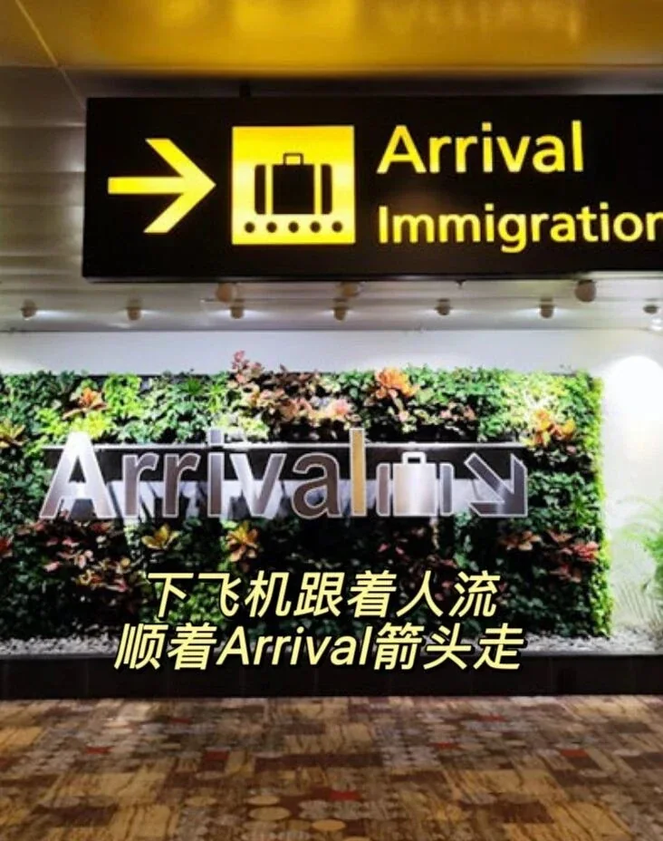

¿Vuelas a Singapur este otoño? Aquí está todo el flujo de llegada, desde la puerta hasta la acera: sigue a la gente y pasarás inmigración sin dar un giro equivocado.

## Paso 1: sigue a la gente y los carteles de Arrival

Dirígete a la sala de inmigración. Una vez fuera del avión, solo tienes que seguir el flujo de pasajeros y las flechas de Arrival; la ruta cambia según la puerta, pero Arrival siempre señala el camino correcto.

## Paso 2: baja a la sala de inmigración

Sigue las indicaciones y baja por la escalera mecánica o el ascensor: te deja directamente en la sala de inmigración de aduanas.

## Paso 3: la primera puerta (escaneo del pasaporte)

Acércate a la puerta automática y coloca la página del pasaporte con la foto boca abajo en el escáner. Cuando lo lea, la primera puerta se abre.

## Paso 4: la segunda puerta (datos biométricos)

Dentro, sigue las indicaciones en pantalla: mira de frente a la cámara para registrar tu rostro y luego sigue las instrucciones para las huellas. Cuando la verificación sale bien, la puerta se abre y la inmigración está completa.

## ⚠️ Antes de eso: presenta la tarjeta de llegada

No puedes pasar inmigración sin ella. La SG Arrival Card electrónica queda vinculada a tu pasaporte al enviarla, así que nunca necesitas mostrar un documento aparte en las puertas.

Hay paneles recordatorios en el sitio, y puedes rellenarla con el wifi del aeropuerto en unos cinco minutos. ¿Es tu primera vez con el formulario? Consulta nuestra guía paso a paso.

## Apéndice: mapa del aeropuerto de Changi

Si solo estás en tránsito, merece la pena echar un vistazo al mapa: muestra cómo se relacionan las terminales.

## Apéndice: mapa de la MRT de Singapur

## Enlaces relacionados

- **En este sitio**: [Aeropuerto de Singapur Changi (SIN)](/airport/SIN), [Singapur (SG)](/country/SG)
- **Wikipedia**: [Singapore Changi Airport](https://en.wikipedia.org/wiki/Singapore_Changi_Airport)
- **Baidu Baike**: [Singapore Changi Airport](https://baike.baidu.com/item/%E6%96%B0%E5%8A%A0%E5%9D%A1%E6%A8%9F%E5%AE%9C%E6%9C%BA%E5%9C%BA)
