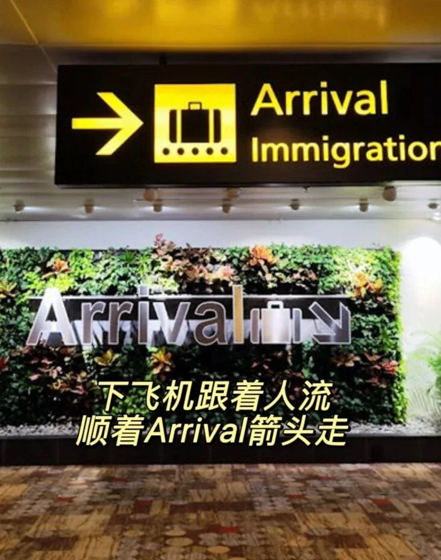
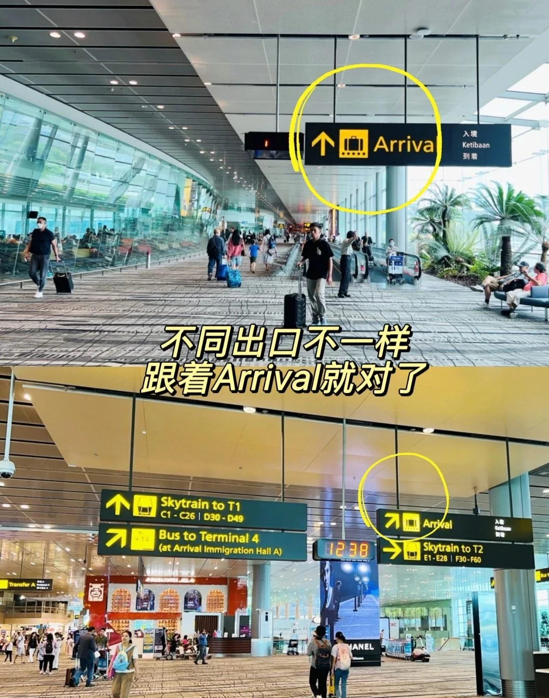
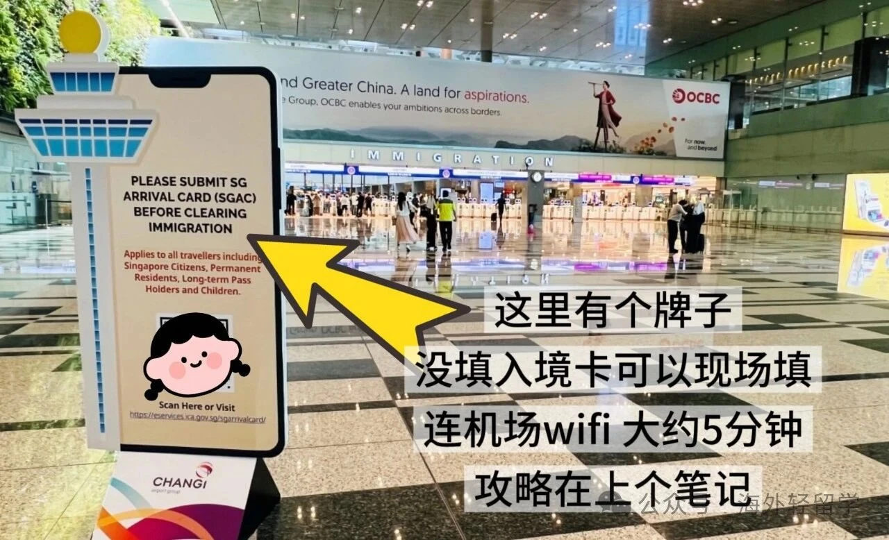
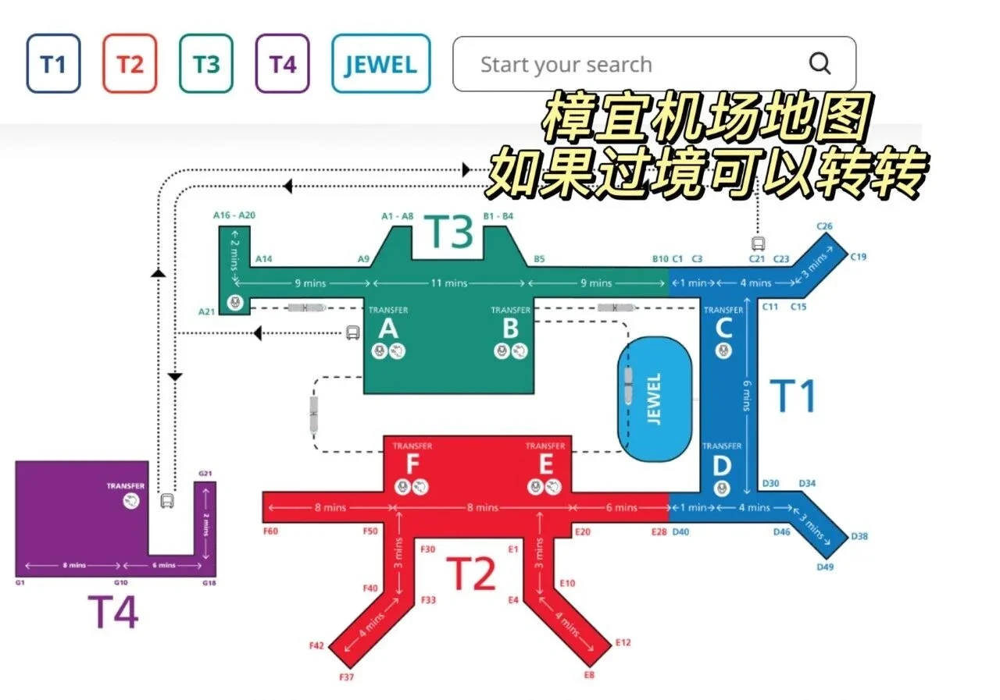
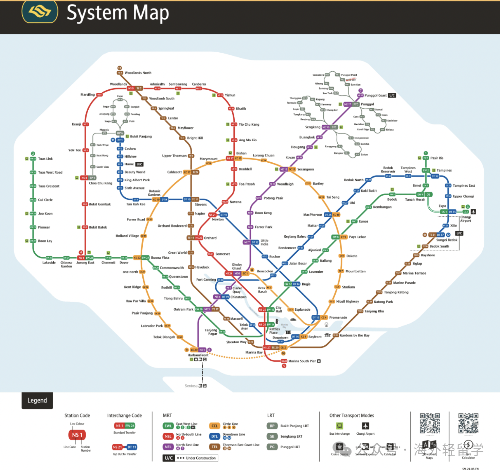

Vous arrivez à Singapour cet automne ? Voici tout le parcours d'arrivée, de la porte d'embarquement à la sortie — suivez la foule et vous passerez l'immigration sans faire fausse route.

## Étape 1 : suivez la foule et les panneaux Arrival

Dirigez-vous vers le hall de l'immigration. Une fois sorti de l'avion, suivez simplement le flux de passagers et les flèches Arrival ; le chemin diffère selon la porte, mais Arrival indique toujours la bonne direction.

## Étape 2 : descendez au hall de l'immigration

Suivez les panneaux et prenez l'escalator ou l'ascenseur pour descendre — vous arrivez directement au hall de l'immigration.

## Étape 3 : le premier portique (lecture du passeport)

Avancez vers le portique automatique et posez la page photo de votre passeport face contre le lecteur. Une fois la lecture faite, le premier portique s'ouvre.

## Étape 4 : le second portique (données biométriques)

À l'intérieur, suivez les instructions à l'écran : regardez droit vers la caméra pour enregistrer votre visage, puis suivez les indications pour vos empreintes digitales. Quand la vérification réussit, le portique s'ouvre et l'immigration est terminée.

## ⚠️ Avant cela : remplissez votre carte d'arrivée

Vous ne pouvez pas passer l'immigration sans elle. La carte d'arrivée électronique SG Arrival Card est liée à votre passeport dès sa soumission : vous n'avez jamais besoin de présenter un document séparé aux portiques.

Des panneaux de rappel sont sur place, et vous pouvez la remplir via le WiFi de l'aéroport en cinq minutes environ. Vous découvrez ce formulaire ? Consultez notre guide pas à pas.

## Annexe : plan de l'aéroport de Changi

Si vous êtes seulement en transit, le plan vaut un coup d'œil — il montre comment les terminaux s'articulent.

## Annexe : plan du MRT de Singapour

## Liens utiles

- **Sur ce site** : [Aéroport de Singapour Changi (SIN)](/airport/SIN), [Singapour (SG)](/country/SG)
- **Wikipédia** : [Singapore Changi Airport](https://en.wikipedia.org/wiki/Singapore_Changi_Airport)
- **Baidu Baike** : [Singapore Changi Airport](https://baike.baidu.com/item/%E6%96%B0%E5%8A%A0%E5%9D%A1%E6%A8%9F%E5%AE%9C%E6%9C%BA%E5%9C%BA)
