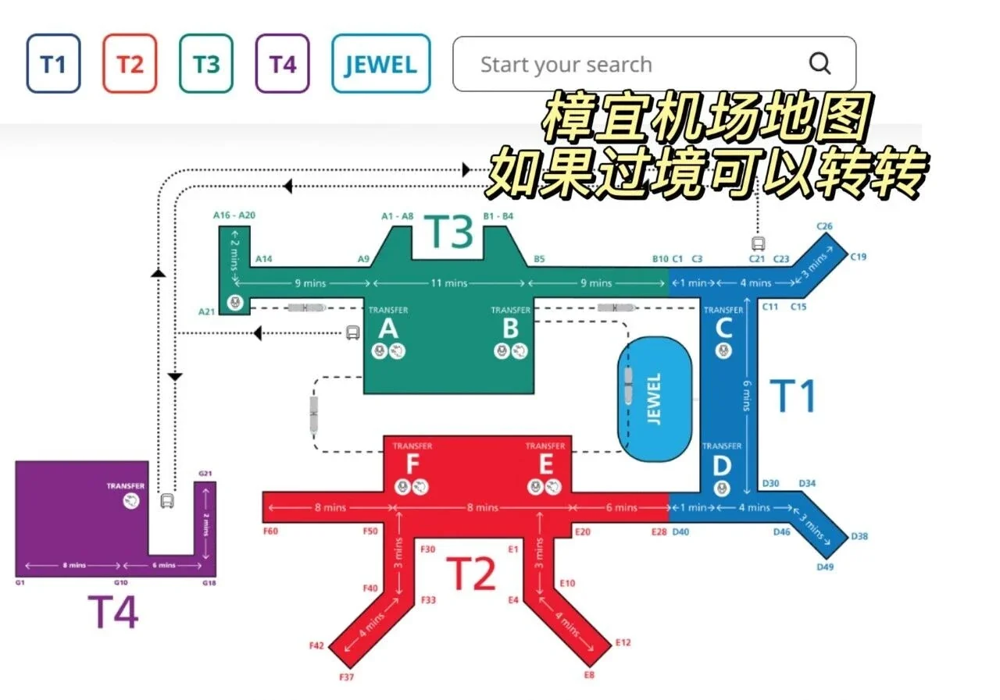

この秋、シンガポールへ飛びますか。到着からタクシー乗り場までの流れをまとめました。人の流れに従えば、迷わず入国審査を通過できます。

## ステップ1：人の流れとArrivalの表示に従う

入国審査場へ向かいます。飛行機を降りたら、乗客の流れとArrivalの矢印に従うだけです。ルートは搭乗口によって異なりますが、Arrivalはいつも正しい方向を指しています。

## ステップ2：下の階の入国審査場へ

表示に従ってエスカレーターかエレベーターで下ります。そのまま税関の入国審査場に着きます。

## ステップ3：最初のゲート（パスポート読み取り）

自動ゲートに進み、パスポートの顔写真ページを下向きにスキャナーに置きます。読み取れると最初のゲートが開きます。

## ステップ4：2番目のゲート（生体認証）

中に入り、画面の指示に従います。カメラをまっすぐ見て顔を登録し、案内に従って指紋を取ります。認証に成功するとゲートが開き、入国手続きは完了です。

## ⚠️ その前に：到着カードを提出

到着カードがなければ入国審査を通れません。電子SG Arrival Cardは提出するとパスポートに紐づくので、ゲートで別の書類を見せる必要はありません。

現地には案内板があり、空港のWiFiで約5分で入力できます。初めての方は、ステップごとのガイドをご覧ください。

## 付録：チャンギ空港マップ

乗り継ぎだけなら、マップを見る価値があります。ターミナル同士の位置関係がわかります。

## 付録：シンガポールMRT路線図

## 関連リンク

- **このサイト内**：[シンガポール・チャンギ空港 (SIN)](/airport/SIN)、[シンガポール (SG)](/country/SG)
- **Wikipedia**：[シンガポール・チャンギ空港](https://en.wikipedia.org/wiki/Singapore_Changi_Airport)
- **百度百科**：[シンガポール・チャンギ空港](https://baike.baidu.com/item/%E6%96%B0%E5%8A%A0%E5%9D%A1%E6%A8%9F%E5%AE%9C%E6%9C%BA%E5%9C%BA)
