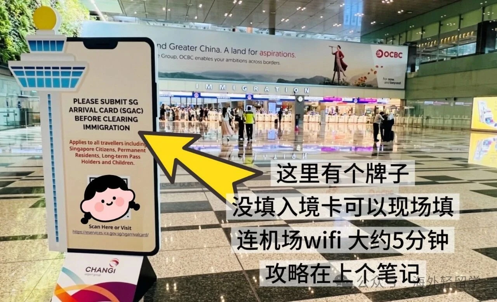

Vliegt u dit najaar naar Singapore? Hier is de hele aankomststroom, van gate tot stoeprand — volg de menigte en u komt zonder verkeerde afslag door de immigratie.

## Stap 1: volg de menigte en de borden Arrival

Ga naar de Immigratiehal. Zodra u het vliegtuig uit bent, volgt u gewoon de stroom passagiers en de pijlen van Arrival; de route verschilt per gate, maar Arrival wijst altijd de juiste kant op.

## Stap 2: ga naar beneden naar de Immigratiehal

Volg de borden en neem de roltrap of de lift naar beneden — die zet u direct af bij de Immigratiehal van de douane.

## Stap 3: de eerste poort (paspoort scannen)

Stap naar de automatische poort en leg de fotopagina van uw paspoort met de beeldzijde naar beneden op de scanner. Zodra die leest, gaat de eerste poort open.

## Stap 4: de tweede poort (biometrie)

Volg binnen de aanwijzingen op het scherm: kijk recht in de camera om uw gezicht te registreren en volg daarna de instructies voor uw vingerafdrukken. Als de verificatie slaagt, gaat de poort open en is de immigratie afgerond.

## ⚠️ Eerst nog: dien uw aankomstkaart in

Zonder aankomstkaart komt u niet door de immigratie. De elektronische SG Arrival Card is na indiening aan uw paspoort gekoppeld, dus u hoeft bij de poorten nooit een apart document te laten zien.

Op de luchthaven staan herinneringsborden, en u kunt het formulier in ongeveer vijf minuten invullen via de wifi van de luchthaven. Nieuw met het formulier? Zie onze stap-voor-stapgids.

## Bijlage: kaart van Changi Airport

Als u alleen overstapt, is de kaart de moeite waard — hij laat zien hoe de terminals ten opzichte van elkaar liggen.

## Bijlage: kaart van de Singapore MRT

## Gerelateerde links

- **Op deze site**: [Internationale luchthaven Singapore Changi (SIN)](/airport/SIN), [Singapore (SG)](/country/SG)
- **Wikipedia**: [Internationale luchthaven Singapore Changi](https://en.wikipedia.org/wiki/Singapore_Changi_Airport)
- **Baidu Baike**: [Internationale luchthaven Singapore Changi](https://baike.baidu.com/item/%E6%96%B0%E5%8A%A0%E5%9D%A1%E6%A8%9F%E5%AE%9C%E6%9C%BA%E5%9C%BA)
