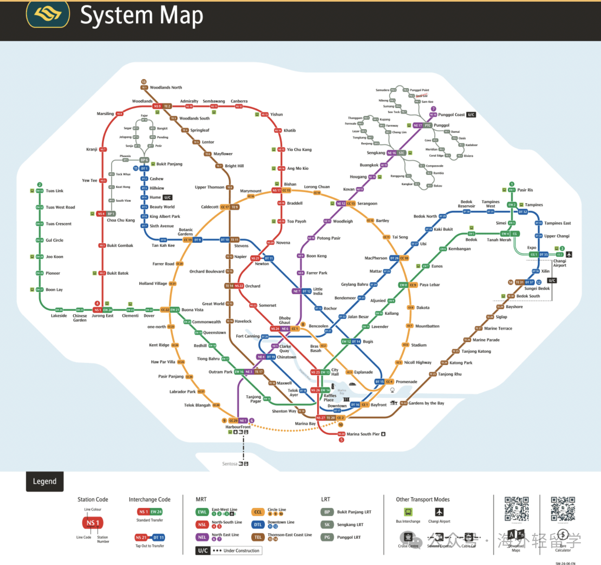

บินเข้าสิงคโปร์ฤดูใบไม้ร่วงนี้? นี่คือขั้นตอนการมาถึงทั้งหมด ตั้งแต่ประตูขึ้นเครื่องถึงขอบถนน — ตามฝูงชนแล้วคุณจะผ่านตรวจคนเข้าเมืองโดยไม่เลี้ยวผิด

## ขั้นที่ 1: ตามฝูงชนและป้าย Arrival

มุ่งไปโถงตรวจคนเข้าเมือง เมื่อลงจากเครื่อง เพียงตามฝูงผู้โดยสารและลูกศร Arrival เส้นทางต่างกันตามประตูขึ้นเครื่อง แต่ Arrival ชี้ทางที่ถูกเสมอ

## ขั้นที่ 2: ลงไปชั้นล่างสู่โถงตรวจคนเข้าเมือง

ตามป้ายแล้วใช้บันไดเลื่อนหรือลิฟต์ลงมา — พาคุณลงตรงสู่โถงตรวจคนเข้าเมืองของศุลกากร

## ขั้นที่ 3: ประตูแรก (สแกนหนังสือเดินทาง)

ก้าวไปที่ประตูอัตโนมัติแล้ววางหน้าหนังสือเดินทางที่มีรูปถ่ายคว่ำลงบนเครื่องสแกน เมื่ออ่านได้ ประตูแรกจะเปิด

## ขั้นที่ 4: ประตูที่สอง (ไบโอเมตริก)

ข้างใน ให้ทำตามคำแนะนำบนหน้าจอ: มองตรงไปที่กล้องเพื่อลงทะเบียนใบหน้า จากนั้นทำตามคำแนะนำสำหรับลายนิ้วมือ เมื่อยืนยันสำเร็จ ประตูจะเปิดและการตรวจคนเข้าเมืองเสร็จสิ้น

## ⚠️ ก่อนหน้านั้น: ยื่นบัตรแจ้งการมาถึง

คุณผ่านตรวจคนเข้าเมืองไม่ได้ถ้าไม่มีบัตรนี้ SG Arrival Card แบบอิเล็กทรอนิกส์เชื่อมกับหนังสือเดินทางเมื่อส่งแล้ว คุณจึงไม่ต้องแสดงเอกสารแยกที่ประตู

มีป้ายเตือนในพื้นที่ และคุณกรอกได้ผ่าน WiFi สนามบินในประมาณห้านาที ยังไม่คุ้นแบบฟอร์ม? ดูคู่มือทีละขั้นตอนของเรา

## ภาคผนวก: แผนที่สนามบินชางงี

หากคุณแค่เปลี่ยนเครื่อง แผนที่มีประโยชน์ — แสดงว่าอาคารผู้โดยสารต่าง ๆ อยู่ร่วมกันอย่างไร

## ภาคผนวก: แผนที่ MRT สิงคโปร์

## ลิงก์ที่เกี่ยวข้อง

- **ในเว็บไซต์นี้**: [สนามบินชางงีสิงคโปร์ (SIN)](/airport/SIN), [สิงคโปร์ (SG)](/country/SG)
- **Wikipedia**: [สนามบินชางงีสิงคโปร์](https://en.wikipedia.org/wiki/Singapore_Changi_Airport)
- **Baidu Baike**: [สนามบินชางงีสิงคโปร์](https://baike.baidu.com/item/%E6%96%B0%E5%8A%A0%E5%9D%A1%E6%A8%9F%E5%AE%9C%E6%9C%BA%E5%9C%BA)
