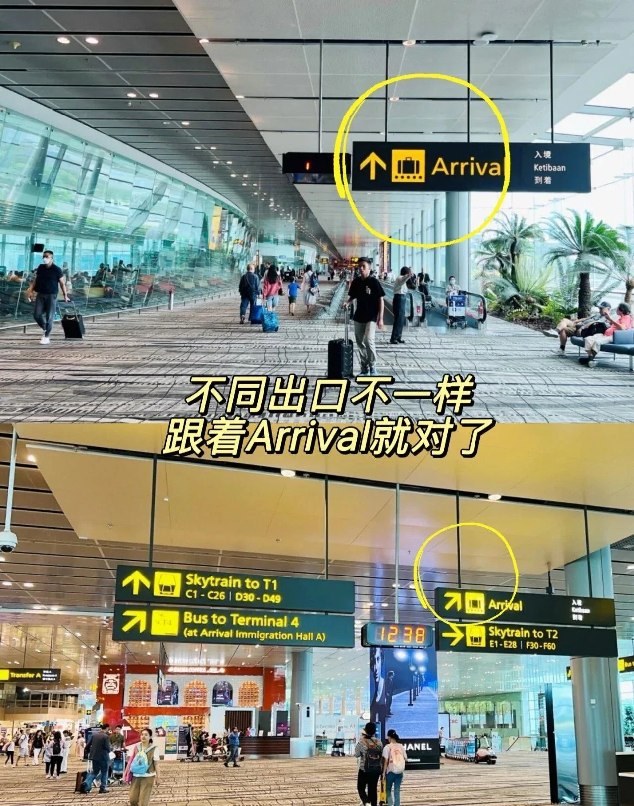

Bay đến Singapore mùa thu này? Đây là toàn bộ quy trình nhập cảnh, từ cổng máy bay đến lề đường — chỉ cần đi theo đám đông và bạn sẽ làm thủ tục nhập cảnh mà không rẽ nhầm.

## Bước 1: đi theo đám đông và biển Arrival

Hãy hướng tới Sảnh Nhập cảnh. Sau khi xuống máy bay, chỉ cần đi theo dòng hành khách và các mũi tên Arrival; lộ trình khác nhau tùy cổng, nhưng Arrival luôn chỉ đúng hướng.

## Bước 2: xuống tầng dưới để tới Sảnh Nhập cảnh

Đi theo biển chỉ dẫn và đi thang cuốn hoặc thang máy xuống — thang đưa bạn thẳng tới Sảnh Nhập cảnh của hải quan.

## Bước 3: cổng đầu tiên (quét hộ chiếu)

Bước tới cổng tự động và đặt trang ảnh của hộ chiếu úp xuống máy quét. Khi máy đọc xong, cổng đầu tiên mở ra.

## Bước 4: cổng thứ hai (sinh trắc học)

Bên trong, hãy làm theo hướng dẫn trên màn hình: nhìn thẳng vào camera để đăng ký khuôn mặt, rồi làm theo hướng dẫn lấy vân tay. Khi xác minh thành công, cổng mở ra và bạn đã hoàn tất nhập cảnh.

## ⚠️ Trước đó: khai báo thẻ nhập cảnh

Bạn không thể làm thủ tục nhập cảnh nếu thiếu thẻ này. SG Arrival Card điện tử được liên kết với hộ chiếu của bạn sau khi gửi, nên bạn không bao giờ phải xuất trình một giấy tờ riêng tại cổng.

Có bảng nhắc nhở tại chỗ, và bạn có thể điền qua WiFi của sân bay trong khoảng năm phút. Lần đầu làm biểu mẫu này? Hãy xem hướng dẫn từng bước của chúng tôi.

## Phụ lục: bản đồ sân bay Changi

Nếu bạn chỉ quá cảnh, bản đồ này đáng để xem — nó cho thấy các nhà ga nằm với nhau như thế nào.

## Phụ lục: bản đồ MRT Singapore

## Liên kết liên quan

- **Trên trang này**: [Sân bay Changi Singapore (SIN)](/airport/SIN), [Singapore (SG)](/country/SG)
- **Wikipedia**: [Sân bay Changi Singapore](https://en.wikipedia.org/wiki/Singapore_Changi_Airport)
- **Baidu Baike**: [Sân bay Changi Singapore](https://baike.baidu.com/item/%E6%96%B0%E5%8A%A0%E5%9D%A1%E6%A8%9F%E5%AE%9C%E6%9C%BA%E5%9C%BA)
