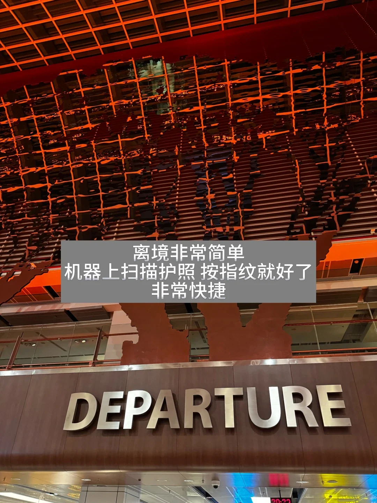

Odlet z Changi funguje jinak než na většině letišť: odbavení se otevírá celé hodiny dopředu, zavazadla se odevzdávají nejdřív, vrácení GST probíhá ještě před pasovou kontrolou a bezpečnostní kontrola je až u nástupního gatu. Když dodržíte správné pořadí, odlet z terminálu 1 vám dá dvě nebo tři hodiny navíc – přesně tolik, kolik potřebujete na sousední Jewel. Seznamy aerolinek i otevírací hodiny se mění, proto si před cestou ověřte web letiště a údaje své aerolinky.

Pokud váš terminál nebo aerolinka v seznamu nejsou, zbytek postupu platí dál; přijdete jen o čas v Jewel.

## 1. Brzké odbavení: náskok, který mají jen odlety z T1

Odletové patro T1 je úroveň 2, přílety a Jewel úroveň 1 a autobusová zastávka je v B2. MRT vás vysadí na stanici Changi Airport a ještě zbývá jízda Skytrainem; taxíky zastavují u odletů. Držte se značek a nejdřív vyřešte zavazadla.

Standardní odbavení se otevírá asi tři hodiny před odletem; brzké odbavení tento čas posouvá výrazně dřív. Hala v Jewel je otevřená denně od 08:00 do 23:59 a zapojené aerolinky přijímají odbavení i zavazadla v okně od tří hodin do 12, 18 nebo dokonce 24 hodin před odletem. Pult není v odletové hale – jděte po cedulích s nápisem Early Check-in přes spojovací most.

Nejdřív si přečtěte omezení: jen lety z T1 a jen zapojené aerolinky, takže cestující z T2, T3 a T4 tuto službu využít nemohou. Jakmile je zavazadlo odbavené, už si ho nevyzvednete, proto pas, powerbanky, léky a bundu nechte v kabinovém zavazadle.

## 2. Časová okna a aerolinky: nejdřív si potvrďte svůj let

Okna se dost liší. Tabulka ukazuje rozsah uvedený přímo na místě; seznam i hodiny se mění, proto si vše ověřte, než si naplánujete den.

| Letecká společnost | Odbavení od | Poznámka |
| --- | --- | --- |
| Singapore Airlines, Turkish Airlines | 3–24 hodin | Nejdelší okno; ranní let lze odbavit už předchozí večer |
| Scoot | 3–18 hodin | Nejdelší okno mezi nízkonákladovými dopravci |
| Cathay Pacific, Japan Airlines, AirAsia | 3–12 hodin | Hodí se pro odpolední a večerní lety |
| Air France, EVA Air, Qantas, Malaysia Airlines a další | 3–12 hodin | Ověřte na obrazovce na místě |

Aerolinky, které v seznamu nejsou, obvykle odbavují ve standardním čase v odletové hale. Seznam se navíc liší podle terminálu a data; nadrozměrné předměty, jako jsou surfy, kočárky a hudební nástroje, patří k samostatnému pultu.

Chcete-li Jewel pořádně využít, dorazte čtyři hodiny předem: odbavení a vrácení daně zaberou asi 40 minut, dvě hodiny zbudou na nákupy a jídlo a 20 minut pokryje cestu přes pasovou kontrolu ke gatu. Na rychlou podívanou na Rain Vortex stačí tři hodiny. Pokud váš let v seznamu není, dorazte tři hodiny předem a nakupujte až po pasové kontrole – tranzitní část T1 má také obchody a restaurace.

## 3. Vrácení GST probíhá před pasovou kontrolou

GST v Singapuru je nyní 9 % a vrácení turistům probíhá přes systém eTRS. Potřebujete nákup alespoň 100 S$ u jednoho prodejce v tentýž den, přičemž můžete spojit až tři účtenky ze stejného dne, a v obchodě si musíte vyžádat eTRS doklad s zaznamenanými údaji z pasu.

Samoobslužné kiosky stojí v odbavovací hale, ještě před pasovou kontrolou. Jsou rozmístěné po celé hale, takže použijte ten, který je volný; v rušném ránu se vyplatí vyřídit to nejdřív a nakupovat až potom. Naskenujte pas, načtou se všechny způsobilé transakce, a pak si vyberte vrácení na kreditní kartu, přes Alipay, nebo v hotovosti u přepážky.

Jedno pravidlo lidi často zaskočí: zboží, které odbavujete do zavazadlového prostoru, je nutné vyřídit ještě před odevzdáním kufru, pro případ, že by si ho celnice chtěla prohlédnout; zboží, které nesete u sebe, lze vyřídit až po pasové kontrole.

Několik pevných pravidel: vyřizujte to na terminálu, ze kterého skutečně odlétáte; karty vydané v Singapuru vrácení daně přijmout nemohou; vyřízené zboží se už nesmí vrátit do odletové haly ani ho předat někomu jinému. Vyplácená částka je po odečtení manipulačního poplatku a platí kurz uvedený na vašem eTRS dokladu.

## 4. Pasová kontrola, bezpečnostní kontrola a gat: cesta zpět neexistuje

Když máte odbavení i vrácení daně za sebou, jděte po značkách Departure nahoru do odletového patra a projděte pasovou kontrolou.

Automatizované přepážky naskenují pas a porovnají obličej; většina cestujících projde za méně než minutu. S malými dětmi nebo s nečitelným pasem použijte přepážku s obsluhou.

Klíčová věta: jakmile projdete pasovou kontrolou, do Jewel se už nevrátíte. To určuje pořadí – odbavte se a odevzdejte zavazadla, vyřiďte vrácení daně, navštivte Jewel a teprve pak projděte pasovou kontrolou. Když to uděláte naopak, vy i vaše zavazadla skončíte na opačných stranách bariéry.

Bezpečnostní kontrola je u nástupního gatu, ne v hale pasové kontroly. Za pasovou kontrolou jsou bezcelní obchody a restaurace a můžete si prohlížet, dokud není čas se postavit do fronty. Nástup obvykle začíná 30–40 minut před odletem a fronta se s blížícím se letem prodlužuje. Bezcelní limity se řídí vaší konečnou destinací, ne Singapurem, proto si před nákupem alkoholu nebo kosmetiky ověřte, co vaše destinace povoluje.

## 5. Co dělat s časem navíc v Jewel

Jewel je pár minut chůze od příletů T1 a nepotřebujete na něj palubní vstupenku. Rain Vortex padá z kopulovité střechy a večer má světelnou show, Forest Valley kolem něj je okruh procházek. Placené atrakce najdete v nejvyšším patře v Canopy Park – Sky Nets, Mirror Maze, Hedge Maze – s cenami a otevírací dobou uvedenými na místě.

Dvě nebo tři hodiny se dají pěkně rozdělit: projděte Forest Valley a podívejte se na Rain Vortex, vyjeďte do Canopy Park a pak se najezte v B1 nebo L1. Značkové obchody od L1 výš vydají na celé odpoledne; s dětmi herní plochy v Canopy Park spolknou překvapivě mnoho času.

Zavazadla jsou největší proměnná. Pokud brzké odbavení ještě nezačalo nebo se vaše aerolinka neúčastní, má Jewel placenou úschovnu v B1 účtovanou za kus a hodinu; o odbavená zavazadla se starat nemusíte.

Časový plán počítaný zpět od odletu:

- 4 hodiny: příjezd na T1, brzké odbavení a odevzdání zavazadel
- 3 hodiny 20 minut: vyřízení vrácení GST v odletové hale, nejdřív celní přepážka, pokud si vaše zboží vyžádá kontrolu
- 3 hodiny: odchod do Jewel – jídlo, nákupy a Rain Vortex
- 1 hodina 10 minut: zpět na T1 a pasová kontrola
- 40 minut: u gatu na bezpečnostní kontrolu a nástup

Dva časy lidi zaskočí: hala se otevírá v 08:00 a zavírá ve 23:59, takže velmi brzké a pozdní lety se odbavují jen u přepážky. Jewel a gaty leží na opačných stranách pasové kontroly, proto si na cestu zpět a frontu nechte dost času.

## Související odkazy

- **Na tomto webu**: [Letiště Singapore Changi (SIN)](/airport/SIN), [Singapur (SG)](/country/SG)
- **Wikipedie**: [Singapore Changi Airport](https://en.wikipedia.org/wiki/Singapore_Changi_Airport), [Jewel Changi Airport](https://en.wikipedia.org/wiki/Jewel_Changi_Airport)
- **Baidu Baike**: [Singapore Changi Airport](https://baike.baidu.com/item/%E6%96%B0%E5%8A%A0%E5%9D%A1%E6%A8%9F%E5%AE%9C%E6%9C%BA%E5%9C%BA)

Účast aerolinek a časová okna, limity pro vrácení daně i časy nástupu se řídí aktuálními oznámeními letiště Changi, singapurské celnice a vaší aerolinky. Zdroj obrázků: cestovatelský průvodce na WeChatu.
