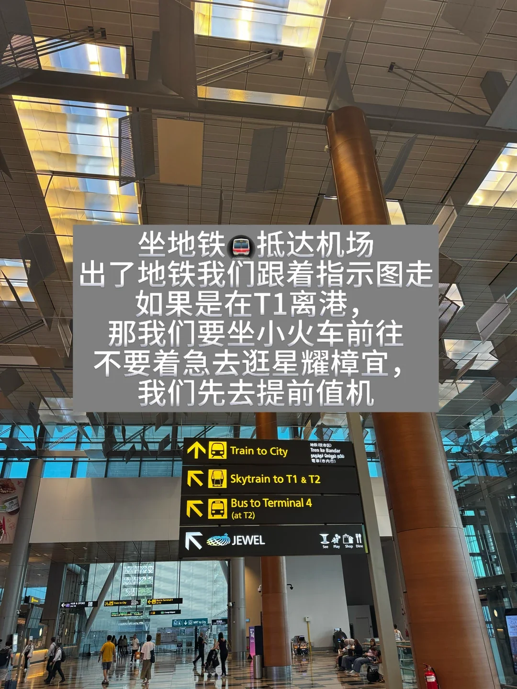
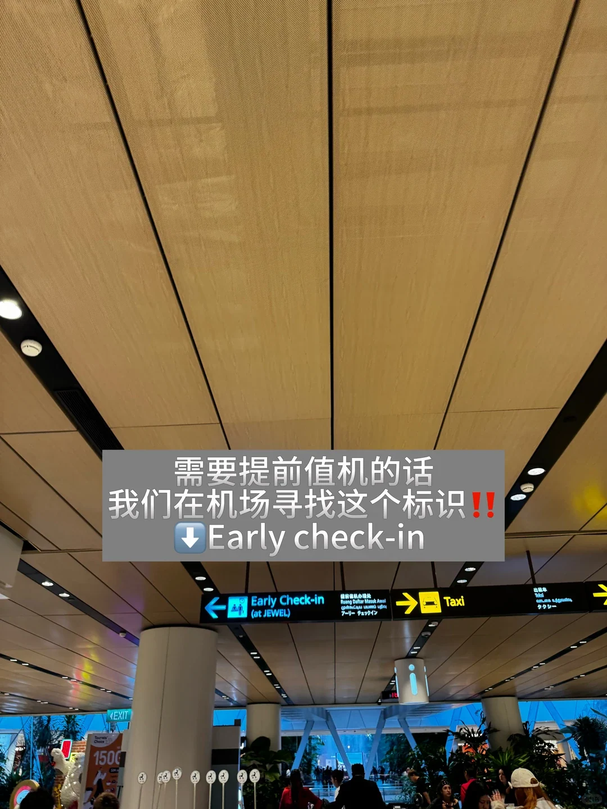
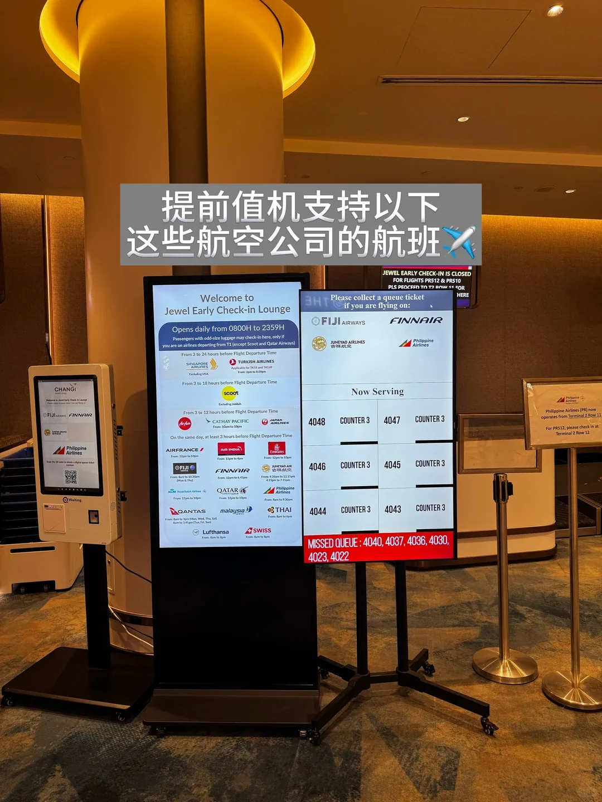
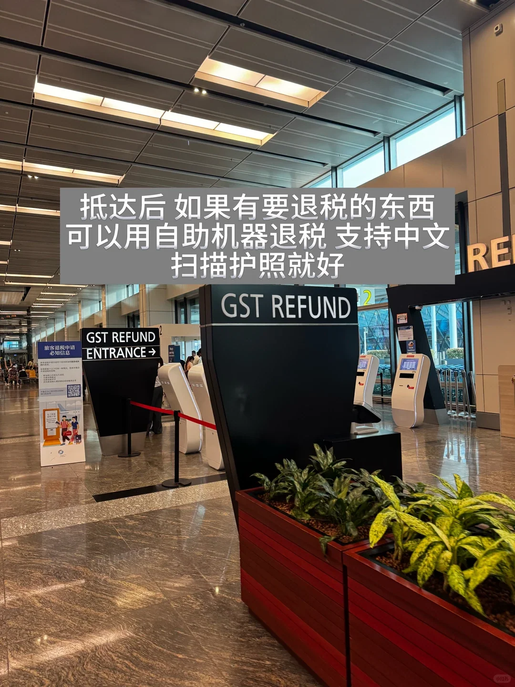
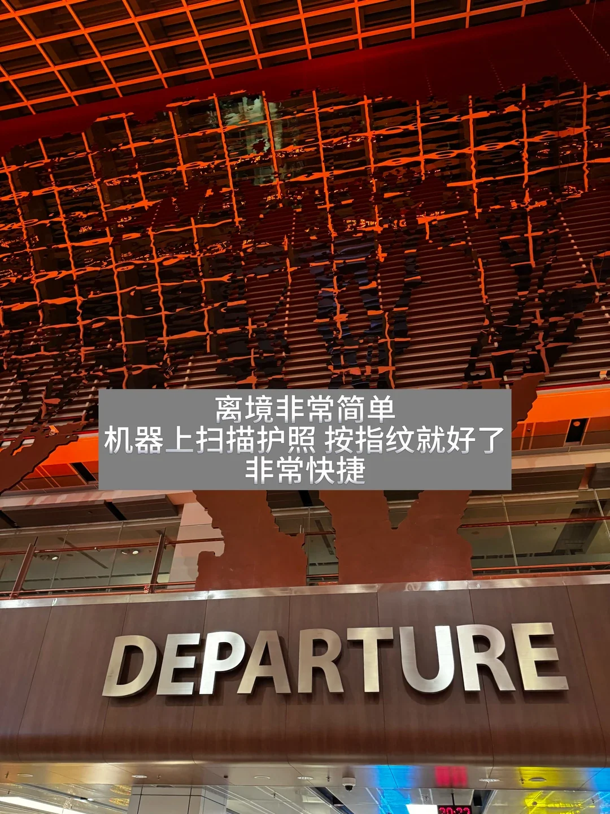
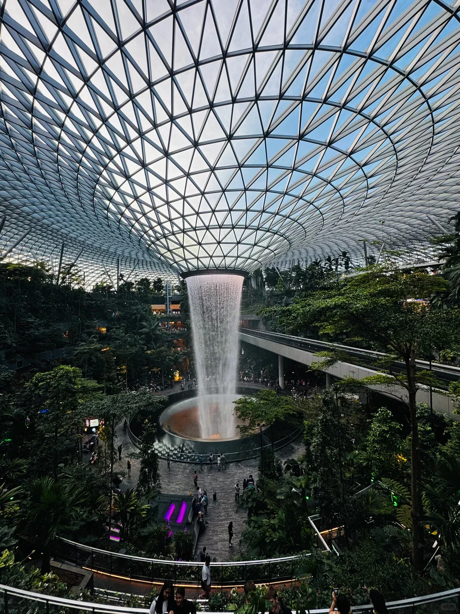
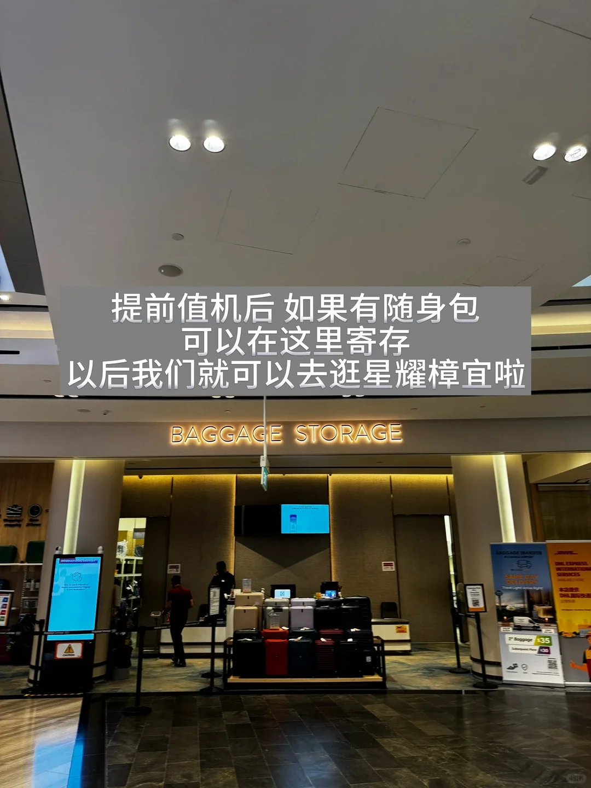

Der Abflug ab Changi funktioniert anders als an den meisten Flughäfen: Der Check-in öffnet Stunden früher, das Gepäck geht zuerst, die GST-Rückerstattung erfolgt vor der Einreise, und die Sicherheitskontrolle befindet sich am Boarding-Gate. Wenn die Reihenfolge stimmt, verschafft Ihnen ein Abflug ab Terminal 1 zwei oder drei freie Stunden – genau genug für Jewel nebenan. Airline-Listen und Öffnungszeiten ändern sich; prüfen Sie daher vor der Reise die Website des Flughafens und Ihre Airline.

Wenn Ihr Terminal oder Ihre Airline nicht aufgeführt ist, gilt der restliche Ablauf weiterhin; Sie verlieren nur die Zeit in Jewel.

## 1. Frühzeitiger Check-in: die Zeit, die nur Abflüge ab T1 bekommen

Die Abflugebene von T1 ist Ebene 2, Ankünfte und Jewel liegen auf Ebene 1, und B2 ist die Bushaltestelle. Die MRT bringt Sie zur Station Changi Airport, von dort ist noch eine Fahrt mit dem Skytrain nötig; Taxis halten am Abflugbereich. Folgen Sie den Schildern und kümmern Sie sich zuerst um das Gepäck.

Der reguläre Check-in öffnet etwa drei Stunden vor dem Abflug; der frühe Check-in schiebt diese Grenze nach vorn. Die Halle in Jewel ist täglich von 08:00 bis 23:59 Uhr geöffnet, und teilnehmende Airlines nehmen Check-in und Gepäck von drei Stunden vor dem Flug bis zu 12, 18 oder sogar 24 Stunden vorher an. Der Schalter liegt nicht in der Abflughalle – folgen Sie den Schildern für den Early Check-in über die Verbindungsbrücke.

Lesen Sie zuerst die Einschränkungen: nur Flüge ab T1, nur teilnehmende Airlines, sodass Passagiere von T2, T3 und T4 ihn nicht nutzen können. Sobald ein Koffer aufgegeben ist, können Sie ihn nicht zurückholen; Pässe, Powerbanks, Medikamente und eine Jacke bleiben daher im Handgepäck.

## 2. Zeitfenster und Airlines: Bestätigen Sie zuerst Ihren Flug

Die Zeitfenster variieren stark. Die Tabelle zeigt die vor Ort veröffentlichte Bandbreite; die Liste und die Zeiten ändern sich, bestätigen Sie sie also, bevor Sie Ihren Tag planen.

| Airline | Check-in ab | Hinweis |
| --- | --- | --- |
| Singapore Airlines, Turkish Airlines | 3–24 Stunden | Das längste Zeitfenster; ein früher Flug kann am Abend zuvor eingecheckt werden |
| Scoot | 3–18 Stunden | Das früheste Zeitfenster der Billigfluggesellschaften |
| Cathay Pacific, Japan Airlines, AirAsia | 3–12 Stunden | Geeignet für Nachmittags- und Abendflüge |
| Air France, EVA Air, Qantas, Malaysia Airlines und andere | 3–12 Stunden | Prüfen Sie den Bildschirm vor Ort |

Nicht aufgeführte Airlines checken in der Regel zur regulären Zeit in der Abflughalle ein. Die Liste variiert außerdem je nach Terminal und Datum; Sondergepäck wie Surfboards, Kinderwagen und Instrumente geht an einen eigenen Schalter.

Um Jewel richtig zu nutzen, kommen Sie vier Stunden vorher: Check-in und Rückerstattung dauern etwa 40 Minuten, zwei Stunden bleiben für Einkäufe und eine Mahlzeit, und 20 Minuten decken den Weg durch die Einreise zum Gate ab. Für einen kurzen Blick auf den Rain Vortex reichen drei Stunden. Wenn Ihr Flug nicht auf der Liste steht, kommen Sie drei Stunden vorher und kaufen Sie nach der Einreise ein – der Transitbereich von T1 hat ebenfalls Shops und Restaurants.

## 3. Die GST-Rückerstattung kommt vor der Einreise

Die GST in Singapur beträgt derzeit 9 %, und die Touristenerstattung läuft über eTRS. Sie benötigen mindestens 100 S$ Umsatz bei einem Händler am selben Tag, wobei Sie bis zu drei Quittungen desselben Tages zusammenfassen können, und müssen den Shop um ein eTRS-Ticket bitten, in dem Ihre Passdaten erfasst sind.

Die Selbstbedienungsautomaten stehen in der Check-in-Halle, vor der Einreise. Sie sind über die Halle verteilt, nutzen Sie also den freien; an einem geschäftigen Morgen lohnt es sich, dies zuerst zu erledigen und danach einzukaufen. Scannen Sie Ihren Pass, um alle erstattungsfähigen Transaktionen aufzurufen, und wählen Sie dann eine Erstattung auf Kreditkarte, Alipay oder Bargeld am Schalter.

Eine Regel bringt Menschen aus dem Konzept: Waren, die Sie aufgeben, müssen erstattet werden, bevor Sie den Koffer abgeben, falls der Zoll sie sehen möchte; Waren, die Sie mit sich führen, können nach der Einreise erstattet werden.

Ein paar harte Regeln: Beantragen Sie die Erstattung in dem Terminal, von dem Sie tatsächlich abfliegen; in Singapur ausgestellte Karten können die Erstattung nicht erhalten; bereits erstattete Waren dürfen nicht in die Abflughalle zurückgebracht oder an andere Personen weitergegeben werden. Die Auszahlung erfolgt abzüglich einer Bearbeitungsgebühr, und der auf Ihrem eTRS-Beleg angegebene Satz ist maßgeblich.

## 4. Einreise, Sicherheitskontrolle und Gate: keine Rückkehr

Wenn Check-in und Rückerstattung erledigt sind, folgen Sie den Schildern „Departure“ hinauf zur Abflugebene und passieren die Einreise.

Die automatisierten Spuren scannen Ihren Pass und gleichen Ihr Gesicht ab; die meisten Reisenden sind in weniger als einer Minute durch. Nutzen Sie eine besetzte Spur, wenn Sie kleine Kinder dabei haben oder Ihr Pass nicht lesbar ist.

Der entscheidende Satz: Sobald Sie die Einreise passiert haben, können Sie nicht nach Jewel zurückkehren. Das legt die Reihenfolge fest – einchecken und Gepäck aufgeben, Rückerstattung beantragen, Jewel besuchen, dann die Einreise passieren. Machen Sie es umgekehrt, landen Sie und Ihr Gepäck auf verschiedenen Seiten der Absperrung.

Die Sicherheitskontrolle findet am Boarding-Gate statt, nicht in der Einreisehalle. Nach der Einreise kommen die Duty-Free-Shops und Restaurants, und Sie können stöbern, bis es Zeit für die Schlange ist. Das Boarding beginnt meist 30–40 Minuten vor dem Abflug, und die Schlange wird länger, je näher der Flug kommt. Duty-Free-Freimengen richten sich nach Ihrem endgültigen Ziel, nicht nach Singapur; prüfen Sie daher, was Ihr Ziel erlaubt, bevor Sie Alkohol oder Kosmetik kaufen.

## 5. Was Sie mit der zusätzlichen Zeit in Jewel anfangen

Jewel ist wenige Minuten zu Fuß von den Ankünften in T1 entfernt und benötigt keine Bordkarte. Der Rain Vortex fällt aus dem Kuppeldach und hat abends eine Lichtshow, und das Forest Valley darum herum ist ein Rundweg aus Stegen. Die kostenpflichtigen Attraktionen liegen auf der obersten Ebene im Canopy Park – Sky Nets, Mirror Maze, Hedge Maze –, mit Preisen und Öffnungszeiten vor Ort.

Zwei oder drei Stunden lassen sich gut aufteilen: das Forest Valley durchwandern und den Rain Vortex ansehen, hinauf zum Canopy Park gehen und dann auf B1 oder L1 essen. Die Markengeschäfte ab L1 füllen einen Nachmittag; mit Kindern schlucken die Spielbereiche im Canopy Park überraschend viel Zeit.

Das Gepäck ist die größte Variable. Wenn der frühe Check-in noch nicht geöffnet hat oder Ihre Airline nicht teilnimmt, bietet Jewel auf B1 kostenpflichtige Aufbewahrung pro Stück und Stunde an; bereits aufgegebenes Gepäck ist nicht Ihr Problem.

Ein Zeitplan, vom Abflug rückwärts gerechnet:

- 4 Stunden: Ankunft in T1, früh einchecken und Gepäck aufgeben
- 3 Stunden 20 Minuten: GST-Rückerstattung in der Abflughalle beantragen, zuerst am Zollschalter, wenn Ihre Waren aufgerufen werden
- 3 Stunden: nach Jewel gehen, essen, einkaufen und den Rain Vortex ansehen
- 1 Stunde 10 Minuten: zurück nach T1 und durch die Einreise
- 40 Minuten: am Gate für Sicherheitskontrolle und Boarding

Zwei Uhrzeiten überraschen viele: Die Halle öffnet um 08:00 Uhr und schließt um 23:59 Uhr, frühe und späte Flüge gehen also zum Schalter. Jewel und die Gates liegen auf entgegengesetzten Seiten der Einreise, planen Sie daher den Fußweg und die Schlange für den Rückweg ein.

## Weiterführende Links

- **Auf dieser Website**: [Singapore Changi Airport (SIN)](/airport/SIN), [Singapur (SG)](/country/SG)
- **Wikipedia**: [Singapore Changi Airport](https://en.wikipedia.org/wiki/Singapore_Changi_Airport), [Jewel Changi Airport](https://en.wikipedia.org/wiki/Jewel_Changi_Airport)
- **Baidu Baike**: [Singapore Changi Airport](https://baike.baidu.com/item/%E6%96%B0%E5%8A%A0%E5%9D%A1%E6%A8%9F%E5%AE%9C%E6%9C%BA%E5%9C%BA)

Airline-Teilnahme und Zeitfenster, Erstattungsschwellen und Boarding-Zeiten folgen den aktuellen Hinweisen von Changi Airport, Singapore Customs und Ihrer Airline. Bildnachweis: WeChat-Reiseführer.
