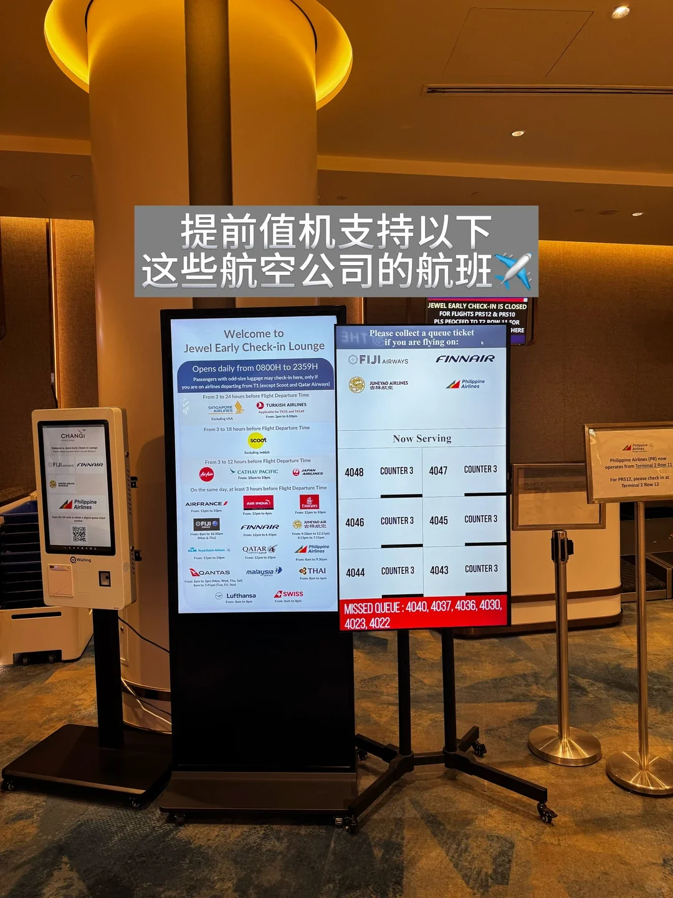

Berangkat dari Changi bekerja berbeda dari sebagian besar bandara: check-in dibuka beberapa jam lebih awal, bagasi diperiksa lebih dulu, pengembalian GST dilakukan sebelum imigrasi, dan keamanan berada di gerbang boarding. Jika urutannya benar, keberangkatan dari Terminal 1 memberi Anda dua atau tiga jam ekstra — tepat cukup untuk Jewel di sebelahnya. Daftar maskapai dan jam berubah, jadi periksa situs web bandara dan maskapai Anda sebelum bepergian.

Jika terminal atau maskapai Anda tidak tercantum, sisa urutannya tetap berlaku; Anda hanya kehilangan waktu untuk Jewel.

## 1. Check-in awal: waktu yang hanya didapat penumpang T1

Lantai keberangkatan T1 adalah lantai 2, kedatangan dan Jewel di lantai 1, dan B2 adalah halte bus. MRT meninggalkan Anda di stasiun Bandara Changi dengan perjalanan Skytrain yang masih harus ditempuh; taksi menurunkan penumpang di lantai keberangkatan. Ikuti tanda dan urus bagasi terlebih dahulu.

Check-in standar dibuka sekitar tiga jam sebelum keberangkatan; check-in awal memundurkan waktu itu. Aula di dalam Jewel buka setiap hari 08.00–23.59, dan maskapai peserta menerima check-in serta bagasi mulai tiga jam sebelum penerbangan hingga 12, 18, atau bahkan 24 jam. Konternya bukan di aula keberangkatan — ikuti tanda Early Check-in melintasi jembatan penghubung.

Baca batasannya dulu: hanya penerbangan T1, hanya maskapai peserta, jadi penumpang T2, T3, dan T4 tidak dapat menggunakannya. Setelah bagasi diperiksa, Anda tidak dapat mengambilnya kembali, jadi paspor, power bank, obat-obatan, dan jaket tetap di tas kabin.

## 2. Jendela waktu dan maskapai: konfirmasi penerbangan Anda dulu

Jendela waktunya sangat bervariasi. Tabel menunjukkan rentang yang terpasang di lokasi; daftar dan jam berubah, jadi konfirmasikan sebelum merencanakan hari Anda.

| Maskapai | Check-in mulai | Catatan |
| --- | --- | --- |
| Singapore Airlines, Turkish Airlines | 3–24 jam | Jendela terpanjang; penerbangan pagi dapat di-check-in pada malam sebelumnya |
| Scoot | 3–18 jam | Yang paling awal di antara maskapai berbiaya rendah |
| Cathay Pacific, Japan Airlines, AirAsia | 3–12 jam | Cocok untuk penerbangan sore dan malam |
| Air France, EVA Air, Qantas, Malaysia Airlines, dan lainnya | 3–12 jam | Periksa layar di lokasi |

Maskapai yang tidak tercantum biasanya check-in pada waktu standar di aula keberangkatan. Daftarnya juga bervariasi menurut terminal dan tanggal; barang berukuran tidak biasa seperti papan selancar, kereta dorong bayi, dan instrumen musik dialihkan ke konter khusus.

Untuk memanfaatkan Jewel dengan baik, tiba empat jam lebih awal: check-in dan pengembalian dana memakan waktu sekitar 40 menit, dua jam tersisa untuk berbelanja dan makan, dan 20 menit untuk berjalan melewati imigrasi ke gerbang. Untuk melihat Rain Vortex sekilas, tiga jam sudah cukup. Jika penerbangan Anda tidak ada dalam daftar, tiba tiga jam lebih awal dan berbelanja setelah imigrasi — area transit T1 juga memiliki toko dan restoran.

## 3. Pengembalian GST dilakukan sebelum imigrasi

GST Singapura saat ini 9%, dan pengembalian untuk wisatawan berjalan melalui eTRS. Anda memerlukan pengeluaran setidaknya S$100 di satu pengecer pada hari yang sama, dengan menggabungkan hingga tiga struk hari yang sama, dan harus meminta toko menerbitkan tiket eTRS dengan data paspor Anda tercatat.

Kios swalayan berada di aula check-in, sebelum imigrasi. Kiosnya tersebar, jadi gunakan yang kosong; pada pagi yang sibuk, lebih baik lakukan ini dulu dan berbelanja setelahnya. Pindai paspor Anda untuk menampilkan setiap transaksi yang memenuhi syarat, lalu pilih pengembalian ke kartu kredit, Alipay, atau tunai di konter.

Satu aturan sering membuat orang terkejut: barang yang Anda check-in harus diklaim sebelum Anda menyerahkan bagasi, untuk berjaga-jaga jika bea cukai ingin melihatnya; barang yang Anda bawa dapat diklaim setelah imigrasi.

Beberapa aturan keras: klaim di terminal tempat Anda benar-benar berangkat; kartu yang diterbitkan di Singapura tidak dapat menerima pengembalian; barang yang sudah diklaim tidak dapat kembali ke aula keberangkatan atau diserahkan kepada orang lain. Pembayaran bersih setelah biaya penanganan, dan kurs pada slip eTRS Anda yang berlaku.

## 4. Imigrasi, keamanan, dan gerbang: tidak ada jalan kembali

Setelah check-in dan pengembalian selesai, ikuti tanda Departure naik ke lantai keberangkatan dan lewati imigrasi.

Jalur otomatis memindai paspor Anda dan mencocokkan wajah; sebagian besar pelancong melewatinya dalam waktu kurang dari satu menit. Gunakan jalur dengan petugas jika Anda membawa anak kecil atau paspor tidak terbaca.

Kalimat kuncinya: setelah melewati imigrasi, Anda tidak dapat kembali ke Jewel. Itu menetapkan urutannya — check-in dan serahkan bagasi, klaim pengembalian, kunjungi Jewel, lalu lewati imigrasi. Lakukan dengan urutan terbalik dan Anda serta bagasi Anda berakhir di sisi yang salah dari pembatas.

Keamanan berada di gerbang boarding, bukan di aula imigrasi. Setelah imigrasi, ada toko bebas bea dan restoran, dan Anda dapat melihat-lihat sampai waktunya mengantre. Boarding biasanya dimulai 30–40 menit sebelum keberangkatan dan antreannya memanjang menjelang penerbangan. Batas bebas bea mengikuti tujuan akhir Anda, bukan Singapura, jadi periksa apa yang diizinkan tujuan Anda sebelum membeli alkohol atau kosmetik.

## 5. Apa yang harus dilakukan dengan waktu ekstra di Jewel

Jewel berjarak beberapa menit berjalan kaki dari kedatangan T1 dan tidak memerlukan boarding pass. Rain Vortex jatuh dari atap berkubah dan memiliki pertunjukan cahaya pada malam hari, dan Forest Valley di sekitarnya adalah jalur pejalan kaki yang melingkar. Atraksi berbayar berada di lantai paling atas di Canopy Park — Sky Nets, Mirror Maze, Hedge Maze — dengan harga dan jam terpasang di lokasi.

Dua atau tiga jam terbagi dengan rapi: jelajahi Forest Valley dan lihat Rain Vortex, naik ke Canopy Park, lalu makan di B1 atau L1. Toko-toko merek dari L1 ke atas dapat mengisi satu sore; jika membawa anak-anak, area bermain Canopy Park menyerap waktu yang mengejutkan banyaknya.

Bagasi adalah variabel terbesar. Jika check-in awal belum dibuka, atau maskapai Anda tidak berpartisipasi, Jewel memiliki penyimpanan berbayar di B1 yang dikenakan per keping dan per jam; bagasi yang sudah di-check-in bukan masalah Anda.

Jadwal, dihitung mundur dari keberangkatan:

- 4 jam: tiba di T1, check-in awal dan serahkan bagasi
- 3 jam 20 menit: klaim pengembalian GST di aula keberangkatan, konter bea cukai lebih dulu jika barang Anda dipanggil
- 3 jam: masuk ke Jewel untuk makan, berbelanja, dan melihat Rain Vortex
- 1 jam 10 menit: kembali ke T1 dan melewati imigrasi
- 40 menit: di gerbang untuk keamanan dan boarding

Dua waktu sering membuat orang terkejut: aula buka pukul 08.00 dan tutup pukul 23.59, jadi penerbangan pagi dan malam harus ke konter. Jewel dan gerbang berada di sisi berlawanan dari imigrasi, jadi perhitungkan jalan kaki dan antrean saat kembali.

## Tautan terkait

- **Di situs ini**: [Bandara Changi Singapura (SIN)](/airport/SIN), [Singapura (SG)](/country/SG)
- **Wikipedia**: [Singapore Changi Airport](https://en.wikipedia.org/wiki/Singapore_Changi_Airport), [Jewel Changi Airport](https://en.wikipedia.org/wiki/Jewel_Changi_Airport)
- **Baidu Baike**: [Singapore Changi Airport](https://baike.baidu.com/item/%E6%96%B0%E5%8A%A0%E5%9D%A1%E6%A8%9F%E5%AE%9C%E6%9C%BA%E5%9C%BA)

Partisipasi dan jendela waktu maskapai, ambang pengembalian dana, dan waktu boarding mengikuti pengumuman terkini dari Bandara Changi, Bea Cukai Singapura, dan maskapai Anda. Kredit gambar: panduan perjalanan WeChat.
