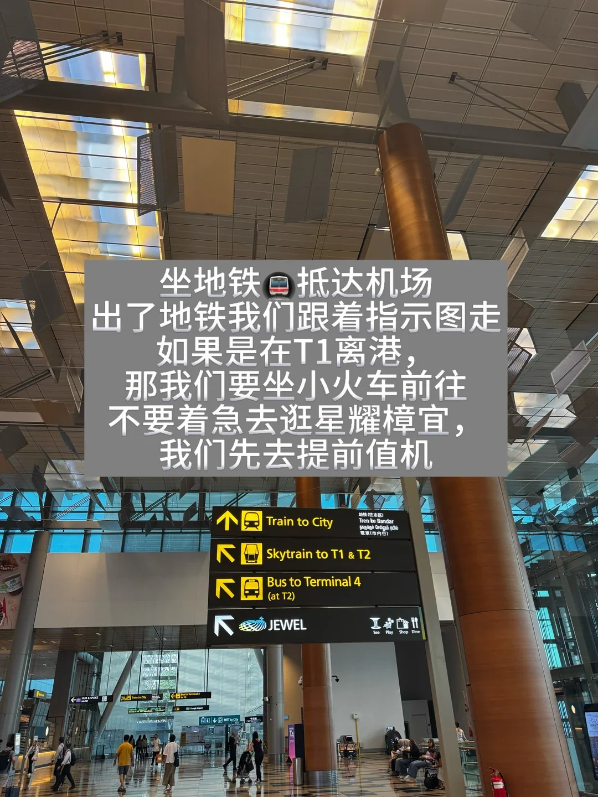
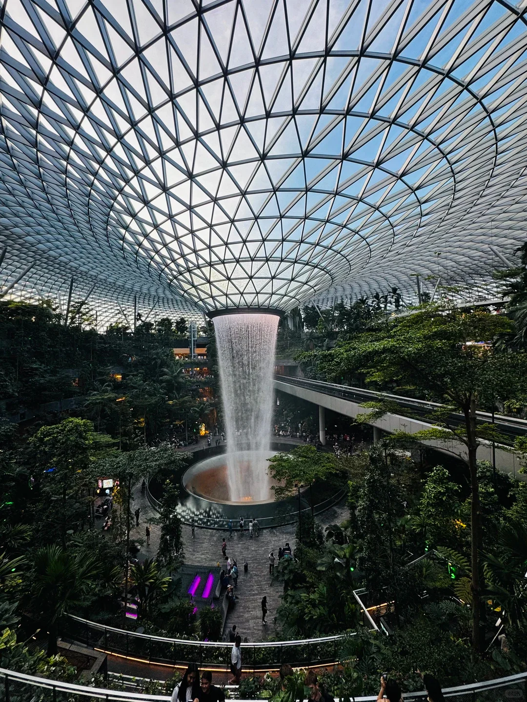

チャンギからの出発は多くの空港と勝手が違います。チェックインは数時間前から始まり、荷物を先に預け、GST還付は入国審査の前に行い、保安検査は搭乗口にあります。順番を間違えなければ、第1ターミナルからの出発では2〜3時間の余裕が生まれます。隣のジュエルを回るにはちょうどよい時間です。航空会社のリストと時間は変わるので、旅行前に空港のウェブサイトと航空会社で確認してください。

ターミナルや航空会社がリストになくても、残りの順序は同じです。ジュエルの時間がなくなるだけです。

## 1. アーリーチェックイン：T1出発者だけが得られる時間

T1の出発階は2階、到着とジュエルは1階、バス停はB2です。MRTはチャンギ空港駅までで、そこからスカイトレインに乗る必要があります。タクシーは出発階に着きます。表示に従い、まず荷物を片付けてください。

通常のチェックインは出発約3時間前に始まり、アーリーチェックインはそれをさらに前倒しします。ジュエル内のホールは毎日08:00〜23:59に開いており、参加航空会社は出発3時間前から12時間前、18時間前、場合によっては24時間前までチェックインと荷物を受け付けます。カウンターは出発ロビーにはありません。アーリーチェックインの表示に従って連絡橋を渡ってください。

まず制限を確認してください。T1発の便のみ、参加航空会社のみなので、T2、T3、T4の旅客は使えません。荷物を預けたら取り戻せないので、パスポート、モバイルバッテリー、薬、上着は機内持ち込み手荷物に入れてください。

## 2. 時間帯と航空会社：まず自分の便を確認

時間帯は大きく異なります。表は現地に掲載されている範囲です。リストと時間は変わるので、1日の計画を立てる前に確認してください。

| 航空会社 | チェックイン開始 | メモ |
| --- | --- | --- |
| シンガポール航空、ターキッシュ・エアラインズ | 3〜24時間前 | 最も長い時間帯。早朝便は前夜に預けられる |
| スクート | 3〜18時間前 | 格安航空会社では最も早い |
| キャセイパシフィック、日本航空、エアアジア | 3〜12時間前 | 午後・夜の便に向く |
| エールフランス、エバー航空、カンタス、マレーシア航空など | 3〜12時間前 | 現地の画面で確認 |

リストにない航空会社は通常、出発ロビーで標準時間にチェックインします。リストはターミナルと日付によっても変わります。サーフボード、ベビーカー、楽器などの特殊な荷物は専用カウンターに回されます。

ジュエルをしっかり楽しむなら4時間前に到着してください。チェックインと還付に約40分、買い物と食事に2時間、入国審査を通って搭乗口までの移動に20分です。レインボルテックスをさっと見るだけなら3時間で足ります。自分の便がリストにない場合は3時間前に到着し、入国審査後に買い物をしてください。T1の制限エリアにも店とレストランがあります。

## 3. GST還付は入国審査の前

シンガポールのGSTは現在9%で、旅行者の還付はeTRSで行います。同じ日に1つの小売店で最低S$100の購入が必要で、同日のレシートを最大3枚まで合算できます。店にパスポート情報を記録したeTRSチケットを発行してもらってください。

セルフサービス端末はチェックインロビー、入国審査の前にあります。あちこちに分散しているので、空いているものを使ってください。忙しい朝は、先にこれを済ませてから買い物をするほうが得です。パスポートをスキャンすると対象取引がすべて表示されるので、クレジットカード、Alipay、カウンターでの現金から還付方法を選びます。

見落としやすいルールが1つあります。預ける荷物は、税関が確認する可能性があるため、荷物を預ける前に還付を申請する必要があります。持ち込む荷物は入国審査後に申請できます。

いくつかの厳格なルールがあります。実際に出発するターミナルで申請すること。シンガポール発行のカードは還付を受け取れません。還付申請した商品は出発ロビーに戻せず、他人に渡すこともできません。支払額は手数料を差し引いた額で、eTRS伝票のレートが適用されます。

## 4. 入国審査、保安検査、搭乗口：後戻りはできない

チェックインと還付が済んだら、Departureの表示に従って出発階へ上がり、入国審査を通ります。

自動ゲートはパスポートをスキャンし、顔を照合します。ほとんどの旅行者は1分以内に通過します。小さな子ども連れや読み取れないパスポートの場合は係員のレーンを使ってください。

重要なのはこの一文です。入国審査を通過すると、ジュエルには戻れません。これで順番が決まります。チェックインして荷物を預け、還付を申請し、ジュエルを訪れ、それから入国審査を通ります。逆にすると、自分と荷物が仕切りの反対側に分かれてしまいます。

保安検査は入国審査場ではなく搭乗口にあります。入国審査の先には免税店とレストランがあり、列に並ぶ時間まで見て回れます。搭乗は通常出発30〜40分前に始まり、便が近づくほど列が長くなります。免税の許容量はシンガポールではなく最終目的地の規則に従うので、酒や化粧品を買う前に目的地の許容量を確認してください。

## 5. 余った時間をジュエルでどう使うか

ジュエルはT1到着から徒歩数分で、搭乗券は不要です。レインボルテックスはドーム屋根から落下し、夜にはライトショーがあります。周囲のフォレストバレーは遊歩道のループです。有料アトラクションは最上階のキャノピーパークにあり、スカイネット、ミラーメイズ、ヘッジメイズなどで、料金と時間は現地に掲載されています。

2〜3時間はきれいに分かれます。フォレストバレーを歩いてレインボルテックスを見て、キャノピーパークに上がり、B1かL1で食事をします。L1以上のブランド店は午後を埋めます。子ども連れなら、キャノピーパークの遊び場は驚くほど時間を消費します。

最大の変数は荷物です。アーリーチェックインが始まっていない、または航空会社が参加していない場合、ジュエルにはB1に個数と時間で課金される有料預かりがあります。預け済みの荷物は関係ありません。

出発時刻から逆算したタイムテーブルです。

- 4時間前：T1に到着し、アーリーチェックインで荷物を預ける
- 3時間20分前：出発ロビーでGST還付を申請。商品の確認を求められたら先に税関カウンターへ
- 3時間前：ジュエルへ入り、食事、買い物、レインボルテックス
- 1時間10分前：T1に戻り、入国審査を通る
- 40分前：搭乗口で保安検査と搭乗

見落としやすい時間が2つあります。ホールは08:00に開き23:59に閉まるので、早朝便と深夜便は通常カウンターを使います。ジュエルと搭乗口は入国審査を挟んで反対側にあるので、戻りの徒歩と列の時間を見込んでください。

## 関連リンク

- **このサイト内**：[シンガポール・チャンギ空港 (SIN)](/airport/SIN)、[シンガポール (SG)](/country/SG)
- **Wikipedia**：[シンガポール・チャンギ空港](https://en.wikipedia.org/wiki/Singapore_Changi_Airport)、[ジュエル・チャンギ空港](https://en.wikipedia.org/wiki/Jewel_Changi_Airport)
- **百度百科**：[シンガポール・チャンギ空港](https://baike.baidu.com/item/%E6%96%B0%E5%8A%A0%E5%9D%A1%E6%A8%9F%E5%AE%9C%E6%9C%BA%E5%9C%BA)

航空会社の参加状況と時間帯、還付の条件、搭乗時刻は、チャンギ空港、シンガポール税関、および各航空会社の最新の案内によります。画像提供：WeChat旅行ガイド。
