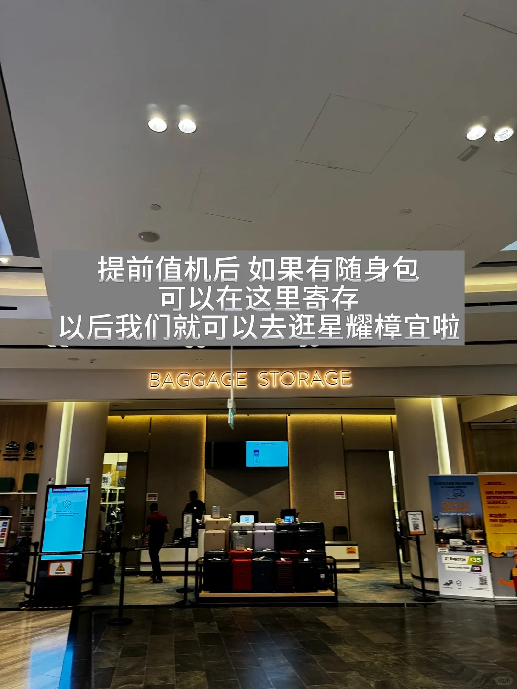

Embarcar em Changi funciona de modo diferente da maioria dos aeroportos: o check-in abre horas antes, as bagagens vão primeiro, o reembolso do GST acontece antes da imigração e a segurança fica no portão de embarque. Acerte a ordem e um embarque no Terminal 1 lhe dá duas ou três horas livres — exatamente o suficiente para o Jewel ao lado. As listas de companhias e os horários mudam, então consulte o site do aeroporto e a sua companhia aérea antes de viajar.

Se o seu terminal ou a sua companhia não estiver na lista, o restante da sequência continua valendo; você só perde o tempo no Jewel.

## 1. Check-in antecipado: o tempo que só quem embarca no T1 ganha

O andar de embarque do T1 é o nível 2, o desembarque e o Jewel ficam no nível 1, e o B2 é a parada de ônibus. O MRT deixa você na estação Changi Airport ainda com um trecho de Skytrain pela frente; os táxis param no embarque. Siga as placas e resolva as bagagens primeiro.

O check-in padrão abre cerca de três horas antes da partida; o check-in antecipado amplia essa janela. O saguão dentro do Jewel funciona diariamente das 08:00 às 23:59, e as companhias participantes aceitam check-in e bagagens de três horas antes do voo até 12, 18 ou mesmo 24 horas. O balcão não fica no saguão de embarque — siga as placas de Early Check-in pela ponte de ligação.

Leia os limites primeiro: só voos do T1, só companhias participantes, então passageiros do T2, T3 e T4 não podem usar. Depois que uma bagagem é despachada, você não pode retirá-la, então passaporte, power banks, medicamentos e um casaco ficam na bagagem de mão.

## 2. Janelas de tempo e companhias: confirme seu voo primeiro

As janelas variam bastante. A tabela mostra a faixa divulgada no local; a lista e os horários mudam, então confirme antes de planejar o dia.

| Companhia aérea | Check-in a partir de | Observação |
| --- | --- | --- |
| Singapore Airlines, Turkish Airlines | 3–24 horas | A janela mais longa; um voo cedo pode ser despachado na noite anterior |
| Scoot | 3–18 horas | A mais cedo entre as companhias de baixo custo |
| Cathay Pacific, Japan Airlines, AirAsia | 3–12 horas | Serve para voos de tarde e de noite |
| Air France, EVA Air, Qantas, Malaysia Airlines e outras | 3–12 horas | Confira a tela no local |

As companhias não listadas geralmente fazem check-in no horário padrão, no saguão de embarque. A lista também varia por terminal e por data; itens de tamanho incomum, como pranchas de surfe, carrinhos de bebê e instrumentos, vão para um balcão dedicado.

Para aproveitar o Jewel de verdade, chegue quatro horas antes: o check-in e o reembolso levam cerca de 40 minutos, sobram duas horas para compras e uma refeição, e 20 minutos cobrem a caminhada pela imigração até o portão. Para uma olhada rápida no Rain Vortex, três horas bastam. Se o seu voo não está na lista, chegue três horas antes e compre depois da imigração — a área de trânsito do T1 também tem lojas e restaurantes.

## 3. O reembolso do GST vem antes da imigração

O GST de Singapura está atualmente em 9%, e os reembolsos para turistas passam pelo eTRS. Você precisa de pelo menos S$100 gastos em um mesmo varejista no mesmo dia, combinando até três recibos do mesmo dia, e deve pedir à loja um bilhete eTRS com os dados do seu passaporte registrados.

Os quiosques de autoatendimento ficam no saguão de check-in, antes da imigração. Eles estão espalhados, então use o que estiver livre; em uma manhã movimentada, vale a pena fazer isso primeiro e comprar depois. Leia seu passaporte para puxar todas as transações elegíveis e depois escolha o reembolso no cartão de crédito, no Alipay ou em dinheiro no balcão.

Uma regra pega as pessoas de surpresa: os produtos que você vai despachar precisam ter o reembolso solicitado antes de entregar a bagagem, caso a alfândega queira vê-los; os produtos que você leva na mão podem ter o reembolso solicitado depois da imigração.

Algumas regras rígidas: solicite o reembolso no terminal de onde você realmente parte; cartões emitidos em Singapura não podem receber o reembolso; produtos com reembolso solicitado não podem voltar ao saguão de embarque nem ser entregues a outra pessoa. O valor pago é líquido de uma taxa de manuseio, e vale a cotação do seu comprovante eTRS.

## 4. Imigração, segurança e portão: sem volta

Com o check-in e o reembolso feitos, siga as placas de “Departure” até o nível de embarque e passe pela imigração.

As faixas automatizadas leem seu passaporte e comparam seu rosto; a maioria dos viajantes passa em menos de um minuto. Use uma faixa com atendente se estiver com crianças pequenas ou se o passaporte não for legível.

A frase-chave: depois de passar pela imigração, você não pode voltar ao Jewel. Isso fixa a ordem — faça o check-in e entregue as bagagens, peça o reembolso, visite o Jewel e depois passe pela imigração. Faça ao contrário e você e sua bagagem acabam em lados diferentes da barreira.

A segurança fica no portão de embarque, não no saguão de imigração. Depois da imigração vêm as lojas duty-free e os restaurantes, e você pode circular até a hora de entrar na fila. O embarque geralmente começa 30–40 minutos antes da partida, e a fila aumenta conforme o voo se aproxima. As cotas de duty-free seguem o seu destino final, não Singapura, então confira o que o seu destino permite antes de comprar álcool ou cosméticos.

## 5. O que fazer com o tempo extra no Jewel

O Jewel fica a poucos minutos a pé do desembarque do T1 e não exige cartão de embarque. O Rain Vortex cai do telhado abobadado e tem um show de luzes à noite, e o Forest Valley ao redor é um circuito de passarelas. As atrações pagas ficam no nível superior, no Canopy Park — Sky Nets, Mirror Maze, Hedge Maze — com preços e horários divulgados no local.

Duas ou três horas se dividem bem: caminhe pelo Forest Valley e veja o Rain Vortex, suba ao Canopy Park e depois coma no B1 ou no L1. As lojas de marcas do L1 para cima preenchem uma tarde; com crianças, as áreas de recreação do Canopy Park consomem um tempo surpreendente.

A bagagem é a maior variável. Se o check-in antecipado ainda não abriu, ou a sua companhia não participa, o Jewel tem guarda-volumes pago no B1, cobrado por peça e por hora; bagagens já despachadas não são problema seu.

Um cronograma, contado a partir da partida:

- 4 horas: chegue ao T1, faça o check-in antecipado e entregue as bagagens
- 3 horas e 20 minutos: peça o reembolso do GST no saguão de embarque, primeiro o balcão da alfândega se os seus produtos forem chamados
- 3 horas: entre no Jewel para comer, comprar e ver o Rain Vortex
- 1 hora e 10 minutos: volte ao T1 e passe pela imigração
- 40 minutos: no portão para a segurança e o embarque

Dois horários pegam as pessoas de surpresa: o saguão abre às 08:00 e fecha às 23:59, então voos muito cedo ou muito tarde vão para o balcão. O Jewel e os portões ficam em lados opostos da imigração, então calcule a caminhada e a fila na volta.

## Links relacionados

- **Neste site**: [Aeroporto de Singapura-Changi (SIN)](/airport/SIN), [Singapura (SG)](/country/SG)
- **Wikipedia**: [Aeroporto de Singapura-Changi](https://en.wikipedia.org/wiki/Singapore_Changi_Airport), [Jewel Changi Airport](https://en.wikipedia.org/wiki/Jewel_Changi_Airport)
- **Baidu Baike**: [Aeroporto de Singapura-Changi](https://baike.baidu.com/item/%E6%96%B0%E5%8A%A0%E5%9D%A1%E6%A8%9F%E5%AE%9C%E6%9C%BA%E5%9C%BA)

A participação e as janelas das companhias, os limites de reembolso e os horários de embarque seguem os avisos atuais do Aeroporto de Changi, da Alfândega de Singapura e da sua companhia aérea. Crédito das imagens: guia de viagem do WeChat.
