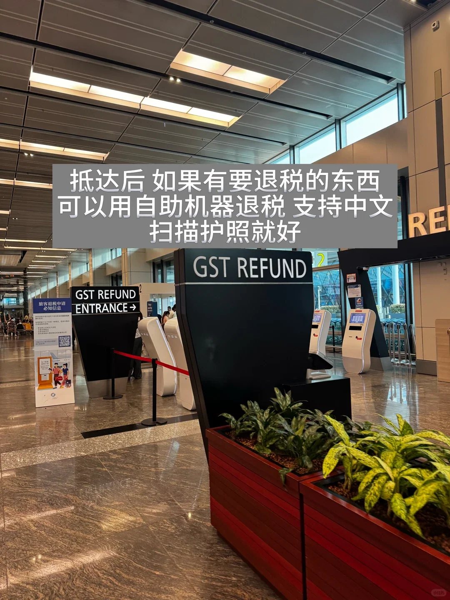

ขาออกจากชางงีทำงานต่างจากสนามบินส่วนใหญ่: เช็คอินเปิดหลายชั่วโมงล่วงหน้า กระเป๋าไปก่อน คืน GST ก่อนตรวจคนเข้าเมือง และความปลอดภัยอยู่ที่ประตูขึ้นเครื่อง ทำลำดับให้ถูกแล้วการออกจากอาคารผู้โดยสาร 1 จะให้เวลาว่างสองหรือสามชั่วโมง — พอดีสำหรับ Jewel ข้าง ๆ รายชื่อสายการบินและเวลาเปลี่ยน ตรวจเว็บไซต์สนามบินและสายการบินก่อนเดินทาง

หากอาคารหรือสายการบินของคุณไม่อยู่ในรายการ ลำดับที่เหลือยังใช้ได้ คุณเพียงเสียเวลาที่ Jewel

## 1. เช็คอินล่วงหน้า: เวลาที่มีเฉพาะผู้โดยสารขาออก T1

ชั้นขาออกของ T1 คือชั้น 2 ชั้นผู้โดยสารขาเข้าและ Jewel คือชั้น 1 และ B2 คือป้ายรถบัส MRT พาคุณมาที่สถานีสนามบินชางงีโดยยังต้องต่อสกายเทรนอีกช่วง แท็กซี่จอดที่ชั้นขาออก ตามป้ายแล้วจัดการกระเป๋าก่อน

เช็คอินมาตรฐานเปิดประมาณสามชั่วโมงก่อนออกบิน เช็คอินล่วงหน้าดันเวลานั้นถอยหลัง โถงใน Jewel เปิดทุกวัน 08:00–23:59 และสายการบินที่ร่วมรายการรับเช็คอินและกระเป๋าตั้งแต่สามชั่วโมงก่อนบินจนถึง 12, 18 หรือแม้แต่ 24 ชั่วโมง เคาน์เตอร์ไม่ได้อยู่ในโถงขาออก — ตามป้าย Early Check-in ข้ามสะพานเชื่อม

อ่านข้อจำกัดก่อน: เฉพาะเที่ยวบิน T1 เฉพาะสายการบินที่ร่วมรายการ ผู้โดยสาร T2, T3 และ T4 จึงใช้ไม่ได้ เมื่อเช็คกระเป๋าแล้วเอากลับไม่ได้ หนังสือเดินทาง พาวเวอร์แบงก์ ยา และเสื้อแจ็กเก็ตจึงเก็บไว้ในกระเป๋าขึ้นเครื่อง

## 2. ช่วงเวลาและสายการบิน: ยืนยันเที่ยวบินก่อน

ช่วงเวลาแตกต่างกันมาก ตารางแสดงช่วงที่ประกาศหน้างาน รายชื่อและเวลาเปลี่ยน ตรวจสอบก่อนวางแผนวัน

| สายการบิน | เช็คอินได้ตั้งแต่ | หมายเหตุ |
| --- | --- | --- |
| Singapore Airlines, Turkish Airlines | 3–24 ชั่วโมง | ช่วงยาวที่สุด เที่ยวบินเช้าสามารถเช็คอินตอนเย็นวันก่อนได้ |
| Scoot | 3–18 ชั่วโมง | เร็วที่สุดในกลุ่มสายการบินต้นทุนต่ำ |
| Cathay Pacific, Japan Airlines, AirAsia | 3–12 ชั่วโมง | เหมาะกับเที่ยวบินบ่ายและเย็น |
| Air France, EVA Air, Qantas, Malaysia Airlines และอื่น ๆ | 3–12 ชั่วโมง | ตรวจหน้าจอหน้างาน |

สายการบินที่ไม่อยู่ในรายการมักเช็คอินตามเวลามาตรฐานในโถงขาออก รายชื่อยังต่างตามอาคารและวันที่ สิ่งของขนาดผิดปกติ เช่น กระดานโต้คลื่น รถเข็นเด็ก และเครื่องดนตรี ไปที่เคาน์เตอร์เฉพาะ

หากใช้ Jewel อย่างคุ้มค่า มาถึงก่อนสี่ชั่วโมง: เช็คอินและคืนภาษีใช้เวลาประมาณ 40 นาที เหลือสองชั่วโมงสำหรับช้อปปิ้งและมื้ออาหาร และ 20 นาทีสำหรับเดินผ่านตรวจคนเข้าเมืองไปประตูขึ้นเครื่อง หากอยากดู Rain Vortex เร็ว ๆ สามชั่วโมงก็พอ หากเที่ยวบินไม่อยู่ในรายการ มาถึงก่อนสามชั่วโมงและช้อปหลังตรวจคนเข้าเมือง — พื้นที่ทรานซิตของ T1 มีร้านค้าและร้านอาหารเช่นกัน

## 3. การคืน GST มาก่อนตรวจคนเข้าเมือง

GST ของสิงคโปร์ปัจจุบันคือ 9% และการคืนภาษีสำหรับนักท่องเที่ยวทำผ่าน eTRS คุณต้องใช้จ่ายอย่างน้อย S$100 ที่ร้านค้ารายเดียวในวันเดียวกัน รวมใบเสร็จวันเดียวกันได้สูงสุดสามใบ และต้องขอใบ eTRS จากร้านโดยบันทึกข้อมูลหนังสือเดินทาง

ตู้บริการตนเองอยู่ในโถงเช็คอิน ก่อนตรวจคนเข้าเมือง กระจายอยู่ทั่วไป ใช้ตู้ว่างได้เลย ในเช้าที่คนเยอะคุ้มที่จะทำเรื่องนี้ก่อนแล้วค่อยช้อป สแกนหนังสือเดินทางเพื่อดึงธุรกรรมที่มีสิทธิ์ทั้งหมด แล้วเลือกคืนเข้าบัตรเครดิต Alipay หรือเงินสดที่เคาน์เตอร์

กฎหนึ่งที่ทำให้คนพลาด: สินค้าที่จะโหลดกระเป๋าต้องขอคืนก่อนส่งกระเป๋า เผื่อศุลกากรขอดู ส่วนสินค้าที่พกขึ้นเครื่องขอคืนหลังตรวจคนเข้าเมืองได้

กฎแข็งไม่กี่ข้อ: ขอคืนที่อาคารที่คุณออกเดินทางจริง บัตรที่ออกในสิงคโปร์รับเงินคืนไม่ได้ สินค้าที่ขอคืนแล้วกลับเข้าโถงขาออกหรือส่งให้คนอื่นไม่ได้ เงินที่ได้หักค่าธรรมเนียมดำเนินการแล้ว และอัตราบนใบ eTRS ของคุณคืออัตราที่ใช้

## 4. ตรวจคนเข้าเมือง ความปลอดภัย และประตูขึ้นเครื่อง: ไม่มีทางย้อนกลับ

เมื่อเช็คอินและคืนภาษีเสร็จ ตามป้าย Departure ขึ้นไปชั้นขาออกและผ่านตรวจคนเข้าเมือง

ช่องอัตโนมัติสแกนหนังสือเดินทางและจับคู่ใบหน้า นักเดินทางส่วนใหญ่ผ่านในไม่ถึงหนึ่งนาที ใช้ช่องที่มีเจ้าหน้าที่หากมีเด็กเล็กหรือหนังสือเดินทางอ่านไม่ได้

ประโยคสำคัญ: เมื่อผ่านตรวจคนเข้าเมืองแล้วคุณกลับไป Jewel ไม่ได้ นั่นกำหนดลำดับ — เช็คอินและส่งกระเป๋า ขอคืนภาษี เที่ยว Jewel แล้วจึงผ่านตรวจคนเข้าเมือง ทำกลับกันคุณกับกระเป๋าจะอยู่คนละฝั่งของกำแพง

ความปลอดภัยอยู่ที่ประตูขึ้นเครื่อง ไม่ใช่ในโถงตรวจคนเข้าเมือง หลังตรวจคนเข้าเมืองมีย่านปลอดอากรและร้านอาหาร และคุณเดินดูได้จนถึงเวลาต่อคิว การขึ้นเครื่องมักเริ่ม 30–40 นาทีก่อนออกบินและคิวยาวขึ้นเมื่อใกล้เวลา สิทธิ์ปลอดอากรขึ้นอยู่กับจุดหมายปลายทางสุดท้าย ไม่ใช่สิงคโปร์ ตรวจว่าจุดหมายอนุญาตอะไรก่อนซื้อแอลกอฮอล์หรือเครื่องสำอาง

## 5. ทำอะไรกับเวลาที่เหลือที่ Jewel

Jewel เดินไม่กี่นาทีจากผู้โดยสารขาเข้า T1 และไม่ต้องใช้บัตรขึ้นเครื่อง Rain Vortex ตกลงมาจากหลังคาโดมและมีโชว์แสงตอนเย็น ส่วน Forest Valley รอบ ๆ เป็นทางเดินวน ตัวเครื่องเล่นแบบเสียเงินอยู่ชั้นบนที่ Canopy Park — Sky Nets, Mirror Maze, Hedge Maze — ราคาและเวลาเปิดประกาศหน้างาน

สองหรือสามชั่วโมงแบ่งได้พอดี: เดิน Forest Valley และดู Rain Vortex ขึ้นไป Canopy Park แล้วกินอาหารที่ B1 หรือ L1 ร้านแบรนด์ตั้งแต่ L1 ขึ้นไปเติมบ่ายได้ หากมีเด็ก พื้นที่เล่นใน Canopy Park กินเวลาได้มากกว่าที่คิด

กระเป๋าคือตัวแปรใหญ่ที่สุด หากเช็คอินล่วงหน้ายังไม่เปิด หรือสายการบินของคุณไม่ร่วมรายการ Jewel มีบริการฝากของเสียเงินที่ B1 คิดตามชิ้นและชั่วโมง กระเป๋าที่เช็คแล้วไม่ใช่ปัญหาของคุณ

ตารางเวลานับถอยหลังจากเวลาออกบิน:

- 4 ชั่วโมง: ถึง T1 เช็คอินล่วงหน้าและส่งกระเป๋า
- 3 ชั่วโมง 20 นาที: ขอคืน GST ในโถงขาออก ไปเคาน์เตอร์ศุลกากรก่อนหากสินค้าของคุณถูกเรียกตรวจ
- 3 ชั่วโมง: เข้า Jewel เพื่อกิน ช้อป และดู Rain Vortex
- 1 ชั่วโมง 10 นาที: กลับ T1 และผ่านตรวจคนเข้าเมือง
- 40 นาที: ถึงประตูขึ้นเครื่องเพื่อตรวจความปลอดภัยและขึ้นเครื่อง

สองเวลาที่ทำให้คนพลาด: โถงเปิด 08:00 และปิด 23:59 เที่ยวบินเช้าตรู่และดึกจึงต้องไปที่เคาน์เตอร์ Jewel กับประตูขึ้นเครื่องอยู่คนละฝั่งของตรวจคนเข้าเมือง ดังนั้นเผื่อเวลาเดินและคิวขากลับ

## ลิงก์ที่เกี่ยวข้อง

- **ในเว็บไซต์นี้**: [สนามบินชางงีสิงคโปร์ (SIN)](/airport/SIN), [สิงคโปร์ (SG)](/country/SG)
- **Wikipedia**: [สนามบินชางงีสิงคโปร์](https://en.wikipedia.org/wiki/Singapore_Changi_Airport), [จิวเวลชางงี](https://en.wikipedia.org/wiki/Jewel_Changi_Airport)
- **Baidu Baike**: [สนามบินชางงีสิงคโปร์](https://baike.baidu.com/item/%E6%96%B0%E5%8A%A0%E5%9D%A1%E6%A8%9F%E5%AE%9C%E6%9C%BA%E5%9C%BA)

การร่วมรายการของสายการบินและช่วงเวลา เกณฑ์การคืนภาษี และเวลาขึ้นเครื่องอ้างอิงประกาศปัจจุบันของสนามบินชางงี ศุลกากรสิงคโปร์ และสายการบินของคุณ เครดิตภาพ: คู่มือท่องเที่ยว WeChat
