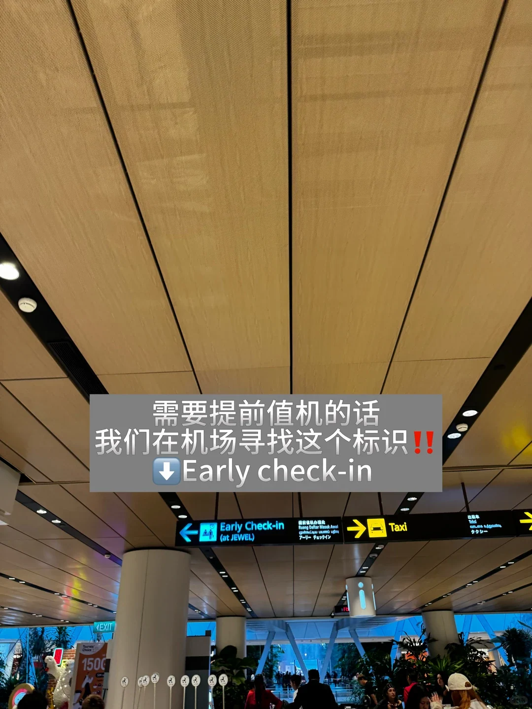

Виліт із Чангі влаштований інакше, ніж у більшості аеропортів: реєстрація відкривається за кілька годин, багаж здають першим, повернення GST оформлюють до паспортного контролю, а огляд відбувається біля виходу до гейту. Якщо дотриматися правильного порядку, виліт із терміналу 1 подарує вам дві-три вільні години — саме стільки, скільки потрібно на сусідній Jewel. Списки авіакомпаній і графіки змінюються, тому перед поїздкою перевірте сайт аеропорту та свою авіакомпанію.

Якщо вашого терміналу чи авіакомпанії немає в списку, решта послідовності все одно діє; ви втратите лише час у Jewel.

## 1. Рання реєстрація: час, який мають лише пасажири T1

Поверх вильоту T1 — це рівень 2, прибуття та Jewel — рівень 1, а B2 — автобусна зупинка. MRT висаджує вас на станції Changi Airport, звідки ще треба доїхати Skytrain; таксі зупиняються біля зони вильоту. Ідіть за вказівниками й спершу розберіться з багажем.

Стандартна реєстрація відкривається приблизно за три години до вильоту; рання зсуває цей час назад. Зал усередині Jewel працює щодня з 08:00 до 23:59, і авіакомпанії-учасниці приймають пасажирів із багажем від трьох годин до вильоту — до 12, 18 і навіть 24 годин. Стійка розташована не в залі вильоту: ідіть за вказівниками ранньої реєстрації через перехідний міст.

Спершу прочитайте обмеження: лише рейси з T1 і лише авіакомпанії-учасниці, тож пасажири T2, T3 і T4 скористатися нею не можуть. Після здавання багажу забрати його неможливо, тому паспорти, павербанки, ліки й куртка залишаються в ручній поклажі.

## 2. Часові вікна й авіакомпанії: спершу підтвердьте свій рейс

Вікна дуже різняться. У таблиці наведено діапазон, опублікований на місці; список і години змінюються, тому підтвердьте все перед тим, як планувати день.

| Авіакомпанія | Реєстрація з | Примітка |
| --- | --- | --- |
| Singapore Airlines, Turkish Airlines | 3–24 години | Найдовше вікно; ранковий рейс можна здати ще звечора |
| Scoot | 3–18 годин | Найраніше серед лоукостерів |
| Cathay Pacific, Japan Airlines, AirAsia | 3–12 годин | Підходить для денних і вечірніх рейсів |
| Air France, EVA Air, Qantas, Malaysia Airlines та інші | 3–12 годин | Дивіться табло на місці |

Авіакомпанії, яких немає в списку, зазвичай реєструють за стандартним часом у залі вильоту. Список також відрізняється залежно від терміналу й дати; негабаритні речі, як-от дошки для серфінгу, дитячі візки та музичні інструменти, приймають на окремій стійці.

Щоб скористатися Jewel як слід, приходьте за чотири години: реєстрація й повернення податку займають близько 40 хвилин, дві години залишаються на покупки та їжу, а 20 хвилин — на дорогу через паспортний контроль до гейту. Для швидкого огляду Rain Vortex достатньо трьох годин. Якщо вашого рейсу немає в списку, приходьте за три години й робіть покупки після паспортного контролю — у транзитній зоні T1 теж є магазини й ресторани.

## 3. Повернення GST відбувається до паспортного контролю

GST у Сінгапурі зараз становить 9%, і туристичні повернення оформлюють через eTRS. Потрібно витратити щонайменше S$100 в одного продавця того самого дня, об'єднавши до трьох чеків за один день, і попросити в магазині квитанцію eTRS із записаними даними вашого паспорта.

Термінали самообслуговування стоять у залі реєстрації, до паспортного контролю. Вони розкидані по залу, тож користуйтеся будь-яким вільним; у напружений ранок варто зробити це спершу, а покупки залишити на потім. Відскануйте паспорт, щоб побачити всі операції, що підлягають поверненню, потім виберіть повернення на кредитну картку, Alipay або готівкою в касі.

Одне правило часто застає людей зненацька: товари, які ви здаєте в багаж, треба заявити до здавання валізи, адже митниця може захотіти їх оглянути; товари, які ви несете з собою, можна заявити після паспортного контролю.

Кілька жорстких правил: заявляйте в тому терміналі, з якого насправді вилітаєте; картки, випущені в Сінгапурі, не можуть отримати повернення; заявлені товари не можна повертати до зали вильоту чи передавати комусь іншому. Суму виплачують за вирахуванням комісії, і діє курс, зазначений у вашому чеку eTRS.

## 4. Паспортний контроль, огляд і гейт: назад дороги немає

Коли реєстрація й повернення податку завершені, ідіть за вказівниками вильоту на рівень відправлення та пройдіть паспортний контроль.

Автоматичні смуги сканують паспорт і звіряють обличчя; більшість мандрівників проходять менш ніж за хвилину. Скористайтеся смугою з працівником, якщо подорожуєте з маленькими дітьми або паспорт не читається.

Ключове речення: після паспортного контролю повернутися до Jewel неможливо. Це й визначає порядок — зареєструватися й здати багаж, отримати повернення податку, відвідати Jewel, а потім пройти паспортний контроль. Зробіть навпаки — і ви з багажем опинитеся по різні боки бар'єра.

Огляд проводять біля гейту, а не в залі паспортного контролю. За паспортним контролем — магазини безмитної торгівлі та ресторани, і ви можете гуляти, доки не настане час ставати в чергу. Посадка зазвичай починається за 30–40 хвилин до вильоту, і черга зростає ближче до рейсу. Норми безмитного ввезення залежать від кінцевого пункту призначення, а не від Сінгапуру, тож перевірте, що дозволяє ваша країна, перш ніж купувати алкоголь чи косметику.

## 5. Що робити із зайвим часом у Jewel

Jewel розташована за кілька хвилин пішки від зони прибуття T1, і посадковий талон не потрібен. Rain Vortex спадає з куполоподібного даху, а ввечері тут влаштовують світлове шоу; Forest Valley навколо — це петля прогулянкових доріжок. Платні атракції розміщені на верхньому рівні в Canopy Park — Sky Nets, Mirror Maze, Hedge Maze — ціни та години роботи вказані на місці.

Дві-три години розподіляються зручно: прогулянка Forest Valley і Rain Vortex, підйом до Canopy Park, потім їжа на B1 або L1. Брендові магазини від L1 і вище заповнять півдня; з дітьми ігрові зони Canopy Park з'їдять напрочуд багато часу.

Багаж — найбільша змінна. Якщо рання реєстрація ще не відкрилася або ваша авіакомпанія не бере участі, у Jewel є платне зберігання на B1 з оплатою за місце й годину; зданий багаж вас уже не турбує.

Розклад, відлічений від вильоту:

- 4 години: прибуття до T1, рання реєстрація й здавання багажу
- 3 години 20 хвилин: повернення GST у залі вильоту, спершу стійка митниці, якщо ваші товари викликали
- 3 години: вирушаєте до Jewel поїсти, зробити покупки й побачити Rain Vortex
- 1 година 10 хвилин: повернення до T1 і проходження паспортного контролю
- 40 хвилин: біля гейту для огляду та посадки

Дві обставини часто застають зненацька: зал відкривається о 08:00 і закривається о 23:59, тож ранні й пізні рейси звертаються до стійки. Jewel і гейти розташовані по різні боки паспортного контролю, тому закладіть час на дорогу й чергу на зворотному шляху.

## Пов'язані посилання

- **На цьому сайті**: [Аеропорт Чангі (SIN)](/airport/SIN), [Сінгапур (SG)](/country/SG)
- **Wikipedia**: [Singapore Changi Airport](https://en.wikipedia.org/wiki/Singapore_Changi_Airport), [Jewel Changi Airport](https://en.wikipedia.org/wiki/Jewel_Changi_Airport)
- **Baidu Baike**: [Singapore Changi Airport](https://baike.baidu.com/item/%E6%96%B0%E5%8A%A0%E5%9D%A1%E6%A8%9F%E5%AE%9C%E6%9C%BA%E5%9C%BA)

Участь авіакомпаній і часові вікна, пороги повернення податку та час посадки відповідають поточним повідомленням аеропорту Чангі, митниці Сінгапуру та вашої авіакомпанії. Джерело зображень: туристичний путівник у WeChat.
