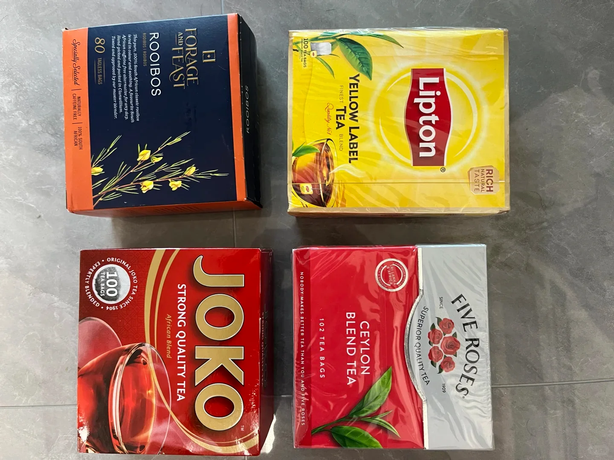

दक्षिण अफ़्रीका से निकलने से पहले क्या खरीदना चाहिए? यहाँ आठ चीज़ें हैं जो पैक करने में आसान, सचमुच उपयोगी और स्पष्ट रूप से स्थानीय होने के आधार पर चुनी गई हैं।

## 1. लकड़ी की नक्काशी: बिग फ़ाइव इकट्ठा करें

ज़्यादातर नक्काशी पूर्वी अफ़्रीका से आती है, और चंदन की बनी चीज़ें सबसे क़ीमती मानी जाती हैं। लेखक ने बिग फ़ाइव की नक्काशी का एक सेट (शेर, हाथी, गैंडा, भैंसा, तेंदुआ) साथ ही अफ़्रीका के आकार की एक चीज़ और एक जिराफ़ खरीदा — ऐसा सेट एक अच्छी निशानी बनता है।

**कैसे चुनें:** हाथ में उठाकर वज़न और लकड़ी के रेशे देखें — चंदन भारी और महीन रेशों वाला महसूस होता है। असमान रंग और दिखाई देने वाले जोड़ आम तौर पर सस्ती नकल की निशानी हैं।

## 2. एलो जेल: यहाँ की सबसे आम चीज़

दक्षिण अफ़्रीकी एलो जेल लगभग अनिवार्य खरीद है, और सबसे आम तौर पर 99% शुद्धता में मिलता है। धूप में जलने के बाद की देखभाल और रोज़ाना नमी के लिए अच्छा है।

## 3. रूइबोस चाय

रूइबोस केवल दक्षिण अफ़्रीका में उगता है, स्वाभाविक रूप से कैफ़ीन-मुक्त है, और गरम या ठंडी दोनों तरह से अच्छा लगता है। यह सादा या स्वाद वाला (वनीला, हनीबुश) मिलता है और दोस्तों में बाँटने के लिए आसान तोहफ़ा है।

## 4. चॉकलेट: नट बार चुनें

नट चॉकलेट की बहुत सी किस्में हैं, इसलिए कुछ स्वाद चुन लें।

## 5. सूखा आम: जोहान्सबर्ग के ड्यूटी-फ़्री से खरीदें

मौसम के दक्षिण अफ़्रीकी आमों से बना, बिना किसी मिलावट के, इसका आम का स्वाद बहुत गहरा होता है। लेखक ने इसे **जोहान्सबर्ग हवाई अड्डे की ड्यूटी-फ़्री दुकानों** से खरीदा — गेट की ओर जाते समय लेना आसान है।

## 6. अमारुला: राष्ट्रीय क्रीम लिकर

अमारुला अफ़्रीकी मारुला फल से बना क्रीम लिकर है। लेबल पर बना हाथी ही वजह है कि चीनी यात्री इसे "हाथी शराब" कहते हैं। यह **जोहान्सबर्ग हवाई अड्डे के ड्यूटी-फ़्री** क्षेत्र में भी मिलता है।

## 7. हीरे: प्रमाणपत्र पर ज़ोर दें

लेखक ने दक्षिण अफ़्रीका की एक हीरा कार्यशाला में लगभग **सूची मूल्य के 42%** पर एक हार खरीदा। प्राकृतिक हीरों के लिए यह उचित कीमत है।

**सावधान:** हमेशा उचित ग्रेडिंग प्रमाणपत्र (GIA, HRD आदि) माँगें और प्रमाणपत्र पर लिखे नंबर को पत्थर पर लेज़र से खुदे नंबर से मिलाएँ। हवाई अड्डों और शहर की पर्यटक दुकानें आम तौर पर कहीं ज़्यादा अधिक कीमत लेती हैं।

## 8. सिगार

ये भी जोहान्सबर्ग हवाई अड्डे के ड्यूटी-फ़्री से खरीदे गए; लेखक इन्हें भरपूर स्वाद और तेज़ बताते हैं। ध्यान रखें कि चीन में प्रवेश पर ड्यूटी-फ़्री तंबाकू की छूट सीमित है — उससे ज़्यादा की घोषणा करनी पड़ती है।

## कहाँ से खरीदें

| वस्तु | सबसे अच्छी जगह |
| --- | --- |
| सूखा आम, अमारुला, सिगार | जोहान्सबर्ग हवाई अड्डे का ड्यूटी-फ़्री, उड़ान से पहले |
| एलो जेल, रूइबोस, चॉकलेट | सुपरमार्केट (Woolworths, Pick n Pay) — सस्ता और ज़्यादा विकल्प |
| लकड़ी की नक्काशी | हस्तशिल्प बाज़ार या हवाई अड्डा; लकड़ी की जाँच करें |
| हीरे | लाइसेंस प्राप्त कार्यशाला, और हमेशा प्रमाणपत्र के साथ |

## व्यावहारिक बातें

- एलो जेल, शराब और अन्य तरल पदार्थ **चेक-इन सामान** में ही रखें।
- लकड़ी और बीज जैसे पौधों व जानवरों से बने उत्पाद पैक करने से पहले चीन के आयात नियम देख लें।
- ड्यूटी-फ़्री की छूट सीमित है: हीरे और सिगार जैसी क़ीमती चीज़ों की रसीदें और प्रमाणपत्र संभालकर रखें, और आगमन पर उनकी घोषणा करें।
