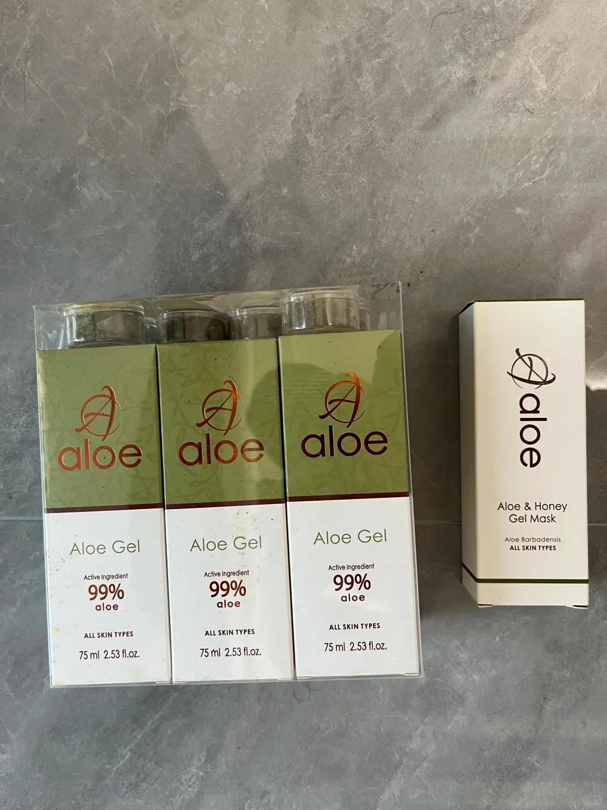

南アフリカを離れる前に何を買うべきでしょうか。ここでは、持ち運びやすく、実用的で、南アフリカらしさのある8つの品を選びました。

## 1. 木彫り：ビッグファイブを揃える

ほとんどの木彫りは東アフリカ産で、白檀（サンダルウッド）の作品が貴重です。筆者はビッグファイブ（ライオン、ゾウ、サイ、バッファロー、ヒョウ）の木彫りセットに、アフリカの形をした作品とキリンを加えて購入しました。このようなセットは記念品として最適です。

**選び方：** 手に取って重さと木目を確かめます。白檀は密度が高く、きめの細かい木目が特徴です。着色のむらや目立つ継ぎ目があるものは、安価な複製品であることがほとんどです。

## 2. アロエジェル：現地の定番

南アフリカのアロエジェルはほぼ必買品で、純度99%のものが一般的です。日焼け後のケアや日常の保湿に適しています。

## 3. ルイボスティー

ルイボスは南アフリカでしか育たず、もともとカフェインを含みません。温めても冷やしてもおいしく飲めます。プレーンなものやフレーバー付き（バニラ、ハニーブッシュ）があり、友人に分けやすいお土産です。

## 4. チョコレート：ナッツ入りバーがおすすめ

ナッツ入りチョコレートは種類が豊富なので、いくつかの味を選んでみてください。

## 5. ドライマンゴー：ヨハネスブルグ空港の免税店で買う

旬の南アフリカ産マンゴーを原料とし、添加物を使っていないため、マンゴーの味が濃厚です。筆者は**ヨハネスブルグ空港の免税店**で購入しました。搭乗口へ向かう途中に気軽に立ち寄れます。

## 6. アマルーラ：南アフリカのクリームリキュール

アマルーラは、アフリカ原産のマルーラの実から作られるクリームリキュールです。ラベルに描かれたゾウから、中国の旅行者は「ゾウのお酒」と呼んでいます。**ヨハネスブルグ空港の免税店**でも購入できます。

## 7. ダイヤモンド：鑑定書を必ず求める

筆者は南アフリカのダイヤモンド工房で、ネックレスを**定価の約42%**で購入しました。天然ダイヤモンドとしては妥当な価格です。

**注意：** 必ず適切な鑑定書（GIA、HRDなど）を求め、鑑定書の番号と石のレーザー刻印が一致するか確認してください。空港や街中の土産物店は、通常はるかに高い割増を取ります。

## 8. 葉巻

これもヨハネスブルグ空港の免税店で購入しました。筆者は濃厚で強い味わいだと評しています。なお、中国の入国時の免税たばこ許容量には制限があり、超過分は申告が必要です。

## 購入場所

| 品目 | 最適な購入場所 |
| --- | --- |
| ドライマンゴー、アマルーラ、葉巻 | 搭乗前のヨハネスブルグ空港免税店 |
| アロエジェル、ルイボス、チョコレート | スーパーマーケット（Woolworths、Pick n Pay）— 安くて種類も豊富 |
| 木彫り | 工芸市場または空港。素材を確認 |
| ダイヤモンド | 許可を受けた工房で、必ず鑑定書付き |

## 実用的な注意点

- アロエジェル、酒類などの液体は**受託手荷物**に入れなければなりません。
- 植物性・動物性の製品（木材、種子）を持ち込む前に、中国の輸入規則を確認してください。
- 免税の許容量には制限があります。ダイヤモンドや葉巻などの貴重品は領収書と証明書を保管し、入国時に申告してください。
