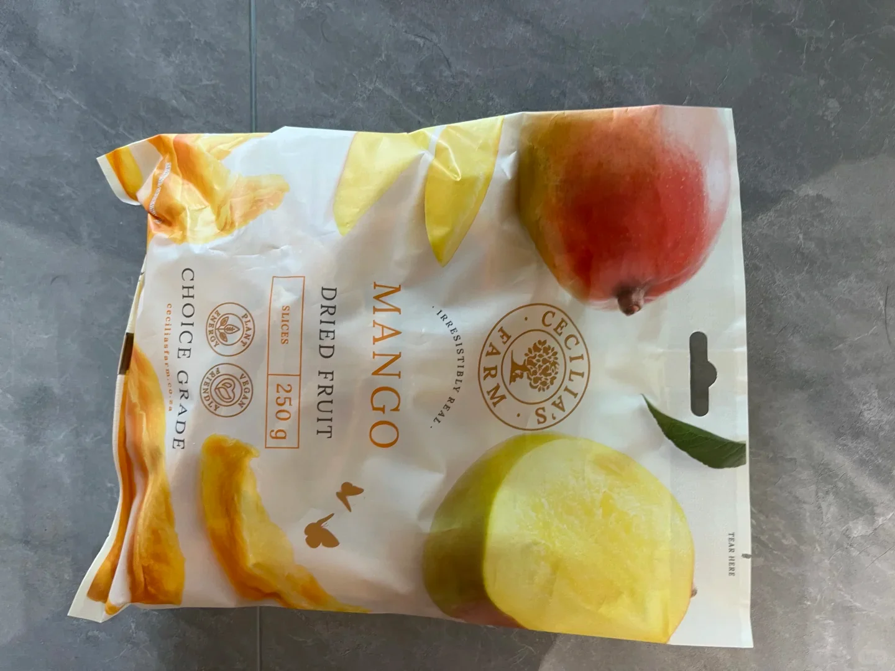

Co kupić przed wyjazdem z Republiki Południowej Afryki? Oto osiem rzeczy wybranych za łatwość pakowania, prawdziwą przydatność i wyraźnie lokalny charakter.

## 1. Rzeźby w drewnie: skompletuj Wielką Piątkę

Większość rzeźb pochodzi z Afryki Wschodniej, a najbardziej cenione są te z drzewa sandałowego. Autorka kupiła zestaw rzeźb Wielkiej Piątki (lew, słoń, nosorożec, bawół, lampart) oraz element w kształcie Afryki i żyrafę — taki zestaw to dobra pamiątka.

**Jak wybierać:** oceń ciężar i słój w dłoni — drzewo sandałowe jest gęste i ma drobny słój. Nierównomierne barwienie i widoczne łączenia zwykle oznaczają tanią podróbkę.

## 2. Żel aloesowy: lokalny klasyk

Żel aloesowy z RPA to niemal obowiązkowy zakup, najczęściej o czystości 99%. Dobry po opalaniu i do codziennego nawilżania.

## 3. Herbata rooibos

Rooibos rośnie tylko w Republice Południowej Afryki, naturalnie nie zawiera kofeiny i smakuje zarówno na gorąco, jak i na zimno. Jest czysty lub aromatyzowany (wanilia, honeybush) i łatwo go rozdać znajomym w prezencie.

## 4. Czekolada: postaw na tabliczki z orzechami

Wybór czekolad z orzechami jest szeroki, więc weź kilka smaków.

## 5. Suszone mango: kup w duty-free w Johannesburgu

Robione z sezonowych południowoafrykańskich mango, bez dodatków — smak mango jest intensywny. Autorka kupiła swoje w **sklepach duty-free na lotnisku w Johannesburgu** — łatwo je zgarnąć w drodze do bramki.

## 6. Amarula: narodowy likier kremowy

Amarula to likier kremowy z afrykańskich owoców marula. Słoń na etykiecie sprawia, że chińscy podróżni nazywają go „likierem słonia”. Dostępna również w strefie **duty-free na lotnisku w Johannesburgu**.

## 7. Diamenty: żądaj certyfikatu

Autorka kupiła naszyjnik w południowoafrykańskim warsztacie diamentowym za około **42% ceny katalogowej**. W przypadku naturalnych diamentów to uczciwa cena.

**Uwaga:** zawsze proś o właściwy certyfikat oceny (GIA, HRD itd.) i sprawdź numer certyfikatu z laserowym napisem na kamieniu. Sklepy turystyczne na lotniskach i w mieście zwykle doliczają znacznie większą marżę.

## 8. Cygara

Kupione również w duty-free na lotnisku w Johannesburgu; autorka opisuje je jako pełne i mocne. Pamiętaj, że limit bezcłowego przywozu tytoniu do Chin jest ograniczony — wszystko powyżej trzeba zgłosić.

## Gdzie kupować

| Przedmiot | Najlepsze miejsce |
| --- | --- |
| Suszone mango, Amarula, cygara | Duty-free na lotnisku w Johannesburgu, przed odlotem |
| Żel aloesowy, rooibos, czekolada | Supermarkety (Woolworths, Pick n Pay) — taniej i większy wybór |
| Rzeźby w drewnie | Targi rękodzieła lub lotnisko; sprawdź materiał |
| Diamenty | Licencjonowany warsztat, zawsze z certyfikatem |

## Praktyczne uwagi

- Żel aloesowy, alkohol i inne płyny muszą trafić do **bagażu rejestrowanego**.
- Przed zapakowaniem sprawdź chińskie przepisy importowe dotyczące produktów roślinnych i zwierzęcych (drewno, nasiona).
- Limity bezcłowe są ograniczone: zachowaj paragony i certyfikaty dla kosztowności, takich jak diamenty i cygara, i zgłoś je po przybyciu.
