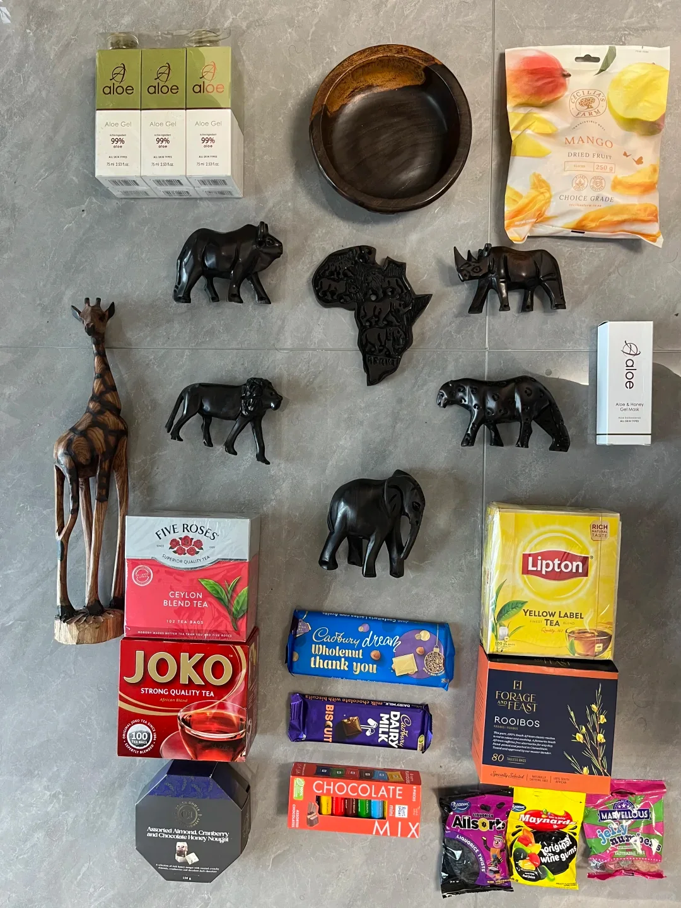
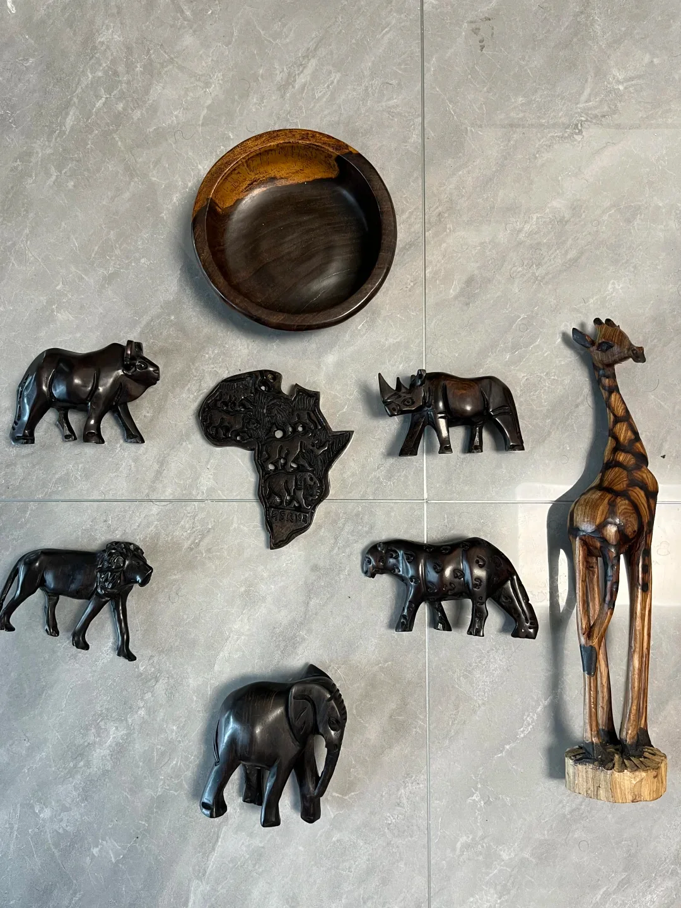

Ce ar trebui să cumperi înainte de a pleca din Africa de Sud? Iată opt lucruri alese pentru că sunt ușor de împachetat, cu adevărat utile și distinct locale.

## 1. Sculpturi în lemn: colecționează Big Five

Majoritatea sculpturilor provin din Africa de Est, iar piesele din lemn de santal sunt cele mai prețuite. Autoarea a cumpărat un set de sculpturi Big Five (leu, elefant, rinocer, bivol, leopard) plus o piesă în formă de Africa și o girafă — un astfel de set este o amintire frumoasă.

**Cum alegi:** judecă greutatea și fibra la pipăit — lemnul de santal se simte dens, cu o fibră fină. Colorarea neuniformă și îmbinările vizibile înseamnă de obicei o reproducere ieftină.

## 2. Gelul de aloe: produsul de bază local

Gelul de aloe sud-african este aproape obligatoriu de cumpărat, cel mai des la puritate 99%. Bun pentru îngrijirea după plajă și pentru hidratarea de zi cu zi.

## 3. Ceai rooibos

Rooibos crește doar în Africa de Sud, nu conține cofeină în mod natural și se bea atât cald, cât și cu gheață. Există simplu sau aromat (vanilie, honeybush) și este un cadou ușor de împărțit între prieteni.

## 4. Ciocolată: alege tabletle cu nuci

Există o gamă largă de ciocolată cu nuci, așa că alege câteva arome.

## 5. Mango uscat: cumpără-l din duty-free-ul din Johannesburg

Făcut din mango sud-african de sezon, fără aditivi, are o aromă intensă de mango. Autoarea l-a cumpărat din **magazinele duty-free de la aeroportul Johannesburg** — ușor de luat pe drum spre poartă.

## 6. Amarula: lichiorul național cu cremă

Amarula este un lichior cu cremă făcut din fructul african de marula. Elefantul de pe etichetă este motivul pentru care călătorii chinezi îl numesc „lichior de elefant”. Este disponibil și în zona **duty-free a aeroportului Johannesburg**.

## 7. Diamante: insistă pentru un certificat

Autoarea a cumpărat un colier dintr-un atelier de diamante sud-african cu aproximativ **42% din prețul de listă**. Pentru diamante naturale, este un preț corect.

**Atenție:** cere întotdeauna un certificat de evaluare corespunzător (GIA, HRD etc.) și verifică numărul certificatului cu inscripția laser de pe piatră. Magazinele pentru turiști din aeroporturi și din oraș percep de obicei o marjă mult mai mare.

## 8. Trabucuri

Cumpărate tot din duty-free-ul aeroportului Johannesburg; autoarea le descrie ca fiind cu corp plin și tari. Reține că limita duty-free pentru tutun la intrarea în China este limitată — tot ce depășește limita trebuie declarat.

## De unde să cumperi

| Produs | Cel mai bun loc |
| --- | --- |
| Mango uscat, Amarula, trabucuri | Duty-free-ul aeroportului Johannesburg, înainte de plecare |
| Gel de aloe, rooibos, ciocolată | Supermarketuri (Woolworths, Pick n Pay) — mai ieftin și mai multă varietate |
| Sculpturi în lemn | Piețe de artizanat sau aeroportul; verifică materialul |
| Diamante | Un atelier autorizat și întotdeauna cu certificat |

## Note practice

- Gelul de aloe, alcoolul și alte lichide trebuie puse în **bagajul de cală**.
- Verifică regulile de import din China pentru produse vegetale și animale (lemn, semințe) înainte de a le împacheta.
- Limitele duty-free sunt restricționate: păstrează bonurile și certificatele pentru obiectele de valoare, cum ar fi diamantele și trabucurile, și declară-le la sosire.
