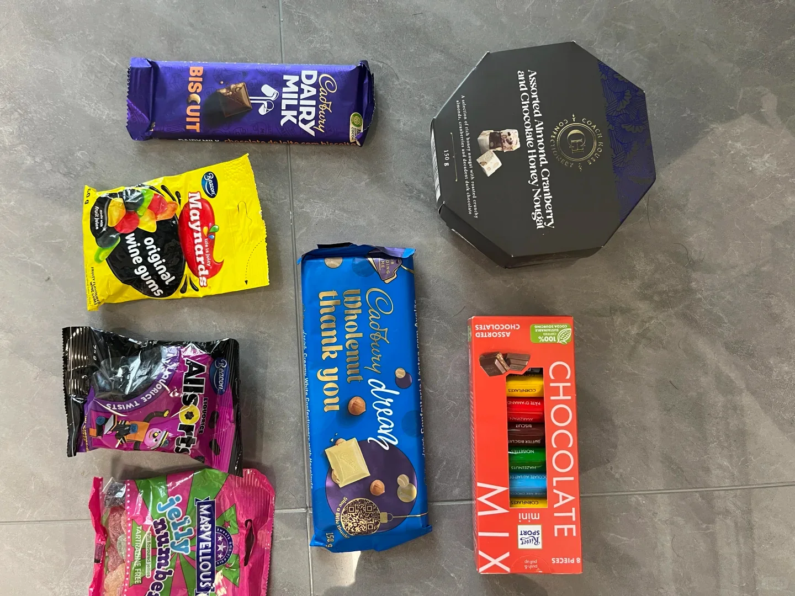
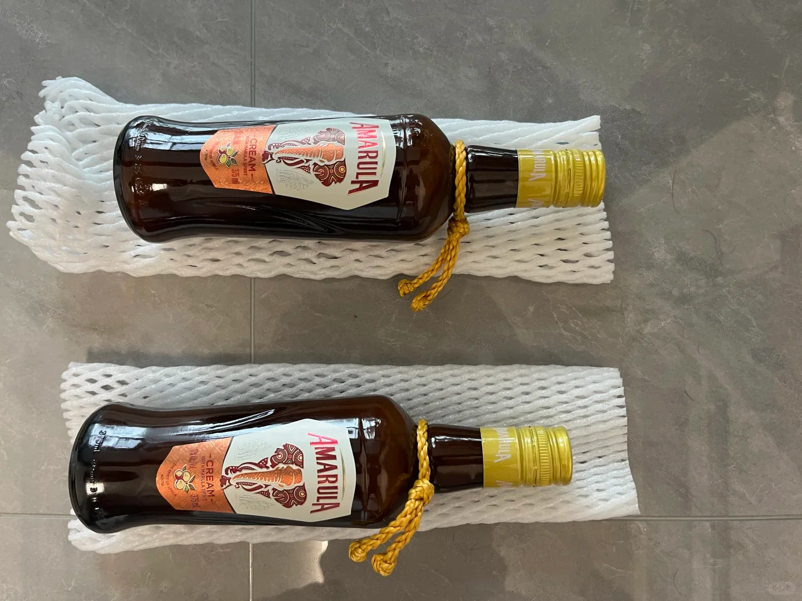

Vad bör du köpa innan du lämnar Sydafrika? Här är åtta saker som valts ut för att de är lätta att packa, verkligen användbara och tydligt lokala.

## 1. Träsniderier: samla Big Five

De flesta sniderier kommer från Östafrika, och föremålen i sandelträ är de mest eftertraktade. Författaren köpte en uppsättning Big Five-sniderier (lejon, elefant, noshörning, buffel, leopard) plus ett föremål i form av Afrika och en giraff – en sådan uppsättning blir ett fint minne.

**Så väljer du:** bedöm vikten och ådringen i handen – sandelträ känns tätt och har fin ådring. Ojämn betsning och synliga fogar brukar betyda att det är en billig kopia.

## 2. Aloe vera-gel: den lokala basvaran

Sydafrikansk aloe vera-gel är nästan ett måste att köpa, oftast med 99 % renhet. Bra för huden efter solbad och för daglig återfuktning.

## 3. Rooibosté

Rooibos odlas bara i Sydafrika, är naturligt koffeinfritt och kan drickas både varmt och iskallt. Det finns naturellt eller smaksatt (vanilj, honungsbuske) och är en tacksam gåva att dela mellan vänner.

## 4. Choklad: satsa på nötchokladen

Det finns ett brett utbud av nötchoklad, så välj några olika smaker.

## 5. Torkad mango: köp den taxfritt på Johannesburgs flygplats

Den är gjord av sydafrikanska mangor i säsong, utan tillsatser, och mangosmaken är intensiv. Författaren köpte sin i **taxfreebutikerna på Johannesburgs flygplats** – lätt att plocka med sig på vägen till gaten.

## 6. Amarula: den nationella gräddlikören

Amarula är en gräddlikör gjord på afrikansk marulafrukt. Elefanten på etiketten är anledningen till att kinesiska resenärer kallar den ”elefantlikör”. Den finns också i **taxfreeområdet på Johannesburgs flygplats**.

## 7. Diamanter: kräv certifikat

Författaren köpte ett halsband på en sydafrikansk diamantverkstad för ungefär **42 % av listpriset**. För naturliga diamanter är det ett rimligt pris.

**Var försiktig:** fråga alltid efter ett ordentligt graderingscertifikat (GIA, HRD med flera) och kontrollera certifikatnumret mot laserinskrivningen på stenen. Turistbutiker på flygplatser och i stan tar vanligtvis ut ett betydligt högre påslag.

## 8. Cigarrer

De köptes också taxfritt på Johannesburgs flygplats; författaren beskriver dem som fylliga och starka. Observera att Kinas tullfria tobakskvot vid inresa är begränsad – allt därutöver måste deklareras.

## Var du ska köpa

| Vara | Bästa stället |
| --- | --- |
| Torkad mango, Amarula, cigarrer | Taxfreebutikerna på Johannesburgs flygplats, före avresa |
| Aloe vera-gel, rooibos, choklad | Stormarknader (Woolworths, Pick n Pay) – billigare och större urval |
| Träsniderier | Hantverksmarknader eller flygplatsen; kontrollera materialet |
| Diamanter | En licensierad verkstad, och alltid med certifikat |

## Praktiska råd

- Aloe vera-gel, alkohol och andra vätskor måste packas i **incheckat bagage**.
- Kontrollera Kinas importregler för växt- och djurprodukter (trä, frön) innan du packar dem.
- De taxfria kvoterna är begränsade: spara kvitton och certifikat för värdesaker som diamanter och cigarrer och deklarera dem vid ankomst.
