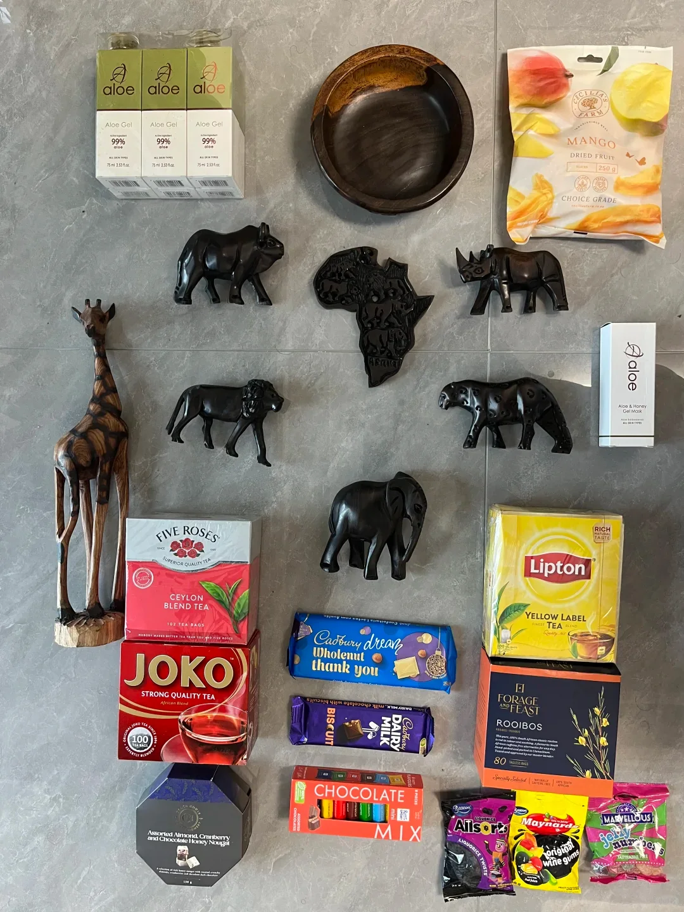
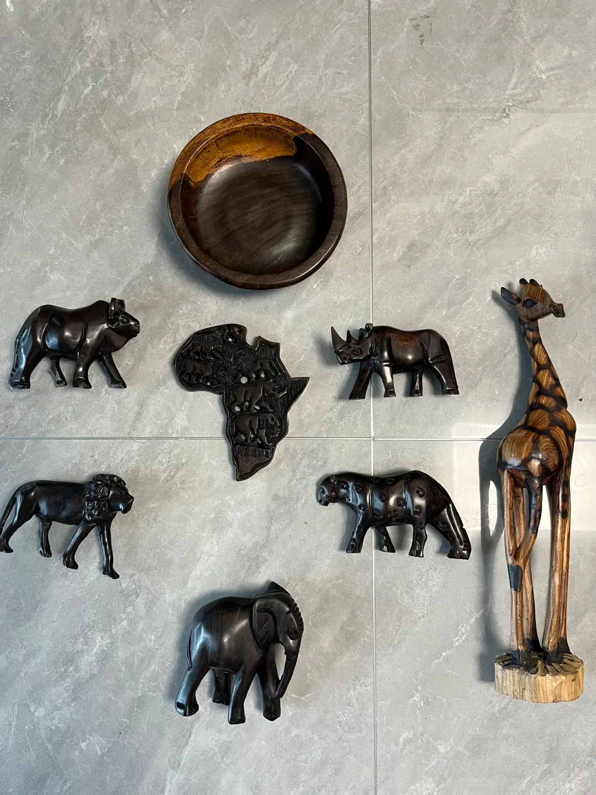
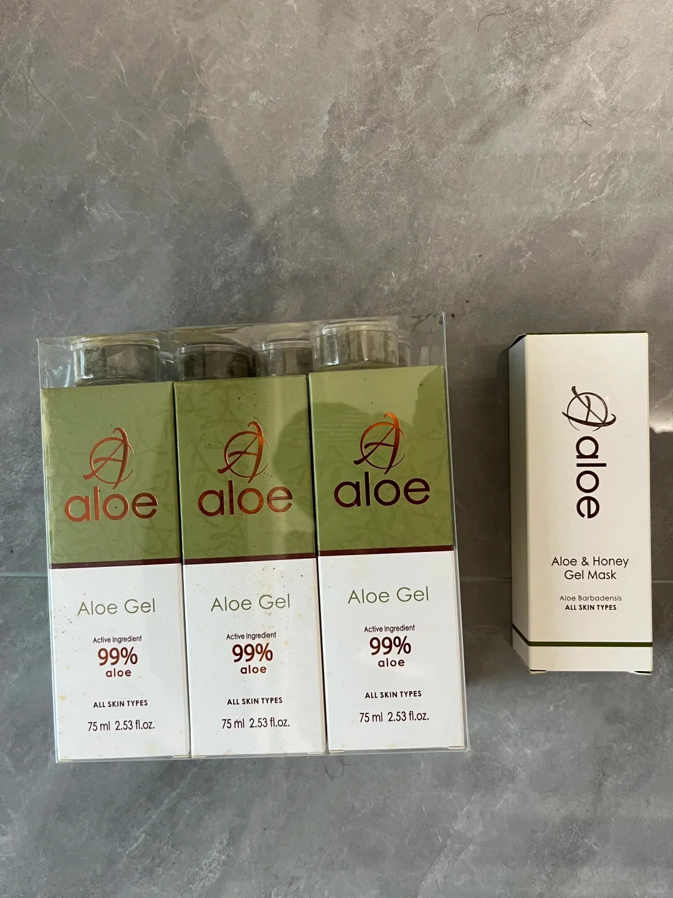
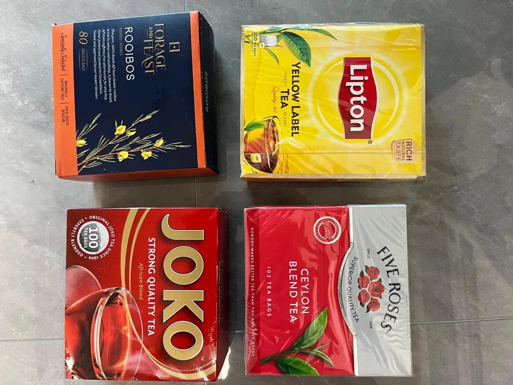
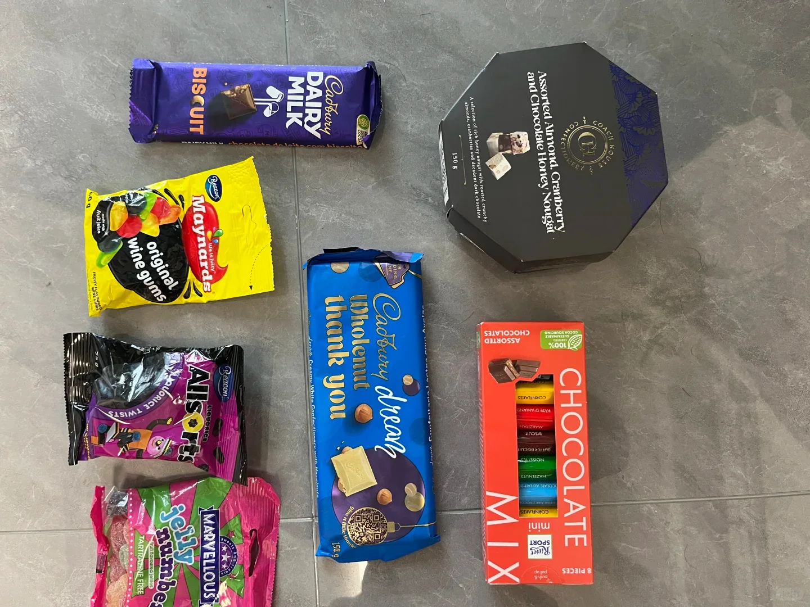
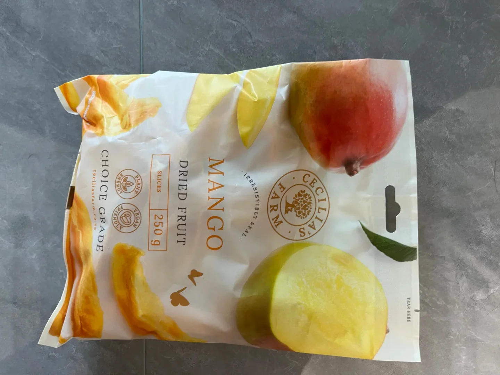
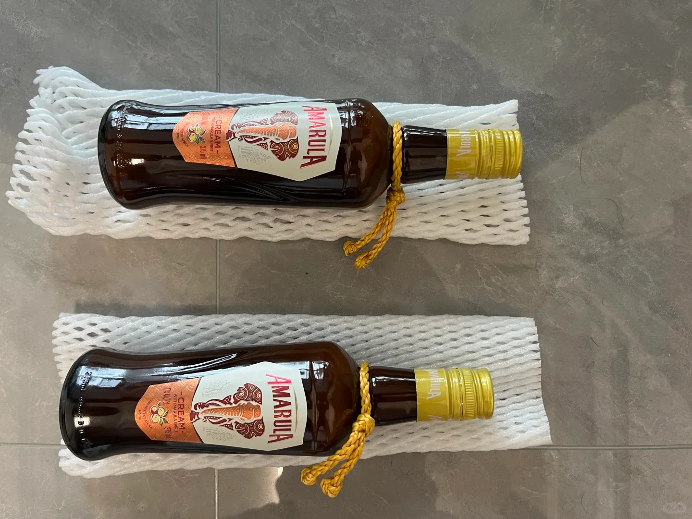

從南非回來該買什麼？這裡按「好帶、好用、有當地特色」三條標準，列了八樣值得帶回來的東西。

## 1. 木雕：把「非洲五霸」集齊

木雕大多產自東非，檀木屬於珍品。作者買了一組非洲五霸（獅子、大象、犀牛、水牛、豹）的小雕件，另有非洲地圖造型和長頸鹿，擺一套很有紀念意義。

**挑選建議**：拿在手上看重量與紋理，檀木手感沉、紋理細；上色不均、有明顯拼接縫的多是廉價複製品。

## 2. 蘆薈膠：南非特產，防曬好用

南非蘆薈膠幾乎是必買項，99% 純度的最常見，用來曬後修復和日常保溼都不錯。

## 3. 南非國寶茶（博士茶，Rooibos）

南非獨有的博士茶，不含咖啡因，冷熱都好喝，有原味、香草、蜜樹等不同口味，適合當伴手禮分送。

## 4. 巧克力：堅果款最有當地味

堅果巧克力品類很多，可以按口味多選幾款。

## 5. 芒果乾：約翰尼斯堡機場免稅店買

這款芒果乾在南非芒果產季製作，無任何新增，芒果味很純。作者是在**約翰尼斯堡機場免稅店**買的，走之前順手帶幾包很方便。

## 6. 大象酒（Amarula）：南非國寶酒

Amarula 是用非洲馬魯拉果釀的奶油利口酒，酒標上的大象是它的標誌，所以被叫作「大象酒」。同樣可以在**約翰尼斯堡機場免稅店**買到。

## 7. 鑽石：認準加工廠與證書

作者在南非的鑽石加工廠買了一條項鍊，拿到約**標價 42%**（四二折）的價格。喜歡天然鑽石的話，這個價位算划算。

**注意**：一定要索要正規鑑定證書（GIA／HRD 等），並核對證書編號與鑽石鐳射刻字；機場與市區的旅遊商店溢價通常更高。

## 8. 雪茄：機場免稅店

雪茄同樣是在約翰尼斯堡機場免稅店買的，作者形容味道「很勁爆」。按中國海關規定，入境可免稅攜帶的菸草製品數量有限，超過需申報。

## 買在哪：機場還是市區

| 品類 | 建議購買地 |
| --- | --- |
| 芒果乾、大象酒、雪茄 | 約翰尼斯堡機場免稅店，走之前順手買 |
| 蘆薈膠、博士茶、巧克力 | 超市（Woolworths、Pick n Pay 等）更便宜，選擇也多 |
| 木雕 | 手工藝市場或機場，注意辨別材質 |
| 鑽石 | 有資質的加工廠，務必帶證書 |

## 小提醒

- 蘆薈膠、酒類、液體都要**託運**，隨身攜帶會被攔。
- 動植物製品（木雕需注意材質、種子類）入境中國前先確認是否受管制。
- 免稅額度有限，貴重物品（鑽石、雪茄）保留好發票與證書，入境時如實申報。
