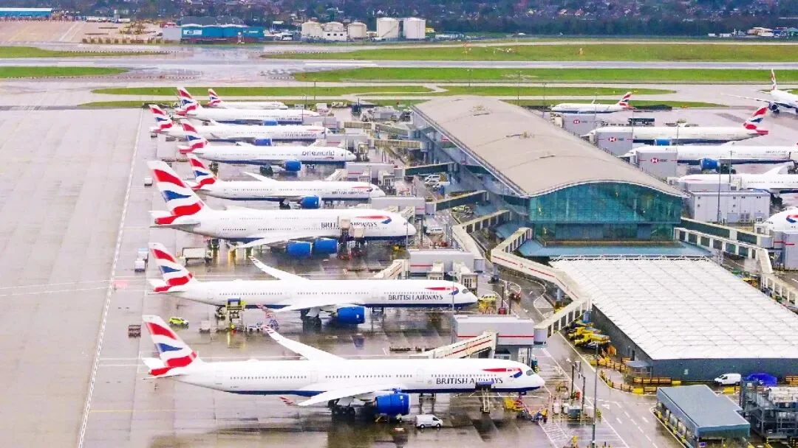
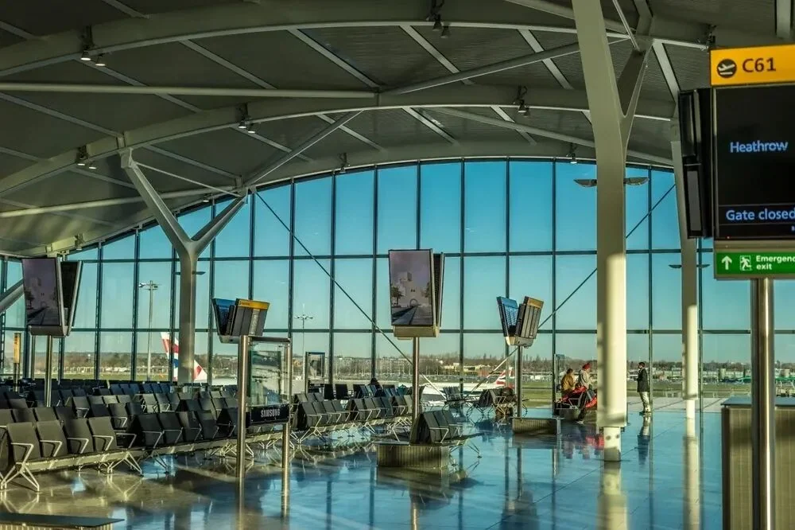
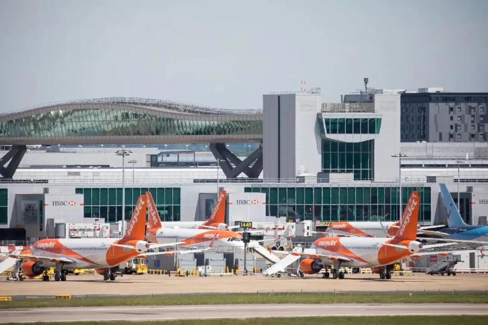

The Skytrax World Airport Awards 2026 have been published, and London Heathrow (LHR) is once again the highest-ranked UK airport on the global list: 16th in the world, up six places on last year, and eighth in Europe. It also took the category award for World's Best Airport Shopping.

The only other UK airport in the top 100 is London Gatwick (LGW), at 30th, also up six places. Two London airports and two six-place gains make up the whole of the UK's showing this year. This article looks at Heathrow's two results, prints the 2026 top ten, and considers what the ranking is actually worth when you are choosing an airport.

## 1. Heathrow: 16th globally, first in the UK, eighth in Europe

Start with the number. Sixteenth in the world, up six places; eighth among European airports; the best UK position. For an established hub that travellers routinely criticise for congestion and mediocre connections, that is not a spectacular result, but it is movement in the right direction.

The Skytrax awards have run since 1999, annually, and draw on surveys of passengers at more than 575 airports in over 100 countries. Travellers rate the journey in parts: how easy the airport is to reach, the check-in facilities, the choice of shops and restaurants, how friendly staff are, and how well baggage is handled. It is not an architecture prize; it is the whole chain from arrival to departure, scored piece by piece.

Heathrow's improvement is hard to attribute to any single new building. Its four terminals have all been running for years, and Terminal 5 opened back in 2008. The likelier explanation is operational steadiness: security queues, baggage belts and signage are scored every year, and an airport that avoids a few bad weeks tends to get some of the score back.

## 2. Best for shopping: 345 outlets and a brand list

What actually won Heathrow its category award this year is retail. Across four terminals the airport has more than 345 retail, food and beverage outlets, from Union Jack souvenirs and a paperback for the pool to a last-minute gift for someone at the other end of the trip.

At the luxury end there is Burberry, Bulgari, Harrods, Fortnum & Mason and Prada; for everyday needs there is Boots, JD Sports, Accessorize and WHSmith, plus Marks & Spencer, which arrived last summer. There is also a Hamleys toy shop, where families travelling with children tend to lose an extra twenty minutes.

That list says more than the trophy does. Heathrow's retail mix works both ends of the market: the duty-free and luxury side lifts spend per passenger, while Boots and WHSmith are the shops travellers actually walk into. For most passengers the second group is what "shopping experience" means; for the airport, the first group sets the ceiling on retail revenue.

## 3. Fraser Brown: retail in one of the most constrained airports

Heathrow's retail director, Fraser Brown, framed the two awards around the fact that passengers vote directly. "Winning the Skytrax award for World's Best Airport Shopping, and being named one of the world's best airports, is a source of great pride for everyone at Heathrow," he said. "These awards are voted for directly by passengers, and that recognition is proof of what we see every day: our teams deliver a world-class retail experience in one of the most operationally constrained airport environments in the world."

Two things in that statement are worth noting. The first is "voted for directly by passengers", which reflects how Skytrax works and explains why a shopping award and the overall ranking tend to move together. The second is "operationally constrained": Heathrow has only two runways and a brutally tight slot schedule, so it cannot build at will during the day and has to fit its retail into terminals that already exist.

For travellers, that means Heathrow's shopping advantage is unlikely to disappear in a single refurbishment, but nor should you expect the concourses to suddenly get wider. It is a commercial operation that has been pushed close to its limits inside a fixed envelope, not a new shopping centre with a runway attached.

## 4. The 2026 top ten

Listing the top ten makes the UK's position clearer. The ranks below are as published by the organiser for 2026.

| Rank | Airport |
| --- | --- |
| 1 | Singapore Changi |
| 2 | Seoul Incheon |
| 3 | Tokyo Haneda |
| 4 | Hong Kong International |
| 5 | Tokyo Narita |
| 6 | Paris Charles de Gaulle |
| 7 | Rome Fiumicino |
| 8 | Istanbul |
| 9 | Munich |
| 10 | Vancouver |

Below the top ten, several positions are worth noting: Helsinki-Vantaa is 11th, Dubai 13th, Vienna 15th, Amsterdam Schiphol 17th and Zurich 19th, followed by Melbourne at 21st — this year's Best Airport in Australia-Pacific — with Taiwan Taoyuan 24th and Kansai 25th. Only Heathrow and Gatwick represent the UK in the top 100.

One prominent name is missing: Doha's Hamad International, last year's runner-up, does not appear anywhere in this year's top 30. According to Australian media reports, it withdrew at the last moment because Middle East airspace around Qatar has been closed by the current conflict — which explains the unfamiliar shape of the upper table.

## 5. Gatwick at 30: the UK's second ticket

Gatwick placed 30th this year, also up six. Its role differs from Heathrow's: Heathrow carries most of London's long-haul traffic, while Gatwick leans on short-haul leisure routes and low-cost carriers. The transfer between its North and South terminals, and the Gatwick Express into central London, are the two things passengers mention most often.

For travellers living south of London, Gatwick is often the more practical choice: the terminal is smaller, the walk is shorter, and the station is a few minutes from arrivals. A six-place rise suggests that this small-airport convenience is worth real points in passenger surveys.

## 6. How to read the list

First, the category awards are more useful than the overall rank. Shopping points to Heathrow this year, dining and immigration to Changi, security to Hong Kong International, and the regional title to Melbourne; each one maps onto a specific need rather than an abstract idea of quality.

Second, read movements against the size of the field. Six places sounds like a lot, but the gaps inside the top 30 are usually small, and one survey cycle can move an airport several places. The durable signal is an airport that stays in the same band for years.

Third, do not plan a trip around the ranking. For any individual journey, schedules, terminals, immigration queues and ground transport matter far more than a position on a list. Choosing Heathrow for a connection because it is "16th in the world" will not help much if you are waiting for a bag at a peak hour on a two-runway airport.

## Related links

- **On this site**: [London Heathrow (LHR)](/airport/LHR), [London Gatwick (LGW)](/airport/LGW), [United Kingdom (GB)](/country/GB)
- **Wikipedia**: [Heathrow Airport](https://en.wikipedia.org/wiki/Heathrow_Airport), [Gatwick Airport](https://en.wikipedia.org/wiki/Gatwick_Airport)
- **Baidu Baike**: [Heathrow Airport](https://baike.baidu.com/item/%E5%B8%8C%E6%80%9D%E7%BD%97%E6%9C%BA%E5%9C%BA), [Gatwick Airport](https://baike.baidu.com/item/%E7%9B%96%E7%89%B9%E5%A8%81%E5%85%8B%E6%9C%BA%E5%9C%BA)

Image source: UK Campus. Award names, rankings and criteria are as published by Skytrax; check Heathrow and Gatwick's own sites for current shops, terminals and transport arrangements.
